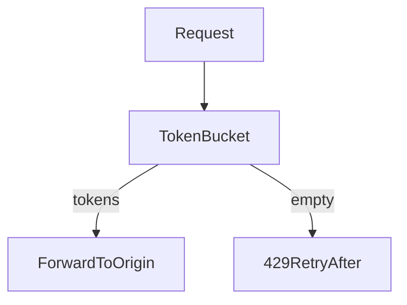

# D06-T012 — Rate limiting and quotas

Topic ID: `D06-T012`
Domain: API Design and REST
Subdomain: Rate limiting and quotas
Importance: core
Complexity: intermediate
Dependencies: `D06-T011`, `D06-T001`, `D04-T001`, `D04-T002`, `D05-T001`, `D05-T002`
Execution status of the code in section F: illustrative (not executed in CI for this topic)

## A. Topic Overview

Rate limiting protects origins from abuse and noisy neighbors. Return `429 Too Many Requests` with `Retry-After` (seconds or HTTP-date). Quotas cap usage per period (daily API calls, upload bytes).

Implement token bucket or sliding window per API key, user, or IP. Expose optional `RateLimit-Limit`, `RateLimit-Remaining`, `RateLimit-Reset` headers (common conventions vary; document yours).

## B. First-Principles Explanation

Rate limits bound work per identity over time. Token buckets allow controlled bursts while enforcing average throughput. Quotas accumulate usage per billing period and may hard-stop until reset. The goal is fairness and protecting shared databases, not punishing legitimate retry logic that honors `429`.

## C. Internal Working and Architecture

Counters live in Redis or gateway memory shards keyed by API key hash. Each request decrements tokens or increments window count atomically. On exceed, the edge returns `429` without hitting origin. Origin services may apply second-level limits per expensive endpoint.

## D. Diagrams and Visual Models



## E. Examples and Analogies

A theme park wristband allows five rides per hour: burst of two quick rides still consumes tokens. Quotas resemble monthly cell data caps.

## F. Code Examples

```python
def allow(key: str, cost: int = 1) -> bool:
    bucket = redis.hgetall(f"rl:{key}")
    # illustrative token bucket update
    return int(bucket.get("tokens", 0)) >= cost
```

## G. Practical Backend Application

Publish limits in docs; return consistent problem types (`D06-T008`). Coordinate gateway and service limits to avoid double 429 stories. Exempt health checks.

## H. Advantages, Limitations and Trade-offs

| Approach | Benefit | Cost |
| --- | --- | --- |
| Edge limit | Saves origin | Coarse keys |
| Per-user | Fairness | Stateful counters |
| IP limit | Simple | NAT collisions |

## I. Common Mistakes and Misconceptions

Returning `401` instead of `429`. Missing `Retry-After`. Unlimited retries on `POST` payments without idempotency keys.

## J. Debugging and Troubleshooting

Spikes in `429` after deploy: check lowered limits. False positives: NAT shared IPs; move to API keys. Metrics: limit hits per route and tenant.

## K. Interview Preparation

### Beginner

#### Q1. Why rate limit APIs?

**Answer:** Prevent DoS, protect databases, and ensure fair sharing among tenants. Limits keep p95 latency stable for everyone. They convert unbounded retry storms into backoff signals.

#### Q2. What status for throttling?

**Answer:** `429 Too Many Requests` is standard. Include `Retry-After` when possible. Do not misuse `503` for per-client quotas.

#### Q3. Limit by what dimension?

**Answer:** API key, user id, IP, or combination. Choose the identity matching billing and abuse model.

#### Q4. Hard vs soft limits?

**Answer:** Hard blocks requests; soft logs or degrades. Document which endpoints are critical.

#### Q5. Client behavior on 429?

**Answer:** Exponential backoff respecting `Retry-After`. Avoid tight loops hammering the API.

### Intermediate

#### Q1. Token bucket vs fixed window?

**Answer:** Token bucket allows bursts while limiting average rate. Fixed windows are simpler but can allow double bursts at boundaries.

#### Q2. Gateway vs service limits?

**Answer:** Edge limits protect globally; service limits protect individual databases. Align headers so clients see one story.

#### Q3. Different limits per tier?

**Answer:** Enterprise plans get higher buckets; enforce via key metadata.

#### Q4. Idempotent retries and 429?

**Answer:** Retries consume tokens; combine with idempotency keys for payments.

#### Q5. GraphQL cost limits?

**Answer:** Query complexity scoring before execution (`D06-T020`).

### Advanced

#### Q1. Global rate limit coordination?

**Answer:** Redis sliding window Lua; beware clock skew.

#### Q2. Adaptive limits?

**Answer:** Lower limits when error rate rises; requires careful tuning.

#### Q3. Webhook outbound limits?

**Answer:** Pace deliveries to customer endpoints (`D06-T018`).

#### Q4. Quota billing alignment?

**Answer:** Count successful `2xx` only or all attempts; document.

#### Q5. Testing limits?

**Answer:** Integration tests with fake clocks and isolated buckets.

### Scenarios

#### Q1. Partner blames 429 during batch.

**Answer:** Provide higher quota or async export; show metrics.

#### Q2. NAT users share IP limit.

**Answer:** Switch to user-based keys.

#### Q3. Retry storm after incident.

**Answer:** Circuit breakers plus jittered backoff guidance.

#### Q4. Missing Retry-After.

**Answer:** Clients default backoff; add header.

#### Q5. Limits bypassed via many keys?

**Answer:** Fraud detection; org-level caps.

### Follow-ups

#### Q1. Status codes?

**Answer:** `D06-T004`.

#### Q2. Gateways?

**Answer:** `D06-T017`.

#### Q3. Errors body?

**Answer:** `D06-T008` problem type for quota exceeded.

## L. Practical Exercises

Solutions: `EXERCISES/solutions/D06-T012.md`.

1. Design per-tenant token bucket with headers.
2. Fix NAT IP throttling false positives.
3. Document client backoff for 429.

## M. Revision Notes

- 429 + Retry-After.
- Identity dimension for buckets.
- Edge + service coordination.

## N. Related Topics

`D06-T004`, `D06-T008`, `D06-T017`.

## O. Completion Criteria

- Implement sliding window limiter.
- Choose limit identity dimension.
- Publish header conventions.
