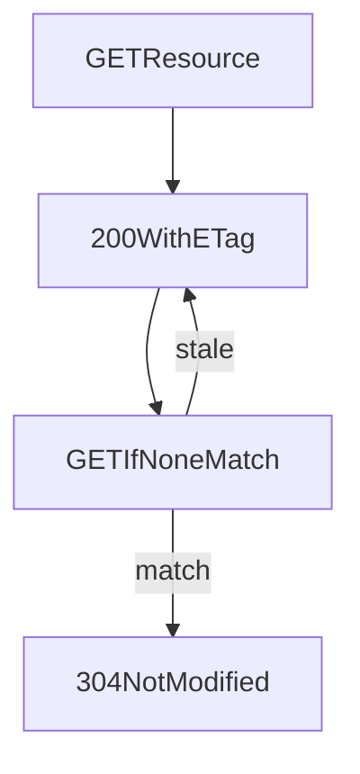

# D06-T013 — Conditional requests: ETag, If-Match

Topic ID: `D06-T013`
Domain: API Design and REST
Subdomain: Conditional requests: ETag, If-Match
Importance: core
Complexity: intermediate
Dependencies: `D06-T012`, `D06-T001`, `D04-T001`, `D04-T002`, `D05-T001`, `D05-T002`
Execution status of the code in section F: illustrative (not executed in CI for this topic)

## A. Topic Overview

**ETag** is an opaque validator for a representation version. Clients send **If-None-Match** on `GET` to receive `304 Not Modified` when unchanged, saving bandwidth. **If-Match** on `PUT`/`PATCH`/`DELETE` ensures you update only if the version still matches; mismatch returns `412 Precondition Failed`.

Strong ETags change when any byte changes; weak ETags (`W/"..."`) suit semantically equivalent variants. Optimistic concurrency prevents lost updates without long DB locks.

## B. First-Principles Explanation

Validators turn representations into comparable tokens so caches and clients avoid redundant work and conflicting writes.

## C. Internal Working and Architecture

Servers compute ETag on render; store version column in database; compare on write preconditions before commit.

## D. Diagrams and Visual Models



## E. Examples and Analogies

Editing a wiki page with “you are viewing version 42”; saves fail if someone else published version 43.

## F. Code Examples

```http
PATCH /v1/items/1
If-Match: "rev-9"
```

## G. Practical Backend Application

Return ETag on reads; require If-Match on sensitive PATCH; document 412 client merge flow.

## H. Advantages, Limitations and Trade-offs

Optimistic concurrency scales reads; writers must handle conflicts.

## I. Common Mistakes and Misconceptions

Weak ETags for write preconditions, missing ETag on list endpoints that should not be cached together.

## J. Debugging and Troubleshooting

Frequent 412: concurrent editors; teach refresh-and-retry. Stale GET: revalidation headers misconfigured.

## K. Interview Preparation

### Beginner

#### Q1. What is an ETag?

**Answer:** A server-generated validator representing a specific version of a representation. Clients echo it in conditional headers on later requests. It enables caching and concurrency control without exposing internal version numbers.

#### Q2. If-None-Match on GET?

**Answer:** Client sends cached ETag; server returns `304` if still current. No body on `304`; client uses cache. Reduces payload on large JSON documents.

#### Q3. If-Match on PUT?

**Answer:** Update applies only if ETag matches current resource. Prevents overwriting newer changes from another client. Failure returns `412`.

#### Q4. Strong vs weak ETag?

**Answer:** Strong validators byte-identical; weak allow semantically equivalent compression variants. Use strong for concurrency unless documented otherwise.

#### Q5. ETag versus Last-Modified?

**Answer:** `Last-Modified` is second-granularity time; ETag handles rapid writes and dynamic content better. Both can coexist (`D06-T014`).

### Intermediate

#### Q1. How generate ETag?

**Answer:** Hash of representation, version column, or revision number formatted opaque. Must change when representation changes.

#### Q2. DELETE with If-Match?

**Answer:** Prevent deleting a resource that changed since read; avoids accidental removal of updated rows.

#### Q3. PATCH concurrency?

**Answer:** Require If-Match on patch documents; merge strategies documented.

#### Q4. 412 client flow?

**Answer:** Refresh with GET, show merge UI, retry with new ETag.

#### Q5. ETags on collections?

**Answer:** Rare; usually per-item ETags. Collection aggregates may use weak ETags carefully.

### Advanced

#### Q1. Distributed replicas lag?

**Answer:** ETag from primary for writes; reads from replica may be stale; document read-your-writes policy.

#### Q2. GraphQL mutations?

**Answer:** Expose resource versions via fields or headers on underlying REST (`D06-T020`).

#### Q3. Precondition Required 428?

**Answer:** Force clients to send If-Match on sensitive resources.

#### Q4. Combined If-Unmodified-Since?

**Answer:** HTTP allows; prefer ETag for precision.

#### Q5. Testing concurrency?

**Answer:** Parallel PUTs with same ETag; one succeeds, one `412`.

### Scenarios

#### Q1. Lost update without validators.

**Answer:** Add If-Match requirement on PATCH.

#### Q2. CDN serves stale despite ETag.

**Answer:** Configure revalidation; `Cache-Control` private where needed.

#### Q3. Client caches 304 incorrectly.

**Answer:** Ensure cache stores ETag pairings per URL and `Vary`.

#### Q4. Weak ETag breaks concurrency.

**Answer:** Switch to strong for write paths.

#### Q5. ETag leaks implementation?

**Answer:** Use hashed opaque tokens not sequential ids.

### Follow-ups

#### Q1. Caching?

**Answer:** `D06-T014`.

#### Q2. Status codes?

**Answer:** `D06-T004` for `304` and `412`.

#### Q3. Methods?

**Answer:** `D06-T003`.

## L. Practical Exercises

Solutions: `EXERCISES/solutions/D06-T013.md`.

1. Add ETag + If-Match to update endpoint.
2. Debug client ignoring 412 merge flow.
3. Choose strong vs weak ETag for compressed responses.

## M. Revision Notes

- ETag validates representation version.
- If-None-Match -> 304 on GET.
- If-Match -> 412 on conflicting write.

## N. Related Topics

`D06-T014`, `D06-T004`, `D06-T003`.

## O. Completion Criteria

- Implement optimistic locking with ETags.
- Explain 304 vs 412 flows.
- Test parallel writers.
