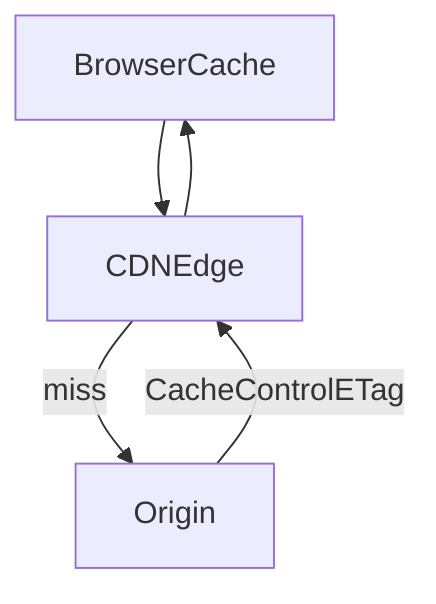

# D06-T014 — Caching: Cache-Control, ETag, Last-Modified

Topic ID: `D06-T014`
Domain: API Design and REST
Subdomain: Caching: Cache-Control, ETag, Last-Modified
Importance: core
Complexity: intermediate
Dependencies: `D06-T013`, `D06-T001`, `D04-T001`, `D04-T002`, `D05-T001`, `D05-T002`
Execution status of the code in section F: illustrative (not executed in CI for this topic)

## A. Topic Overview

HTTP caching lets browsers, CDNs, and reverse proxies reuse responses. `Cache-Control` directives (`max-age`, `s-maxage`, `private`, `no-store`, `no-cache`) define who may cache and for how long. Validators (`ETag`, `Last-Modified`) enable revalidation without full downloads.

Never mark personalized or authorized responses as publicly cacheable unless keys include auth context. `no-store` for sensitive health or PII.

## B. First-Principles Explanation

Caches trade freshness for latency; HTTP directives make that trade explicit to browsers and CDNs.

## C. Internal Working and Architecture

Origins set `Cache-Control` and validators; edges store responses keyed by URL and `Vary` headers; clients revalidate with `If-None-Match`.

## D. Diagrams and Visual Models



## E. Examples and Analogies

Library lending card stamped “do not reshelve until date X” resembles `max-age`.

## F. Code Examples

```http
Cache-Control: public, max-age=300
ETag: "catalog-2025-10-12"
```

## G. Practical Backend Application

Catalog `public` short TTL; account `private` or `no-store`; purge on admin updates.

## H. Advantages, Limitations and Trade-offs

CDNs slash origin load; stale or leaked cache entries are costly incidents.

## I. Common Mistakes and Misconceptions

Caching authenticated JSON as `public`, caching 500 responses.

## J. Debugging and Troubleshooting

Compare `Age` header edge vs origin; verify `Vary` when content negotiates language.

## K. Interview Preparation

### Beginner

#### Q1. What does Cache-Control do?

**Answer:** It instructs caches whether they may store a response and for how long. `max-age` sets freshness in seconds. `private` restricts to browser; `public` allows shared caches.

#### Q2. no-store versus no-cache?

**Answer:** `no-store` forbids storing any copy. `no-cache` allows storage but requires revalidation before reuse. Sensitive data often needs `no-store`.

#### Q3. Role of ETag in caching?

**Answer:** Validators let caches ask if content changed via `If-None-Match`. Matching ETag yields `304` saving bandwidth (`D06-T013`).

#### Q4. Last-Modified?

**Answer:** Timestamp validator with second resolution. Less precise than ETag for fast updates.

#### Q5. Vary header?

**Answer:** Tells caches to key separately on listed request headers like `Accept-Language`.

### Intermediate

#### Q1. s-maxage for CDNs?

**Answer:** Overrides `max-age` for shared caches only; browsers may still use `max-age`.

#### Q2. Caching authenticated GET?

**Answer:** Usually `private` with short `max-age` or `no-store`. Never `public` for user-specific JSON.

#### Q3. Purge versus short TTL?

**Answer:** Short TTL simplifies invalidation; purge for marketing events.

#### Q4. Stale-while-revalidate?

**Answer:** Serve stale briefly while fetching fresh; improves perceived latency.

#### Q5. Error response caching?

**Answer:** Mark `5xx` `no-store` to avoid poisoned edges.

### Advanced

#### Q1. Cache key design at CDN?

**Answer:** Include path, query, `Vary` headers, and optionally normalized `Accept`.

#### Q2. ETag at edge?

**Answer:** Some CDNs strip; configure pass-through.

#### Q3. GraphQL GET caching?

**Answer:** Rare; POST default reduces cacheability (`D06-T020`).

#### Q4. Invalidation on write?

**Answer:** Purge tags or rely on short TTL plus ETag revalidation.

#### Q5. HTTP/2 push interactions?

**Answer:** Largely deprecated patterns; focus on standard cache headers.

### Scenarios

#### Q1. Users see another user's data from CDN.

**Answer:** Mis-`public` cache; fix to `private`/`no-store`; purge.

#### Q2. Prices stale during sale.

**Answer:** Lower TTL or active purge; separate cacheable marketing from price API.

#### Q3. 304 missing body confuses client.

**Answer:** Client must use cached representation paired with ETag.

#### Q4. API gateway caches POST by mistake.

**Answer:** Disable; only safe methods cacheable by default.

#### Q5. Locale mix-up.

**Answer:** `Vary: Accept-Language` or locale in path.

### Follow-ups

#### Q1. Conditional requests?

**Answer:** `D06-T013`.

#### Q2. REST constraints?

**Answer:** `D06-T001` cacheability.

#### Q3. Pagination lists?

**Answer:** `D06-T009` usually uncached or short TTL.

## L. Practical Exercises

Solutions: `EXERCISES/solutions/D06-T014.md`.

1. Set cache headers for public catalog vs account profile.
2. Debug CDN cross-user leak.
3. Design purge strategy for product updates.

## M. Revision Notes

- Cache-Control governs storage and freshness.
- ETag/Last-Modified for revalidation.
- private/no-store for auth data.

## N. Related Topics

`D06-T013`, `D06-T001`, `D06-T009`.

## O. Completion Criteria

- Choose directives per endpoint class.
- Explain 304 revalidation flow.
- Prevent shared cache PII leaks.
