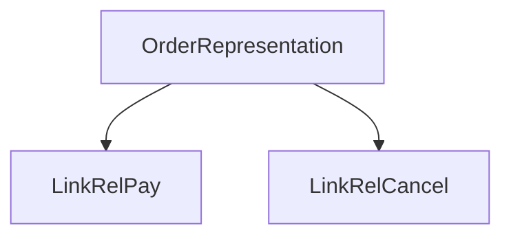

# D06-T015 — HATEOAS and when it is useful

Topic ID: `D06-T015`
Domain: API Design and REST
Subdomain: HATEOAS and when it is useful
Importance: core
Complexity: intermediate
Dependencies: `D06-T014`, `D06-T001`, `D04-T001`, `D04-T002`, `D05-T001`, `D05-T002`
Execution status of the code in section F: illustrative (not executed in CI for this topic)

## A. Topic Overview

HATEOAS (Hypermedia As The Engine Of Application State) embeds links (`rel`, `href`, `method`) in responses so clients discover next actions without hard-coded URLs. It completes the REST uniform interface for evolving public APIs.

Internal microservices often skip HATEOAS and use OpenAPI instead. Useful for partner APIs, payment flows, and long-lived public integrations.

## B. First-Principles Explanation

Hypermedia links decouple clients from URL construction by advertising available transitions per representation state.

## C. Internal Working and Architecture

Servers embed `_links` based on state machines and permissions; clients follow `rel` without hard-coded paths.

## D. Diagrams and Visual Models



## E. Examples and Analogies

ATM menus showing only valid buttons for your account state.

## F. Code Examples

```json
{"status":"PENDING","_links":{"pay":{"href":"/payments/p1"}}}
```

## G. Practical Backend Application

Use for partner onboarding flows; skip for mobile apps with bundled OpenAPI SDKs if team agrees.

## H. Advantages, Limitations and Trade-offs

Evolvable URLs; larger payloads and client complexity.

## I. Common Mistakes and Misconceptions

Links without method semantics, absolute URLs with wrong host.

## J. Debugging and Troubleshooting

Clients ignoring links and hard-coding paths—metric link usage.

## K. Interview Preparation

### Beginner

#### Q1. What is HATEOAS?

**Answer:** Responses include hypermedia links describing available transitions. Clients follow `rel` types instead of constructing URLs. Servers can change URI layout without breaking clients that honor links.

#### Q2. Example link relation?

**Answer:** `{ "rel": "payment", "href": "/payments/p1", "method": "GET" }` guides next step.

#### Q3. JSON HAL or custom?

**Answer:** HAL, JSON-LD, or `_links` object; pick one style and document.

#### Q4. vs OpenAPI?

**Answer:** OpenAPI describes static catalog; HATEOAS supplies runtime-available actions per state.

#### Q5. When skip?

**Answer:** Tight coupling mobile apps with generated SDKs may not need links.

### Intermediate

#### Q1. State machines in links?

**Answer:** Only valid transitions appear; illegal actions omitted or disabled with reason.

#### Q2. Versioning links?

**Answer:** Links include versioned paths or absolute URLs with correct host.

#### Q3. Pagination links?

**Answer:** `rel="next"` in body or `Link` header complements cursors (`D06-T009`).

#### Q4. Security of links?

**Answer:** Links still require auth; do not embed secrets in href.

#### Q5. Testing?

**Answer:** Contract tests assert required `rel`s per state.

### Advanced

#### Q1. Coupling reduction metrics?

**Answer:** Fewer client releases when URLs move if clients use links.

#### Q2. GraphQL comparison?

**Answer:** GraphQL schema is static graph; HATEOAS is dynamic per resource (`D06-T020`).

#### Q3. Overhead?

**Answer:** Larger payloads; mitigate with sparse linking.

#### Q4. Idempotent actions in links?

**Answer:** Document methods on links (`D06-T003`).

#### Q5. Webhooks vs links?

**Answer:** Push vs pull; complementary (`D06-T018`).

### Scenarios

#### Q1. Client hard-coded URLs break deploy.

**Answer:** Migrate client to follow `rel` links from responses.

#### Q2. Payment next step unclear.

**Answer:** Return `rel=approve` only when status allows.

#### Q3. Too many links clutter.

**Answer:** Include only actionable transitions.

#### Q4. Wrong host in absolute URLs.

**Answer:** Generate from configured public base URL.

#### Q5. Mobile offline?

**Answer:** Cache last links cautiously; refresh on sync.

### Follow-ups

#### Q1. REST constraints?

**Answer:** `D06-T001` hypermedia constraint.

#### Q2. OpenAPI?

**Answer:** `D06-T016`.

#### Q3. URL design?

**Answer:** `D06-T002`.

## L. Practical Exercises

Solutions: `EXERCISES/solutions/D06-T015.md`.

1. Add `_links` to order states for pay/cancel.
2. Decide HATEOAS vs OpenAPI for partner API.
3. Test client consumes `rel=next` pagination.

## M. Revision Notes

- Links expose allowed transitions.
- Clients follow rel, not hard-coded paths.
- Optional for internal JSON APIs.

## N. Related Topics

`D06-T001`, `D06-T016`, `D06-T009`.

## O. Completion Criteria

- Design link relations for a workflow.
- Argue when HATEOAS helps or hurts.
