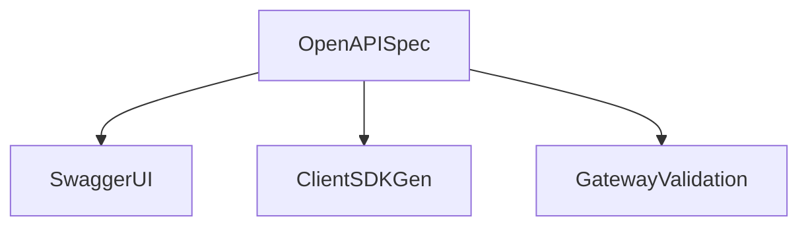

# D06-T016 — OpenAPI and Swagger

Topic ID: `D06-T016`
Domain: API Design and REST
Subdomain: OpenAPI and Swagger
Importance: core
Complexity: intermediate
Dependencies: `D06-T015`, `D06-T001`, `D04-T001`, `D04-T002`, `D05-T001`, `D05-T002`
Execution status of the code in section F: illustrative (not executed in CI for this topic)

## A. Topic Overview

OpenAPI describes HTTP APIs: paths, methods, parameters, request/response schemas, security schemes, and examples. Swagger UI renders docs; codegen builds client and server stubs.

Treat OpenAPI as contract artifact in CI: diff on PR, publish per API version (`D06-T010`). "Swagger" often means OpenAPI 3.x spec plus UI tools.

## B. First-Principles Explanation

OpenAPI is the machine-readable contract bridging docs, mocks, gateways, and SDK generation.

## C. Internal Working and Architecture

Specs live in git; CI diffs and publishes; UI renders docs; codegen emits clients.

## D. Diagrams and Visual Models



## E. Examples and Analogies

Blueprint for a house versus photos of one finished room—schemas define all rooms.

## F. Code Examples

```yaml
components:
  schemas:
    Money:
      type: object
      required: [amount_cents, currency]
```

## G. Practical Backend Application

Keep spec aligned with production; annotate security schemes; version artifacts per major API.

## H. Advantages, Limitations and Trade-offs

Great DX; drift is the main risk without automation.

## I. Common Mistakes and Misconceptions

Examples without schemas, undocumented auth, mixing v2 and v3 syntax.

## J. Debugging and Troubleshooting

Partner integration failures: diff their SDK version against published spec hash.

## K. Interview Preparation

### Beginner

#### Q1. What is OpenAPI?

**Answer:** Machine-readable API description enabling docs, mocks, and codegen. It complements but does not replace runtime validation.

#### Q2. OpenAPI vs implementation?

**Answer:** Spec can drift from code; automate generation or contract tests.

#### Q3. Components section?

**Answer:** Reusable schemas, parameters, responses referenced by `$ref`.

#### Q4. Security schemes?

**Answer:** Document bearer JWT, API keys, OAuth flows.

#### Q5. Examples field?

**Answer:** Helps humans; schemas help machines.

### Intermediate

#### Q1. Code-first vs design-first?

**Answer:** Design-first for public APIs; code-first with annotations for fast iteration if CI enforces sync.

#### Q2. Breaking change detection?

**Answer:** oasdiff or openapi-diff in CI (`D06-T006`).

#### Q3. Webhooks in OpenAPI?

**Answer:** OpenAPI 3.1 improves callbacks documentation (`D06-T018`).

#### Q4. Multiple servers?

**Answer:** `servers` array for prod/sandbox URLs.

#### Q5. Nullable in OpenAPI 3?

**Answer:** `nullable: true` vs `type` array in 3.1.

### Advanced

#### Q1. Overlay specs?

**Answer:** Merge partner-specific extensions without forking core.

#### Q2. JSON Schema draft alignment?

**Answer:** 3.1 aligns closer with JSON Schema 2020-12.

#### Q3. Performance of huge specs?

**Answer:** Split by domain or use references.

#### Q4. gRPC transcoding?

**Answer:** Google API annotations generate OpenAPI from protobuf (`D06-T020`).

#### Q5. Mock servers?

**Answer:** Prism or WireMock for parallel client dev.

### Scenarios

#### Q1. Docs lie about required field.

**Answer:** Fix spec or code; add contract test.

#### Q2. SDK missing new endpoint.

**Answer:** Regenerate from spec release pipeline.

#### Q3. Auth not documented.

**Answer:** Add security scheme; fail CI if missing on protected routes.

#### Q4. Version mismatch in URL.

**Answer:** Align `servers` and path `/v1` (`D06-T010`).

#### Q5. Partner imports wrong spec version.

**Answer:** Publish versioned artifacts with checksums.

### Follow-ups

#### Q1. Schemas?

**Answer:** `D06-T005`.

#### Q2. Versioning?

**Answer:** `D06-T010`.

#### Q3. Gateways?

**Answer:** `D06-T017` import spec for validation.

## L. Practical Exercises

Solutions: `EXERCISES/solutions/D06-T016.md`.

1. Author shared Money schema component.
2. Add CI openapi-diff gate.
3. Document OAuth2 security scheme.

## M. Revision Notes

- OpenAPI = contract + tooling.
- Keep spec and code aligned.
- Publish per major version.

## N. Related Topics

`D06-T005`, `D06-T010`, `D06-T017`.

## O. Completion Criteria

- Read and extend OpenAPI 3 components.
- Set up diff CI.
- Explain codegen trade-offs.
