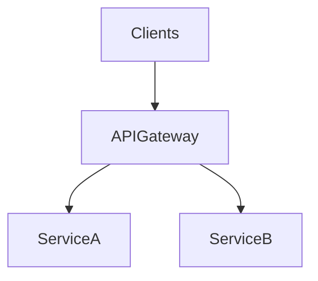

# D06-T017 — API gateways

Topic ID: `D06-T017`
Domain: API Design and REST
Subdomain: API gateways
Importance: core
Complexity: intermediate
Dependencies: `D06-T016`, `D06-T001`, `D04-T001`, `D04-T002`, `D05-T001`, `D05-T002`
Execution status of the code in section F: illustrative (not executed in CI for this topic)

## A. Topic Overview

An API gateway is the single north-south entry for clients: TLS termination, authentication, rate limiting, routing, request/response transformation, and observability. Examples: Kong, NGINX, Envoy, AWS API Gateway, Azure APIM.

Avoid turning the gateway into a second monolith with heavy business logic; keep domain rules in services.

## B. First-Principles Explanation

Gateways centralize north-south concerns so microservices stay small and policy stays consistent.

## C. Internal Working and Architecture

TLS termination, JWT validation, routing, rate limits, and observability hooks run before upstream calls.

## D. Diagrams and Visual Models



## E. Examples and Analogies

Hotel front desk checks IDs before guests reach room floors.

## F. Code Examples

```yaml
routes:
  - path: /v1/orders/**
    upstream: orders-service
```

## G. Practical Backend Application

Forward auth, idempotency, and tracing headers; align timeouts with slowest safe upstream.

## H. Advantages, Limitations and Trade-offs

Policy consistency vs added latency and blast radius if misconfigured.

## I. Common Mistakes and Misconceptions

Business logic in Lua plugins, dropping critical headers, single-region gateway SPOF.

## J. Debugging and Troubleshooting

504 with healthy upstream: gateway timeout too low. 401 spikes: issuer config change.

## K. Interview Preparation

### Beginner

#### Q1. Why a gateway?

**Answer:** Centralizes cross-cutting concerns so microservices stay focused. Simplifies client configuration with one host. Enables consistent auth and throttling.

#### Q2. Gateway vs load balancer?

**Answer:** LB distributes traffic; gateway adds API-aware policies like JWT validation and path routing.

#### Q3. What is route mapping?

**Answer:** `/v1/orders` forwarded to order service cluster with timeouts and retries.

#### Q4. TLS at edge?

**Answer:** Certificates managed centrally; internal mesh may use mTLS.

#### Q5. Header forwarding?

**Answer:** Must pass `Authorization`, `Idempotency-Key`, `traceparent`.

### Intermediate

#### Q1. Rate limiting at gateway?

**Answer:** First line of defense (`D06-T012`).

#### Q2. Request transformation?

**Answer:** URL rewrite for legacy paths; avoid complex business mapping.

#### Q3. OpenAPI validation at edge?

**Answer:** Reject malformed requests early (`D06-T016`).

#### Q4. BFF pattern?

**Answer:** Backend-for-frontend gateway tailored per client type.

#### Q5. Failure modes?

**Answer:** Gateway outage blocks all traffic; HA pairs and multi-region.

### Advanced

#### Q1. Service mesh vs gateway?

**Answer:** Mesh handles east-west; gateway north-south; both may coexist.

#### Q2. Mutual TLS to origin?

**Answer:** Zero-trust internal hops.

#### Q3. Web Application Firewall?

**Answer:** WAF at edge blocks OWASP patterns.

#### Q4. Canary releases?

**Answer:** Weighted routing by header or percentage.

#### Q5. Cost at scale?

**Answer:** Managed gateway pricing vs self-hosted ops.

### Scenarios

#### Q1. 401 for all routes after JWT change.

**Answer:** Gateway issuer config mismatch.

#### Q2. Idempotency header dropped.

**Answer:** Update allowlist plugins.

#### Q3. Timeout 504 while service healthy.

**Answer:** Gateway timeout shorter than service; align.

#### Q4. Wrong tenant routed.

**Answer:** Path-based tenant extraction bug.

#### Q5. Large body rejected.

**Answer:** Increase limit or use direct upload URLs.

### Follow-ups

#### Q1. Rate limits?

**Answer:** `D06-T012`.

#### Q2. Webhooks outbound?

**Answer:** Often separate worker, not client gateway (`D06-T018`).

#### Q3. Version routing?

**Answer:** `D06-T010`.

## L. Practical Exercises

Solutions: `EXERCISES/solutions/D06-T017.md`.

1. Design gateway routes for two microservices.
2. Fix missing header forwarding for tracing.
3. Compare managed vs self-hosted gateway ops.

## M. Revision Notes

- Edge for auth, limits, routing.
- Do not hide domain logic in gateway.
- HA and header pass-through critical.

## N. Related Topics

`D06-T012`, `D06-T016`, `D06-T010`.

## O. Completion Criteria

- Diagram gateway in request path.
- List policies enforced at edge.
- Debug timeout and auth issues.
