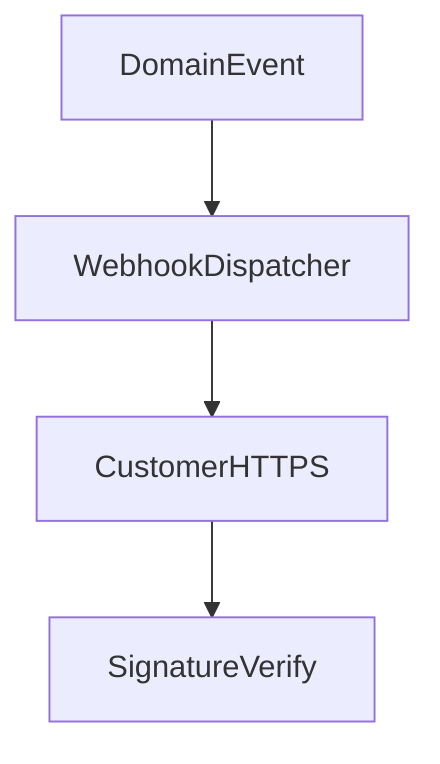

# D06-T018 — Webhooks and signature verification

Topic ID: `D06-T018`
Domain: API Design and REST
Subdomain: Webhooks and signature verification
Importance: core
Complexity: intermediate
Dependencies: `D06-T017`, `D06-T001`, `D04-T001`, `D04-T002`, `D05-T001`, `D05-T002`
Execution status of the code in section F: illustrative (not executed in CI for this topic)

## A. Topic Overview

Webhooks are server-initiated HTTP `POST` callbacks delivering events (payment succeeded, shipment created). Customers expose HTTPS endpoints; you retry with backoff on failures, sign payloads, and include unique **event ids** for deduplication.

Verify signatures with HMAC-SHA256 over timestamp + body using a shared secret or public key (asymmetric). Reject replayed timestamps outside skew window.

## B. First-Principles Explanation

Webhooks push events to subscribers; signatures and event ids make push delivery trustworthy and idempotent.

## C. Internal Working and Architecture

Outbox dispatcher signs payloads, retries with backoff, records delivery attempts per subscription.

## D. Diagrams and Visual Models



## E. Examples and Analogies

Signed delivery receipt proving the package came from the merchant, not a forged notice.

## F. Code Examples

```http
X-Signature: sha256=…
X-Timestamp: 1730000000
{"id":"evt_1","type":"payment.succeeded"}
```

## G. Practical Backend Application

Rotate secrets with overlap; dedupe by `evt_1`; rate limit per subscriber endpoint.

## H. Advantages, Limitations and Trade-offs

Real-time integrations vs delivery complexity and customer endpoint flakiness.

## I. Common Mistakes and Misconceptions

No signature verification, no dedupe store, infinite retries hammering customers.

## J. Debugging and Troubleshooting

Signature failures: clock skew or wrong secret version. Duplicates: missing idempotency on consumer.

## K. Interview Preparation

### Beginner

#### Q1. What is a webhook?

**Answer:** Push notification over HTTP from provider to subscriber when something happens. Complements polling APIs. Requires reliable delivery and security.

#### Q2. Why sign webhooks?

**Answer:** Customers must prove payloads came from you, not an attacker. HMAC or asymmetric signatures are standard patterns.

#### Q3. Event id purpose?

**Answer:** Consumers dedupe retries and at-least-once delivery. Store processed ids idempotently.

#### Q4. HTTPS requirement?

**Answer:** TLS protects data in transit; still verify signatures at application layer.

#### Q5. Retry policy?

**Answer:** Exponential backoff; stop after N days; dead-letter queue for manual replay.

### Intermediate

#### Q1. Timestamp tolerance?

**Answer:** Reject signatures older than five minutes to block replay.

#### Q2. Constant-time compare?

**Answer:** Use constant-time HMAC compare to prevent timing attacks.

#### Q3. Payload versioning?

**Answer:** `event_type` and schema version in envelope (`D06-T006`).

#### Q4. Ordering guarantees?

**Answer:** Usually none; consumers handle out-of-order with versioning.

#### Q5. Returning 2xx?

**Answer:** Ack receipt; process async if needed to avoid timeouts.

### Advanced

#### Q1. mTLS to customer?

**Answer:** High-security partners mutual TLS.

#### Q2. IP allowlists?

**Answer:** Weak alone; combine with signatures.

#### Q3. Webhook management API?

**Answer:** CRUD subscription endpoints with secret rotation.

#### Q4. Load testing customer endpoint?

**Answer:** Rate limit per subscriber (`D06-T012`).

#### Q5. SSRF risks on customer URL validation?

**Answer:** Block internal IPs when customers register URLs.

### Scenarios

#### Q1. Customer processes duplicate charges.

**Answer:** Missing event id dedupe; add idempotent handler.

#### Q2. Signature failures after secret rotate.

**Answer:** Support overlapping secrets during rotation window.

#### Q3. Slow customer 504 loops retries.

**Answer:** Ack fast, queue internal processing.

#### Q4. Attacker posts fake webhook.

**Answer:** Enforce signature verification middleware.

#### Q5. Clock skew rejects valid events.

**Answer:** Widen tolerance slightly; use NTP.

### Follow-ups

#### Q1. Idempotency keys?

**Answer:** `D06-T011` analogous on inbound POST.

#### Q2. OpenAPI callbacks?

**Answer:** `D06-T016`.

#### Q3. REST vs events?

**Answer:** `D06-T020` polling vs push.

## L. Practical Exercises

Solutions: `EXERCISES/solutions/D06-T018.md`.

1. Design signed webhook envelope with event id.
2. Implement consumer dedupe store.
3. Plan secret rotation without downtime.

## M. Revision Notes

- Sign payloads; verify timestamp + HMAC.
- Unique event id for dedupe.
- Retry with backoff; document 2xx ack.

## N. Related Topics

`D06-T011`, `D06-T012`, `D06-T017`.

## O. Completion Criteria

- Verify webhook signature safely.
- Handle at-least-once delivery.
- Design subscription management API.
