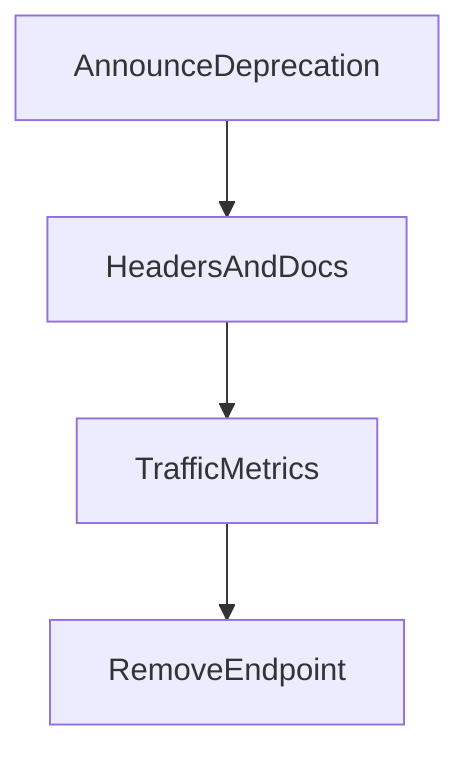

# D06-T019 — API deprecation strategies

Topic ID: `D06-T019`
Domain: API Design and REST
Subdomain: API deprecation strategies
Importance: core
Complexity: intermediate
Dependencies: `D06-T018`, `D06-T001`, `D04-T001`, `D04-T002`, `D05-T001`, `D05-T002`
Execution status of the code in section F: illustrative (not executed in CI for this topic)

## A. Topic Overview

Deprecation communicates sunsetting features without immediate breakage. Use `Deprecation: true` and `Sunset` HTTP headers (Sunset field contains HTTP-date when resource/version ends), changelog entries, and metrics on remaining traffic.

Pair with versioning (`D06-T010`) and compatibility rules (`D06-T021`).

## B. First-Principles Explanation

Deprecation is communicated sunsetting: headers, docs, and metrics before removal.

## C. Internal Working and Architecture

Traffic dashboards per legacy route; automated emails; gateway injects `Deprecation` and `Sunset`.

## D. Diagrams and Visual Models



## E. Examples and Analogies

Road signs announcing bridge closure months ahead.

## F. Code Examples

```http
Deprecation: true
Sunset: Sat, 01 Feb 2026 00:00:00 GMT
```

## G. Practical Backend Application

Never silent removal; offer migration guides; return `410` after sunset.

## H. Advantages, Limitations and Trade-offs

Predictable partner upgrades vs engineering cost of dual stacks.

## I. Common Mistakes and Misconceptions

Undocumented removal, changing semantics without version bump.

## J. Debugging and Troubleshooting

Traffic never drops on deprecated path: identify owning clients via API keys.

## K. Interview Preparation

### Beginner

#### Q1. Why deprecate formally?

**Answer:** Gives integrators time to migrate. Reduces surprise outages. Legal and enterprise contracts often require notice periods.

#### Q2. Sunset header?

**Answer:** Communicates planned removal time in HTTP-date format. Clients and monitors can alert before cutoff.

#### Q3. Deprecation header?

**Answer:** Marks responses from deprecated endpoints or versions as true.

#### Q4. Documentation role?

**Answer:** Changelog, migration guides, and code samples for replacement APIs.

#### Q5. Metrics?

**Answer:** Measure calls to deprecated paths to know when safe to remove.

### Intermediate

#### Q1. Dual-run period?

**Answer:** Old and new endpoints simultaneously with warnings.

#### Q2. Breaking removal without version bump?

**Answer:** Avoid; treat as incident if accidental.

#### Q3. Email partners?

**Answer:** Required for critical payment APIs.

#### Q4. Feature flags vs deprecation?

**Answer:** Flags hide beta; deprecation sunsets stable surface.

#### Q5. GraphQL field deprecation?

**Answer:** Schema `@deprecated` directive with telemetry.

### Advanced

#### Q1. Automated Sunset monitors?

**Answer:** Alert when traffic >0 near Sunset date.

#### Q2. Hard fail vs soft degrade?

**Answer:** Return `410 Gone` after sunset.

#### Q3. Legal retention blocking delete?

**Answer:** Keep read-only archival endpoints.

#### Q4. SDK deprecation tags?

**Answer:** Annotate methods mapping to sunset APIs.

#### Q5. Internal consumers faster sunset?

**Answer:** Shorter windows with direct migration support.

### Scenarios

#### Q1. Zero traffic but enterprise contract.

**Answer:** Extend sunset or provide paid extended support.

#### Q2. Clients ignore headers.

**Answer:** Increase log noise; contact owners; eventual 410.

#### Q3. Deprecated field still written.

**Answer:** Server ignores writes; document read-only legacy.

#### Q4. Mobile app lag years.

**Answer:** Maintain minimal v1 security path.

#### Q5. Accidental early 410.

**Answer:** Roll back; extend sunset.

### Follow-ups

#### Q1. Versioning?

**Answer:** `D06-T010`.

#### Q2. Compatibility?

**Answer:** `D06-T021`.

#### Q3. Evolution?

**Answer:** `D06-T006`.

## L. Practical Exercises

Solutions: `EXERCISES/solutions/D06-T019.md`.

1. Publish deprecation plan for `/v1/payments` move to `/v2`.
2. Dashboard metrics for deprecated route usage.
3. Write partner email template with migration steps.

## M. Revision Notes

- Deprecation + Sunset headers.
- Metrics before removal.
- 410 after cutoff.

## N. Related Topics

`D06-T010`, `D06-T021`, `D06-T006`.

## O. Completion Criteria

- Plan sunset timeline with headers.
- Monitor deprecated traffic.
- Communicate migrations.
