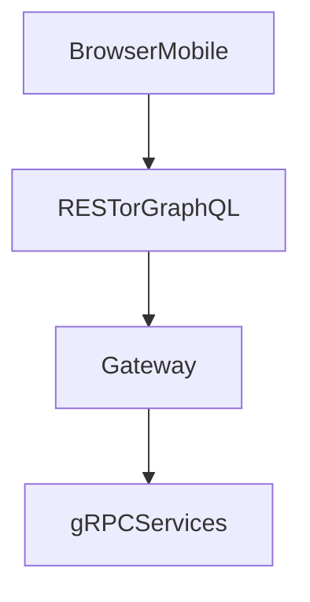

# D06-T020 — REST vs GraphQL vs gRPC vs RPC

Topic ID: `D06-T020`
Domain: API Design and REST
Subdomain: REST vs GraphQL vs gRPC vs RPC
Importance: core
Complexity: intermediate
Dependencies: `D06-T019`, `D06-T001`, `D04-T001`, `D04-T002`, `D05-T001`, `D05-T002`
Execution status of the code in section F: illustrative (not executed in CI for this topic)

## A. Topic Overview

**REST** over HTTP/JSON: resource-oriented, cache-friendly reads, widespread tooling, good for public APIs and browsers. **GraphQL**: single endpoint, client-specified field selection, avoids over/under-fetching, needs query cost limits and careful caching. **gRPC**: HTTP/2, Protocol Buffers, strong typing, streaming, best for internal service-to-service latency. **RPC** (generic): action-oriented interfaces (SOAP, JSON-RPC, custom `POST /doThing`); fast to build, weaker uniform caching semantics.

Choose per boundary: external REST/GraphQL; internal gRPC; avoid exposing raw RPC without documentation and auth.

## B. First-Principles Explanation

Each style optimizes different constraints: cacheable resources, flexible reads, typed low-latency RPC, or quick action endpoints.

## C. Internal Working and Architecture

Browsers and partners hit REST/GraphQL gateways; services speak gRPC behind the mesh; translators map errors and auth.

## D. Diagrams and Visual Models



## E. Examples and Analogies

REST is a menu of fixed dishes; GraphQL is a buffet plate you compose; gRPC is a kitchen intercom with strict tickets.

## F. Code Examples

```protobuf
service Inventory { rpc GetItem(ItemRequest) returns (Item); }
```

## G. Practical Backend Application

Expose REST OpenAPI publicly; GraphQL BFF for mobile home screen; gRPC between inventory and orders.

## H. Advantages, Limitations and Trade-offs

| Style | Strength | Weakness |
| --- | --- | --- |
| REST | Caching, simplicity | Chatty reads |
| GraphQL | Flexible reads | Query cost |
| gRPC | Speed, types | Browser friction |

## I. Common Mistakes and Misconceptions

GraphQL without limits, gRPC everywhere to browsers, RPC verbs on public URLs.

## J. Debugging and Troubleshooting

GraphQL latency: N+1 resolvers. gRPC failures: protobuf mismatch between services.

## K. Interview Preparation

### Beginner

#### Q1. When prefer REST?

**Answer:** Public HTTP APIs, CDN caching, simple CRUD, and teams wanting OpenAPI ecosystems. REST leverages HTTP methods, status codes, and cache headers natively. It is the default for third-party integrators.

#### Q2. When prefer GraphQL?

**Answer:** Mobile or web clients need flexible queries across related objects without many REST round trips. A schema registry documents fields. Requires query depth/complexity limits to protect servers.

#### Q3. When prefer gRPC?

**Answer:** Low-latency internal calls, streaming, and strongly typed contracts in polyglot microservices. Not browser-native without gRPC-Web proxies. Excellent with service meshes.

#### Q4. What is wrong with generic RPC?

**Answer:** Action endpoints hide resources, complicate caching, and encourage breaking changes. Still used internally behind gateways with clear contracts.

#### Q5. Can you mix styles?

**Answer:** Common pattern: REST/GraphQL northbound, gRPC east-west. Translate at gateway with careful error mapping.

### Intermediate

#### Q1. GraphQL caching?

**Answer:** POST by default reduces HTTP cache; use persisted queries, CDN at edge for allowlisted queries, or APQ. Entity-level caching in server.

#### Q2. REST over-fetching?

**Answer:** Solve with sparse fieldsets, includes, or separate composite endpoints; or move to GraphQL for UI-heavy apps.

#### Q3. gRPC versioning?

**Answer:** protobuf package versions; never reuse field numbers; add optional fields.

#### Q4. GraphQL N+1?

**Answer:** DataLoader batching in resolvers.

#### Q5. REST HATEOAS vs GraphQL schema?

**Answer:** HATEOAS dynamic links per resource; GraphQL static schema with introspection (`D06-T015`).

### Advanced

#### Q1. Idempotency across styles?

**Answer:** REST uses methods + keys (`D06-T011`). gRPC idempotency levels in some frameworks. GraphQL mutations should document idempotency keys on HTTP layer.

#### Q2. Streaming use cases?

**Answer:** gRPC server streaming for logs; SSE/websockets for browsers.

#### Q3. JSON transcoding gRPC?

**Answer:** grpc-gateway exposes REST façade over protobuf.

#### Q4. Federation GraphQL?

**Answer:** Multiple subgraphs composed; operational complexity rises.

#### Q5. Security models?

**Answer:** REST scopes per route; GraphQL per-field auth; gRPC interceptors.

### Scenarios

#### Q1. Mobile app many REST calls.

**Answer:** Consider GraphQL BFF or composite REST resources.

#### Q2. Latency SLO 5ms internal.

**Answer:** gRPC between services.

#### Q3. Public partner wants OpenAPI.

**Answer:** Stay REST; avoid GraphQL unless partners agree.

#### Q4. GraphQL query melts DB.

**Answer:** Complexity limits, pagination, persisted queries.

#### Q5. Browser needs streaming.

**Answer:** SSE/WebSocket public; gRPC-Web behind gateway.

### Follow-ups

#### Q1. REST constraints?

**Answer:** `D06-T001`.

#### Q2. OpenAPI?

**Answer:** `D06-T016` for REST docs.

#### Q3. Webhooks?

**Answer:** `D06-T018` event push regardless of query style.

## L. Practical Exercises

Solutions: `EXERCISES/solutions/D06-T020.md`.

1. Pick API style for marketplace public API and internal inventory service.
2. Mitigate GraphQL query cost attack.
3. Sketch grpc-gateway REST mapping for one RPC.

## M. Revision Notes

- REST: HTTP resources + caches.
- GraphQL: flexible reads; guard cost.
- gRPC: typed fast internal RPC.
- RPC verbs OK internal with gateway.

## N. Related Topics

`D06-T001`, `D06-T016`, `D06-T017`, `D06-T018`.

## O. Completion Criteria

- Compare trade-offs with examples.
- Choose styles per trust boundary.
- Explain GraphQL and gRPC operational costs.
