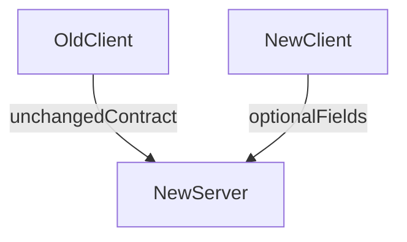

# D06-T021 — API compatibility and backward compatibility

Topic ID: `D06-T021`
Domain: API Design and REST
Subdomain: API compatibility and backward compatibility
Importance: core
Complexity: intermediate
Dependencies: `D06-T020`, `D06-T001`, `D04-T001`, `D04-T002`, `D05-T001`, `D05-T002`
Execution status of the code in section F: illustrative (not executed in CI for this topic)

## A. Topic Overview

Backward compatibility means new server versions do not break existing clients that follow the published contract. Forward compatibility means old servers tolerate unknown fields from newer clients when possible.

Maintain checklists: safe additive response fields, optional request fields, no type changes, no semantic redefinition, stable error codes, and versioned breaking changes (`D06-T010`, `D06-T019`).

## B. First-Principles Explanation

Backward compatibility preserves existing client behavior when servers upgrade; forward compatibility lets old servers tolerate unknown client fields when safe.

## C. Internal Working and Architecture

PR checklists plus OpenAPI diff gates enforce rules; adapters maintain old response shapes during migrations.

## D. Diagrams and Visual Models



## E. Examples and Analogies

New phone OS reading old apps because APIs stayed stable; breaking changes are like removing the charging port.

## F. Code Examples

```json
{"id":"1","customer_id":"c1","customerId":"c1"}
```

Dual-field period during rename.

## G. Practical Backend Application

Publish checklist; metric legacy field usage; never remove until zero.

## H. Advantages, Limitations and Trade-offs

Happy integrators vs slower schema cleanup.

## I. Common Mistakes and Misconceptions

Assuming mobile updates quickly, changing error strings clients parse.

## J. Debugging and Troubleshooting

Sudden client crashes: strict parsers on removed null fields—restore or bump major.

## K. Interview Preparation

### Beginner

#### Q1. What is backward compatibility?

**Answer:** Upgrading the server should not break clients built against the old spec. Clients may ignore unknown response fields. Breaking changes require new major versions or explicit migration.

#### Q2. Safe response change?

**Answer:** Adding optional JSON fields clients ignore. Document in changelog.

#### Q3. Unsafe response change?

**Answer:** Removing fields, changing types, or renaming without dual fields.

#### Q4. Client forward compatibility?

**Answer:** Clients should tolerate unknown fields and enum values when documented.

#### Q5. Why checklist?

**Answer:** Prevents debate during PR review; automates CI diff.

### Intermediate

#### Q1. Tightening validation?

**Answer:** Usually breaking; use new version or opt-in strict mode.

#### Q2. Error code changes?

**Answer:** Breaking for SDKs; treat like schema.

#### Q3. Pagination cursor format change?

**Answer:** Version bump or dual decode window.

#### Q4. Nullable to required?

**Answer:** Breaking unless default provided server-side.

#### Q5. Consumer-driven contracts?

**Answer:** Pact tests verify providers meet consumer expectations (`D06-T006`).

### Advanced

#### Q1. Polyglot clients?

**Answer:** OpenAPI + contract tests + staged rollouts.

#### Q2. Mobile lag years?

**Answer:** Long v1 support; minimal changes on old majors.

#### Q3. Database blocking compatible API?

**Answer:** Expand-contract migrations before API exposure.

#### Q4. Feature detection?

**Answer:** `capabilities` object in response optional fields.

#### Q5. Legal immutability?

**Answer:** Some fields cannot change meaning for compliance.

### Scenarios

#### Q1. Server removes null field.

**Answer:** Clients using `hasOwnProperty` break; keep nulls or major bump.

#### Q2. Enum shrink breaks mobile.

**Answer:** Never remove enum values without version.

#### Q3. Partner parses error strings.

**Answer:** Migrate to stable codes (`D06-T008`).

#### Q4. Accidental OpenAPI break.

**Answer:** Revert; add diff gate.

#### Q5. Dual-write period ends too early.

**Answer:** Clients still send legacy field; extend sunset (`D06-T019`).

### Follow-ups

#### Q1. Evolution?

**Answer:** `D06-T006`.

#### Q2. Versioning?

**Answer:** `D06-T010`.

#### Q3. Deprecation?

**Answer:** `D06-T019`.

## L. Practical Exercises

Solutions: `EXERCISES/solutions/D06-T021.md`.

1. Write compatibility checklist for your API team.
2. Classify proposed PR changes safe vs breaking.
3. Design capabilities discovery for optional features.

## M. Revision Notes

- Clients ignore unknown response fields.
- Additive in place; breaking needs major version.
- Automate OpenAPI diff CI.

## N. Related Topics

`D06-T006`, `D06-T010`, `D06-T019`, `D06-T005`.

## O. Completion Criteria

- Apply compatibility checklist in review.
- Design dual-field migration.
- Explain forward vs backward compatibility.
