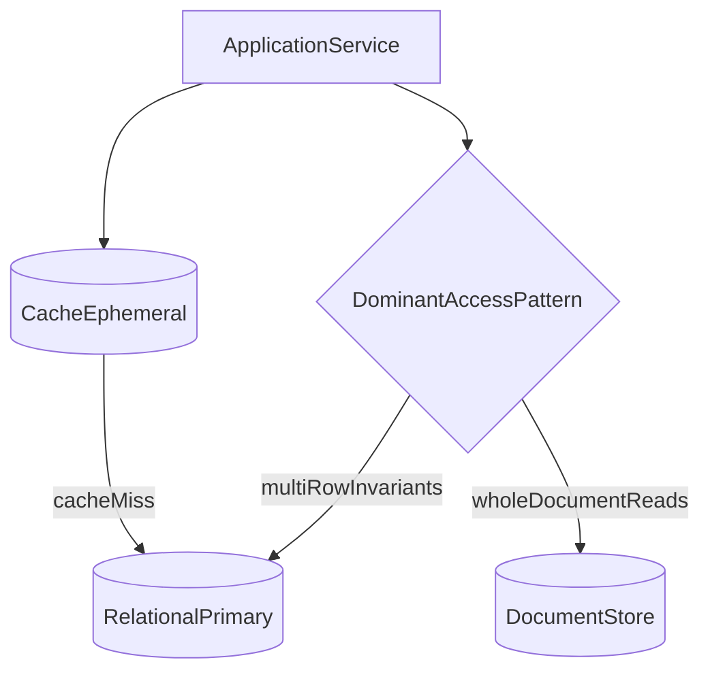

# D07-T001 — Relational vs non-relational databases

Topic ID: `D07-T001`
Domain: Database Fundamentals
Subdomain: Relational vs non-relational databases
Importance: core
Complexity: intermediate
Dependencies: `D01-T001`, `D01-T002`, `D05-T001`, `D05-T002`
SQL in section F: unexecuted (illustrative only)

## A. Topic Overview

Relational databases organize data into tables with declared types and enforce relationships with keys and constraints. Non-relational databases optimize for alternative models and often for horizontal scale at the cost of narrower transactional guarantees. Backend engineers choose between them based on invariants, query shapes, team skills, and operational budget—not slogans. Interviews use this topic to see whether you can name trade-offs before jumping to microservices and sharding.

Prerequisites: `D05-T002`. Next in the database track: `D07-T002`.

## B. First-Principles Explanation

Persistent storage must survive process crashes. A database engine pages data to disk, replays logs, and exposes a concurrency model. Relational theory (Codd) adds structure: relations, tuples, and declarative queries. SQL is the mainstream language for that model. NoSQL families emerged when single-node SQL hit limits or when nested documents matched product shapes. The first-principles question is always: what must be true after a crash, under concurrency, and during a partition—and which engine proves those properties cheapest.

## C. Internal Working and Architecture

A relational engine parses SQL, plans joins and index scans, acquires locks or MVCC snapshots, and writes WAL records before acknowledging commit. A document engine stores BSON or JSON on disk with optional secondary indexes and replication per shard. Key-value engines hash keys to partitions; wide-column engines sort rows by partition key plus clustering columns. Your service sees a connection pool, sessions, and transactions; the difference is what the server can atomically combine in one commit.

## D. Diagrams and Visual Models



Read the diagram as a logical model for this topic; engine details vary by product.

## E. Examples and Analogies

Analogy: relational is a spreadsheet with strict column types and referential checks; document is a folder of JSON files with optional indexes. Neither analogy replaces knowing your queries. Backend example: user profiles as documents can work; wallet balances belong in rows with `numeric` and transactional updates. Do not store authoritative money in a cache. Do not run cross-shard joins without accepting latency.

## F. Code Examples

Illustrative SQL (compare models with the same entity). Not executed in this repository.

```sql
-- unexecuted
CREATE TABLE accounts (
  id         bigint PRIMARY KEY,
  owner_id   bigint NOT NULL,
  balance    numeric(18,2) NOT NULL CHECK (balance >= 0)
);

-- document store equivalent is one JSON blob per owner with embedded accounts array;
-- updating one account balance without touching siblings needs careful atomic operators.
```

Read the statements as teaching examples. Bind parameters in application code; do not concatenate user input into these patterns.

## G. Practical Backend Application

Start new services on one relational database unless a written ADR documents a different store. Put connection strings in secrets; use pooling (`D07-T025`). Log slow queries and migration versions. When product asks for a second database, require a failing metric on the first and a rollback plan.

## H. Advantages, Limitations and Trade-offs

- | Relational | ACID, joins, mature ops | migration rigidity | ledgers, ERP | giant opaque blobs only |

| Choice | Benefit | Cost | Choose when | Avoid when |
| --- | --- | --- | --- | --- |
| Relational | ACID, SQL joins | vertical scale limits first | money, reporting | only unstructured media |
| Document | flexible nested shape | cross-doc transactions limited | CMS, catalogs | multi-row invariants |
| Key-value | O(1) lookups | no ad hoc queries | sessions, rate limits | complex analytics |
| Wide-column | huge write throughput | modeling learning curve | time series at scale | heavy ad hoc joins |

## I. Common Mistakes and Misconceptions

- Picking MongoDB because JSON 'matches the API' while finance needs SQL aggregates.
- Treating Redis as the system of record for balances.
- Assuming NoSQL means no schema—clients still need compatible fields.
- Ignoring backup and restore drills for the chosen engine.
- Sharding before normalization and query tuning on a single node.

## J. Debugging and Troubleshooting

- Symptom: inconsistent reads across services—map each entity to its system of record.
- Symptom: ORM generates huge joins—check whether document shape would help or indexes are missing.
- Compare p95 latency with cache off to see if the database choice is the bottleneck.
- Review ADRs and runbooks: if only Postgres is documented, new stores are accidental.

## K. Interview Preparation

### Beginner

#### Q1. What is a relational database?

**Answer:** A relational database stores data in tables made of rows and columns with a declared schema. Relationships between entities are expressed with keys and enforced with constraints, not only in application code. Clients query with SQL or a query builder that compiles to SQL. The engine guarantees transactional semantics when you use explicit transactions.

#### Q2. What does non-relational mean in practice?

**Answer:** Non-relational stores trade the uniform table model for models tuned to access patterns: documents, wide columns, key-value, or graphs. Many relax multi-row ACID guarantees or expose them only per partition or per document. Schema may be flexible or enforced at write time depending on the product. They are chosen when scale, latency, or shape of data fits the model better than normalized tables.

#### Q3. Name two differences between SQL and NoSQL marketing labels.

**Answer:** SQL is a language; relational is a data model. Some NoSQL databases still offer SQL interfaces or strong consistency options. NoSQL originally meant not only SQL, not no SQL forever. Interview answers should name concrete trade-offs, not slogans.

#### Q4. Where does the application sit in the data path?

**Answer:** The service opens connections, begins transactions, and issues reads and writes through a driver. The database enforces constraints, locks or MVCC rules, and durability to disk. Caches and search indexes are separate systems that must be kept consistent with policy. Choosing relational versus non-relational changes how you handle joins, migrations, and failure modes.

#### Q5. What is a single reason to keep using a relational database in 2026?

**Answer:** Complex reporting, money movement, and multi-entity invariants still map cleanly to normalized tables plus SQL. Mature tooling for migrations, backups, and operational playbooks reduces risk. You can add read replicas and partitioning without abandoning the model. If your queries need ad hoc joins and aggregations, relational remains the default correct answer.

### Intermediate

#### Q1. How do you decide between PostgreSQL and MongoDB for a new product?

**Answer:** List the dominant read and write paths and whether they need multi-row atomic updates. If orders, inventory, and payments must move together, a relational transaction is simpler than compensating sagas across documents. If the payload is a nested document read as a whole and rarely joined, a document store can reduce impedance mismatch. Prototype the hardest query on both and measure, including migration and backup cost, not only hello-world latency.

#### Q2. What is the impedance mismatch problem?

**Answer:** Object-oriented application code wants graphs of objects; relational storage wants flat rows and foreign keys. ORMs map between them but can hide N+1 queries and surprise transactions. Document databases store JSON-like trees that match some APIs closely. The mismatch is managed with schema design, DTOs, and explicit query layers, not ignored.

#### Q3. Can a system use both relational and non-relational databases?

**Answer:** Yes, polyglot persistence is common: PostgreSQL for ledger data, Redis for locks, Elasticsearch for search. Each store becomes a source of truth for what it owns; cross-store consistency needs outbox events or batch reconciliation. Operational complexity rises with every additional datastore. Add a second database only when the benefit is measured, not because a blog post recommended it.

#### Q4. How does schema flexibility differ?

**Answer:** Relational schemas are declared with DDL and enforced on insert and update. Document stores may allow any shape per document but still need application validation for compatibility. Flexible schema speeds early development and slows queries that lack stable fields. Migrations in relational systems are explicit versioned scripts; in document systems they are often lazy backfills.

#### Q5. What question exposes a weak 'NoSQL for scale' answer?

**Answer:** Ask what happens to a financial transfer that touches balance and audit tables. If the candidate cannot explain atomic commit or an alternative saga with idempotency, scale talk is hand waving. Scale has axes: read QPS, write QPS, data size, and operational headcount. Pick the store that fits the invariant, then scale that design with replicas, pooling, and query tuning.

### Advanced

#### Q1. How does CAP apply to database choice?

**Answer:** CAP describes partitions in distributed systems: when the network splits, you choose between strong consistency and availability for that window. Single-node PostgreSQL avoids partition trade-offs until you add replicas and failover. Many distributed NoSQL systems let you pick per-request consistency levels. Interviewers want you to connect CAP to replication lag and read-your-writes, not recite the acronym alone.

#### Q2. What is BASE as contrasted with ACID?

**Answer:** BASE (basically available, soft state, eventual consistency) describes systems that accept temporary divergence for availability. ACID transactions keep invariants inside one database boundary. Eventual consistency can be correct if business rules tolerate lag and you have reconciliation. Payment ledgers usually stay ACID; view counters may be eventual.

#### Q3. When is a graph database the right relational alternative?

**Answer:** When traversals along many relationships are the hot path and recursive SQL becomes painful. Social feeds, permission graphs, and fraud rings are classic examples. Graph stores optimize pointer chasing; they are weaker for bulk tabular reporting. You can model graphs in relational tables too; choose graph when traversal performance dominates.

#### Q4. What operational signals differ between stores?

**Answer:** Relational ops focus on vacuum or autovacuum, bloat, connection counts, and replication lag. Document and wide-column ops add compaction, tombstones, and repair jobs. Backup formats and restore time targets differ by orders of magnitude. Runbooks must match the engine you picked, not a generic 'database' checklist.

#### Q5. How do you migrate from document to relational later?

**Answer:** Extract stable entities into tables, keep JSON blobs only for truly schemaless attributes. Backfill with idempotent jobs and verify row counts and checksums per entity. Dual-write or CDC until cutover, then freeze writes to the old collection. The cost is why teams normalize early for core domains even if edges stay document-shaped.

### Scenarios

#### Q1. Marketing wants Mongo because 'JSON matches the API' but finance needs SQL reports. What do you propose?

**Answer:** Keep money and reporting entities in PostgreSQL with strict types and migrations. Store marketing content or CMS blobs in a document DB if it truly reduces release friction. Expose a read model or materialized view for finance instead of querying the document store ad hoc. Document the system of record per entity so audits know which database to subpoena.

#### Q2. Latency on reads spiked after choosing Redis as the primary database. What went wrong?

**Answer:** Redis is an in-memory data structure server, not a durable system of record for all entities. Persistence modes and eviction under memory pressure can lose or stall data. The fix is to put authoritative rows in PostgreSQL and use Redis for cache or ephemeral state. Measure hit ratio, memory limits, and RPO before trusting Redis for anything financial.

#### Q3. A startup copied a big-tech polyglot diagram. Incidents multiply. Why?

**Answer:** Each database adds failure domains, backup jobs, security patches, and on-call expertise. Without staff to operate Cassandra, Elasticsearch, and Postgres, pages go unresolved. Start with one relational database until metrics prove a second store is required. Extract services and datastores after boundaries are clear, not before.

#### Q4. Team argues Dynamo-style always beats SQL. What benchmark do you run?

**Answer:** Pick three production queries: a join report, a point read, and a write with a uniqueness constraint. Run them with realistic data size and concurrent writers on both candidates. Include failover drill time and cost of fixing a bad migration. Whichever wins on the metrics you actually SLO on gets the job.

#### Q5. Compliance requires row-level audit who changed what. Does NoSQL help?

**Answer:** Relational audit tables with append-only rows and triggers or application-level audit are well understood. Some document stores offer change streams but cross-document transactions may be limited. Immutable event logs in Kafka plus relational projections are a common hybrid. Choose the design regulators can query with standard SQL during an audit.

### Follow-ups

#### Q1. How does this connect to schema design in D07-T002?

**Answer:** Once you pick relational storage, tables, types, and schemas become the contract between services and DBAs. NoSQL still needs logical schemas even if physical storage is flexible. The choice of store determines how painful migrations and joins will be later. Read D07-T002 before debating indexes on a store you have not modeled.

#### Q2. How does this connect to transactions in D07-T011?

**Answer:** Relational databases expose multi-statement transactions as a first-class feature. Many non-relational systems scope atomicity to a single document or partition. Your store choice bounds how you implement transfers and inventory holds. If you need ACID across rows, start relational or accept distributed transaction complexity.

#### Q3. How does caching relate to picking SQL versus NoSQL?

**Answer:** Caching is orthogonal: Redis does not replace a relational source of truth. Document stores are not a cache layer unless you explicitly treat them as ephemeral. Cache invalidation policy must reference the authoritative database. See domain 11 for Redis patterns after you know what is canonical in domain 7.


## L. Practical Exercises

Solutions are in `EXERCISES/solutions/D07-T001.md`. Try these before opening that file.

### Exercise 1 — design

Pick a ride-hailing app: users, trips, payments. State which entities live in PostgreSQL versus a document store and why. Acceptance: at least one entity must use multi-row ACID justification.

### Exercise 2 — trade-off

Your team proposes Cassandra for a 500-row configuration table. Write a one-page argument for or against. Acceptance: mention operational cost and query pattern, not only throughput.

### Exercise 3 — migration

You inherit MongoDB for orders but need SQL reporting. Outline a dual-write cutover plan. Acceptance: idempotent backfill, verification metrics, and freeze window.

## M. Revision Notes

- Relational = tables + keys + SQL + multi-row transactions.
- NoSQL = model fit and scale trade-offs, not 'no rules'.
- Polyglot persistence needs explicit sources of truth.
- Benchmark real queries and ops cost, not slogans.

## N. Related Topics

Understand this before: `D05-T002`.

This topic supports: `D07-T002`.

Often confused with: adjacent domain-7 topics—read section N of neighbors when unsure.

Interviewers combine this with `D05-T021` pooling and `D07-T023` EXPLAIN.

## O. Completion Criteria

- Explain when relational storage is non-negotiable.
- Name two NoSQL families and a valid use case each.
- Describe polyglot persistence risks.
- Push back on store choice with metrics and invariants.
