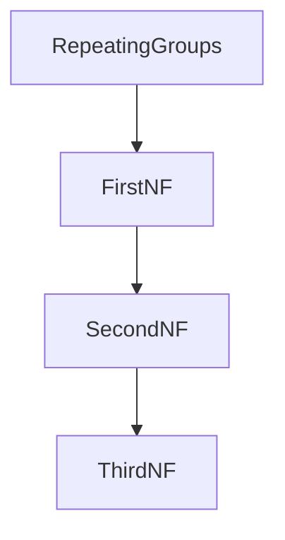

# D07-T006 — Normalization: 1NF, 2NF, 3NF, BCNF

Topic ID: `D07-T006`
Domain: Database Fundamentals
Subdomain: Normalization: 1NF, 2NF, 3NF, BCNF
Importance: core
Complexity: intermediate
Dependencies: `D07-T005`, `D07-T001`, `D01-T001`, `D01-T002`
SQL in section F: unexecuted (illustrative only)

## A. Topic Overview

Normalization decomposes tables to eliminate redundancy and update anomalies through 1NF, 2NF, 3NF, and BCNF.

Prerequisites: `D07-T005`. Next in the database track: `D07-T007`.

## B. First-Principles Explanation

Functional dependencies drive decomposition. Each normal form fixes a specific anomaly class.

## C. Internal Working and Architecture

FDs are declared or discovered from keys. Decomposition must be lossless and dependency-preserving when possible.

## D. Diagrams and Visual Models



Read the diagram as a logical model for this topic; engine details vary by product.

## E. Examples and Analogies

Storing city only by zip in orders creates transitive dependency on zip if zip determines city.

## F. Code Examples

Illustrative SQL (normalization through BCNF). Not executed in this repository.

```sql
-- unexecuted
-- Violation: orders(customer_id, product_a, product_b) repeating products
CREATE TABLE order_lines (
  order_id bigint NOT NULL,
  line_no int NOT NULL,
  product_id bigint NOT NULL,
  qty int NOT NULL CHECK (qty > 0),
  PRIMARY KEY (order_id, line_no)
);
```

Read the statements as teaching examples. Bind parameters in application code; do not concatenate user input into these patterns.

## G. Practical Backend Application

Normalize write paths first; denormalize reads with measured need (`D07-T007`).

## H. Advantages, Limitations and Trade-offs

| Choice | Benefit | Cost | Choose when | Avoid when |
| --- | --- | --- | --- | --- |
| Apply topic pattern | predictable behavior | design time | core domain data | quick hacks |
| Defer topic pattern | faster prototype | incident debt | throwaway demos | money and compliance |

## I. Common Mistakes and Misconceptions

- Skipping 1NF with JSON arrays in columns.
- 3NF confusion with star schema.
- Over-normalizing read-heavy dashboards.
- BCNF overkill for tiny tables.
- No FK after split.

## J. Debugging and Troubleshooting

- Find update anomalies in prod data.
- Check redundant city columns.
- Verify join reconstructs facts.
- Document FDs in ADR.

## K. Interview Preparation

### Beginner

#### Q1. What is the core idea behind normalization through BCNF?

**Answer:** First normal form requires atomic column values without repeating groups. Second normal form removes partial dependencies on part of a composite key. Third normal form removes transitive dependencies on non-key attributes. BCNF requires every determinant to be a candidate key.

#### Q2. Why do backend teams care about normalization through BCNF?

**Answer:** Normalization reduces update anomalies and duplicate facts. Denormalization is a later deliberate trade for read performance. Interviewers want examples of anomalies, not only definitions. OLTP schemas are usually at least 3NF for core entities.

#### Q3. Name one mistake juniors make with normalization through BCNF.

**Answer:** Teams forget that DDL can lock tables during careless migrations. Assuming default isolation is SERIALIZABLE causes surprise anomalies. Application retries must be idempotent when constraints fail. Caching without invalidation creates ghost reads for users.

#### Q4. How does normalization through BCNF show up in production incidents?

**Answer:** Backups are worthless without tested restore procedures. Replication is not sharding; conflating them breaks capacity plans. Incidents show up as 500s, timeouts, or silent wrong balances. Compare primary versus replica lag during read inconsistency tickets.

#### Q5. What should you read in logs when debugging normalization through BCNF?

**Answer:** EXPLAIN output tells you whether the planner chose a seq scan. Check max_connections and pool exhaustion before blaming CPU. Correlate deploy time with migration version and lock waits. Use statement timeouts to fail fast instead of wedging pools.

### Intermediate

#### Q1. How would you explain normalization through BCNF to a product manager?

**Answer:** Product wants features; you translate them into constraints and indexes. Teach stakeholders that data rules live in the database when possible. Show how a constraint prevents an entire class of bugs. Estimate migration downtime using row counts and lock models.

#### Q2. What SQL or schema detail best teaches normalization through BCNF?

**Answer:** Split phone_list column into phone_numbers table for 1NF. Move city_from_zip out of orders if zip determines city (3NF). Foreign keys document relationships for the next engineer. CHECK constraints encode domain rules close to storage.

#### Q3. How does normalization through BCNF interact with connection pooling?

**Answer:** Pools reuse TCP connections and amortize authentication. Pool size times pod count must stay below database max_connections. Long transactions hold connections and block pool recycling. Monitor hikaricp or pgBouncer wait metrics in production.

#### Q4. When does normalization through BCNF block a release?

**Answer:** Backward-incompatible DDL needs expand-contract deploy steps. Blocking migrations should run in maintenance windows or online tools. Feature flags do not rollback applied DDL automatically. Document forward-only migrations with compensating application logic.

#### Q5. What metric proves you solved a normalization through BCNF problem?

**Answer:** Success means p95 query latency within SLO after change. Deadlock rate should not spike after a concurrency change. Replication lag p99 within budget for stale-tolerant reads. Constraint violation rate should be near zero for happy paths.

### Advanced

#### Q1. How does normalization through BCNF differ between PostgreSQL and MySQL?

**Answer:** PostgreSQL uses MVCC; MySQL InnoDB does with different DDL behavior. Isolation semantics differ slightly; read the manual per engine. Never assume Oracle locking on Postgres without testing. Session-level settings can change isolation for one transaction.

#### Q2. How does normalization through BCNF change under replication lag?

**Answer:** Asynchronous replicas apply WAL after commit on primary. Read-your-writes fails if you read a lagging replica too soon. Critical reads after a write should target the primary. Lag-aware routers help dashboards but not payment confirmation.

#### Q3. How does normalization through BCNF relate to MVCC?

**Answer:** MVCC does not remove need for normalized write paths. UPDATE creates new row versions; old versions need vacuum. HOT updates avoid index churn when indexed columns unchanged. Serializable isolation uses SSI or predicate locks depending on engine.

#### Q4. What is a distributed-systems failure mode for normalization through BCNF?

**Answer:** Network partitions can promote a replica while primary still writes. Split brain duplicates primary unless fencing stops old writer. Idempotent consumers heal duplicate messages after failover. Cross-shard transactions need two-phase commit or sagas.

#### Q5. How would you test normalization through BCNF in CI?

**Answer:** Spin up test database in CI and apply migration chain. Run EXPLAIN on golden queries when indexes change. Assert migration checksum and rollback script presence. Concurrency integration tests catch lost updates early.

### Scenarios

#### Q1. On-call: p95 latency doubled after a deploy touching normalization through BCNF. First three steps?

**Answer:** Reports wrong city when zip table stale—check 3NF decomposition. Inspect recent deploy, pool metrics, and slow query log. Capture pg_stat_activity for blocking queries. Roll back application if migration is forward-only broken.

#### Q2. Finance reports wrong totals linked to normalization through BCNF. What do you verify?

**Answer:** Reconcile financial totals against ledger constraints. Halt batch jobs that double-apply partial migrations. Compare row counts before and after backfill scripts. Restore from PITR if DDL corrupted constraints mid-flight.

#### Q3. A migration failed mid-way affecting normalization through BCNF. How do you recover?

**Answer:** Put cluster in read-only, fix schema, replay missed writes. Keep runbook steps in the incident channel for audit. Explain risk of data loss if shortcuts ship without review. Offer phased rollout with measurable rollback triggers.

#### Q4. Team wants to skip normalization through BCNF to ship faster. Your response?

**Answer:** Pair extra QA time with any isolation level change. Send post-write reads to primary until lag under threshold. Stamp session with last_write_lsn for replica routing if available. Invalidate caches on write path before acknowledging client.

#### Q5. Read replica serves stale data involving normalization through BCNF. Mitigation?

**Answer:** Page if replica lag exceeds minutes for user-facing reads. The next topic in domain seven builds on this foundation. API pagination should use indexed columns for stability. Map SQLSTATE or vendor codes to stable HTTP errors.

### Follow-ups

#### Q1. How does normalization through BCNF connect to the next topic in domain 7?

**Answer:** Emit db.client.operation spans with sanitized statements. Dashboard pool usage, deadlocks, replication lag, and bloat. Shard keys should be chosen before volume makes resharding painful. Index-only scans may still hit the heap when the visibility map is stale.

#### Q2. How does normalization through BCNF connect to API design?

**Answer:** Prepared statements conflict with transaction-level pool modes. Logical dumps differ from physical backups in restore time and PITR. Autovacuum tuning must match update-heavy table churn. Partial indexes shrink size when queries always filter status.

#### Q3. How does normalization through BCNF connect to observability?

**Answer:** Covering indexes trade disk for fewer heap lookups on hot reads. SERIALIZABLE workloads need application retry on serialization failures. Retention documentation belongs in privacy policies and ops runbooks. Document expected query shapes beside every new index in code review.


## L. Practical Exercises

Solutions are in `EXERCISES/solutions/D07-T006.md`. Try these before opening that file.

### Exercise 1

Decompose orders with repeating products.

### Exercise 2

Identify 3NF violation in sample schema.

### Exercise 3

Argue when star schema is OK.

## M. Revision Notes

- 1NF atomic.
- 2NF no partial FD.
- 3NF no transitive FD.
- BCNF all determinants are keys.

## N. Related Topics

Understand this before: `D07-T005`.

This topic supports: `D07-T007`.

Often confused with: adjacent domain-7 topics—read section N of neighbors when unsure.

Interviewers combine this with `D05-T021` pooling and `D07-T023` EXPLAIN.

## O. Completion Criteria

- Fix 1NF violation.
- Explain transitive FD.
- When BCNF differs from 3NF.
- Lossless join test.
