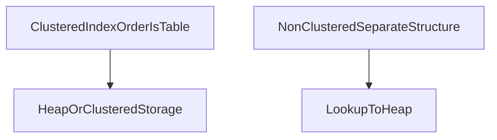

# D07-T020 — Clustered vs non-clustered indexes

Topic ID: `D07-T020`
Domain: Database Fundamentals
Subdomain: Clustered vs non-clustered indexes
Importance: core
Complexity: intermediate
Dependencies: `D07-T019`, `D07-T001`, `D01-T001`, `D01-T002`
SQL in section F: unexecuted (illustrative only)

## A. Topic Overview

Clustered indexes define physical row order; non-clustered indexes are separate structures pointing to rows.

Prerequisites: `D07-T019`. Next in the database track: `D07-T021`.

## B. First-Principles Explanation

SQL Server clustered index is the table order. Postgres uses heap with separate indexes; CLUSTER is one-time rewrite.

## C. Internal Working and Architecture

InnoDB clusters by primary key. Too many secondary indexes increase write amplification.

## D. Diagrams and Visual Models



Read the diagram as a logical model for this topic; engine details vary by product.

## E. Examples and Analogies

Choose clustering key aligned with range scans if engine supports it.

## F. Code Examples

Illustrative SQL (clustered versus non-clustered indexes). Not executed in this repository.

```sql
-- unexecuted
-- SQL Server style (illustrative)
-- CREATE CLUSTERED INDEX cx ON orders(created_at);
-- Postgres: CLUSTER command reorders heap once; PK is logical not clustered by default
```

Read the statements as teaching examples. Bind parameters in application code; do not concatenate user input into these patterns.

## G. Practical Backend Application

Know your engine: interview answers must not confuse Postgres heap with SQL Server clustered.

## H. Advantages, Limitations and Trade-offs

| Choice | Benefit | Cost | Choose when | Avoid when |
| --- | --- | --- | --- | --- |
| Apply topic pattern | predictable behavior | design time | core domain data | quick hacks |
| Defer topic pattern | faster prototype | incident debt | throwaway demos | money and compliance |

## I. Common Mistakes and Misconceptions

- Thinking Postgres PK is clustered like SQL Server.
- CLUSTER in prod without window.
- Random UUID PK clustering.
- Many secondary on wide PK.
- Ignoring fillfactor.

## J. Debugging and Troubleshooting

- Check amname index type.
- Heap vs index read in EXPLAIN.
- Page splits on insert pattern.
- CLUSTER one-off plan.

## K. Interview Preparation

### Beginner

#### Q1. What is the core idea behind clustered versus non-clustered indexes?

**Answer:** A clustered index determines physical storage order on some engines. Non-clustered indexes are separate trees pointing to row locators. PostgreSQL tables are heap-organized with separate indexes. InnoDB stores rows in primary key order.

#### Q2. Why do backend teams care about clustered versus non-clustered indexes?

**Answer:** Production debugging starts with identifying the system of record. Logs and metrics should name the database role: primary or replica. Slow queries often trace to missing indexes or bad join order. Connection storms look like database outages but are client misconfig.

#### Q3. Name one mistake juniors make with clustered versus non-clustered indexes.

**Answer:** Teams forget that DDL can lock tables during careless migrations. Assuming default isolation is SERIALIZABLE causes surprise anomalies. Application retries must be idempotent when constraints fail. Caching without invalidation creates ghost reads for users.

#### Q4. How does clustered versus non-clustered indexes show up in production incidents?

**Answer:** Backups are worthless without tested restore procedures. Replication is not sharding; conflating them breaks capacity plans. Incidents show up as 500s, timeouts, or silent wrong balances. Compare primary versus replica lag during read inconsistency tickets.

#### Q5. What should you read in logs when debugging clustered versus non-clustered indexes?

**Answer:** EXPLAIN output tells you whether the planner chose a seq scan. Check max_connections and pool exhaustion before blaming CPU. Correlate deploy time with migration version and lock waits. Use statement timeouts to fail fast instead of wedging pools.

### Intermediate

#### Q1. How would you explain clustered versus non-clustered indexes to a product manager?

**Answer:** Product wants features; you translate them into constraints and indexes. Teach stakeholders that data rules live in the database when possible. Show how a constraint prevents an entire class of bugs. Estimate migration downtime using row counts and lock models.

#### Q2. What SQL or schema detail best teaches clustered versus non-clustered indexes?

**Answer:** Illustrative SQL in notes is unexecuted but should be valid dialect. Use parameterized queries in real services, not string concatenation. Foreign keys document relationships for the next engineer. CHECK constraints encode domain rules close to storage.

#### Q3. How does clustered versus non-clustered indexes interact with connection pooling?

**Answer:** Pools reuse TCP connections and amortize authentication. Pool size times pod count must stay below database max_connections. Long transactions hold connections and block pool recycling. Monitor hikaricp or pgBouncer wait metrics in production.

#### Q4. When does clustered versus non-clustered indexes block a release?

**Answer:** Backward-incompatible DDL needs expand-contract deploy steps. Blocking migrations should run in maintenance windows or online tools. Feature flags do not rollback applied DDL automatically. Document forward-only migrations with compensating application logic.

#### Q5. What metric proves you solved a clustered versus non-clustered indexes problem?

**Answer:** Success means p95 query latency within SLO after change. Deadlock rate should not spike after a concurrency change. Replication lag p99 within budget for stale-tolerant reads. Constraint violation rate should be near zero for happy paths.

### Advanced

#### Q1. How does clustered versus non-clustered indexes differ between PostgreSQL and MySQL?

**Answer:** PostgreSQL uses MVCC; MySQL InnoDB does with different DDL behavior. Isolation semantics differ slightly; read the manual per engine. Never assume Oracle locking on Postgres without testing. Session-level settings can change isolation for one transaction.

#### Q2. How does clustered versus non-clustered indexes change under replication lag?

**Answer:** Asynchronous replicas apply WAL after commit on primary. Read-your-writes fails if you read a lagging replica too soon. Critical reads after a write should target the primary. Lag-aware routers help dashboards but not payment confirmation.

#### Q3. How does clustered versus non-clustered indexes relate to MVCC?

**Answer:** MVCC keeps snapshot versions per transaction id or xmin xmax. UPDATE creates new row versions; old versions need vacuum. HOT updates avoid index churn when indexed columns unchanged. Serializable isolation uses SSI or predicate locks depending on engine.

#### Q4. What is a distributed-systems failure mode for clustered versus non-clustered indexes?

**Answer:** Network partitions can promote a replica while primary still writes. Split brain duplicates primary unless fencing stops old writer. Idempotent consumers heal duplicate messages after failover. Cross-shard transactions need two-phase commit or sagas.

#### Q5. How would you test clustered versus non-clustered indexes in CI?

**Answer:** Spin up test database in CI and apply migration chain. Run EXPLAIN on golden queries when indexes change. Assert migration checksum and rollback script presence. Concurrency integration tests catch lost updates early.

### Scenarios

#### Q1. On-call: p95 latency doubled after a deploy touching clustered versus non-clustered indexes. First three steps?

**Answer:** Load test with pool size matching production per instance. Inspect recent deploy, pool metrics, and slow query log. Capture pg_stat_activity for blocking queries. Roll back application if migration is forward-only broken.

#### Q2. Finance reports wrong totals linked to clustered versus non-clustered indexes. What do you verify?

**Answer:** Reconcile financial totals against ledger constraints. Halt batch jobs that double-apply partial migrations. Compare row counts before and after backfill scripts. Restore from PITR if DDL corrupted constraints mid-flight.

#### Q3. A migration failed mid-way affecting clustered versus non-clustered indexes. How do you recover?

**Answer:** Put cluster in read-only, fix schema, replay missed writes. Keep runbook steps in the incident channel for audit. Explain risk of data loss if shortcuts ship without review. Offer phased rollout with measurable rollback triggers.

#### Q4. Team wants to skip clustered versus non-clustered indexes to ship faster. Your response?

**Answer:** Pair extra QA time with any isolation level change. Send post-write reads to primary until lag under threshold. Stamp session with last_write_lsn for replica routing if available. Invalidate caches on write path before acknowledging client.

#### Q5. Read replica serves stale data involving clustered versus non-clustered indexes. Mitigation?

**Answer:** Page if replica lag exceeds minutes for user-facing reads. The next topic in domain seven builds on this foundation. API pagination should use indexed columns for stability. Map SQLSTATE or vendor codes to stable HTTP errors.

### Follow-ups

#### Q1. How does clustered versus non-clustered indexes connect to the next topic in domain 7?

**Answer:** Emit db.client.operation spans with sanitized statements. Dashboard pool usage, deadlocks, replication lag, and bloat. Shard keys should be chosen before volume makes resharding painful. Index-only scans may still hit the heap when the visibility map is stale.

#### Q2. How does clustered versus non-clustered indexes connect to API design?

**Answer:** Prepared statements conflict with transaction-level pool modes. Logical dumps differ from physical backups in restore time and PITR. Autovacuum tuning must match update-heavy table churn. Partial indexes shrink size when queries always filter status.

#### Q3. How does clustered versus non-clustered indexes connect to observability?

**Answer:** Covering indexes trade disk for fewer heap lookups on hot reads. SERIALIZABLE workloads need application retry on serialization failures. Retention documentation belongs in privacy policies and ops runbooks. Document expected query shapes beside every new index in code review.


## L. Practical Exercises

Solutions are in `EXERCISES/solutions/D07-T020.md`. Try these before opening that file.

### Exercise 1

Document engine clustering model.

### Exercise 2

Mitigate UUID PK fragmentation.

### Exercise 3

When CLUSTER helps.

## M. Revision Notes

- Engine-specific clustering.
- Postgres heap default.
- InnoDB PK clustered.
- CLUSTER not continuous.

## N. Related Topics

Understand this before: `D07-T019`.

This topic supports: `D07-T021`.

Often confused with: adjacent domain-7 topics—read section N of neighbors when unsure.

Interviewers combine this with `D05-T021` pooling and `D07-T023` EXPLAIN.

## O. Completion Criteria

- Compare Postgres vs SQL Server.
- Pick clustering key.
- UUID insert penalty.
- Explain lookup.
