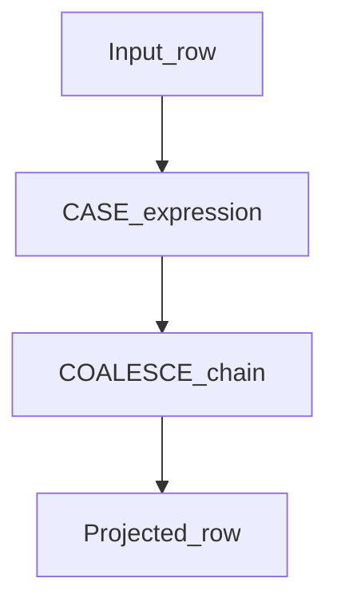

# D08-T008 — CASE, COALESCE, NULLIF

Topic ID: `D08-T008`
Domain: SQL — Advanced Topics
Subdomain: CASE, COALESCE, NULLIF
Importance: common
Complexity: advanced
Dependencies: `D08-T007`, `D08-T001`, `D07-T001`, `D07-T002`
Execution status of the code in section F: not executed (illustrative PostgreSQL-style SQL)

## A. Topic Overview

`CASE`, `COALESCE`, and `NULLIF` shape values and handle missing data in projections. They keep transformations declarative instead of scattered in application code. They interact with three-valued logic when conditions involve NULL.

## B. First-Principles Explanation

CASE is structured if/else; COALESCE returns first non-NULL; NULLIF maps equal values to NULL.

## C. Internal Working and Architecture

Evaluated per row during projection; short-circuit rules are dialect-specific for CASE.

## D. Diagrams and Visual Models

The diagram below summarizes the main flow for this topic.




## E. Examples and Analogies

COALESCE is a fallback chain like trying backup phone numbers until one answers.

## F. Code Examples

Dialect: PostgreSQL 15+ style (adjust identifiers for your engine).

Status: **not executed** — illustrative only.
```sql
SELECT id,
       COALESCE(nickname, legal_name, 'unknown') AS display_name,
       CASE status
         WHEN 'paid' THEN total_cents
         WHEN 'refunded' THEN -total_cents
         ELSE 0
       END AS signed_total
FROM orders;
```

## G. Practical Backend Application

Map enums to API labels in SQL views for stable contracts.

## H. Advantages, Limitations and Trade-offs

| App mapping | SQL CASE |
| Unit tests in language | Single query truth |

## I. Common Mistakes and Misconceptions

- `COALESCE` hiding missing required fields.
- CASE without ELSE returning NULL unexpectedly.

## J. Debugging and Troubleshooting

Print intermediate columns in SELECT to see which branch fired.

## K. Interview Preparation

### Beginner

#### Q1. What is CASE, COALESCE, and NULLIF in SQL?

**Answer:** CASE, COALESCE, and NULLIF is a language feature that lets you normalize values in queries without pulling intermediate results into application memory. Relational engines evaluate it as part of a single query plan, which means the optimizer can reorder work, push predicates, and choose join algorithms. In backend services you still express business rules in SQL or in an ORM translation, but the database remains the place where large datasets are filtered and combined. Interviewers ask this to see whether you treat SQL as a thin CRUD layer or as a data-processing tool.

#### Q2. When would you use CASE, COALESCE, and NULLIF instead of application code?

**Answer:** Use CASE, COALESCE, and NULLIF when the working set is already in the database and network round trips dominate. Shipping thousands of rows to a service only to filter or aggregate them wastes CPU and bandwidth. Keeping the logic in SQL also preserves transactional consistency: you see one snapshot of data for the whole statement. The trade-off is readability and testability in the app repo, which is why teams document complex SQL and cover it with integration tests.

#### Q3. How does this relate to indexes?

**Answer:** Indexes change how the engine finds rows, not the meaning of your query. For CASE, COALESCE, and NULLIF, the planner still needs selective predicates or join keys that match index leading columns. A beautiful query that scans an entire fact table will fail in production regardless of syntax sophistication. When you design a feature around advanced SQL, co-design the supporting indexes and verify plans with `EXPLAIN (ANALYZE, BUFFERS)`.

#### Q4. What is the difference between INNER and OUTER joins?

**Answer:** INNER JOIN keeps only row pairs that satisfy the join predicate on both sides. LEFT OUTER JOIN keeps every row from the left table and fills missing right-side columns with NULL. That distinction matters for reporting: an INNER JOIN silently drops customers with zero orders, while a LEFT JOIN exposes them with NULL order fields. Choosing the wrong join type is one of the most common sources of 'missing data' bugs in analytics APIs.

#### Q5. Why do interviewers care about SQL in backend roles?

**Answer:** Most production systems still use a relational database for authoritative state. ORMs hide SQL until latency or correctness breaks, and seniors are expected to read execution plans. Topics like CASE, COALESCE, and NULLIF separate candidates who can debug data issues from those who only wire REST endpoints. You are not expected to memorize every dialect edge case, but you must know how to reason about correctness, NULLs, and performance.

### Intermediate

#### Q1. How would you test a query that uses CASE, COALESCE, and NULLIF?

**Answer:** Start with fixture tables that include empty sets, duplicates, and NULL foreign keys. Assert row counts and spot-check aggregates against hand-calculated expectations. Run the statement inside a transaction in CI against a real engine, because SQLite and PostgreSQL differ on edge cases. Capture `EXPLAIN` output for the happy path so plan regressions show up when statistics drift.

#### Q2. What portability issues appear with CASE, COALESCE, and NULLIF?

**Answer:** PostgreSQL, MySQL, and SQL Server extend standard SQL with different keywords and function names. Upsert syntax, locking hints, and JSON operators are the usual portability cliffs. Microservices on one engine can still leak dialect if read replicas or analytics warehouses differ. Document the target engine in migrations and add contract tests when you must support more than one.

#### Q3. How do NULLs interact with joins and filters?

**Answer:** SQL uses three-valued logic: predicates can be TRUE, FALSE, or UNKNOWN. Comparing anything to NULL with `=` yields UNKNOWN, so those rows drop out of `WHERE` but still appear in OUTER joins unless you handle them. `IS DISTINCT FROM` and explicit `IS NULL` checks make intent obvious. Reports that use `COUNT(*)` versus `COUNT(column)` diverge when the column is nullable.

#### Q4. When is a subquery rewritten into a join?

**Answer:** Optimizers often decorrelate correlated subqueries into semi-joins or anti-joins. Whether that happens depends on cost estimates, statistics, and version-specific rules. You should not rely on a subquery staying nested; write the clearest form and verify the plan. Sometimes a manual rewrite to `EXISTS` or a CTE is both clearer and faster.

#### Q5. How does connection pooling affect long SQL statements?

**Answer:** Poolers multiplex many clients onto fewer server connections. A statement that holds a connection while scanning terabytes blocks other work on that connection. Transactions that stay open across awaits in application code pin connections and cause pool exhaustion. Keep transactions short, stream large results with cursors if needed, and set statement timeouts.

### Advanced

#### Q1. How can CASE, COALESCE, and NULLIF cause a performance cliff?

**Answer:** Cardinality estimates that are off by orders of magnitude make the planner pick nested loops over hash joins or vice versa. Correlated execution can devolve into per-row subquery evaluation if decorrelation fails. Wide result sets defeat covering indexes and force heap fetches. Mitigate with fresh statistics, targeted indexes, predicate pushdown, and breaking work into stages with temp tables when appropriate.

#### Q2. Explain MVCC interaction with locking reads.

**Answer:** Under MVCC, readers do not block writers on row versions, but `SELECT FOR UPDATE` takes row-level locks on current tuples. A locking read establishes what you are allowed to update before you mutate. If two transactions lock rows in opposite order, you can still deadlock. Design lock order consistently and use short transactions.

#### Q3. How do you version breaking SQL changes?

**Answer:** Ship additive schema first: new columns, backfill jobs, dual-write periods. Deploy query changes behind feature flags only when semantics are backward compatible. For renames, use views as compatibility shims until all callers migrate. Measure query latency and error rates per release; roll back the app if the database change is irreversible.

#### Q4. What is the difference between logical and physical query plans?

**Answer:** The logical plan is relational algebra: joins, filters, projections. The physical plan chooses algorithms: index scan, bitmap heap scan, hash aggregate. `EXPLAIN` shows the physical plan the executor will run. Advanced SQL authors read both the shape (many nested loops) and the actual timings from `EXPLAIN ANALYZE`.

#### Q5. How would you secure dynamic SQL built from user filters?

**Answer:** Never concatenate user strings into SQL text. Use parameterized queries for values and allow-list column names for dynamic sort or filter fields. ORM query builders still need review when they expose raw fragments. Log query templates with parameters redacted, and cap sortable fields to indexed columns to avoid sort explosions.

### Scenarios

#### Q1. An API returns duplicate parent rows after you added a join. What happened?

**Answer:** You likely used an INNER JOIN to a one-to-many child table without aggregating or deduplicating. Each parent repeats once per child row, which breaks pagination counts in the API. Fix with a subquery or CTE that aggregates children first, or use `DISTINCT ON` / window `ROW_NUMBER` when appropriate. Add an integration test that asserts one DTO per parent id.

#### Q2. A nightly job suddenly times out after data doubled. First steps?

**Answer:** Confirm whether the timeout is statement, lock wait, or pool wait. Capture `EXPLAIN (ANALYZE, BUFFERS)` for the failing statement on production-like data. Check for missing indexes on new join keys introduced by a feature flag. Consider partitioning or incremental processing instead of one monolithic scan.

#### Q3. Two services upsert the same natural key concurrently. How do you avoid lost updates?

**Answer:** Use a single `INSERT ... ON CONFLICT` or equivalent with a clear conflict target. Define which columns are immutable versus mergeable on conflict. Serialize critical sections with row locks or advisory locks when business rules require read-modify-write. Emit metrics on conflict rate so you detect hot keys before they become incidents.

#### Q4. Read replica lag makes a dashboard show stale ranks. Options?

**Answer:** Route interactive analytics to the primary or a delayed-tolerance cache. Materialize rankings on a schedule into a table refreshed by the job. Expose 'as of' timestamps in the API so users understand staleness. Do not assume read-your-writes on replicas unless the driver pins sessions.

#### Q5. JSON attributes power search but CPU is high. What do you change?

**Answer:** Move hot filter fields into typed columns with indexes. Use JSONB with GIN indexes on specific paths instead of parsing text JSON. Avoid `->>` without functional indexes when predicates run on every request. Validate document shape at write time so queries do not branch on missing keys.

### Follow-ups

#### Q1. How does this connect to ORM N+1 issues?

**Answer:** ORMs lazy-load associations with one query per parent row unless you eager fetch or join. Advanced SQL such as CASE, COALESCE, and NULLIF is often the fix: one query with joins or batch `IN` loads. See `D08-T021` for the application-side diagnosis patterns. The best teams measure SQL statement count per HTTP request.

#### Q2. When should logic live in a stored procedure?

**Answer:** When multiple clients must share identical rules and round trips dominate. When you need atomic multi-step workflows close to data. Avoid when release cadence of app and database cannot move together. See `D08-T016` for triggers versus application services.

#### Q3. What PostgreSQL topics deepen this further?

**Answer:** MVCC, WAL, vacuum, and planner statistics change how the same SQL behaves over time. Domain `D09` covers internals that explain bloat, index-only scans failing, and replication lag. Interviewers at database-heavy companies bridge advanced SQL questions into those internals. Read `EXPLAIN` output alongside wait events when tuning.

## L. Practical Exercises

Solutions are in `EXERCISES/solutions/D08-T008.md`. Try these before opening that file.

### Exercise 1 — display name fallback chain.

### Exercise 2 — NULLIF to avoid divide-by-zero.

### Exercise 3 — CASE vs lookup table trade-off.

## M. Revision Notes

- COALESCE first non-NULL.
- NULLIF to NULL on match.
- CASE for branching.

## N. Related Topics

Leads to NULL semantics `D08-T009`.

## O. Completion Criteria

- Write safe divide with NULLIF.
- Use CASE for signed amounts.
