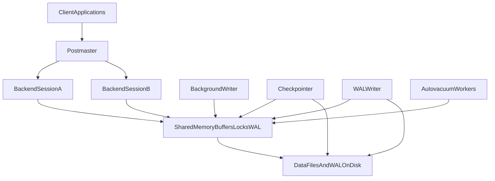

# D09-T001 — PostgreSQL architecture

Topic ID: `D09-T001`
Domain: PostgreSQL Internals
Subdomain: PostgreSQL architecture
Importance: advanced
Complexity: advanced
Dependencies: `D07-T001`, `D07-T002`, `D08-T001`, `D08-T002`
Execution status of the code in section F: reference SQL (verify on your PostgreSQL version)

## A. Topic Overview

PostgreSQL is a multi-process database server. A supervising **postmaster** listens for connections, forks or allocates **backend** processes for clients, and manages auxiliary workers for checkpointing, WAL persistence, buffer eviction, and vacuum.

The architecture exists because isolating work in processes keeps a bug or stuck query from tearing down the entire server, and because the operating system scheduler can reason about CPU and memory per backend. Shared state lives in **shared memory** (buffer pool, lock tables, WAL buffers) while SQL execution state stays mostly private to each backend.

In production you see this when tuning `max_connections`, diagnosing which process is waiting on I/O, or explaining why connection storms hurt memory. Interviewers use architecture to anchor MVCC, WAL, vacuum, and poolers in something concrete instead of abstract SQL.

Prerequisites: relational basics (`D07-T001`, `D07-T002`) and general database storage concepts (`D08-T001`, `D08-T002`). Later PostgreSQL topics assume you know which process owns checkpoints versus client queries.

## B. First-Principles Explanation

A database server must accept many clients, keep data durable on disk, and serve reads from memory when possible. PostgreSQL splits those jobs across processes coordinated through shared memory and signals.

When a client connects, the postmaster accepts the TCP session and starts a new backend process (unless an external pooler multiplexes clients). That backend parses SQL, plans it, executes it, and returns rows. Meanwhile other processes flush dirty buffers, write WAL, and advance checkpoints without blocking every client in one giant lock.

Shared memory holds the **buffer cache** copy of data pages, so backends read and modify the same pages safely using lightweight locks and MVCC rules (`D09-T002`). WAL records go to shared WAL buffers before the **WAL writer** persists them (`D09-T003`).

PostgreSQL chose processes for portability and fault isolation. A runaway backend can often be terminated with `pg_terminate_backend` while siblings continue. The trade-off is higher per-connection overhead than some threaded designs, which motivates connection poolers (`D09-T015`).

## C. Internal Working and Architecture

Major components:

- **Postmaster**: parent process; listens on ports; forks backends; does not run user SQL.
- **Backend processes**: one per active server session (unless pooling multiplexes).
- **Background writer**: writes dirty shared buffers ahead of demand.
- **Checkpointer**: checkpoint records and dirty-page flush at checkpoint time (`D09-T004`).
- **WAL writer**: flushes WAL buffers to WAL segment files.
- **Autovacuum launcher** and **workers**: schedule vacuum/analyze (`D09-T005`).
- Optional: logical replication workers, parallel query workers, WAL **archiver**.

Read path: backend → planner (`D09-T009`) → buffer manager → visibility (`D09-T002`) → client.

Connection state is per backend (GUC settings, prepared statements, temp tables). User data pages are global in shared buffers. `shared_buffers` is cluster-wide; each backend also uses private memory such as **work_mem** for sorts and hashes.

## D. Diagrams and Visual Models



Clients never touch data files directly; backends mutate shared buffers under WAL and MVCC rules; auxiliary processes persist and recycle storage.

## E. Examples and Analogies

Analogy: the postmaster is a hotel front desk assigning a concierge (backend) per guest. Housekeeping (vacuum), night audit (checkpoint), and the security log (WAL) are separate staff sharing the building (shared memory).

During a deploy, `pg_stat_activity` may show hundreds of backends `idle in transaction`. Each idle session still consumes a process and memory even when not running queries.

Do not assume the postmaster runs SQL. Do not set `max_connections` to thousands without memory modeling and a pooler. Do not confuse **background writer** with **checkpointer**.

## F. Code Examples

File: `examples/d09_t001_architecture.sql`

```sql
SELECT pid, backend_type, state, wait_event_type, wait_event
FROM pg_stat_activity
WHERE backend_type IS NOT NULL
ORDER BY backend_type, pid;

SHOW max_connections;
SHOW shared_buffers;
```

Run with `psql -f` from `EXERCISES/examples/`. Output depends on your version and configuration.

## G. Practical Backend Application

Microservices often open a connection per request unless pooled. Architecture explains why traffic spikes become **process** spikes. Use `pg_stat_activity` in runbooks: slow queries, checkpointer waits, missing autovacuum workers.

`too many clients` is a capacity signal. Export metrics by `state` and `wait_event_type`. Scale reads with replicas (`D09-T013`) rather than unbounded connections to one primary.

## H. Advantages, Limitations and Trade-offs

| Choice | Benefit | Cost | Choose when | Avoid when |
| --- | --- | --- | --- | --- |
| Process per connection | Isolation | RAM per backend | Moderate connections | Thousands of chatty clients without pooler |
| High shared_buffers | Cache hits | Eviction, recovery time | Warm read workloads | Tiny RAM VMs |
| No pooler | Full session features | Connection storms | Migrations, admin | Serverless-style concurrency |

## I. Common Mistakes and Misconceptions

- Assuming one thread per client (regular backends are processes).
- Killing the postmaster casually (stops the cluster).
- Copying `shared_buffers` rules of thumb without measuring OS cache pressure.
- Ignoring session-bound temp tables and prepared statements with poolers (`D09-T015`).

## J. Debugging and Troubleshooting

Symptoms: `too many clients`, memory climb with idle sessions, postmaster restarts.

1. `SELECT count(*), state FROM pg_stat_activity GROUP BY 1;`
2. Compare app pool size × instances to `max_connections` (reserved slots vary by version).
3. Map `pid` to OS CPU with `top`.
4. Inspect `wait_event` for I/O or LWLock contention.

Mitigate: shrink pools, terminate `idle in transaction`, add PgBouncer, fix connection leaks.

## K. Interview Preparation

### Beginner

#### Q1. What is the postmaster in PostgreSQL?

**Answer:** The postmaster is the root server process that listens for inbound connections and starts backend processes to handle them. It supervises auxiliary processes such as the checkpointer, background writer, WAL writer, and autovacuum launcher. If the postmaster exits, the entire database instance stops. Interviewers expect you to separate the postmaster from client backends because only backends execute session SQL.

#### Q2. What does a backend process do?

**Answer:** A backend serves one client connection from login until disconnect. It parses SQL, invokes the planner and executor, reads and modifies shared buffer pages under MVCC rules, and returns results. Session-local state such as temporary tables and prepared statements live with that backend. When the client disconnects, the backend process ends, so idle connections still consume a slot.

#### Q3. What is stored in shared memory?

**Answer:** Shared memory holds the buffer pool, lock manager state, WAL buffers, and global caches. All backends access these structures concurrently using lightweight locks. Shared buffers let one backend reuse pages another cached. Private sort/hash memory is per backend according to settings like `work_mem`.

#### Q4. Name two auxiliary processes besides client backends.

**Answer:** The checkpointer establishes recovery checkpoints and flushes dirty pages at checkpoint boundaries. The WAL writer flushes WAL from shared buffers to segment files. Other auxiliaries include the background writer, autovacuum launcher/workers, and optional archiver or logical replication workers. Name plus responsibility shows you understand maintenance outside user queries.

#### Q5. Why does PostgreSQL use processes instead of only threads?

**Answer:** Process isolation limits blast radius: a stuck backend can often be terminated without ending every session. The model maps cleanly to Unix APIs and historically improved portability. Each connection maps to identifiable OS resources for observability. The cost is higher per-connection overhead, motivating external poolers.

### Intermediate

#### Q1. How does a SELECT interact with the buffer cache?

**Answer:** The executor requests pages through the buffer manager. On a hit, PostgreSQL reads from shared memory without disk I/O; on a miss, it reads into a victim frame. Visibility checks happen in memory using snapshots. Repeated scans benefit from pages warmed by other backends.

#### Q2. What is the relationship between backends and max_connections?

**Answer:** `max_connections` caps client backends plus reserved superuser slots in typical setups. Each active session consumes one slot unless a pooler multiplexes clients. Raising the limit increases worst-case private memory. Confirm defaults and reserved behavior on your version rather than assuming.

#### Q3. What do the background writer and checkpointer both do, and how do they differ?

**Answer:** Both can write dirty shared buffers to table files. The background writer trickles writes to smooth I/O. The checkpointer runs at checkpoint events, flushes a consistent set, and writes checkpoint records that bound recovery. Mis-tuning confuses steady bgwriter I/O with checkpoint spikes.

#### Q4. Where does autovacuum fit architecturally?

**Answer:** The autovacuum launcher schedules workers based on statistics and policy. Workers run maintenance such as VACUUM and ANALYZE and compete for I/O like other backends. Without workers, dead tuples and stale stats accumulate. Architecture places vacuum beside backends, not inside the postmaster.

#### Q5. How would you prove which process is consuming CPU?

**Answer:** Join `pg_stat_activity.pid` to OS `top` or `ps`. Filter by `state` and query text to separate active SQL from idle sessions. Auxiliary processes show distinct `backend_type` values. Managed services may restrict OS access, making wait events primary.

### Advanced

#### Q1. Explain how parallel query workers relate to the session backend.

**Answer:** The leader backend spawns workers for parallel plan fragments. Workers use dynamic shared memory and belong to the issuing query. They consume CPU while running and appear in activity views. Caps such as `max_parallel_workers_per_gather` prevent one query from starving the host.

#### Q2. What happens when the postmaster receives SIGTERM?

**Answer:** PostgreSQL initiates controlled shutdown: backends finish, checkpoints run, shared memory is released. Immediate modes risk longer recovery if checkpoint cannot complete. Applications see connection errors and must reconnect. Use `pg_ctl` or service managers rather than `kill -9` on the postmaster.

#### Q3. Why can idle in transaction sessions hurt the cluster?

**Answer:** They hold backend slots near `max_connections`. They pin snapshots and can block vacuum and DDL. Connection pools that leak open transactions are a common cause in `pg_stat_activity`. Ending transactions is often the real fix.

#### Q4. How does shared_buffers interact with the OS page cache?

**Answer:** PostgreSQL maintains its own buffer pool while the OS also caches files. Double caching can waste RAM on some workloads. Modest `shared_buffers` with OS cache can still perform well. Measure hit ratios and total memory pressure instead of copying one tuning myth.

#### Q5. What architectural constraint motivates connection poolers?

**Answer:** One backend per client does not scale to tens of thousands of short connections. Each backend carries parsing state and potential sort memory. Poolers multiplex clients onto fewer server sessions. Transaction pooling trades some session semantics for density (`D09-T015`).

### Scenarios

#### Q1. After deploy, 500 mostly idle backends—what do you check first?

**Answer:** Compare application instance count times pool max to `max_connections` and actual activity counts. Idle backends still consume processes and memory. Microservice scale-out multiplies pools without a central pooler. Mitigate with smaller pools, PgBouncer, or justified limit increases after memory modeling.

#### Q2. Disk at 100% but queries look idle—who writes?

**Answer:** Checkpointer and background writer flush dirty buffers. WAL writer persists WAL; autovacuum rewrites pages. Archiver copies WAL if enabled. Use `pg_stat_bgwriter`, checkpoint logs, and `pg_stat_progress_vacuum` to attribute I/O.

#### Q3. VPN disconnect during migration—what breaks?

**Answer:** Disconnect ends the backend unless the job runs on a stable bastion session. Partial work rolls back unless designed otherwise. Poolers may reassign sessions and break temp tables and `SET` commands. Run DDL from controlled sessions with timeouts.

#### Q4. One parallel query starves others—planner bug?

**Answer:** Parallelism is chosen when estimated benefit exceeds cost; one gather can consume most CPUs. Others queue at the scheduler and show latency spikes. Throttle parallelism or separate OLAP workloads. Capacity planning beats blaming the planner alone.

#### Q5. Postmaster restarts hourly—what do you inspect?

**Answer:** Frequent restarts suggest OOM, panic, or failing health checks. Check OS logs for SIGKILL, full disks, and shared memory failures. Read PostgreSQL logs for FATAL/panic lines. Children cannot outlive a dead postmaster, so clients see mass disconnects.

### Follow-ups

#### Q1. How does architecture connect to MVCC?

**Answer:** Visibility is evaluated in backend executors reading shared buffers. Old row versions remain in heap pages until vacuum. All backends share buffers, so visibility must be cheap per tuple. See `D09-T002`.

#### Q2. Which process is responsible for WAL durability?

**Answer:** Backends insert WAL into shared buffers during changes. The WAL writer flushes to files; commit waits per `synchronous_commit`. Checkpointer and archiver interact with segments but do not replace WAL persistence. See `D09-T003` and `D09-T004`.

#### Q3. Why mention poolers in an architecture topic?

**Answer:** Poolers change the one-client-one-backend picture. They sit between apps and the postmaster with fewer server sessions. Session features depend on pooling mode. See `D09-T015`.

## L. Practical Exercises

Solutions are in `EXERCISES/solutions/D09-T001.md`. Try these before opening that file.

### Exercise 1 — implementation

Map `pg_stat_activity.backend_type` rows to roles in section D.

### Exercise 2 — debugging

Diagnose `too many clients already` using connection math and pools.

### Exercise 3 — trade-off

Compare raising `max_connections` versus PgBouncer for a read API.

## M. Revision Notes

- Postmaster supervises; backends run client SQL.
- Shared memory holds buffers, locks, and WAL buffers.
- Checkpointer, background writer, WAL writer, autovacuum are aux processes.
- One client connection maps to one backend before poolers.
- Idle sessions still consume backends.

## N. Related Topics

Understand this before: `D07-T001`, `D07-T002`, `D08-T001`.

This topic supports: `D09-T002` MVCC, `D09-T003` WAL, `D09-T015` poolers.

Often confused with: threaded engines and app-side pools only.

## O. Completion Criteria

- Draw postmaster, backends, shared memory, and three aux processes.
- Explain why idle sessions still consume backends.
- Use `pg_stat_activity` to attribute CPU or waits to a PID.
- Relate `max_connections` to app pool sizing.
- Describe one failure mode of connection storms.
