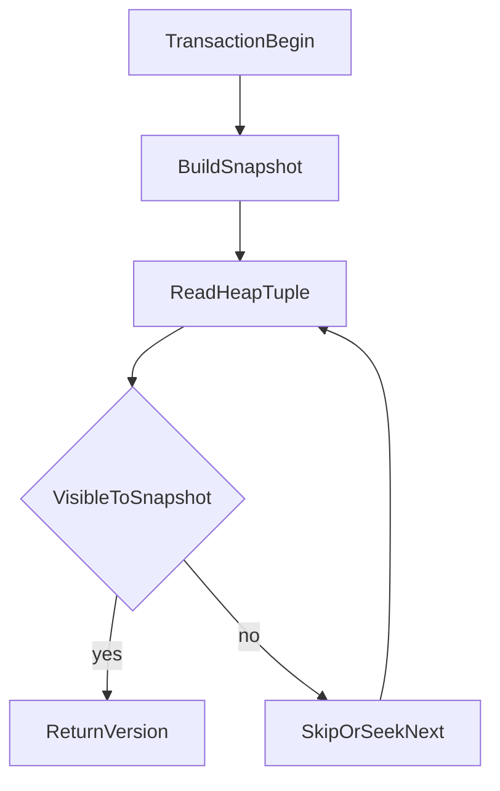

# D09-T002 — MVCC and tuple visibility

Topic ID: `D09-T002`
Domain: PostgreSQL Internals
Subdomain: MVCC and tuple visibility
Importance: advanced
Complexity: advanced
Dependencies: `D09-T001`, `D07-T001`, `D07-T002`, `D08-T001`, `D08-T002`
Execution status of the code in section F: reference SQL (verify on your PostgreSQL version)

## A. Topic Overview

Multi-Version Concurrency Control (MVCC) lets PostgreSQL readers and writers overlap without readers blocking writers on row locks for ordinary `SELECT`. Each row version is a heap tuple tagged with inserting and deleting transaction ids (`xmin`, `xmax`) plus hint bits for visibility. Snapshots taken at statement or transaction start decide which versions a session may see. Interviewers probe MVCC before WAL, vacuum, and isolation because it explains bloat, anomalies, and why `UPDATE` creates new row versions.

## B. First-Principles Explanation

If every reader locked rows writers need, OLTP throughput would collapse. PostgreSQL keeps old versions until vacuum reclaims them; `UPDATE` inserts new versions and `DELETE` marks old ones dead. A snapshot lists visible transaction ids and bounds; the executor tests each tuple against it. Readers do not overwrite committed user rows in place; writers create new tuples and may chain via `ctid`.

## C. Internal Working and Architecture

Heap tuples store `xmin` (creator xid) and `xmax` (deleter/updater xid when set). Hint bits cache commit status to reduce clog lookups. Snapshots come from procarray machinery; isolation level controls when snapshots are taken (`REPEATABLE READ` holds one snapshot for the transaction). Subtransactions use `cmin`/`cmax` for in-transaction visibility. Transaction id wraparound is a cluster risk if vacuum cannot freeze old horizons (`D09-T005`).

## D. Diagrams and Visual Models



## E. Examples and Analogies

Edits append new spreadsheet rows with timestamps; readers pick rows their timestamp allows. `UPDATE` sets `xmax` on the old version while a new tuple holds the new values. `DELETE` does not instantly free disk bytes. MVCC does not remove the need for row locks on conflicting writes.

## F. Code Examples

File: `examples/d09_t002_mvcc.sql`

```sql
SELECT ctid, xmin, xmax, relname FROM pg_class WHERE relname = 'pg_class' LIMIT 3;
BEGIN;
SELECT txid_current();
ROLLBACK;
```

## G. Practical Backend Application

Long open transactions delay vacuum and cause bloat—common with ORMs and `idle in transaction`. Standbys evaluate visibility on replayed pages for hot standby queries. Pair `pg_stat_activity.xmin` with `n_dead_tup` when vacuum lags. Serializable isolation adds SSI on top of MVCC (`D09-T011`).

## H. Advantages, Limitations and Trade-offs

| Choice | Benefit | Cost | Choose when | Avoid when |
| --- | --- | --- | --- | --- |
| MVCC reads | Readers rarely block writers | Dead tuple storage | Mixed OLTP | Heavy updates without vacuum |
| RR snapshot | Consistent txn reads | Longer horizons if txn open | Reporting txn | Chatty long transactions |
| Row locks on write | Prevents lost updates | Waits/deadlocks | Concurrent updates | Unbounded hot-row updates |

## I. Common Mistakes and Misconceptions

- “MVCC means no locks.”
- “DELETE frees disk immediately.”
- Ignoring xmin horizon from idle transactions.
- Assuming `READ COMMITTED` and `REPEATABLE READ` match other databases’ behavior without reading PostgreSQL docs.

## J. Debugging and Troubleshooting

Growing table size with stable live rows: check `n_dead_tup`, `last_autovacuum`, and `idle in transaction`. End long transactions, tune autovacuum, then vacuum manually if needed.

## K. Interview Preparation

### Beginner

#### Q1. What problem does MVCC solve?

**Answer:** It allows concurrent reads while writes proceed by keeping multiple row versions. Readers use snapshots instead of locking every row they read. Writers create new versions rather than overwriting visible data in place. This increases throughput for typical OLTP mixed workloads.

#### Q2. What are xmin and xmax on a heap tuple?

**Answer:** xmin records which transaction inserted the row version. xmax records which transaction deleted or updated it out of visibility, when set. Visibility routines compare them to the active snapshot. Hint bits cache whether xmin/xmax transactions committed or aborted.

#### Q3. What is a snapshot?

**Answer:** A snapshot captures which transactions are visible to a statement or transaction. It includes xmin/xmax bounds and in-progress xid sets as of snapshot build time. Executors ask whether a tuple is visible to that snapshot. Different isolation levels take snapshots at different times.

#### Q4. Does SELECT take row locks in PostgreSQL?

**Answer:** A plain SELECT does not take row-exclusive locks for read consistency under MVCC. It reads tuple versions visible to its snapshot. Writers still lock rows they modify. SELECT FOR UPDATE explicitly locks rows for later update.

#### Q5. What happens on UPDATE?

**Answer:** PostgreSQL writes a new row version and marks the old version dead with xmax. Indexes may need new entries unless HOT applies (`D09-T006`). Until vacuum runs, both versions occupy space. Concurrent readers in older snapshots may still see the old version.

### Intermediate

#### Q1. How does READ COMMITTED differ from REPEATABLE READ for snapshots?

**Answer:** READ COMMITTED takes a new snapshot for each statement in PostgreSQL. REPEATABLE READ holds the first snapshot for the whole transaction. That changes whether a second SELECT in the same txn can see commits from others. Neither eliminates write conflicts on updates.

#### Q2. What are hint bits?

**Answer:** They are status flags on tuples caching commit knowledge for xmin/xmax. They reduce repeated access to the commit log once known. They can be set when visibility is first determined. They must be treated as hints; visibility still follows snapshot rules.

#### Q3. Why can long transactions cause bloat?

**Answer:** Vacuum cannot remove dead tuples still visible to any open snapshot horizon. An idle in transaction session pins xmin and blocks freezing old pages. Dead tuples accumulate even if current queries need few rows. Ending long transactions is often the real fix, not only autovacuum tuning.

#### Q4. What is ctid?

**Answer:** ctid is the physical tuple identifier (block, offset) of a row version. It can change when a row is rewritten by VACUUM FULL or CLUSTER. Applications should not use ctid as a stable primary key. It helps explain chains of row versions on updates.

#### Q5. How does DELETE interact with MVCC?

**Answer:** DELETE sets xmax on visible versions rather than erasing bytes immediately. Space becomes reusable on that page after vacuum. Concurrent snapshots may still see the row until their snapshot predates the delete commit. Foreign keys and triggers still run under normal locking rules.

### Advanced

#### Q1. What is transaction id wraparound?

**Answer:** Transaction ids are 32-bit and eventually exhaust if not frozen. Vacuum (freeze) marks old tuples as frozen so xmin horizons advance safely. If autovacuum cannot keep up, the cluster may refuse new transactions to protect data integrity. Monitoring age of oldest xmin and emergency autovacuum settings is an operational duty.

#### Q2. How do subtransactions affect visibility?

**Answer:** cmin and cmax track command ids within a transaction for tuple visibility among statements in the same txn. Savepoints create subtransactions with their own ids. Visibility must handle whether a tuple inserted earlier in the same txn is visible to later commands. This explains odd self-visibility edge cases in advanced debugging.

#### Q3. Does MVCC apply on replicas?

**Answer:** Standbys replay WAL and have their own snapshots for queries on hot standbys when enabled. Visibility is evaluated on the standby's data pages like on the primary. Replication lag means snapshots may see older global state relative to primary commits. Hot standby conflicts can cancel queries in documented edge cases.

#### Q4. How does SERIALIZABLE differ from MVCC alone?

**Answer:** Serializable Snapshot Isolation adds predicate locking and serialization failures. MVCC still stores versions; SSI detects rw-dependencies that could break serializability. Applications may see `serialization_failure` and must retry. It is stricter than REPEATABLE READ for certain anomaly classes.

#### Q5. Why can COUNT(*) be expensive under MVCC?

**Answer:** Each version must be checked for visibility per snapshot. Large tables with many dead tuples slow scans even if live rows are few. Vacuum reduces dead tuples; partial indexes do not remove visibility work on the heap. Approximate counts or maintained counters are common patterns at scale.

### Scenarios

#### Q1. Dashboard COUNT grows but business rows stable—MVCC angle?

**Answer:** Likely dead tuples from updates without adequate vacuum or a blocked horizon. Check `n_dead_tup` and `last_autovacuum`. Find long transactions holding snapshots. Fix workload or autovacuum before adding hardware.

#### Q2. Two SELECTs in one txn return different row counts—why?

**Answer:** If isolation is READ COMMITTED, each statement gets a new snapshot. Commits between statements become visible. REPEATABLE READ would keep counts stable unless the txn itself writes. This is expected PostgreSQL behavior, not a broken replica.

#### Q3. ORM keeps transaction open during external API call—impact?

**Answer:** Snapshot horizon is pinned; vacuum cannot prune dead tuples those transactions could still see. Table and index bloat accelerate. Connection pools may exhaust backends. Commit before external I/O or use outbox/async patterns.

#### Q4. UPDATE hot row every millisecond—what MVCC symptom?

**Answer:** Rapid creation of dead tuples and index churn. Throughput may plateau due to vacuum and WAL volume. Consider queue aggregation, advisory serialization, or alternative patterns. Row-level locks also serialize writers on that key.

#### Q5. After bulk UPDATE, disk doubled—next step?

**Answer:** Confirm dead tuple count via `pg_stat_all_tables`. Run manual VACUUM (not FULL first) during low traffic. Ensure no long snapshots block cleanup. Plan autovacuum cost limits if vacuum cannot keep pace.

### Follow-ups

#### Q1. Link MVCC to WAL?

**Answer:** Every tuple change generates WAL like any page modification. MVCC semantics are about visibility; WAL is about durability and replication. See `D09-T003` for commit WAL records. Both interact during crash recovery replay.

#### Q2. Link MVCC to vacuum?

**Answer:** Vacuum reclaims dead tuple space and freezes xids. Without vacuum MVCC versions accumulate. See `D09-T005` and `D09-T006`. Autovacuum is the automated piece.

#### Q3. Link MVCC to locking?

**Answer:** MVCC avoids reader-writer blocking for plain reads. Writers still lock updated rows; DDL takes stronger locks. See `D09-T011`. SELECT FOR UPDATE bridges MVCC reads with explicit locks.

## L. Practical Exercises

Solutions are in `EXERCISES/solutions/D09-T002.md`.

### Exercise 1 — implementation

Catalog xmin/xmax lab per section F.

### Exercise 2 — debugging

Dead tuples with `idle in transaction`.

### Exercise 3 — trade-off

READ COMMITTED vs REPEATABLE READ for reporting.

## M. Revision Notes

- xmin/xmax tag row versions.
- Snapshots pick visible tuples.
- UPDATE creates new versions.
- Vacuum reclaims dead tuples.
- Long txns block horizons.

## N. Related Topics

Builds on `D09-T001`. Leads to `D09-T005` vacuum, `D09-T011` isolation.

## O. Completion Criteria

- Explain UPDATE visibility without erasing old bytes immediately.
- Relate idle transactions to bloat.
- Contrast READ COMMITTED and REPEATABLE READ snapshots.
- Describe xid wraparound risk at a high level.
- Read xmin/xmax from a catalog query.
