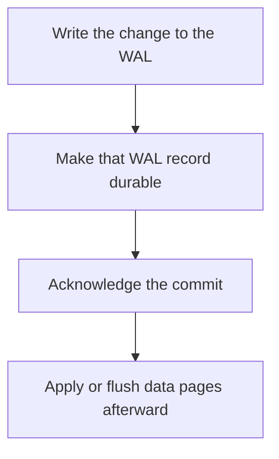

# D09-T003 — WAL (Write-Ahead Logging)

Topic ID: `D09-T003`
Domain: PostgreSQL Internals
Subdomain: WAL (Write-Ahead Logging)
Importance: advanced
Complexity: advanced
Dependencies: `D09-T002`, `D09-T001`, `D07-T001`, `D07-T002`, `D08-T001`, `D08-T002`
Execution status of the code in section F: unexecuted

## A. Topic Overview

Write-ahead logging records a change to durable log storage before the database treats the change as committed. On crash, replay of the log restores committed work and discards what never committed. The log is the source of recovery. Data pages can be flushed later. A commit that returns before the WAL record is durable is not a commit.

In production this shows up as follows: PostgreSQL commit waits on WAL flush according to synchronous_commit. Turning that off makes commits faster and silently drops the last transactions on a crash.

Interviewers use WAL (Write-Ahead Logging) to see whether you can state the failure mode, not only the definition. The failure to name is: acknowledging a commit before the WAL fsync, so a crash loses a transaction the client was told succeeded

Prerequisites: `D09-T002`, `D09-T001`, `D07-T001`, `D07-T002`, `D08-T001`, `D08-T002`. Later notes should link here instead of repeating the mechanism.

## B. First-Principles Explanation

Write-ahead logging records a change to durable log storage before the database treats the change as committed. On crash, replay of the log restores committed work and discards what never committed. The log is the source of recovery. Data pages can be flushed later. A commit that returns before the WAL record is durable is not a commit.

The useful picture is: The WAL is a diary you write in ink before you update the printed ledger. If the building loses power, you redo the diary and ignore pencil notes that never made it.

What has to be true:

1. Write the change to the WAL
2. Make that WAL record durable
3. Acknowledge the commit
4. Apply or flush data pages afterward

It works when those steps preserve one invariant. It fails when acknowledging a commit before the WAL fsync, so a crash loses a transaction the client was told succeeded. The alternative is: you are using a cache, which has no such log unless you add one

## C. Internal Working and Architecture

Components involved: the caller, the state WAL (Write-Ahead Logging) mutates or reads, and the observer that reports WAL sync latency and the lag between commit and the durable LSN.

Execution:

1. Write the change to the WAL
2. Make that WAL record durable
3. Acknowledge the commit
4. Apply or flush data pages afterward

Data moves only along that path. A retry re-enters at step 1, so the operation must say what a duplicate does. Memory and locks stay inside this mechanism. Callers see the result or a typed error, not a half-updated invariant.

State to remember: choose this when you need crash recovery of committed transactions. Do not choose it when you are using a cache, which has no such log unless you add one.

## D. Diagrams and Visual Models



Read the diagram from top to bottom. Each box is one step of WAL (Write-Ahead Logging). The failure mode (acknowledging a commit before the WAL fsync, so a crash loses a transaction the client was told succeeded) is what you look for when a later box never happens or happens twice.

## E. Examples and Analogies

Analogy: The WAL is a diary you write in ink before you update the printed ledger. If the building loses power, you redo the diary and ignore pencil notes that never made it.

Production example: PostgreSQL commit waits on WAL flush according to synchronous_commit. Turning that off makes commits faster and silently drops the last transactions on a crash.

A small counterexample is enough in an interview. Show the input, apply the steps, and show the broken outcome if someone uses the mechanism outside its rule: acknowledging a commit before the WAL fsync, so a crash loses a transaction the client was told succeeded.

## F. Code Examples

The snippet is labeled unexecuted. It illustrates the shape of the idea. It is not a benchmark and it embeds no secret.

```sql
-- unexecuted illustration, not a production setting
-- commit returns after the WAL record for that transaction is flushed
```

After the snippet, check WAL sync latency and the lag between commit and the durable LSN. If that signal moves the wrong way, the snippet is the wrong tool for the workload.

## G. Practical Backend Application

Use WAL (Write-Ahead Logging) in a service when you need crash recovery of committed transactions.

A typical place is the production case already stated: PostgreSQL commit waits on WAL flush according to synchronous_commit. Turning that off makes commits faster and silently drops the last transactions on a crash.

Operationally you alert on WAL sync latency and the lag between commit and the durable LSN. You do not alert only on process uptime. The dashboard should show the failure mode, a success rate, and the saturation signal (queue depth, lock wait, or latency) that predicts it.

## H. Advantages, Limitations and Trade-offs

| Choice | Benefit | Cost | Choose when | Avoid when |
| --- | --- | --- | --- | --- |
| Apply WAL (Write-Ahead Logging) | you need crash recovery of committed transactions | Extra moving parts and a new failure mode | The failure you are preventing is already real | you are using a cache, which has no such log unless you add one |
| Simpler alternative | Less code and fewer dependencies | acknowledging a commit before the WAL fsync, so a crash loses a transaction the client was told succeeded | The workload does not hit the limit | The invariant must hold under concurrency or failure |

WAL (Write-Ahead Logging) is a trade. State the benefit and the cost in the same sentence when you propose it in a design review.

## I. Common Mistakes and Misconceptions

- Disabling sync for speed and still promising durability.
- Putting WAL and data on a volume that lies about fsync.
- Deleting WAL segments that a replica still needs.
- Treating a diagram of WAL (Write-Ahead Logging) as proof that the invariant holds in production.
- Copying a default configuration without naming WAL sync latency and the lag between commit and the durable LSN.

## J. Debugging and Troubleshooting

Symptom: acknowledging a commit before the WAL fsync, so a crash loses a transaction the client was told succeeded

First check: WAL sync latency and the lag between commit and the durable LSN.

Then compare one healthy instance against one unhealthy instance. Confirm whether retries are duplicating work. Confirm whether a timeout is shorter than the work. Fix the invariant, then watch the same metric for a full peak, not only for the next minute.

Useful questions: did the step order in section C actually happen, or did a caller skip a step? Did a deploy change the data shape that WAL (Write-Ahead Logging) assumes?

## K. Interview Preparation

### Beginner

#### Q1. What problem does WAL (Write-Ahead Logging) solve?

**Answer:** Write-ahead logging records a change to durable log storage before the database treats the change as committed. On crash, replay of the log restores committed work and discards what never committed. The log is the source of recovery. Data pages can be flushed later. A commit that returns before the WAL record is durable is not a commit. Without it, the usual backend failure is: acknowledging a commit before the WAL fsync, so a crash loses a transaction the client was told succeeded.

#### Q2. Where does WAL (Write-Ahead Logging) sit on a request path?

**Answer:** WAL (Write-Ahead Logging) is not a library you sprinkle on every call. you need crash recovery of committed transactions You notice it when WAL sync latency and the lag between commit and the durable LSN. Name the constraint that makes this choice correct. Say what you would measure to confirm it.

#### Q3. Give a concrete example of WAL (Write-Ahead Logging).

**Answer:** PostgreSQL commit waits on WAL flush according to synchronous_commit. Turning that off makes commits faster and silently drops the last transactions on a crash. Walk the input, the state change, and the observable output. Name the constraint that makes this choice correct.

#### Q4. What is a common mix-up around WAL (Write-Ahead Logging)?

**Answer:** acknowledging a commit before the WAL fsync, so a crash loses a transaction the client was told succeeded The corrective check is WAL sync latency and the lag between commit and the durable LSN. Name the constraint that makes this choice correct. Say what you would measure to confirm it. Say which alternative you rejected and why.

#### Q5. When would you skip WAL (Write-Ahead Logging)?

**Answer:** you are using a cache, which has no such log unless you add one Skipping is a decision with a measured cost, not a slogan. Name the constraint that makes this choice correct. Say what you would measure to confirm it. Say which alternative you rejected and why.

### Intermediate

#### Q1. What invariant makes WAL (Write-Ahead Logging) correct?

**Answer:** Write-ahead logging records a change to durable log storage before the database treats the change as committed. On crash, replay of the log restores committed work and discards what never committed. The log is the source of recovery. Data pages can be flushed later. A commit that returns before the WAL record is durable is not a commit. State the invariant before you name the tool.

#### Q2. How do you test WAL (Write-Ahead Logging)?

**Answer:** Assert the failure mode directly: acknowledging a commit before the WAL fsync, so a crash loses a transaction the client was told succeeded. The assertion should watch WAL sync latency and the lag between commit and the durable LSN. Include a concurrent or retry case if the bug only appears then. Name the constraint that makes this choice correct.

#### Q3. What signal tells you WAL (Write-Ahead Logging) is misbehaving in production?

**Answer:** Watch WAL sync latency and the lag between commit and the durable LSN. The user-visible symptom is usually acknowledging a commit before the WAL fsync, so a crash loses a transaction the client was told succeeded. Name the constraint that makes this choice correct. Say what you would measure to confirm it.

#### Q4. How would you introduce WAL (Write-Ahead Logging) into a legacy service?

**Answer:** you need crash recovery of committed transactions Ship it behind a metric so you can compare the old path. Roll back if acknowledging a commit before the WAL fsync, so a crash loses a transaction the client was told succeeded gets worse. Name the constraint that makes this choice correct. Say what you would measure to confirm it.

#### Q5. What do you trade away by choosing WAL (Write-Ahead Logging)?

**Answer:** you need crash recovery of committed transactions you are using a cache, which has no such log unless you add one Say the cost in latency, storage, or operational load. Name the constraint that makes this choice correct. Say what you would measure to confirm it. Say which alternative you rejected and why.

### Advanced

#### Q1. What breaks if a dependency of WAL (Write-Ahead Logging) is slow or down?

**Answer:** acknowledging a commit before the WAL fsync, so a crash loses a transaction the client was told succeeded Degrade using the rule: you are using a cache, which has no such log unless you add one. Timeouts must be shorter than the caller's deadline. Name the constraint that makes this choice correct. Say what you would measure to confirm it.

#### Q2. How does WAL (Write-Ahead Logging) behave under retries?

**Answer:** Retries repeat work, so WAL (Write-Ahead Logging) must define what a duplicate does. acknowledging a commit before the WAL fsync, so a crash loses a transaction the client was told succeeded Idempotency keys or fences belong next to the write, not in a comment. Name the constraint that makes this choice correct. Say what you would measure to confirm it.

#### Q3. What is the capacity limit of WAL (Write-Ahead Logging)?

**Answer:** The limit shows up as WAL sync latency and the lag between commit and the durable LSN. Add capacity only after you know whether the bottleneck is CPU, lock wait, or network. Name the constraint that makes this choice correct. Say what you would measure to confirm it.

#### Q4. How do you evolve WAL (Write-Ahead Logging) without a flag day?

**Answer:** you need crash recovery of committed transactions Version the contract or the on-disk format. Readers should tolerate one old and one new shape during the rollout. Name the constraint that makes this choice correct. Say what you would measure to confirm it.

#### Q5. What security or correctness bug hides inside WAL (Write-Ahead Logging)?

**Answer:** acknowledging a commit before the WAL fsync, so a crash loses a transaction the client was told succeeded Check authorization and tenancy at the same boundary as the mechanism. A cache or queue must not widen who can read the data. Name the constraint that makes this choice correct. Say what you would measure to confirm it.

### Scenario

#### Q1. Incident: acknowledging a commit before the WAL fsync, so a crash loses a transaction the client was told succeeded. What do you check first?

**Answer:** Start with WAL sync latency and the lag between commit and the durable LSN. Compare a good host and a bad host before you restart anything. Write-ahead logging records a change to durable log storage before the database treats the change as committed. On crash, replay of the log restores committed work and discards what never committed. The log is the source of recovery. Data pages can be flushed later. A commit that returns before the WAL record is durable is not a commit.

#### Q2. A reviewer wants the clever version. What data settles it?

**Answer:** you need crash recovery of committed transactions you are using a cache, which has no such log unless you add one Bring WAL sync latency and the lag between commit and the durable LSN from a load test or from production, not a slogan. Name the constraint that makes this choice correct. Say what you would measure to confirm it. Say which alternative you rejected and why.

#### Q3. You have one hour to explain WAL (Write-Ahead Logging) at a whiteboard.

**Answer:** Draw the happy path in four boxes. Then draw the failure: acknowledging a commit before the WAL fsync, so a crash loses a transaction the client was told succeeded. End with the metric you would page on. Name the constraint that makes this choice correct.

#### Q4. The bug only appears under two concurrent callers.

**Answer:** acknowledging a commit before the WAL fsync, so a crash loses a transaction the client was told succeeded Reproduce with a barrier so both sides enter the critical window. Confirm the fix with WAL sync latency and the lag between commit and the durable LSN. Name the constraint that makes this choice correct. Say what you would measure to confirm it.

#### Q5. Leadership wants this on every service next week.

**Answer:** you are using a cache, which has no such log unless you add one you need crash recovery of committed transactions Roll it out where the failure mode is already hurting users. Name the constraint that makes this choice correct. Say what you would measure to confirm it. Say which alternative you rejected and why.

### Follow-up

#### Q1. What did you assume about the data size or the clock?

**Answer:** Write-ahead logging records a change to durable log storage before the database treats the change as committed. On crash, replay of the log restores committed work and discards what never committed. The log is the source of recovery. Data pages can be flushed later. A commit that returns before the WAL record is durable is not a commit. Clocks are not a total order across machines. State whether the algorithm needs bounded size or a single leader.

#### Q2. What would you measure after the change ships?

**Answer:** Page on WAL sync latency and the lag between commit and the durable LSN. Keep a before/after dashboard for one week. Alert on the failure mode, not only on CPU. Name the constraint that makes this choice correct.

#### Q3. Which neighboring topic did you deliberately not re-teach?

**Answer:** This note owns WAL (Write-Ahead Logging). Related identifiers are in section N. Shared ideas are linked, not copied. Name the constraint that makes this choice correct.

## L. Practical Exercises

Solutions are in `EXERCISES/solutions/D09-T003.md`, not in this section.

1. Whiteboard the four steps of WAL (Write-Ahead Logging) and mark where `acknowledging a commit before the WAL fsync, so a crash loses a transaction the client was told succeeded` enters.
2. Read the snippet in section F and write the assertion that would catch that failure. The assertion must mention `WAL sync latency and the lag between commit and the durable LSN`.
3. Argue for or against using WAL (Write-Ahead Logging) on a service you know. Use the choose and avoid rows from section H. Do not appeal to popularity.

## M. Revision Notes

- Mechanism: Write-ahead logging records a change to durable log storage before the database treats the change as committed.
- Failure: acknowledging a commit before the WAL fsync, so a crash loses a transaction the client was told succeeded
- Metric: WAL sync latency and the lag between commit and the durable LSN
- Choose when: you need crash recovery of committed transactions
- Avoid when: you are using a cache, which has no such log unless you add one

## N. Related Topics

Dependencies to review first: `D09-T002`, `D09-T001`, `D07-T001`, `D07-T002`, `D08-T001`, `D08-T002`.

Shared ideas stay in those notes. This note does not restate them.

## O. Completion Criteria

- You can explain WAL (Write-Ahead Logging) without reading this note, including the failure mode.
- You can draw the diagram in section D from memory.
- You can say when not to use it, using the avoid condition in section H.
- You can name the metric you would watch after shipping it.
