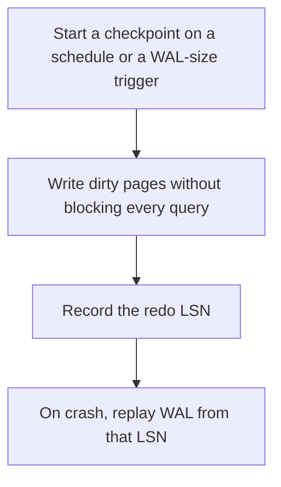

# D09-T004 — Checkpoints and crash recovery

Topic ID: `D09-T004`
Domain: PostgreSQL Internals
Subdomain: Checkpoints and crash recovery
Importance: advanced
Complexity: advanced
Dependencies: `D09-T003`, `D09-T001`, `D07-T001`, `D07-T002`, `D08-T001`, `D08-T002`
Execution status of the code in section F: unexecuted

## A. Topic Overview

A checkpoint flushes dirty data pages so that crash recovery does not have to replay the entire history of the database. Recovery starts from the last checkpoint's redo point and replays WAL up to the end. Checkpoints that are too infrequent make recovery long. Checkpoints that are too aggressive flood the disk and stall queries. The checkpoint is not a backup.

In production this shows up as follows: After a power loss, PostgreSQL replays from the last checkpoint. A restore drill that has never been timed is how you discover recovery takes two hours.

Interviewers use Checkpoints and crash recovery to see whether you can state the failure mode, not only the definition. The failure to name is: recovery taking longer than the outage budget because checkpoints were rare, or a checkpoint IO spike causing query latency

Prerequisites: `D09-T003`, `D09-T001`, `D07-T001`, `D07-T002`, `D08-T001`, `D08-T002`. Later notes should link here instead of repeating the mechanism.

## B. First-Principles Explanation

A checkpoint flushes dirty data pages so that crash recovery does not have to replay the entire history of the database. Recovery starts from the last checkpoint's redo point and replays WAL up to the end. Checkpoints that are too infrequent make recovery long. Checkpoints that are too aggressive flood the disk and stall queries. The checkpoint is not a backup.

The useful picture is: A checkpoint is photographing the shop floor so tonight's audit only reviews receipts since the photo, not since the store opened.

What has to be true:

1. Start a checkpoint on a schedule or a WAL-size trigger
2. Write dirty pages without blocking every query
3. Record the redo LSN
4. On crash, replay WAL from that LSN

It works when those steps preserve one invariant. It fails when recovery taking longer than the outage budget because checkpoints were rare, or a checkpoint IO spike causing query latency. The alternative is: you need a point-in-time backup, which a checkpoint does not give you

## C. Internal Working and Architecture

Components involved: the caller, the state Checkpoints and crash recovery mutates or reads, and the observer that reports checkpoint duration, WAL bytes generated between checkpoints, and recovery time in a restore drill.

Execution:

1. Start a checkpoint on a schedule or a WAL-size trigger
2. Write dirty pages without blocking every query
3. Record the redo LSN
4. On crash, replay WAL from that LSN

Data moves only along that path. A retry re-enters at step 1, so the operation must say what a duplicate does. Memory and locks stay inside this mechanism. Callers see the result or a typed error, not a half-updated invariant.

State to remember: choose this when you are bounding crash recovery time. Do not choose it when you need a point-in-time backup, which a checkpoint does not give you.

## D. Diagrams and Visual Models



Read the diagram from top to bottom. Each box is one step of Checkpoints and crash recovery. The failure mode (recovery taking longer than the outage budget because checkpoints were rare, or a checkpoint IO spike causing query latency) is what you look for when a later box never happens or happens twice.

## E. Examples and Analogies

Analogy: A checkpoint is photographing the shop floor so tonight's audit only reviews receipts since the photo, not since the store opened.

Production example: After a power loss, PostgreSQL replays from the last checkpoint. A restore drill that has never been timed is how you discover recovery takes two hours.

A small counterexample is enough in an interview. Show the input, apply the steps, and show the broken outcome if someone uses the mechanism outside its rule: recovery taking longer than the outage budget because checkpoints were rare, or a checkpoint IO spike causing query latency.

## F. Code Examples

The snippet is labeled unexecuted. It illustrates the shape of the idea. It is not a benchmark and it embeds no secret.

```sql
-- unexecuted: control checkpoint pressure in postgresql.conf
-- checkpoint_timeout and max_wal_size bound how much WAL recovery must replay
```

After the snippet, check checkpoint duration, WAL bytes generated between checkpoints, and recovery time in a restore drill. If that signal moves the wrong way, the snippet is the wrong tool for the workload.

## G. Practical Backend Application

Use Checkpoints and crash recovery in a service when you are bounding crash recovery time.

A typical place is the production case already stated: After a power loss, PostgreSQL replays from the last checkpoint. A restore drill that has never been timed is how you discover recovery takes two hours.

Operationally you alert on checkpoint duration, WAL bytes generated between checkpoints, and recovery time in a restore drill. You do not alert only on process uptime. The dashboard should show the failure mode, a success rate, and the saturation signal (queue depth, lock wait, or latency) that predicts it.

## H. Advantages, Limitations and Trade-offs

| Choice | Benefit | Cost | Choose when | Avoid when |
| --- | --- | --- | --- | --- |
| Apply Checkpoints and crash recovery | you are bounding crash recovery time | Extra moving parts and a new failure mode | The failure you are preventing is already real | you need a point-in-time backup, which a checkpoint does not give you |
| Simpler alternative | Less code and fewer dependencies | recovery taking longer than the outage budget because checkpoints were rare, or a checkpoint IO spike causing query latency | The workload does not hit the limit | The invariant must hold under concurrency or failure |

Checkpoints and crash recovery is a trade. State the benefit and the cost in the same sentence when you propose it in a design review.

## I. Common Mistakes and Misconceptions

- Calling a checkpoint a backup.
- Setting checkpoint frequency without watching IO.
- Never practicing recovery.
- Treating a diagram of Checkpoints and crash recovery as proof that the invariant holds in production.
- Copying a default configuration without naming checkpoint duration, WAL bytes generated between checkpoints, and recovery time in a restore drill.

## J. Debugging and Troubleshooting

Symptom: recovery taking longer than the outage budget because checkpoints were rare, or a checkpoint IO spike causing query latency

First check: checkpoint duration, WAL bytes generated between checkpoints, and recovery time in a restore drill.

Then compare one healthy instance against one unhealthy instance. Confirm whether retries are duplicating work. Confirm whether a timeout is shorter than the work. Fix the invariant, then watch the same metric for a full peak, not only for the next minute.

Useful questions: did the step order in section C actually happen, or did a caller skip a step? Did a deploy change the data shape that Checkpoints and crash recovery assumes?

## K. Interview Preparation

### Beginner

#### Q1. What problem does Checkpoints and crash recovery solve?

**Answer:** A checkpoint flushes dirty data pages so that crash recovery does not have to replay the entire history of the database. Recovery starts from the last checkpoint's redo point and replays WAL up to the end. Checkpoints that are too infrequent make recovery long. Checkpoints that are too aggressive flood the disk and stall queries. The checkpoint is not a backup. Without it, the usual backend failure is: recovery taking longer than the outage budget because checkpoints were rare, or a checkpoint IO spike causing query latency.

#### Q2. Where does Checkpoints and crash recovery sit on a request path?

**Answer:** Checkpoints and crash recovery is not a library you sprinkle on every call. you are bounding crash recovery time You notice it when checkpoint duration, WAL bytes generated between checkpoints, and recovery time in a restore drill. Name the constraint that makes this choice correct. Say what you would measure to confirm it.

#### Q3. Give a concrete example of Checkpoints and crash recovery.

**Answer:** After a power loss, PostgreSQL replays from the last checkpoint. A restore drill that has never been timed is how you discover recovery takes two hours. Walk the input, the state change, and the observable output. Name the constraint that makes this choice correct.

#### Q4. What is a common mix-up around Checkpoints and crash recovery?

**Answer:** recovery taking longer than the outage budget because checkpoints were rare, or a checkpoint IO spike causing query latency The corrective check is checkpoint duration, WAL bytes generated between checkpoints, and recovery time in a restore drill. Name the constraint that makes this choice correct. Say what you would measure to confirm it. Say which alternative you rejected and why.

#### Q5. When would you skip Checkpoints and crash recovery?

**Answer:** you need a point-in-time backup, which a checkpoint does not give you Skipping is a decision with a measured cost, not a slogan. Name the constraint that makes this choice correct. Say what you would measure to confirm it. Say which alternative you rejected and why.

### Intermediate

#### Q1. What invariant makes Checkpoints and crash recovery correct?

**Answer:** A checkpoint flushes dirty data pages so that crash recovery does not have to replay the entire history of the database. Recovery starts from the last checkpoint's redo point and replays WAL up to the end. Checkpoints that are too infrequent make recovery long. Checkpoints that are too aggressive flood the disk and stall queries. The checkpoint is not a backup. State the invariant before you name the tool.

#### Q2. How do you test Checkpoints and crash recovery?

**Answer:** Assert the failure mode directly: recovery taking longer than the outage budget because checkpoints were rare, or a checkpoint IO spike causing query latency. The assertion should watch checkpoint duration, WAL bytes generated between checkpoints, and recovery time in a restore drill. Include a concurrent or retry case if the bug only appears then. Name the constraint that makes this choice correct.

#### Q3. What signal tells you Checkpoints and crash recovery is misbehaving in production?

**Answer:** Watch checkpoint duration, WAL bytes generated between checkpoints, and recovery time in a restore drill. The user-visible symptom is usually recovery taking longer than the outage budget because checkpoints were rare, or a checkpoint IO spike causing query latency. Name the constraint that makes this choice correct. Say what you would measure to confirm it.

#### Q4. How would you introduce Checkpoints and crash recovery into a legacy service?

**Answer:** you are bounding crash recovery time Ship it behind a metric so you can compare the old path. Roll back if recovery taking longer than the outage budget because checkpoints were rare, or a checkpoint IO spike causing query latency gets worse. Name the constraint that makes this choice correct. Say what you would measure to confirm it.

#### Q5. What do you trade away by choosing Checkpoints and crash recovery?

**Answer:** you are bounding crash recovery time you need a point-in-time backup, which a checkpoint does not give you Say the cost in latency, storage, or operational load. Name the constraint that makes this choice correct. Say what you would measure to confirm it. Say which alternative you rejected and why.

### Advanced

#### Q1. What breaks if a dependency of Checkpoints and crash recovery is slow or down?

**Answer:** recovery taking longer than the outage budget because checkpoints were rare, or a checkpoint IO spike causing query latency Degrade using the rule: you need a point-in-time backup, which a checkpoint does not give you. Timeouts must be shorter than the caller's deadline. Name the constraint that makes this choice correct. Say what you would measure to confirm it.

#### Q2. How does Checkpoints and crash recovery behave under retries?

**Answer:** Retries repeat work, so Checkpoints and crash recovery must define what a duplicate does. recovery taking longer than the outage budget because checkpoints were rare, or a checkpoint IO spike causing query latency Idempotency keys or fences belong next to the write, not in a comment. Name the constraint that makes this choice correct. Say what you would measure to confirm it.

#### Q3. What is the capacity limit of Checkpoints and crash recovery?

**Answer:** The limit shows up as checkpoint duration, WAL bytes generated between checkpoints, and recovery time in a restore drill. Add capacity only after you know whether the bottleneck is CPU, lock wait, or network. Name the constraint that makes this choice correct. Say what you would measure to confirm it.

#### Q4. How do you evolve Checkpoints and crash recovery without a flag day?

**Answer:** you are bounding crash recovery time Version the contract or the on-disk format. Readers should tolerate one old and one new shape during the rollout. Name the constraint that makes this choice correct. Say what you would measure to confirm it.

#### Q5. What security or correctness bug hides inside Checkpoints and crash recovery?

**Answer:** recovery taking longer than the outage budget because checkpoints were rare, or a checkpoint IO spike causing query latency Check authorization and tenancy at the same boundary as the mechanism. A cache or queue must not widen who can read the data. Name the constraint that makes this choice correct. Say what you would measure to confirm it.

### Scenario

#### Q1. Incident: recovery taking longer than the outage budget because checkpoints were rare, or a checkpoint IO spike causing query latency. What do you check first?

**Answer:** Start with checkpoint duration, WAL bytes generated between checkpoints, and recovery time in a restore drill. Compare a good host and a bad host before you restart anything. A checkpoint flushes dirty data pages so that crash recovery does not have to replay the entire history of the database. Recovery starts from the last checkpoint's redo point and replays WAL up to the end. Checkpoints that are too infrequent make recovery long. Checkpoints that are too aggressive flood the disk and stall queries. The checkpoint is not a backup.

#### Q2. A reviewer wants the clever version. What data settles it?

**Answer:** you are bounding crash recovery time you need a point-in-time backup, which a checkpoint does not give you Bring checkpoint duration, WAL bytes generated between checkpoints, and recovery time in a restore drill from a load test or from production, not a slogan. Name the constraint that makes this choice correct. Say what you would measure to confirm it. Say which alternative you rejected and why.

#### Q3. You have one hour to explain Checkpoints and crash recovery at a whiteboard.

**Answer:** Draw the happy path in four boxes. Then draw the failure: recovery taking longer than the outage budget because checkpoints were rare, or a checkpoint IO spike causing query latency. End with the metric you would page on. Name the constraint that makes this choice correct.

#### Q4. The bug only appears under two concurrent callers.

**Answer:** recovery taking longer than the outage budget because checkpoints were rare, or a checkpoint IO spike causing query latency Reproduce with a barrier so both sides enter the critical window. Confirm the fix with checkpoint duration, WAL bytes generated between checkpoints, and recovery time in a restore drill. Name the constraint that makes this choice correct. Say what you would measure to confirm it.

#### Q5. Leadership wants this on every service next week.

**Answer:** you need a point-in-time backup, which a checkpoint does not give you you are bounding crash recovery time Roll it out where the failure mode is already hurting users. Name the constraint that makes this choice correct. Say what you would measure to confirm it. Say which alternative you rejected and why.

### Follow-up

#### Q1. What did you assume about the data size or the clock?

**Answer:** A checkpoint flushes dirty data pages so that crash recovery does not have to replay the entire history of the database. Recovery starts from the last checkpoint's redo point and replays WAL up to the end. Checkpoints that are too infrequent make recovery long. Checkpoints that are too aggressive flood the disk and stall queries. The checkpoint is not a backup. Clocks are not a total order across machines. State whether the algorithm needs bounded size or a single leader.

#### Q2. What would you measure after the change ships?

**Answer:** Page on checkpoint duration, WAL bytes generated between checkpoints, and recovery time in a restore drill. Keep a before/after dashboard for one week. Alert on the failure mode, not only on CPU. Name the constraint that makes this choice correct.

#### Q3. Which neighboring topic did you deliberately not re-teach?

**Answer:** This note owns Checkpoints and crash recovery. Related identifiers are in section N. Shared ideas are linked, not copied. Name the constraint that makes this choice correct.

## L. Practical Exercises

Solutions are in `EXERCISES/solutions/D09-T004.md`, not in this section.

1. Whiteboard the four steps of Checkpoints and crash recovery and mark where `recovery taking longer than the outage budget because checkpoints were rare, or a checkpoint IO spike causing query latency` enters.
2. Read the snippet in section F and write the assertion that would catch that failure. The assertion must mention `checkpoint duration, WAL bytes generated between checkpoints, and recovery time in a restore drill`.
3. Argue for or against using Checkpoints and crash recovery on a service you know. Use the choose and avoid rows from section H. Do not appeal to popularity.

## M. Revision Notes

- Mechanism: A checkpoint flushes dirty data pages so that crash recovery does not have to replay the entire history of the database.
- Failure: recovery taking longer than the outage budget because checkpoints were rare, or a checkpoint IO spike causing query latency
- Metric: checkpoint duration, WAL bytes generated between checkpoints, and recovery time in a restore drill
- Choose when: you are bounding crash recovery time
- Avoid when: you need a point-in-time backup, which a checkpoint does not give you

## N. Related Topics

Dependencies to review first: `D09-T003`, `D09-T001`, `D07-T001`, `D07-T002`, `D08-T001`, `D08-T002`.

Shared ideas stay in those notes. This note does not restate them.

## O. Completion Criteria

- You can explain Checkpoints and crash recovery without reading this note, including the failure mode.
- You can draw the diagram in section D from memory.
- You can say when not to use it, using the avoid condition in section H.
- You can name the metric you would watch after shipping it.
