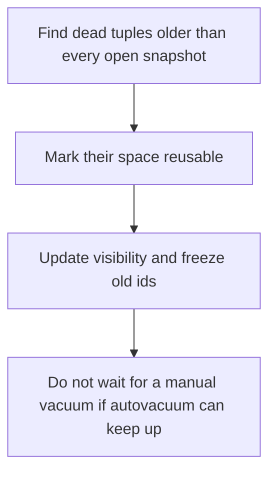

# D09-T005 — Vacuum and autovacuum

Topic ID: `D09-T005`
Domain: PostgreSQL Internals
Subdomain: Vacuum and autovacuum
Importance: advanced
Complexity: advanced
Dependencies: `D09-T004`, `D09-T001`, `D07-T001`, `D07-T002`, `D08-T001`, `D08-T002`
Execution status of the code in section F: unexecuted

## A. Topic Overview

VACUUM reclaims space from dead tuples so PostgreSQL can reuse it, and it freezes transaction ids so the system does not wrap. Autovacuum runs that work in the background when a table's dead-tuple count crosses a threshold. Vacuum does not return space to the operating system unless it can truncate free pages at the end. A long-running transaction blocks vacuum from removing tuples that transaction might still see.

In production this shows up as follows: A reporting transaction left open overnight stops autovacuum from cleaning the orders table. The table bloats and sequential scans get slower until the transaction ends.

Interviewers use Vacuum and autovacuum to see whether you can state the failure mode, not only the definition. The failure to name is: transaction-id wraparound shutdown, or a table that grows forever because a forgotten transaction holds back vacuum

Prerequisites: `D09-T004`, `D09-T001`, `D07-T001`, `D07-T002`, `D08-T001`, `D08-T002`. Later notes should link here instead of repeating the mechanism.

## B. First-Principles Explanation

VACUUM reclaims space from dead tuples so PostgreSQL can reuse it, and it freezes transaction ids so the system does not wrap. Autovacuum runs that work in the background when a table's dead-tuple count crosses a threshold. Vacuum does not return space to the operating system unless it can truncate free pages at the end. A long-running transaction blocks vacuum from removing tuples that transaction might still see.

The useful picture is: Vacuum is clearing abandoned plates so the tables can be reused. It does not knock down the restaurant wall and give the land back to the city.

What has to be true:

1. Find dead tuples older than every open snapshot
2. Mark their space reusable
3. Update visibility and freeze old ids
4. Do not wait for a manual vacuum if autovacuum can keep up

It works when those steps preserve one invariant. It fails when transaction-id wraparound shutdown, or a table that grows forever because a forgotten transaction holds back vacuum. The alternative is: you expect VACUUM FULL's lock on a hot table during peak

## C. Internal Working and Architecture

Components involved: the caller, the state Vacuum and autovacuum mutates or reads, and the observer that reports dead tuple count, age of the oldest transaction id, and autovacuum runtime.

Execution:

1. Find dead tuples older than every open snapshot
2. Mark their space reusable
3. Update visibility and freeze old ids
4. Do not wait for a manual vacuum if autovacuum can keep up

Data moves only along that path. A retry re-enters at step 1, so the operation must say what a duplicate does. Memory and locks stay inside this mechanism. Callers see the result or a typed error, not a half-updated invariant.

State to remember: choose this when the table receives updates or deletes. Do not choose it when you expect VACUUM FULL's lock on a hot table during peak.

## D. Diagrams and Visual Models



Read the diagram from top to bottom. Each box is one step of Vacuum and autovacuum. The failure mode (transaction-id wraparound shutdown, or a table that grows forever because a forgotten transaction holds back vacuum) is what you look for when a later box never happens or happens twice.

## E. Examples and Analogies

Analogy: Vacuum is clearing abandoned plates so the tables can be reused. It does not knock down the restaurant wall and give the land back to the city.

Production example: A reporting transaction left open overnight stops autovacuum from cleaning the orders table. The table bloats and sequential scans get slower until the transaction ends.

A small counterexample is enough in an interview. Show the input, apply the steps, and show the broken outcome if someone uses the mechanism outside its rule: transaction-id wraparound shutdown, or a table that grows forever because a forgotten transaction holds back vacuum.

## F. Code Examples

The snippet is labeled unexecuted. It illustrates the shape of the idea. It is not a benchmark and it embeds no secret.

```sql
-- unexecuted diagnostic
SELECT relname, n_dead_tup, last_autovacuum FROM pg_stat_user_tables;
```

After the snippet, check dead tuple count, age of the oldest transaction id, and autovacuum runtime. If that signal moves the wrong way, the snippet is the wrong tool for the workload.

## G. Practical Backend Application

Use Vacuum and autovacuum in a service when the table receives updates or deletes.

A typical place is the production case already stated: A reporting transaction left open overnight stops autovacuum from cleaning the orders table. The table bloats and sequential scans get slower until the transaction ends.

Operationally you alert on dead tuple count, age of the oldest transaction id, and autovacuum runtime. You do not alert only on process uptime. The dashboard should show the failure mode, a success rate, and the saturation signal (queue depth, lock wait, or latency) that predicts it.

## H. Advantages, Limitations and Trade-offs

| Choice | Benefit | Cost | Choose when | Avoid when |
| --- | --- | --- | --- | --- |
| Apply Vacuum and autovacuum | the table receives updates or deletes | Extra moving parts and a new failure mode | The failure you are preventing is already real | you expect VACUUM FULL's lock on a hot table during peak |
| Simpler alternative | Less code and fewer dependencies | transaction-id wraparound shutdown, or a table that grows forever because a forgotten transaction holds back vacuum | The workload does not hit the limit | The invariant must hold under concurrency or failure |

Vacuum and autovacuum is a trade. State the benefit and the cost in the same sentence when you propose it in a design review.

## I. Common Mistakes and Misconceptions

- Disabling autovacuum.
- Leaving idle-in-transaction sessions open.
- Assuming vacuum shrinks the file on disk.
- Treating a diagram of Vacuum and autovacuum as proof that the invariant holds in production.
- Copying a default configuration without naming dead tuple count, age of the oldest transaction id, and autovacuum runtime.

## J. Debugging and Troubleshooting

Symptom: transaction-id wraparound shutdown, or a table that grows forever because a forgotten transaction holds back vacuum

First check: dead tuple count, age of the oldest transaction id, and autovacuum runtime.

Then compare one healthy instance against one unhealthy instance. Confirm whether retries are duplicating work. Confirm whether a timeout is shorter than the work. Fix the invariant, then watch the same metric for a full peak, not only for the next minute.

Useful questions: did the step order in section C actually happen, or did a caller skip a step? Did a deploy change the data shape that Vacuum and autovacuum assumes?

## K. Interview Preparation

### Beginner

#### Q1. What problem does Vacuum and autovacuum solve?

**Answer:** VACUUM reclaims space from dead tuples so PostgreSQL can reuse it, and it freezes transaction ids so the system does not wrap. Autovacuum runs that work in the background when a table's dead-tuple count crosses a threshold. Vacuum does not return space to the operating system unless it can truncate free pages at the end. A long-running transaction blocks vacuum from removing tuples that transaction might still see. Without it, the usual backend failure is: transaction-id wraparound shutdown, or a table that grows forever because a forgotten transaction holds back vacuum.

#### Q2. Where does Vacuum and autovacuum sit on a request path?

**Answer:** Vacuum and autovacuum is not a library you sprinkle on every call. the table receives updates or deletes You notice it when dead tuple count, age of the oldest transaction id, and autovacuum runtime. Name the constraint that makes this choice correct. Say what you would measure to confirm it.

#### Q3. Give a concrete example of Vacuum and autovacuum.

**Answer:** A reporting transaction left open overnight stops autovacuum from cleaning the orders table. The table bloats and sequential scans get slower until the transaction ends. Walk the input, the state change, and the observable output. Name the constraint that makes this choice correct.

#### Q4. What is a common mix-up around Vacuum and autovacuum?

**Answer:** transaction-id wraparound shutdown, or a table that grows forever because a forgotten transaction holds back vacuum The corrective check is dead tuple count, age of the oldest transaction id, and autovacuum runtime. Name the constraint that makes this choice correct. Say what you would measure to confirm it. Say which alternative you rejected and why.

#### Q5. When would you skip Vacuum and autovacuum?

**Answer:** you expect VACUUM FULL's lock on a hot table during peak Skipping is a decision with a measured cost, not a slogan. Name the constraint that makes this choice correct. Say what you would measure to confirm it. Say which alternative you rejected and why.

### Intermediate

#### Q1. What invariant makes Vacuum and autovacuum correct?

**Answer:** VACUUM reclaims space from dead tuples so PostgreSQL can reuse it, and it freezes transaction ids so the system does not wrap. Autovacuum runs that work in the background when a table's dead-tuple count crosses a threshold. Vacuum does not return space to the operating system unless it can truncate free pages at the end. A long-running transaction blocks vacuum from removing tuples that transaction might still see. State the invariant before you name the tool.

#### Q2. How do you test Vacuum and autovacuum?

**Answer:** Assert the failure mode directly: transaction-id wraparound shutdown, or a table that grows forever because a forgotten transaction holds back vacuum. The assertion should watch dead tuple count, age of the oldest transaction id, and autovacuum runtime. Include a concurrent or retry case if the bug only appears then. Name the constraint that makes this choice correct.

#### Q3. What signal tells you Vacuum and autovacuum is misbehaving in production?

**Answer:** Watch dead tuple count, age of the oldest transaction id, and autovacuum runtime. The user-visible symptom is usually transaction-id wraparound shutdown, or a table that grows forever because a forgotten transaction holds back vacuum. Name the constraint that makes this choice correct. Say what you would measure to confirm it.

#### Q4. How would you introduce Vacuum and autovacuum into a legacy service?

**Answer:** the table receives updates or deletes Ship it behind a metric so you can compare the old path. Roll back if transaction-id wraparound shutdown, or a table that grows forever because a forgotten transaction holds back vacuum gets worse. Name the constraint that makes this choice correct. Say what you would measure to confirm it.

#### Q5. What do you trade away by choosing Vacuum and autovacuum?

**Answer:** the table receives updates or deletes you expect VACUUM FULL's lock on a hot table during peak Say the cost in latency, storage, or operational load. Name the constraint that makes this choice correct. Say what you would measure to confirm it. Say which alternative you rejected and why.

### Advanced

#### Q1. What breaks if a dependency of Vacuum and autovacuum is slow or down?

**Answer:** transaction-id wraparound shutdown, or a table that grows forever because a forgotten transaction holds back vacuum Degrade using the rule: you expect VACUUM FULL's lock on a hot table during peak. Timeouts must be shorter than the caller's deadline. Name the constraint that makes this choice correct. Say what you would measure to confirm it.

#### Q2. How does Vacuum and autovacuum behave under retries?

**Answer:** Retries repeat work, so Vacuum and autovacuum must define what a duplicate does. transaction-id wraparound shutdown, or a table that grows forever because a forgotten transaction holds back vacuum Idempotency keys or fences belong next to the write, not in a comment. Name the constraint that makes this choice correct. Say what you would measure to confirm it.

#### Q3. What is the capacity limit of Vacuum and autovacuum?

**Answer:** The limit shows up as dead tuple count, age of the oldest transaction id, and autovacuum runtime. Add capacity only after you know whether the bottleneck is CPU, lock wait, or network. Name the constraint that makes this choice correct. Say what you would measure to confirm it.

#### Q4. How do you evolve Vacuum and autovacuum without a flag day?

**Answer:** the table receives updates or deletes Version the contract or the on-disk format. Readers should tolerate one old and one new shape during the rollout. Name the constraint that makes this choice correct. Say what you would measure to confirm it.

#### Q5. What security or correctness bug hides inside Vacuum and autovacuum?

**Answer:** transaction-id wraparound shutdown, or a table that grows forever because a forgotten transaction holds back vacuum Check authorization and tenancy at the same boundary as the mechanism. A cache or queue must not widen who can read the data. Name the constraint that makes this choice correct. Say what you would measure to confirm it.

### Scenario

#### Q1. Incident: transaction-id wraparound shutdown, or a table that grows forever because a forgotten transaction holds back vacuum. What do you check first?

**Answer:** Start with dead tuple count, age of the oldest transaction id, and autovacuum runtime. Compare a good host and a bad host before you restart anything. VACUUM reclaims space from dead tuples so PostgreSQL can reuse it, and it freezes transaction ids so the system does not wrap. Autovacuum runs that work in the background when a table's dead-tuple count crosses a threshold. Vacuum does not return space to the operating system unless it can truncate free pages at the end. A long-running transaction blocks vacuum from removing tuples that transaction might still see.

#### Q2. A reviewer wants the clever version. What data settles it?

**Answer:** the table receives updates or deletes you expect VACUUM FULL's lock on a hot table during peak Bring dead tuple count, age of the oldest transaction id, and autovacuum runtime from a load test or from production, not a slogan. Name the constraint that makes this choice correct. Say what you would measure to confirm it. Say which alternative you rejected and why.

#### Q3. You have one hour to explain Vacuum and autovacuum at a whiteboard.

**Answer:** Draw the happy path in four boxes. Then draw the failure: transaction-id wraparound shutdown, or a table that grows forever because a forgotten transaction holds back vacuum. End with the metric you would page on. Name the constraint that makes this choice correct.

#### Q4. The bug only appears under two concurrent callers.

**Answer:** transaction-id wraparound shutdown, or a table that grows forever because a forgotten transaction holds back vacuum Reproduce with a barrier so both sides enter the critical window. Confirm the fix with dead tuple count, age of the oldest transaction id, and autovacuum runtime. Name the constraint that makes this choice correct. Say what you would measure to confirm it.

#### Q5. Leadership wants this on every service next week.

**Answer:** you expect VACUUM FULL's lock on a hot table during peak the table receives updates or deletes Roll it out where the failure mode is already hurting users. Name the constraint that makes this choice correct. Say what you would measure to confirm it. Say which alternative you rejected and why.

### Follow-up

#### Q1. What did you assume about the data size or the clock?

**Answer:** VACUUM reclaims space from dead tuples so PostgreSQL can reuse it, and it freezes transaction ids so the system does not wrap. Autovacuum runs that work in the background when a table's dead-tuple count crosses a threshold. Vacuum does not return space to the operating system unless it can truncate free pages at the end. A long-running transaction blocks vacuum from removing tuples that transaction might still see. Clocks are not a total order across machines. State whether the algorithm needs bounded size or a single leader.

#### Q2. What would you measure after the change ships?

**Answer:** Page on dead tuple count, age of the oldest transaction id, and autovacuum runtime. Keep a before/after dashboard for one week. Alert on the failure mode, not only on CPU. Name the constraint that makes this choice correct.

#### Q3. Which neighboring topic did you deliberately not re-teach?

**Answer:** This note owns Vacuum and autovacuum. Related identifiers are in section N. Shared ideas are linked, not copied. Name the constraint that makes this choice correct.

## L. Practical Exercises

Solutions are in `EXERCISES/solutions/D09-T005.md`, not in this section.

1. Whiteboard the four steps of Vacuum and autovacuum and mark where `transaction-id wraparound shutdown, or a table that grows forever because a forgotten transaction holds back vacuum` enters.
2. Read the snippet in section F and write the assertion that would catch that failure. The assertion must mention `dead tuple count, age of the oldest transaction id, and autovacuum runtime`.
3. Argue for or against using Vacuum and autovacuum on a service you know. Use the choose and avoid rows from section H. Do not appeal to popularity.

## M. Revision Notes

- Mechanism: VACUUM reclaims space from dead tuples so PostgreSQL can reuse it, and it freezes transaction ids so the system does not wrap.
- Failure: transaction-id wraparound shutdown, or a table that grows forever because a forgotten transaction holds back vacuum
- Metric: dead tuple count, age of the oldest transaction id, and autovacuum runtime
- Choose when: the table receives updates or deletes
- Avoid when: you expect VACUUM FULL's lock on a hot table during peak

## N. Related Topics

Dependencies to review first: `D09-T004`, `D09-T001`, `D07-T001`, `D07-T002`, `D08-T001`, `D08-T002`.

Shared ideas stay in those notes. This note does not restate them.

## O. Completion Criteria

- You can explain Vacuum and autovacuum without reading this note, including the failure mode.
- You can draw the diagram in section D from memory.
- You can say when not to use it, using the avoid condition in section H.
- You can name the metric you would watch after shipping it.
