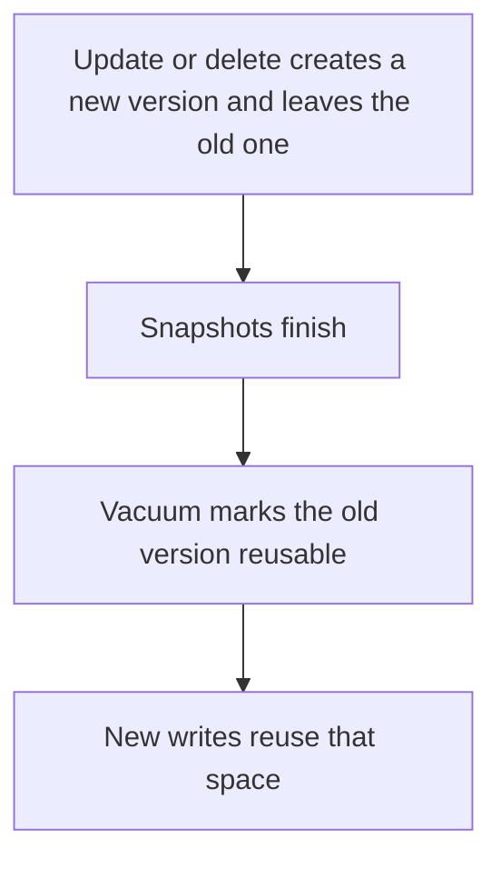

# D09-T006 — Dead tuples and table bloat

Topic ID: `D09-T006`
Domain: PostgreSQL Internals
Subdomain: Dead tuples and table bloat
Importance: advanced
Complexity: advanced
Dependencies: `D09-T005`, `D09-T001`, `D07-T001`, `D07-T002`, `D08-T001`, `D08-T002`
Execution status of the code in section F: unexecuted

## A. Topic Overview

A dead tuple is a row version that no current snapshot needs, left behind by an update or delete because PostgreSQL uses MVCC. Table bloat is the live data plus those dead versions plus free space that has not been reused. Bloat makes sequential scans and index scans read more pages. The fix is vacuum and shorter transactions, not a bigger cache alone.

In production this shows up as follows: An orders table updated on every status change, with a replica used for analytics that lags, retains dead tuples until vacuum can see that the replica has moved on. Disk and cache fill with old versions.

Interviewers use Dead tuples and table bloat to see whether you can state the failure mode, not only the definition. The failure to name is: a table several times larger than its live rows, with queries reading mostly dead bytes

Prerequisites: `D09-T005`, `D09-T001`, `D07-T001`, `D07-T002`, `D08-T001`, `D08-T002`. Later notes should link here instead of repeating the mechanism.

## B. First-Principles Explanation

A dead tuple is a row version that no current snapshot needs, left behind by an update or delete because PostgreSQL uses MVCC. Table bloat is the live data plus those dead versions plus free space that has not been reused. Bloat makes sequential scans and index scans read more pages. The fix is vacuum and shorter transactions, not a bigger cache alone.

The useful picture is: Dead tuples are old editions of a form left in the folder. The folder gets thick even though only the top form is current.

What has to be true:

1. Update or delete creates a new version and leaves the old one
2. Snapshots finish
3. Vacuum marks the old version reusable
4. New writes reuse that space

It works when those steps preserve one invariant. It fails when a table several times larger than its live rows, with queries reading mostly dead bytes. The alternative is: you rewrite the table with VACUUM FULL during peak traffic

## C. Internal Working and Architecture

Components involved: the caller, the state Dead tuples and table bloat mutates or reads, and the observer that reports live tuple count versus page count, and bloat estimated from pg_stat.

Execution:

1. Update or delete creates a new version and leaves the old one
2. Snapshots finish
3. Vacuum marks the old version reusable
4. New writes reuse that space

Data moves only along that path. A retry re-enters at step 1, so the operation must say what a duplicate does. Memory and locks stay inside this mechanism. Callers see the result or a typed error, not a half-updated invariant.

State to remember: choose this when you are explaining growth or a scan that got slower after updates. Do not choose it when you rewrite the table with VACUUM FULL during peak traffic.

## D. Diagrams and Visual Models



Read the diagram from top to bottom. Each box is one step of Dead tuples and table bloat. The failure mode (a table several times larger than its live rows, with queries reading mostly dead bytes) is what you look for when a later box never happens or happens twice.

## E. Examples and Analogies

Analogy: Dead tuples are old editions of a form left in the folder. The folder gets thick even though only the top form is current.

Production example: An orders table updated on every status change, with a replica used for analytics that lags, retains dead tuples until vacuum can see that the replica has moved on. Disk and cache fill with old versions.

A small counterexample is enough in an interview. Show the input, apply the steps, and show the broken outcome if someone uses the mechanism outside its rule: a table several times larger than its live rows, with queries reading mostly dead bytes.

## F. Code Examples

The snippet is labeled unexecuted. It illustrates the shape of the idea. It is not a benchmark and it embeds no secret.

```sql
SELECT n_live_tup, n_dead_tup FROM pg_stat_user_tables WHERE relname = 'orders';
```

After the snippet, check live tuple count versus page count, and bloat estimated from pg_stat. If that signal moves the wrong way, the snippet is the wrong tool for the workload.

## G. Practical Backend Application

Use Dead tuples and table bloat in a service when you are explaining growth or a scan that got slower after updates.

A typical place is the production case already stated: An orders table updated on every status change, with a replica used for analytics that lags, retains dead tuples until vacuum can see that the replica has moved on. Disk and cache fill with old versions.

Operationally you alert on live tuple count versus page count, and bloat estimated from pg_stat. You do not alert only on process uptime. The dashboard should show the failure mode, a success rate, and the saturation signal (queue depth, lock wait, or latency) that predicts it.

## H. Advantages, Limitations and Trade-offs

| Choice | Benefit | Cost | Choose when | Avoid when |
| --- | --- | --- | --- | --- |
| Apply Dead tuples and table bloat | you are explaining growth or a scan that got slower after updates | Extra moving parts and a new failure mode | The failure you are preventing is already real | you rewrite the table with VACUUM FULL during peak traffic |
| Simpler alternative | Less code and fewer dependencies | a table several times larger than its live rows, with queries reading mostly dead bytes | The workload does not hit the limit | The invariant must hold under concurrency or failure |

Dead tuples and table bloat is a trade. State the benefit and the cost in the same sentence when you propose it in a design review.

## I. Common Mistakes and Misconceptions

- Adding an index to a bloated heap and expecting the heap scan to shrink.
- Blaming autovacuum without looking for a held snapshot.
- Equating file size with live data size.
- Treating a diagram of Dead tuples and table bloat as proof that the invariant holds in production.
- Copying a default configuration without naming live tuple count versus page count, and bloat estimated from pg_stat.

## J. Debugging and Troubleshooting

Symptom: a table several times larger than its live rows, with queries reading mostly dead bytes

First check: live tuple count versus page count, and bloat estimated from pg_stat.

Then compare one healthy instance against one unhealthy instance. Confirm whether retries are duplicating work. Confirm whether a timeout is shorter than the work. Fix the invariant, then watch the same metric for a full peak, not only for the next minute.

Useful questions: did the step order in section C actually happen, or did a caller skip a step? Did a deploy change the data shape that Dead tuples and table bloat assumes?

## K. Interview Preparation

### Beginner

#### Q1. What problem does Dead tuples and table bloat solve?

**Answer:** A dead tuple is a row version that no current snapshot needs, left behind by an update or delete because PostgreSQL uses MVCC. Table bloat is the live data plus those dead versions plus free space that has not been reused. Bloat makes sequential scans and index scans read more pages. The fix is vacuum and shorter transactions, not a bigger cache alone. Without it, the usual backend failure is: a table several times larger than its live rows, with queries reading mostly dead bytes.

#### Q2. Where does Dead tuples and table bloat sit on a request path?

**Answer:** Dead tuples and table bloat is not a library you sprinkle on every call. you are explaining growth or a scan that got slower after updates You notice it when live tuple count versus page count, and bloat estimated from pg_stat. Name the constraint that makes this choice correct. Say what you would measure to confirm it.

#### Q3. Give a concrete example of Dead tuples and table bloat.

**Answer:** An orders table updated on every status change, with a replica used for analytics that lags, retains dead tuples until vacuum can see that the replica has moved on. Disk and cache fill with old versions. Walk the input, the state change, and the observable output. Name the constraint that makes this choice correct.

#### Q4. What is a common mix-up around Dead tuples and table bloat?

**Answer:** a table several times larger than its live rows, with queries reading mostly dead bytes The corrective check is live tuple count versus page count, and bloat estimated from pg_stat. Name the constraint that makes this choice correct. Say what you would measure to confirm it. Say which alternative you rejected and why.

#### Q5. When would you skip Dead tuples and table bloat?

**Answer:** you rewrite the table with VACUUM FULL during peak traffic Skipping is a decision with a measured cost, not a slogan. Name the constraint that makes this choice correct. Say what you would measure to confirm it. Say which alternative you rejected and why.

### Intermediate

#### Q1. What invariant makes Dead tuples and table bloat correct?

**Answer:** A dead tuple is a row version that no current snapshot needs, left behind by an update or delete because PostgreSQL uses MVCC. Table bloat is the live data plus those dead versions plus free space that has not been reused. Bloat makes sequential scans and index scans read more pages. The fix is vacuum and shorter transactions, not a bigger cache alone. State the invariant before you name the tool.

#### Q2. How do you test Dead tuples and table bloat?

**Answer:** Assert the failure mode directly: a table several times larger than its live rows, with queries reading mostly dead bytes. The assertion should watch live tuple count versus page count, and bloat estimated from pg_stat. Include a concurrent or retry case if the bug only appears then. Name the constraint that makes this choice correct.

#### Q3. What signal tells you Dead tuples and table bloat is misbehaving in production?

**Answer:** Watch live tuple count versus page count, and bloat estimated from pg_stat. The user-visible symptom is usually a table several times larger than its live rows, with queries reading mostly dead bytes. Name the constraint that makes this choice correct. Say what you would measure to confirm it.

#### Q4. How would you introduce Dead tuples and table bloat into a legacy service?

**Answer:** you are explaining growth or a scan that got slower after updates Ship it behind a metric so you can compare the old path. Roll back if a table several times larger than its live rows, with queries reading mostly dead bytes gets worse. Name the constraint that makes this choice correct. Say what you would measure to confirm it.

#### Q5. What do you trade away by choosing Dead tuples and table bloat?

**Answer:** you are explaining growth or a scan that got slower after updates you rewrite the table with VACUUM FULL during peak traffic Say the cost in latency, storage, or operational load. Name the constraint that makes this choice correct. Say what you would measure to confirm it. Say which alternative you rejected and why.

### Advanced

#### Q1. What breaks if a dependency of Dead tuples and table bloat is slow or down?

**Answer:** a table several times larger than its live rows, with queries reading mostly dead bytes Degrade using the rule: you rewrite the table with VACUUM FULL during peak traffic. Timeouts must be shorter than the caller's deadline. Name the constraint that makes this choice correct. Say what you would measure to confirm it.

#### Q2. How does Dead tuples and table bloat behave under retries?

**Answer:** Retries repeat work, so Dead tuples and table bloat must define what a duplicate does. a table several times larger than its live rows, with queries reading mostly dead bytes Idempotency keys or fences belong next to the write, not in a comment. Name the constraint that makes this choice correct. Say what you would measure to confirm it.

#### Q3. What is the capacity limit of Dead tuples and table bloat?

**Answer:** The limit shows up as live tuple count versus page count, and bloat estimated from pg_stat. Add capacity only after you know whether the bottleneck is CPU, lock wait, or network. Name the constraint that makes this choice correct. Say what you would measure to confirm it.

#### Q4. How do you evolve Dead tuples and table bloat without a flag day?

**Answer:** you are explaining growth or a scan that got slower after updates Version the contract or the on-disk format. Readers should tolerate one old and one new shape during the rollout. Name the constraint that makes this choice correct. Say what you would measure to confirm it.

#### Q5. What security or correctness bug hides inside Dead tuples and table bloat?

**Answer:** a table several times larger than its live rows, with queries reading mostly dead bytes Check authorization and tenancy at the same boundary as the mechanism. A cache or queue must not widen who can read the data. Name the constraint that makes this choice correct. Say what you would measure to confirm it.

### Scenario

#### Q1. Incident: a table several times larger than its live rows, with queries reading mostly dead bytes. What do you check first?

**Answer:** Start with live tuple count versus page count, and bloat estimated from pg_stat. Compare a good host and a bad host before you restart anything. A dead tuple is a row version that no current snapshot needs, left behind by an update or delete because PostgreSQL uses MVCC. Table bloat is the live data plus those dead versions plus free space that has not been reused. Bloat makes sequential scans and index scans read more pages. The fix is vacuum and shorter transactions, not a bigger cache alone.

#### Q2. A reviewer wants the clever version. What data settles it?

**Answer:** you are explaining growth or a scan that got slower after updates you rewrite the table with VACUUM FULL during peak traffic Bring live tuple count versus page count, and bloat estimated from pg_stat from a load test or from production, not a slogan. Name the constraint that makes this choice correct. Say what you would measure to confirm it. Say which alternative you rejected and why.

#### Q3. You have one hour to explain Dead tuples and table bloat at a whiteboard.

**Answer:** Draw the happy path in four boxes. Then draw the failure: a table several times larger than its live rows, with queries reading mostly dead bytes. End with the metric you would page on. Name the constraint that makes this choice correct.

#### Q4. The bug only appears under two concurrent callers.

**Answer:** a table several times larger than its live rows, with queries reading mostly dead bytes Reproduce with a barrier so both sides enter the critical window. Confirm the fix with live tuple count versus page count, and bloat estimated from pg_stat. Name the constraint that makes this choice correct. Say what you would measure to confirm it.

#### Q5. Leadership wants this on every service next week.

**Answer:** you rewrite the table with VACUUM FULL during peak traffic you are explaining growth or a scan that got slower after updates Roll it out where the failure mode is already hurting users. Name the constraint that makes this choice correct. Say what you would measure to confirm it. Say which alternative you rejected and why.

### Follow-up

#### Q1. What did you assume about the data size or the clock?

**Answer:** A dead tuple is a row version that no current snapshot needs, left behind by an update or delete because PostgreSQL uses MVCC. Table bloat is the live data plus those dead versions plus free space that has not been reused. Bloat makes sequential scans and index scans read more pages. The fix is vacuum and shorter transactions, not a bigger cache alone. Clocks are not a total order across machines. State whether the algorithm needs bounded size or a single leader.

#### Q2. What would you measure after the change ships?

**Answer:** Page on live tuple count versus page count, and bloat estimated from pg_stat. Keep a before/after dashboard for one week. Alert on the failure mode, not only on CPU. Name the constraint that makes this choice correct.

#### Q3. Which neighboring topic did you deliberately not re-teach?

**Answer:** This note owns Dead tuples and table bloat. Related identifiers are in section N. Shared ideas are linked, not copied. Name the constraint that makes this choice correct.

## L. Practical Exercises

Solutions are in `EXERCISES/solutions/D09-T006.md`, not in this section.

1. Whiteboard the four steps of Dead tuples and table bloat and mark where `a table several times larger than its live rows, with queries reading mostly dead bytes` enters.
2. Read the snippet in section F and write the assertion that would catch that failure. The assertion must mention `live tuple count versus page count, and bloat estimated from pg_stat`.
3. Argue for or against using Dead tuples and table bloat on a service you know. Use the choose and avoid rows from section H. Do not appeal to popularity.

## M. Revision Notes

- Mechanism: A dead tuple is a row version that no current snapshot needs, left behind by an update or delete because PostgreSQL uses MVCC.
- Failure: a table several times larger than its live rows, with queries reading mostly dead bytes
- Metric: live tuple count versus page count, and bloat estimated from pg_stat
- Choose when: you are explaining growth or a scan that got slower after updates
- Avoid when: you rewrite the table with VACUUM FULL during peak traffic

## N. Related Topics

Dependencies to review first: `D09-T005`, `D09-T001`, `D07-T001`, `D07-T002`, `D08-T001`, `D08-T002`.

Shared ideas stay in those notes. This note does not restate them.

## O. Completion Criteria

- You can explain Dead tuples and table bloat without reading this note, including the failure mode.
- You can draw the diagram in section D from memory.
- You can say when not to use it, using the avoid condition in section H.
- You can name the metric you would watch after shipping it.
