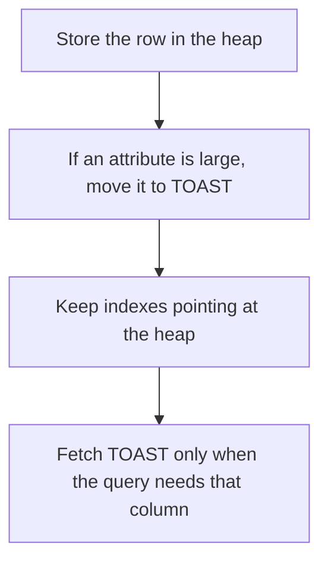

# D09-T007 — Heap storage and TOAST

Topic ID: `D09-T007`
Domain: PostgreSQL Internals
Subdomain: Heap storage and TOAST
Importance: advanced
Complexity: advanced
Dependencies: `D09-T006`, `D09-T001`, `D07-T001`, `D07-T002`, `D08-T001`, `D08-T002`
Execution status of the code in section F: unexecuted

## A. Topic Overview

The heap is PostgreSQL's table storage: unordered row versions in pages. An index points at heap tuple identifiers. TOAST moves oversized attributes to a side table and leaves a pointer in the main row, so a page can stay small enough to scan. Toasted values may be compressed and stored out of line. Selecting the wide column fetches the TOAST data. Selecting only the narrow columns can avoid it.

In production this shows up as follows: A documents table stores the file bytes in a bytea column and every list API loads them. Splitting metadata from payload, or simply not selecting the bytea, drops latency.

Interviewers use Heap storage and TOAST to see whether you can state the failure mode, not only the definition. The failure to name is: SELECT * on a table with large JSON or text, pulling TOAST for rows that only needed an id

Prerequisites: `D09-T006`, `D09-T001`, `D07-T001`, `D07-T002`, `D08-T001`, `D08-T002`. Later notes should link here instead of repeating the mechanism.

## B. First-Principles Explanation

The heap is PostgreSQL's table storage: unordered row versions in pages. An index points at heap tuple identifiers. TOAST moves oversized attributes to a side table and leaves a pointer in the main row, so a page can stay small enough to scan. Toasted values may be compressed and stored out of line. Selecting the wide column fetches the TOAST data. Selecting only the narrow columns can avoid it.

The useful picture is: The heap is a stack of variable forms. TOAST is the annex where the oversized attachments live, with a stub left on the form.

What has to be true:

1. Store the row in the heap
2. If an attribute is large, move it to TOAST
3. Keep indexes pointing at the heap
4. Fetch TOAST only when the query needs that column

It works when those steps preserve one invariant. It fails when SELECT * on a table with large JSON or text, pulling TOAST for rows that only needed an id. The alternative is: you put hot narrow counters and cold blobs in one row and always select both

## C. Internal Working and Architecture

Components involved: the caller, the state Heap storage and TOAST mutates or reads, and the observer that reports TOAST table size and buffer hits when the query list includes the wide column.

Execution:

1. Store the row in the heap
2. If an attribute is large, move it to TOAST
3. Keep indexes pointing at the heap
4. Fetch TOAST only when the query needs that column

Data moves only along that path. A retry re-enters at step 1, so the operation must say what a duplicate does. Memory and locks stay inside this mechanism. Callers see the result or a typed error, not a half-updated invariant.

State to remember: choose this when rows carry attributes too large for a normal page. Do not choose it when you put hot narrow counters and cold blobs in one row and always select both.

## D. Diagrams and Visual Models



Read the diagram from top to bottom. Each box is one step of Heap storage and TOAST. The failure mode (SELECT * on a table with large JSON or text, pulling TOAST for rows that only needed an id) is what you look for when a later box never happens or happens twice.

## E. Examples and Analogies

Analogy: The heap is a stack of variable forms. TOAST is the annex where the oversized attachments live, with a stub left on the form.

Production example: A documents table stores the file bytes in a bytea column and every list API loads them. Splitting metadata from payload, or simply not selecting the bytea, drops latency.

A small counterexample is enough in an interview. Show the input, apply the steps, and show the broken outcome if someone uses the mechanism outside its rule: SELECT * on a table with large JSON or text, pulling TOAST for rows that only needed an id.

## F. Code Examples

The snippet is labeled unexecuted. It illustrates the shape of the idea. It is not a benchmark and it embeds no secret.

```sql
SELECT id, status FROM orders WHERE id = 1;
-- avoids reading a toasted payload column that this query does not need
```

After the snippet, check TOAST table size and buffer hits when the query list includes the wide column. If that signal moves the wrong way, the snippet is the wrong tool for the workload.

## G. Practical Backend Application

Use Heap storage and TOAST in a service when rows carry attributes too large for a normal page.

A typical place is the production case already stated: A documents table stores the file bytes in a bytea column and every list API loads them. Splitting metadata from payload, or simply not selecting the bytea, drops latency.

Operationally you alert on TOAST table size and buffer hits when the query list includes the wide column. You do not alert only on process uptime. The dashboard should show the failure mode, a success rate, and the saturation signal (queue depth, lock wait, or latency) that predicts it.

## H. Advantages, Limitations and Trade-offs

| Choice | Benefit | Cost | Choose when | Avoid when |
| --- | --- | --- | --- | --- |
| Apply Heap storage and TOAST | rows carry attributes too large for a normal page | Extra moving parts and a new failure mode | The failure you are preventing is already real | you put hot narrow counters and cold blobs in one row and always select both |
| Simpler alternative | Less code and fewer dependencies | SELECT * on a table with large JSON or text, pulling TOAST for rows that only needed an id | The workload does not hit the limit | The invariant must hold under concurrency or failure |

Heap storage and TOAST is a trade. State the benefit and the cost in the same sentence when you propose it in a design review.

## I. Common Mistakes and Misconceptions

- Using SELECT *.
- Indexing a toasted column by accident in a way that bloats the index.
- Assuming the heap is ordered by primary key.
- Treating a diagram of Heap storage and TOAST as proof that the invariant holds in production.
- Copying a default configuration without naming TOAST table size and buffer hits when the query list includes the wide column.

## J. Debugging and Troubleshooting

Symptom: SELECT * on a table with large JSON or text, pulling TOAST for rows that only needed an id

First check: TOAST table size and buffer hits when the query list includes the wide column.

Then compare one healthy instance against one unhealthy instance. Confirm whether retries are duplicating work. Confirm whether a timeout is shorter than the work. Fix the invariant, then watch the same metric for a full peak, not only for the next minute.

Useful questions: did the step order in section C actually happen, or did a caller skip a step? Did a deploy change the data shape that Heap storage and TOAST assumes?

## K. Interview Preparation

### Beginner

#### Q1. What problem does Heap storage and TOAST solve?

**Answer:** The heap is PostgreSQL's table storage: unordered row versions in pages. An index points at heap tuple identifiers. TOAST moves oversized attributes to a side table and leaves a pointer in the main row, so a page can stay small enough to scan. Toasted values may be compressed and stored out of line. Selecting the wide column fetches the TOAST data. Selecting only the narrow columns can avoid it. Without it, the usual backend failure is: SELECT * on a table with large JSON or text, pulling TOAST for rows that only needed an id.

#### Q2. Where does Heap storage and TOAST sit on a request path?

**Answer:** Heap storage and TOAST is not a library you sprinkle on every call. rows carry attributes too large for a normal page You notice it when TOAST table size and buffer hits when the query list includes the wide column. Name the constraint that makes this choice correct. Say what you would measure to confirm it.

#### Q3. Give a concrete example of Heap storage and TOAST.

**Answer:** A documents table stores the file bytes in a bytea column and every list API loads them. Splitting metadata from payload, or simply not selecting the bytea, drops latency. Walk the input, the state change, and the observable output. Name the constraint that makes this choice correct.

#### Q4. What is a common mix-up around Heap storage and TOAST?

**Answer:** SELECT * on a table with large JSON or text, pulling TOAST for rows that only needed an id The corrective check is TOAST table size and buffer hits when the query list includes the wide column. Name the constraint that makes this choice correct. Say what you would measure to confirm it. Say which alternative you rejected and why.

#### Q5. When would you skip Heap storage and TOAST?

**Answer:** you put hot narrow counters and cold blobs in one row and always select both Skipping is a decision with a measured cost, not a slogan. Name the constraint that makes this choice correct. Say what you would measure to confirm it. Say which alternative you rejected and why.

### Intermediate

#### Q1. What invariant makes Heap storage and TOAST correct?

**Answer:** The heap is PostgreSQL's table storage: unordered row versions in pages. An index points at heap tuple identifiers. TOAST moves oversized attributes to a side table and leaves a pointer in the main row, so a page can stay small enough to scan. Toasted values may be compressed and stored out of line. Selecting the wide column fetches the TOAST data. Selecting only the narrow columns can avoid it. State the invariant before you name the tool.

#### Q2. How do you test Heap storage and TOAST?

**Answer:** Assert the failure mode directly: SELECT * on a table with large JSON or text, pulling TOAST for rows that only needed an id. The assertion should watch TOAST table size and buffer hits when the query list includes the wide column. Include a concurrent or retry case if the bug only appears then. Name the constraint that makes this choice correct.

#### Q3. What signal tells you Heap storage and TOAST is misbehaving in production?

**Answer:** Watch TOAST table size and buffer hits when the query list includes the wide column. The user-visible symptom is usually SELECT * on a table with large JSON or text, pulling TOAST for rows that only needed an id. Name the constraint that makes this choice correct. Say what you would measure to confirm it.

#### Q4. How would you introduce Heap storage and TOAST into a legacy service?

**Answer:** rows carry attributes too large for a normal page Ship it behind a metric so you can compare the old path. Roll back if SELECT * on a table with large JSON or text, pulling TOAST for rows that only needed an id gets worse. Name the constraint that makes this choice correct. Say what you would measure to confirm it.

#### Q5. What do you trade away by choosing Heap storage and TOAST?

**Answer:** rows carry attributes too large for a normal page you put hot narrow counters and cold blobs in one row and always select both Say the cost in latency, storage, or operational load. Name the constraint that makes this choice correct. Say what you would measure to confirm it. Say which alternative you rejected and why.

### Advanced

#### Q1. What breaks if a dependency of Heap storage and TOAST is slow or down?

**Answer:** SELECT * on a table with large JSON or text, pulling TOAST for rows that only needed an id Degrade using the rule: you put hot narrow counters and cold blobs in one row and always select both. Timeouts must be shorter than the caller's deadline. Name the constraint that makes this choice correct. Say what you would measure to confirm it.

#### Q2. How does Heap storage and TOAST behave under retries?

**Answer:** Retries repeat work, so Heap storage and TOAST must define what a duplicate does. SELECT * on a table with large JSON or text, pulling TOAST for rows that only needed an id Idempotency keys or fences belong next to the write, not in a comment. Name the constraint that makes this choice correct. Say what you would measure to confirm it.

#### Q3. What is the capacity limit of Heap storage and TOAST?

**Answer:** The limit shows up as TOAST table size and buffer hits when the query list includes the wide column. Add capacity only after you know whether the bottleneck is CPU, lock wait, or network. Name the constraint that makes this choice correct. Say what you would measure to confirm it.

#### Q4. How do you evolve Heap storage and TOAST without a flag day?

**Answer:** rows carry attributes too large for a normal page Version the contract or the on-disk format. Readers should tolerate one old and one new shape during the rollout. Name the constraint that makes this choice correct. Say what you would measure to confirm it.

#### Q5. What security or correctness bug hides inside Heap storage and TOAST?

**Answer:** SELECT * on a table with large JSON or text, pulling TOAST for rows that only needed an id Check authorization and tenancy at the same boundary as the mechanism. A cache or queue must not widen who can read the data. Name the constraint that makes this choice correct. Say what you would measure to confirm it.

### Scenario

#### Q1. Incident: SELECT * on a table with large JSON or text, pulling TOAST for rows that only needed an id. What do you check first?

**Answer:** Start with TOAST table size and buffer hits when the query list includes the wide column. Compare a good host and a bad host before you restart anything. The heap is PostgreSQL's table storage: unordered row versions in pages. An index points at heap tuple identifiers. TOAST moves oversized attributes to a side table and leaves a pointer in the main row, so a page can stay small enough to scan. Toasted values may be compressed and stored out of line. Selecting the wide column fetches the TOAST data. Selecting only the narrow columns can avoid it.

#### Q2. A reviewer wants the clever version. What data settles it?

**Answer:** rows carry attributes too large for a normal page you put hot narrow counters and cold blobs in one row and always select both Bring TOAST table size and buffer hits when the query list includes the wide column from a load test or from production, not a slogan. Name the constraint that makes this choice correct. Say what you would measure to confirm it. Say which alternative you rejected and why.

#### Q3. You have one hour to explain Heap storage and TOAST at a whiteboard.

**Answer:** Draw the happy path in four boxes. Then draw the failure: SELECT * on a table with large JSON or text, pulling TOAST for rows that only needed an id. End with the metric you would page on. Name the constraint that makes this choice correct.

#### Q4. The bug only appears under two concurrent callers.

**Answer:** SELECT * on a table with large JSON or text, pulling TOAST for rows that only needed an id Reproduce with a barrier so both sides enter the critical window. Confirm the fix with TOAST table size and buffer hits when the query list includes the wide column. Name the constraint that makes this choice correct. Say what you would measure to confirm it.

#### Q5. Leadership wants this on every service next week.

**Answer:** you put hot narrow counters and cold blobs in one row and always select both rows carry attributes too large for a normal page Roll it out where the failure mode is already hurting users. Name the constraint that makes this choice correct. Say what you would measure to confirm it. Say which alternative you rejected and why.

### Follow-up

#### Q1. What did you assume about the data size or the clock?

**Answer:** The heap is PostgreSQL's table storage: unordered row versions in pages. An index points at heap tuple identifiers. TOAST moves oversized attributes to a side table and leaves a pointer in the main row, so a page can stay small enough to scan. Toasted values may be compressed and stored out of line. Selecting the wide column fetches the TOAST data. Selecting only the narrow columns can avoid it. Clocks are not a total order across machines. State whether the algorithm needs bounded size or a single leader.

#### Q2. What would you measure after the change ships?

**Answer:** Page on TOAST table size and buffer hits when the query list includes the wide column. Keep a before/after dashboard for one week. Alert on the failure mode, not only on CPU. Name the constraint that makes this choice correct.

#### Q3. Which neighboring topic did you deliberately not re-teach?

**Answer:** This note owns Heap storage and TOAST. Related identifiers are in section N. Shared ideas are linked, not copied. Name the constraint that makes this choice correct.

## L. Practical Exercises

Solutions are in `EXERCISES/solutions/D09-T007.md`, not in this section.

1. Whiteboard the four steps of Heap storage and TOAST and mark where `SELECT * on a table with large JSON or text, pulling TOAST for rows that only needed an id` enters.
2. Read the snippet in section F and write the assertion that would catch that failure. The assertion must mention `TOAST table size and buffer hits when the query list includes the wide column`.
3. Argue for or against using Heap storage and TOAST on a service you know. Use the choose and avoid rows from section H. Do not appeal to popularity.

## M. Revision Notes

- Mechanism: The heap is PostgreSQL's table storage: unordered row versions in pages.
- Failure: SELECT * on a table with large JSON or text, pulling TOAST for rows that only needed an id
- Metric: TOAST table size and buffer hits when the query list includes the wide column
- Choose when: rows carry attributes too large for a normal page
- Avoid when: you put hot narrow counters and cold blobs in one row and always select both

## N. Related Topics

Dependencies to review first: `D09-T006`, `D09-T001`, `D07-T001`, `D07-T002`, `D08-T001`, `D08-T002`.

Shared ideas stay in those notes. This note does not restate them.

## O. Completion Criteria

- You can explain Heap storage and TOAST without reading this note, including the failure mode.
- You can draw the diagram in section D from memory.
- You can say when not to use it, using the avoid condition in section H.
- You can name the metric you would watch after shipping it.
