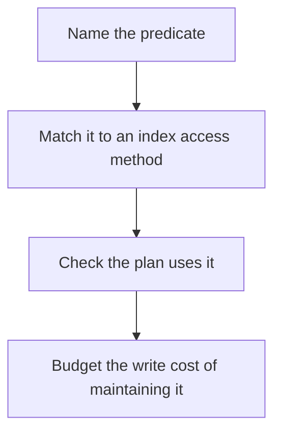

# D09-T008 — B-tree, GIN, GiST and BRIN indexes

Topic ID: `D09-T008`
Domain: PostgreSQL Internals
Subdomain: B-tree, GIN, GiST and BRIN indexes
Importance: advanced
Complexity: advanced
Dependencies: `D09-T007`, `D09-T001`, `D07-T001`, `D07-T002`, `D08-T001`, `D08-T002`
Execution status of the code in section F: unexecuted

## A. Topic Overview

A B-tree index supports equality and range order. GIN indexes composite values such as arrays, JSONB keys, and full text, and is built for elements contained in a value. GiST indexes geometric and other extensible types and nearest-neighbor strategies. BRIN stores summaries of value ranges per block range and stays small when the table is physically ordered by the indexed column. The wrong index type still gets updated on every write.

In production this shows up as follows: created_at on an append-only events table is a BRIN candidate. A unique order id is a B-tree. Searching JSONB containment wants GIN. Building all three 'just in case' taxes every insert.

Interviewers use B-tree, GIN, GiST and BRIN indexes to see whether you can state the failure mode, not only the definition. The failure to name is: a B-tree on a high-cardinality JSON path that the planner never uses, or a BRIN index on unordered data that returns the whole table

Prerequisites: `D09-T007`, `D09-T001`, `D07-T001`, `D07-T002`, `D08-T001`, `D08-T002`. Later notes should link here instead of repeating the mechanism.

## B. First-Principles Explanation

A B-tree index supports equality and range order. GIN indexes composite values such as arrays, JSONB keys, and full text, and is built for elements contained in a value. GiST indexes geometric and other extensible types and nearest-neighbor strategies. BRIN stores summaries of value ranges per block range and stays small when the table is physically ordered by the indexed column. The wrong index type still gets updated on every write.

The useful picture is: A B-tree is a phone book. GIN is an index of individual words. GiST is a map index. BRIN is a note that says which shelf of a time-ordered archive might hold the year you want.

What has to be true:

1. Name the predicate
2. Match it to an index access method
3. Check the plan uses it
4. Budget the write cost of maintaining it

It works when those steps preserve one invariant. It fails when a B-tree on a high-cardinality JSON path that the planner never uses, or a BRIN index on unordered data that returns the whole table. The alternative is: you add indexes for columns nobody filters on

## C. Internal Working and Architecture

Components involved: the caller, the state B-tree, GIN, GiST and BRIN indexes mutates or reads, and the observer that reports index-only or index scan rows versus sequential scan rows, and insert latency after the index exists.

Execution:

1. Name the predicate
2. Match it to an index access method
3. Check the plan uses it
4. Budget the write cost of maintaining it

Data moves only along that path. A retry re-enters at step 1, so the operation must say what a duplicate does. Memory and locks stay inside this mechanism. Callers see the result or a typed error, not a half-updated invariant.

State to remember: choose this when you have a predicate and a measured plan. Do not choose it when you add indexes for columns nobody filters on.

## D. Diagrams and Visual Models



Read the diagram from top to bottom. Each box is one step of B-tree, GIN, GiST and BRIN indexes. The failure mode (a B-tree on a high-cardinality JSON path that the planner never uses, or a BRIN index on unordered data that returns the whole table) is what you look for when a later box never happens or happens twice.

## E. Examples and Analogies

Analogy: A B-tree is a phone book. GIN is an index of individual words. GiST is a map index. BRIN is a note that says which shelf of a time-ordered archive might hold the year you want.

Production example: created_at on an append-only events table is a BRIN candidate. A unique order id is a B-tree. Searching JSONB containment wants GIN. Building all three 'just in case' taxes every insert.

A small counterexample is enough in an interview. Show the input, apply the steps, and show the broken outcome if someone uses the mechanism outside its rule: a B-tree on a high-cardinality JSON path that the planner never uses, or a BRIN index on unordered data that returns the whole table.

## F. Code Examples

The snippet is labeled unexecuted. It illustrates the shape of the idea. It is not a benchmark and it embeds no secret.

```sql
CREATE INDEX CONCURRENTLY orders_created_brin ON orders USING brin (created_at);
```

After the snippet, check index-only or index scan rows versus sequential scan rows, and insert latency after the index exists. If that signal moves the wrong way, the snippet is the wrong tool for the workload.

## G. Practical Backend Application

Use B-tree, GIN, GiST and BRIN indexes in a service when you have a predicate and a measured plan.

A typical place is the production case already stated: created_at on an append-only events table is a BRIN candidate. A unique order id is a B-tree. Searching JSONB containment wants GIN. Building all three 'just in case' taxes every insert.

Operationally you alert on index-only or index scan rows versus sequential scan rows, and insert latency after the index exists. You do not alert only on process uptime. The dashboard should show the failure mode, a success rate, and the saturation signal (queue depth, lock wait, or latency) that predicts it.

## H. Advantages, Limitations and Trade-offs

| Choice | Benefit | Cost | Choose when | Avoid when |
| --- | --- | --- | --- | --- |
| Apply B-tree, GIN, GiST and BRIN indexes | you have a predicate and a measured plan | Extra moving parts and a new failure mode | The failure you are preventing is already real | you add indexes for columns nobody filters on |
| Simpler alternative | Less code and fewer dependencies | a B-tree on a high-cardinality JSON path that the planner never uses, or a BRIN index on unordered data that returns the whole table | The workload does not hit the limit | The invariant must hold under concurrency or failure |

B-tree, GIN, GiST and BRIN indexes is a trade. State the benefit and the cost in the same sentence when you propose it in a design review.

## I. Common Mistakes and Misconceptions

- Assuming every index speeds every query.
- Using BRIN on randomly inserted keys.
- Creating indexes without CONCURRENTLY on a live table and taking a write lock you did not plan.
- Treating a diagram of B-tree, GIN, GiST and BRIN indexes as proof that the invariant holds in production.
- Copying a default configuration without naming index-only or index scan rows versus sequential scan rows, and insert latency after the index exists.

## J. Debugging and Troubleshooting

Symptom: a B-tree on a high-cardinality JSON path that the planner never uses, or a BRIN index on unordered data that returns the whole table

First check: index-only or index scan rows versus sequential scan rows, and insert latency after the index exists.

Then compare one healthy instance against one unhealthy instance. Confirm whether retries are duplicating work. Confirm whether a timeout is shorter than the work. Fix the invariant, then watch the same metric for a full peak, not only for the next minute.

Useful questions: did the step order in section C actually happen, or did a caller skip a step? Did a deploy change the data shape that B-tree, GIN, GiST and BRIN indexes assumes?

## K. Interview Preparation

### Beginner

#### Q1. What problem does B-tree, GIN, GiST and BRIN indexes solve?

**Answer:** A B-tree index supports equality and range order. GIN indexes composite values such as arrays, JSONB keys, and full text, and is built for elements contained in a value. GiST indexes geometric and other extensible types and nearest-neighbor strategies. BRIN stores summaries of value ranges per block range and stays small when the table is physically ordered by the indexed column. The wrong index type still gets updated on every write. Without it, the usual backend failure is: a B-tree on a high-cardinality JSON path that the planner never uses, or a BRIN index on unordered data that returns the whole table.

#### Q2. Where does B-tree, GIN, GiST and BRIN indexes sit on a request path?

**Answer:** B-tree, GIN, GiST and BRIN indexes is not a library you sprinkle on every call. you have a predicate and a measured plan You notice it when index-only or index scan rows versus sequential scan rows, and insert latency after the index exists. Name the constraint that makes this choice correct. Say what you would measure to confirm it.

#### Q3. Give a concrete example of B-tree, GIN, GiST and BRIN indexes.

**Answer:** created_at on an append-only events table is a BRIN candidate. A unique order id is a B-tree. Searching JSONB containment wants GIN. Building all three 'just in case' taxes every insert. Walk the input, the state change, and the observable output.

#### Q4. What is a common mix-up around B-tree, GIN, GiST and BRIN indexes?

**Answer:** a B-tree on a high-cardinality JSON path that the planner never uses, or a BRIN index on unordered data that returns the whole table The corrective check is index-only or index scan rows versus sequential scan rows, and insert latency after the index exists. Name the constraint that makes this choice correct. Say what you would measure to confirm it. Say which alternative you rejected and why.

#### Q5. When would you skip B-tree, GIN, GiST and BRIN indexes?

**Answer:** you add indexes for columns nobody filters on Skipping is a decision with a measured cost, not a slogan. Name the constraint that makes this choice correct. Say what you would measure to confirm it. Say which alternative you rejected and why.

### Intermediate

#### Q1. What invariant makes B-tree, GIN, GiST and BRIN indexes correct?

**Answer:** A B-tree index supports equality and range order. GIN indexes composite values such as arrays, JSONB keys, and full text, and is built for elements contained in a value. GiST indexes geometric and other extensible types and nearest-neighbor strategies. BRIN stores summaries of value ranges per block range and stays small when the table is physically ordered by the indexed column. The wrong index type still gets updated on every write. State the invariant before you name the tool.

#### Q2. How do you test B-tree, GIN, GiST and BRIN indexes?

**Answer:** Assert the failure mode directly: a B-tree on a high-cardinality JSON path that the planner never uses, or a BRIN index on unordered data that returns the whole table. The assertion should watch index-only or index scan rows versus sequential scan rows, and insert latency after the index exists. Include a concurrent or retry case if the bug only appears then. Name the constraint that makes this choice correct.

#### Q3. What signal tells you B-tree, GIN, GiST and BRIN indexes is misbehaving in production?

**Answer:** Watch index-only or index scan rows versus sequential scan rows, and insert latency after the index exists. The user-visible symptom is usually a B-tree on a high-cardinality JSON path that the planner never uses, or a BRIN index on unordered data that returns the whole table. Name the constraint that makes this choice correct. Say what you would measure to confirm it.

#### Q4. How would you introduce B-tree, GIN, GiST and BRIN indexes into a legacy service?

**Answer:** you have a predicate and a measured plan Ship it behind a metric so you can compare the old path. Roll back if a B-tree on a high-cardinality JSON path that the planner never uses, or a BRIN index on unordered data that returns the whole table gets worse. Name the constraint that makes this choice correct. Say what you would measure to confirm it.

#### Q5. What do you trade away by choosing B-tree, GIN, GiST and BRIN indexes?

**Answer:** you have a predicate and a measured plan you add indexes for columns nobody filters on Say the cost in latency, storage, or operational load. Name the constraint that makes this choice correct. Say what you would measure to confirm it. Say which alternative you rejected and why.

### Advanced

#### Q1. What breaks if a dependency of B-tree, GIN, GiST and BRIN indexes is slow or down?

**Answer:** a B-tree on a high-cardinality JSON path that the planner never uses, or a BRIN index on unordered data that returns the whole table Degrade using the rule: you add indexes for columns nobody filters on. Timeouts must be shorter than the caller's deadline. Name the constraint that makes this choice correct. Say what you would measure to confirm it.

#### Q2. How does B-tree, GIN, GiST and BRIN indexes behave under retries?

**Answer:** Retries repeat work, so B-tree, GIN, GiST and BRIN indexes must define what a duplicate does. a B-tree on a high-cardinality JSON path that the planner never uses, or a BRIN index on unordered data that returns the whole table Idempotency keys or fences belong next to the write, not in a comment. Name the constraint that makes this choice correct. Say what you would measure to confirm it.

#### Q3. What is the capacity limit of B-tree, GIN, GiST and BRIN indexes?

**Answer:** The limit shows up as index-only or index scan rows versus sequential scan rows, and insert latency after the index exists. Add capacity only after you know whether the bottleneck is CPU, lock wait, or network. Name the constraint that makes this choice correct. Say what you would measure to confirm it.

#### Q4. How do you evolve B-tree, GIN, GiST and BRIN indexes without a flag day?

**Answer:** you have a predicate and a measured plan Version the contract or the on-disk format. Readers should tolerate one old and one new shape during the rollout. Name the constraint that makes this choice correct. Say what you would measure to confirm it.

#### Q5. What security or correctness bug hides inside B-tree, GIN, GiST and BRIN indexes?

**Answer:** a B-tree on a high-cardinality JSON path that the planner never uses, or a BRIN index on unordered data that returns the whole table Check authorization and tenancy at the same boundary as the mechanism. A cache or queue must not widen who can read the data. Name the constraint that makes this choice correct. Say what you would measure to confirm it.

### Scenario

#### Q1. Incident: a B-tree on a high-cardinality JSON path that the planner never uses, or a BRIN index on unordered data that returns the whole table. What do you check first?

**Answer:** Start with index-only or index scan rows versus sequential scan rows, and insert latency after the index exists. Compare a good host and a bad host before you restart anything. A B-tree index supports equality and range order. GIN indexes composite values such as arrays, JSONB keys, and full text, and is built for elements contained in a value. GiST indexes geometric and other extensible types and nearest-neighbor strategies. BRIN stores summaries of value ranges per block range and stays small when the table is physically ordered by the indexed column. The wrong index type still gets updated on every write.

#### Q2. A reviewer wants the clever version. What data settles it?

**Answer:** you have a predicate and a measured plan you add indexes for columns nobody filters on Bring index-only or index scan rows versus sequential scan rows, and insert latency after the index exists from a load test or from production, not a slogan. Name the constraint that makes this choice correct. Say what you would measure to confirm it. Say which alternative you rejected and why.

#### Q3. You have one hour to explain B-tree, GIN, GiST and BRIN indexes at a whiteboard.

**Answer:** Draw the happy path in four boxes. Then draw the failure: a B-tree on a high-cardinality JSON path that the planner never uses, or a BRIN index on unordered data that returns the whole table. End with the metric you would page on. Name the constraint that makes this choice correct.

#### Q4. The bug only appears under two concurrent callers.

**Answer:** a B-tree on a high-cardinality JSON path that the planner never uses, or a BRIN index on unordered data that returns the whole table Reproduce with a barrier so both sides enter the critical window. Confirm the fix with index-only or index scan rows versus sequential scan rows, and insert latency after the index exists. Name the constraint that makes this choice correct. Say what you would measure to confirm it.

#### Q5. Leadership wants this on every service next week.

**Answer:** you add indexes for columns nobody filters on you have a predicate and a measured plan Roll it out where the failure mode is already hurting users. Name the constraint that makes this choice correct. Say what you would measure to confirm it. Say which alternative you rejected and why.

### Follow-up

#### Q1. What did you assume about the data size or the clock?

**Answer:** A B-tree index supports equality and range order. GIN indexes composite values such as arrays, JSONB keys, and full text, and is built for elements contained in a value. GiST indexes geometric and other extensible types and nearest-neighbor strategies. BRIN stores summaries of value ranges per block range and stays small when the table is physically ordered by the indexed column. The wrong index type still gets updated on every write. Clocks are not a total order across machines. State whether the algorithm needs bounded size or a single leader.

#### Q2. What would you measure after the change ships?

**Answer:** Page on index-only or index scan rows versus sequential scan rows, and insert latency after the index exists. Keep a before/after dashboard for one week. Alert on the failure mode, not only on CPU. Name the constraint that makes this choice correct.

#### Q3. Which neighboring topic did you deliberately not re-teach?

**Answer:** This note owns B-tree, GIN, GiST and BRIN indexes. Related identifiers are in section N. Shared ideas are linked, not copied. Name the constraint that makes this choice correct.

## L. Practical Exercises

Solutions are in `EXERCISES/solutions/D09-T008.md`, not in this section.

1. Whiteboard the four steps of B-tree, GIN, GiST and BRIN indexes and mark where `a B-tree on a high-cardinality JSON path that the planner never uses, or a BRIN index on unordered data that returns the whole table` enters.
2. Read the snippet in section F and write the assertion that would catch that failure. The assertion must mention `index-only or index scan rows versus sequential scan rows, and insert latency after the index exists`.
3. Argue for or against using B-tree, GIN, GiST and BRIN indexes on a service you know. Use the choose and avoid rows from section H. Do not appeal to popularity.

## M. Revision Notes

- Mechanism: A B-tree index supports equality and range order.
- Failure: a B-tree on a high-cardinality JSON path that the planner never uses, or a BRIN index on unordered data that returns the whole table
- Metric: index-only or index scan rows versus sequential scan rows, and insert latency after the index exists
- Choose when: you have a predicate and a measured plan
- Avoid when: you add indexes for columns nobody filters on

## N. Related Topics

Dependencies to review first: `D09-T007`, `D09-T001`, `D07-T001`, `D07-T002`, `D08-T001`, `D08-T002`.

Shared ideas stay in those notes. This note does not restate them.

## O. Completion Criteria

- You can explain B-tree, GIN, GiST and BRIN indexes without reading this note, including the failure mode.
- You can draw the diagram in section D from memory.
- You can say when not to use it, using the avoid condition in section H.
- You can name the metric you would watch after shipping it.
