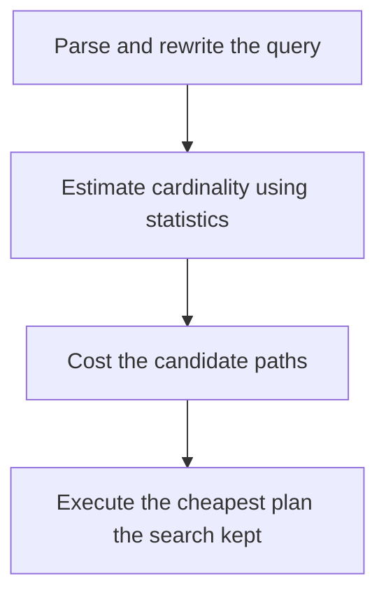

# D09-T009 — Query planner and optimizer

Topic ID: `D09-T009`
Domain: PostgreSQL Internals
Subdomain: Query planner and optimizer
Importance: advanced
Complexity: advanced
Dependencies: `D09-T008`, `D09-T001`, `D07-T001`, `D07-T002`, `D08-T001`, `D08-T002`
Execution status of the code in section F: unexecuted

## A. Topic Overview

The planner turns a SQL statement into a plan by estimating the cost of candidate paths: sequential scans, index scans, joins, and aggregations. The optimizer searches that space. It does not execute the query to decide. Bad estimates produce bad plans. The executor then runs the chosen plan. A plan that was good at one data size can be wrong after the table grows.

In production this shows up as follows: A query that is fast in staging and slow in production often has a different row estimate. EXPLAIN ANALYZE showing estimated rows of 1 and actual rows of 500000 is the smoking gun.

Interviewers use Query planner and optimizer to see whether you can state the failure mode, not only the definition. The failure to name is: a nested loop over a million-row underestimate, or a sequential scan chosen because a parameter is unknown at plan time

Prerequisites: `D09-T008`, `D09-T001`, `D07-T001`, `D07-T002`, `D08-T001`, `D08-T002`. Later notes should link here instead of repeating the mechanism.

## B. First-Principles Explanation

The planner turns a SQL statement into a plan by estimating the cost of candidate paths: sequential scans, index scans, joins, and aggregations. The optimizer searches that space. It does not execute the query to decide. Bad estimates produce bad plans. The executor then runs the chosen plan. A plan that was good at one data size can be wrong after the table grows.

The useful picture is: The planner is a dispatcher who prices several routes from a map. If the map says the bridge is empty and it is not, the cheap route is a traffic jam.

What has to be true:

1. Parse and rewrite the query
2. Estimate cardinality using statistics
3. Cost the candidate paths
4. Execute the cheapest plan the search kept

It works when those steps preserve one invariant. It fails when a nested loop over a million-row underestimate, or a sequential scan chosen because a parameter is unknown at plan time. The alternative is: you rewrite SQL at random without looking at estimated versus actual rows

## C. Internal Working and Architecture

Components involved: the caller, the state Query planner and optimizer mutates or reads, and the observer that reports estimated rows versus actual rows in EXPLAIN ANALYZE.

Execution:

1. Parse and rewrite the query
2. Estimate cardinality using statistics
3. Cost the candidate paths
4. Execute the cheapest plan the search kept

Data moves only along that path. A retry re-enters at step 1, so the operation must say what a duplicate does. Memory and locks stay inside this mechanism. Callers see the result or a typed error, not a half-updated invariant.

State to remember: choose this when you are explaining a slow query. Do not choose it when you rewrite SQL at random without looking at estimated versus actual rows.

## D. Diagrams and Visual Models



Read the diagram from top to bottom. Each box is one step of Query planner and optimizer. The failure mode (a nested loop over a million-row underestimate, or a sequential scan chosen because a parameter is unknown at plan time) is what you look for when a later box never happens or happens twice.

## E. Examples and Analogies

Analogy: The planner is a dispatcher who prices several routes from a map. If the map says the bridge is empty and it is not, the cheap route is a traffic jam.

Production example: A query that is fast in staging and slow in production often has a different row estimate. EXPLAIN ANALYZE showing estimated rows of 1 and actual rows of 500000 is the smoking gun.

A small counterexample is enough in an interview. Show the input, apply the steps, and show the broken outcome if someone uses the mechanism outside its rule: a nested loop over a million-row underestimate, or a sequential scan chosen because a parameter is unknown at plan time.

## F. Code Examples

The snippet is labeled unexecuted. It illustrates the shape of the idea. It is not a benchmark and it embeds no secret.

```sql
EXPLAIN (ANALYZE, BUFFERS) SELECT * FROM orders WHERE customer_id = 42;
```

After the snippet, check estimated rows versus actual rows in EXPLAIN ANALYZE. If that signal moves the wrong way, the snippet is the wrong tool for the workload.

## G. Practical Backend Application

Use Query planner and optimizer in a service when you are explaining a slow query.

A typical place is the production case already stated: A query that is fast in staging and slow in production often has a different row estimate. EXPLAIN ANALYZE showing estimated rows of 1 and actual rows of 500000 is the smoking gun.

Operationally you alert on estimated rows versus actual rows in EXPLAIN ANALYZE. You do not alert only on process uptime. The dashboard should show the failure mode, a success rate, and the saturation signal (queue depth, lock wait, or latency) that predicts it.

## H. Advantages, Limitations and Trade-offs

| Choice | Benefit | Cost | Choose when | Avoid when |
| --- | --- | --- | --- | --- |
| Apply Query planner and optimizer | you are explaining a slow query | Extra moving parts and a new failure mode | The failure you are preventing is already real | you rewrite SQL at random without looking at estimated versus actual rows |
| Simpler alternative | Less code and fewer dependencies | a nested loop over a million-row underestimate, or a sequential scan chosen because a parameter is unknown at plan time | The workload does not hit the limit | The invariant must hold under concurrency or failure |

Query planner and optimizer is a trade. State the benefit and the cost in the same sentence when you propose it in a design review.

## I. Common Mistakes and Misconceptions

- Reading cost numbers as milliseconds.
- Adding a hint or an index before reading the plan.
- Assuming the planner knows about correlation it was not told about.
- Treating a diagram of Query planner and optimizer as proof that the invariant holds in production.
- Copying a default configuration without naming estimated rows versus actual rows in EXPLAIN ANALYZE.

## J. Debugging and Troubleshooting

Symptom: a nested loop over a million-row underestimate, or a sequential scan chosen because a parameter is unknown at plan time

First check: estimated rows versus actual rows in EXPLAIN ANALYZE.

Then compare one healthy instance against one unhealthy instance. Confirm whether retries are duplicating work. Confirm whether a timeout is shorter than the work. Fix the invariant, then watch the same metric for a full peak, not only for the next minute.

Useful questions: did the step order in section C actually happen, or did a caller skip a step? Did a deploy change the data shape that Query planner and optimizer assumes?

## K. Interview Preparation

### Beginner

#### Q1. What problem does Query planner and optimizer solve?

**Answer:** The planner turns a SQL statement into a plan by estimating the cost of candidate paths: sequential scans, index scans, joins, and aggregations. The optimizer searches that space. It does not execute the query to decide. Bad estimates produce bad plans. The executor then runs the chosen plan. A plan that was good at one data size can be wrong after the table grows. Without it, the usual backend failure is: a nested loop over a million-row underestimate, or a sequential scan chosen because a parameter is unknown at plan time.

#### Q2. Where does Query planner and optimizer sit on a request path?

**Answer:** Query planner and optimizer is not a library you sprinkle on every call. you are explaining a slow query You notice it when estimated rows versus actual rows in EXPLAIN ANALYZE. Name the constraint that makes this choice correct. Say what you would measure to confirm it.

#### Q3. Give a concrete example of Query planner and optimizer.

**Answer:** A query that is fast in staging and slow in production often has a different row estimate. EXPLAIN ANALYZE showing estimated rows of 1 and actual rows of 500000 is the smoking gun. Walk the input, the state change, and the observable output. Name the constraint that makes this choice correct.

#### Q4. What is a common mix-up around Query planner and optimizer?

**Answer:** a nested loop over a million-row underestimate, or a sequential scan chosen because a parameter is unknown at plan time The corrective check is estimated rows versus actual rows in EXPLAIN ANALYZE. Name the constraint that makes this choice correct. Say what you would measure to confirm it. Say which alternative you rejected and why.

#### Q5. When would you skip Query planner and optimizer?

**Answer:** you rewrite SQL at random without looking at estimated versus actual rows Skipping is a decision with a measured cost, not a slogan. Name the constraint that makes this choice correct. Say what you would measure to confirm it. Say which alternative you rejected and why.

### Intermediate

#### Q1. What invariant makes Query planner and optimizer correct?

**Answer:** The planner turns a SQL statement into a plan by estimating the cost of candidate paths: sequential scans, index scans, joins, and aggregations. The optimizer searches that space. It does not execute the query to decide. Bad estimates produce bad plans. The executor then runs the chosen plan. A plan that was good at one data size can be wrong after the table grows. State the invariant before you name the tool.

#### Q2. How do you test Query planner and optimizer?

**Answer:** Assert the failure mode directly: a nested loop over a million-row underestimate, or a sequential scan chosen because a parameter is unknown at plan time. The assertion should watch estimated rows versus actual rows in EXPLAIN ANALYZE. Include a concurrent or retry case if the bug only appears then. Name the constraint that makes this choice correct.

#### Q3. What signal tells you Query planner and optimizer is misbehaving in production?

**Answer:** Watch estimated rows versus actual rows in EXPLAIN ANALYZE. The user-visible symptom is usually a nested loop over a million-row underestimate, or a sequential scan chosen because a parameter is unknown at plan time. Name the constraint that makes this choice correct. Say what you would measure to confirm it.

#### Q4. How would you introduce Query planner and optimizer into a legacy service?

**Answer:** you are explaining a slow query Ship it behind a metric so you can compare the old path. Roll back if a nested loop over a million-row underestimate, or a sequential scan chosen because a parameter is unknown at plan time gets worse. Name the constraint that makes this choice correct. Say what you would measure to confirm it.

#### Q5. What do you trade away by choosing Query planner and optimizer?

**Answer:** you are explaining a slow query you rewrite SQL at random without looking at estimated versus actual rows Say the cost in latency, storage, or operational load. Name the constraint that makes this choice correct. Say what you would measure to confirm it. Say which alternative you rejected and why.

### Advanced

#### Q1. What breaks if a dependency of Query planner and optimizer is slow or down?

**Answer:** a nested loop over a million-row underestimate, or a sequential scan chosen because a parameter is unknown at plan time Degrade using the rule: you rewrite SQL at random without looking at estimated versus actual rows. Timeouts must be shorter than the caller's deadline. Name the constraint that makes this choice correct. Say what you would measure to confirm it.

#### Q2. How does Query planner and optimizer behave under retries?

**Answer:** Retries repeat work, so Query planner and optimizer must define what a duplicate does. a nested loop over a million-row underestimate, or a sequential scan chosen because a parameter is unknown at plan time Idempotency keys or fences belong next to the write, not in a comment. Name the constraint that makes this choice correct. Say what you would measure to confirm it.

#### Q3. What is the capacity limit of Query planner and optimizer?

**Answer:** The limit shows up as estimated rows versus actual rows in EXPLAIN ANALYZE. Add capacity only after you know whether the bottleneck is CPU, lock wait, or network. Name the constraint that makes this choice correct. Say what you would measure to confirm it.

#### Q4. How do you evolve Query planner and optimizer without a flag day?

**Answer:** you are explaining a slow query Version the contract or the on-disk format. Readers should tolerate one old and one new shape during the rollout. Name the constraint that makes this choice correct. Say what you would measure to confirm it.

#### Q5. What security or correctness bug hides inside Query planner and optimizer?

**Answer:** a nested loop over a million-row underestimate, or a sequential scan chosen because a parameter is unknown at plan time Check authorization and tenancy at the same boundary as the mechanism. A cache or queue must not widen who can read the data. Name the constraint that makes this choice correct. Say what you would measure to confirm it.

### Scenario

#### Q1. Incident: a nested loop over a million-row underestimate, or a sequential scan chosen because a parameter is unknown at plan time. What do you check first?

**Answer:** Start with estimated rows versus actual rows in EXPLAIN ANALYZE. Compare a good host and a bad host before you restart anything. The planner turns a SQL statement into a plan by estimating the cost of candidate paths: sequential scans, index scans, joins, and aggregations. The optimizer searches that space. It does not execute the query to decide. Bad estimates produce bad plans. The executor then runs the chosen plan. A plan that was good at one data size can be wrong after the table grows.

#### Q2. A reviewer wants the clever version. What data settles it?

**Answer:** you are explaining a slow query you rewrite SQL at random without looking at estimated versus actual rows Bring estimated rows versus actual rows in EXPLAIN ANALYZE from a load test or from production, not a slogan. Name the constraint that makes this choice correct. Say what you would measure to confirm it. Say which alternative you rejected and why.

#### Q3. You have one hour to explain Query planner and optimizer at a whiteboard.

**Answer:** Draw the happy path in four boxes. Then draw the failure: a nested loop over a million-row underestimate, or a sequential scan chosen because a parameter is unknown at plan time. End with the metric you would page on. Name the constraint that makes this choice correct.

#### Q4. The bug only appears under two concurrent callers.

**Answer:** a nested loop over a million-row underestimate, or a sequential scan chosen because a parameter is unknown at plan time Reproduce with a barrier so both sides enter the critical window. Confirm the fix with estimated rows versus actual rows in EXPLAIN ANALYZE. Name the constraint that makes this choice correct. Say what you would measure to confirm it.

#### Q5. Leadership wants this on every service next week.

**Answer:** you rewrite SQL at random without looking at estimated versus actual rows you are explaining a slow query Roll it out where the failure mode is already hurting users. Name the constraint that makes this choice correct. Say what you would measure to confirm it. Say which alternative you rejected and why.

### Follow-up

#### Q1. What did you assume about the data size or the clock?

**Answer:** The planner turns a SQL statement into a plan by estimating the cost of candidate paths: sequential scans, index scans, joins, and aggregations. The optimizer searches that space. It does not execute the query to decide. Bad estimates produce bad plans. The executor then runs the chosen plan. A plan that was good at one data size can be wrong after the table grows. Clocks are not a total order across machines. State whether the algorithm needs bounded size or a single leader.

#### Q2. What would you measure after the change ships?

**Answer:** Page on estimated rows versus actual rows in EXPLAIN ANALYZE. Keep a before/after dashboard for one week. Alert on the failure mode, not only on CPU. Name the constraint that makes this choice correct.

#### Q3. Which neighboring topic did you deliberately not re-teach?

**Answer:** This note owns Query planner and optimizer. Related identifiers are in section N. Shared ideas are linked, not copied. Name the constraint that makes this choice correct.

## L. Practical Exercises

Solutions are in `EXERCISES/solutions/D09-T009.md`, not in this section.

1. Whiteboard the four steps of Query planner and optimizer and mark where `a nested loop over a million-row underestimate, or a sequential scan chosen because a parameter is unknown at plan time` enters.
2. Read the snippet in section F and write the assertion that would catch that failure. The assertion must mention `estimated rows versus actual rows in EXPLAIN ANALYZE`.
3. Argue for or against using Query planner and optimizer on a service you know. Use the choose and avoid rows from section H. Do not appeal to popularity.

## M. Revision Notes

- Mechanism: The planner turns a SQL statement into a plan by estimating the cost of candidate paths: sequential scans, index scans, joins, and aggregations.
- Failure: a nested loop over a million-row underestimate, or a sequential scan chosen because a parameter is unknown at plan time
- Metric: estimated rows versus actual rows in EXPLAIN ANALYZE
- Choose when: you are explaining a slow query
- Avoid when: you rewrite SQL at random without looking at estimated versus actual rows

## N. Related Topics

Dependencies to review first: `D09-T008`, `D09-T001`, `D07-T001`, `D07-T002`, `D08-T001`, `D08-T002`.

Shared ideas stay in those notes. This note does not restate them.

## O. Completion Criteria

- You can explain Query planner and optimizer without reading this note, including the failure mode.
- You can draw the diagram in section D from memory.
- You can say when not to use it, using the avoid condition in section H.
- You can name the metric you would watch after shipping it.
