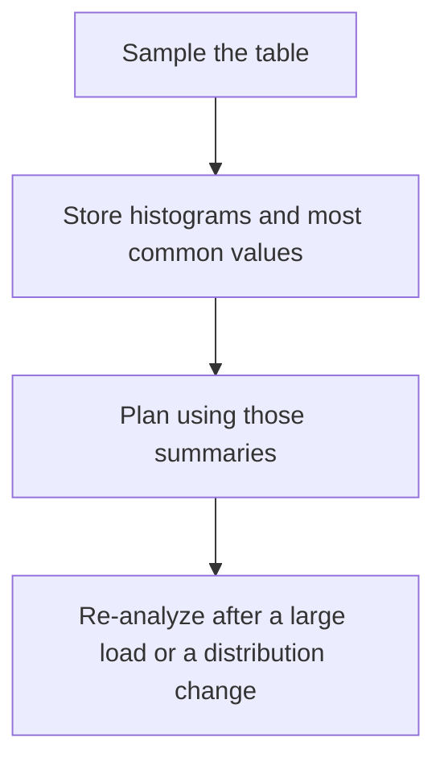

# D09-T010 — Statistics and ANALYZE

Topic ID: `D09-T010`
Domain: PostgreSQL Internals
Subdomain: Statistics and ANALYZE
Importance: advanced
Complexity: advanced
Dependencies: `D09-T009`, `D09-T001`, `D07-T001`, `D07-T002`, `D08-T001`, `D08-T002`
Execution status of the code in section F: unexecuted

## A. Topic Overview

Statistics are the planner's summary of a table: most common values, histograms, fraction of nulls, and distinct counts. ANALYZE samples the table and writes pg_statistic. Autovacuum analyzes as well as vacuums. Stale statistics after a bulk load produce plans for a table shape that no longer exists. Extended statistics capture correlation between columns that single-column stats miss.

In production this shows up as follows: A nightly load of a year's orders followed by queries that still assume the table is tiny is fixed by an explicit ANALYZE at the end of the load, not by a new index first.

Interviewers use Statistics and ANALYZE to see whether you can state the failure mode, not only the definition. The failure to name is: a plan chosen from last month's histogram after a backfill changed the data

Prerequisites: `D09-T009`, `D09-T001`, `D07-T001`, `D07-T002`, `D08-T001`, `D08-T002`. Later notes should link here instead of repeating the mechanism.

## B. First-Principles Explanation

Statistics are the planner's summary of a table: most common values, histograms, fraction of nulls, and distinct counts. ANALYZE samples the table and writes pg_statistic. Autovacuum analyzes as well as vacuums. Stale statistics after a bulk load produce plans for a table shape that no longer exists. Extended statistics capture correlation between columns that single-column stats miss.

The useful picture is: Statistics are a survey, not a census. The planner believes the survey until you run another one.

What has to be true:

1. Sample the table
2. Store histograms and most common values
3. Plan using those summaries
4. Re-analyze after a large load or a distribution change

It works when those steps preserve one invariant. It fails when a plan chosen from last month's histogram after a backfill changed the data. The alternative is: you analyze every minute on a table whose distribution is stable and you just add IO

## C. Internal Working and Architecture

Components involved: the caller, the state Statistics and ANALYZE mutates or reads, and the observer that reports last_analyze time and the estimated-versus-actual row gap.

Execution:

1. Sample the table
2. Store histograms and most common values
3. Plan using those summaries
4. Re-analyze after a large load or a distribution change

Data moves only along that path. A retry re-enters at step 1, so the operation must say what a duplicate does. Memory and locks stay inside this mechanism. Callers see the result or a typed error, not a half-updated invariant.

State to remember: choose this when data distribution changed or estimates are wildly wrong. Do not choose it when you analyze every minute on a table whose distribution is stable and you just add IO.

## D. Diagrams and Visual Models



Read the diagram from top to bottom. Each box is one step of Statistics and ANALYZE. The failure mode (a plan chosen from last month's histogram after a backfill changed the data) is what you look for when a later box never happens or happens twice.

## E. Examples and Analogies

Analogy: Statistics are a survey, not a census. The planner believes the survey until you run another one.

Production example: A nightly load of a year's orders followed by queries that still assume the table is tiny is fixed by an explicit ANALYZE at the end of the load, not by a new index first.

A small counterexample is enough in an interview. Show the input, apply the steps, and show the broken outcome if someone uses the mechanism outside its rule: a plan chosen from last month's histogram after a backfill changed the data.

## F. Code Examples

The snippet is labeled unexecuted. It illustrates the shape of the idea. It is not a benchmark and it embeds no secret.

```sql
ANALYZE orders;
```

After the snippet, check last_analyze time and the estimated-versus-actual row gap. If that signal moves the wrong way, the snippet is the wrong tool for the workload.

## G. Practical Backend Application

Use Statistics and ANALYZE in a service when data distribution changed or estimates are wildly wrong.

A typical place is the production case already stated: A nightly load of a year's orders followed by queries that still assume the table is tiny is fixed by an explicit ANALYZE at the end of the load, not by a new index first.

Operationally you alert on last_analyze time and the estimated-versus-actual row gap. You do not alert only on process uptime. The dashboard should show the failure mode, a success rate, and the saturation signal (queue depth, lock wait, or latency) that predicts it.

## H. Advantages, Limitations and Trade-offs

| Choice | Benefit | Cost | Choose when | Avoid when |
| --- | --- | --- | --- | --- |
| Apply Statistics and ANALYZE | data distribution changed or estimates are wildly wrong | Extra moving parts and a new failure mode | The failure you are preventing is already real | you analyze every minute on a table whose distribution is stable and you just add IO |
| Simpler alternative | Less code and fewer dependencies | a plan chosen from last month's histogram after a backfill changed the data | The workload does not hit the limit | The invariant must hold under concurrency or failure |

Statistics and ANALYZE is a trade. State the benefit and the cost in the same sentence when you propose it in a design review.

## I. Common Mistakes and Misconceptions

- Assuming autovacuum analyze kept up with a bulk load.
- Deleting stats.
- Raising the sample blindly and still ignoring cross-column correlation.
- Treating a diagram of Statistics and ANALYZE as proof that the invariant holds in production.
- Copying a default configuration without naming last_analyze time and the estimated-versus-actual row gap.

## J. Debugging and Troubleshooting

Symptom: a plan chosen from last month's histogram after a backfill changed the data

First check: last_analyze time and the estimated-versus-actual row gap.

Then compare one healthy instance against one unhealthy instance. Confirm whether retries are duplicating work. Confirm whether a timeout is shorter than the work. Fix the invariant, then watch the same metric for a full peak, not only for the next minute.

Useful questions: did the step order in section C actually happen, or did a caller skip a step? Did a deploy change the data shape that Statistics and ANALYZE assumes?

## K. Interview Preparation

### Beginner

#### Q1. What problem does Statistics and ANALYZE solve?

**Answer:** Statistics are the planner's summary of a table: most common values, histograms, fraction of nulls, and distinct counts. ANALYZE samples the table and writes pg_statistic. Autovacuum analyzes as well as vacuums. Stale statistics after a bulk load produce plans for a table shape that no longer exists. Extended statistics capture correlation between columns that single-column stats miss. Without it, the usual backend failure is: a plan chosen from last month's histogram after a backfill changed the data.

#### Q2. Where does Statistics and ANALYZE sit on a request path?

**Answer:** Statistics and ANALYZE is not a library you sprinkle on every call. data distribution changed or estimates are wildly wrong You notice it when last_analyze time and the estimated-versus-actual row gap. Name the constraint that makes this choice correct. Say what you would measure to confirm it.

#### Q3. Give a concrete example of Statistics and ANALYZE.

**Answer:** A nightly load of a year's orders followed by queries that still assume the table is tiny is fixed by an explicit ANALYZE at the end of the load, not by a new index first. Walk the input, the state change, and the observable output. Name the constraint that makes this choice correct. Say what you would measure to confirm it.

#### Q4. What is a common mix-up around Statistics and ANALYZE?

**Answer:** a plan chosen from last month's histogram after a backfill changed the data The corrective check is last_analyze time and the estimated-versus-actual row gap. Name the constraint that makes this choice correct. Say what you would measure to confirm it. Say which alternative you rejected and why.

#### Q5. When would you skip Statistics and ANALYZE?

**Answer:** you analyze every minute on a table whose distribution is stable and you just add IO Skipping is a decision with a measured cost, not a slogan. Name the constraint that makes this choice correct. Say what you would measure to confirm it. Say which alternative you rejected and why.

### Intermediate

#### Q1. What invariant makes Statistics and ANALYZE correct?

**Answer:** Statistics are the planner's summary of a table: most common values, histograms, fraction of nulls, and distinct counts. ANALYZE samples the table and writes pg_statistic. Autovacuum analyzes as well as vacuums. Stale statistics after a bulk load produce plans for a table shape that no longer exists. Extended statistics capture correlation between columns that single-column stats miss. State the invariant before you name the tool.

#### Q2. How do you test Statistics and ANALYZE?

**Answer:** Assert the failure mode directly: a plan chosen from last month's histogram after a backfill changed the data. The assertion should watch last_analyze time and the estimated-versus-actual row gap. Include a concurrent or retry case if the bug only appears then. Name the constraint that makes this choice correct.

#### Q3. What signal tells you Statistics and ANALYZE is misbehaving in production?

**Answer:** Watch last_analyze time and the estimated-versus-actual row gap. The user-visible symptom is usually a plan chosen from last month's histogram after a backfill changed the data. Name the constraint that makes this choice correct. Say what you would measure to confirm it.

#### Q4. How would you introduce Statistics and ANALYZE into a legacy service?

**Answer:** data distribution changed or estimates are wildly wrong Ship it behind a metric so you can compare the old path. Roll back if a plan chosen from last month's histogram after a backfill changed the data gets worse. Name the constraint that makes this choice correct. Say what you would measure to confirm it.

#### Q5. What do you trade away by choosing Statistics and ANALYZE?

**Answer:** data distribution changed or estimates are wildly wrong you analyze every minute on a table whose distribution is stable and you just add IO Say the cost in latency, storage, or operational load. Name the constraint that makes this choice correct. Say what you would measure to confirm it. Say which alternative you rejected and why.

### Advanced

#### Q1. What breaks if a dependency of Statistics and ANALYZE is slow or down?

**Answer:** a plan chosen from last month's histogram after a backfill changed the data Degrade using the rule: you analyze every minute on a table whose distribution is stable and you just add IO. Timeouts must be shorter than the caller's deadline. Name the constraint that makes this choice correct. Say what you would measure to confirm it.

#### Q2. How does Statistics and ANALYZE behave under retries?

**Answer:** Retries repeat work, so Statistics and ANALYZE must define what a duplicate does. a plan chosen from last month's histogram after a backfill changed the data Idempotency keys or fences belong next to the write, not in a comment. Name the constraint that makes this choice correct. Say what you would measure to confirm it.

#### Q3. What is the capacity limit of Statistics and ANALYZE?

**Answer:** The limit shows up as last_analyze time and the estimated-versus-actual row gap. Add capacity only after you know whether the bottleneck is CPU, lock wait, or network. Name the constraint that makes this choice correct. Say what you would measure to confirm it.

#### Q4. How do you evolve Statistics and ANALYZE without a flag day?

**Answer:** data distribution changed or estimates are wildly wrong Version the contract or the on-disk format. Readers should tolerate one old and one new shape during the rollout. Name the constraint that makes this choice correct. Say what you would measure to confirm it.

#### Q5. What security or correctness bug hides inside Statistics and ANALYZE?

**Answer:** a plan chosen from last month's histogram after a backfill changed the data Check authorization and tenancy at the same boundary as the mechanism. A cache or queue must not widen who can read the data. Name the constraint that makes this choice correct. Say what you would measure to confirm it.

### Scenario

#### Q1. Incident: a plan chosen from last month's histogram after a backfill changed the data. What do you check first?

**Answer:** Start with last_analyze time and the estimated-versus-actual row gap. Compare a good host and a bad host before you restart anything. Statistics are the planner's summary of a table: most common values, histograms, fraction of nulls, and distinct counts. ANALYZE samples the table and writes pg_statistic. Autovacuum analyzes as well as vacuums. Stale statistics after a bulk load produce plans for a table shape that no longer exists. Extended statistics capture correlation between columns that single-column stats miss.

#### Q2. A reviewer wants the clever version. What data settles it?

**Answer:** data distribution changed or estimates are wildly wrong you analyze every minute on a table whose distribution is stable and you just add IO Bring last_analyze time and the estimated-versus-actual row gap from a load test or from production, not a slogan. Name the constraint that makes this choice correct. Say what you would measure to confirm it. Say which alternative you rejected and why.

#### Q3. You have one hour to explain Statistics and ANALYZE at a whiteboard.

**Answer:** Draw the happy path in four boxes. Then draw the failure: a plan chosen from last month's histogram after a backfill changed the data. End with the metric you would page on. Name the constraint that makes this choice correct.

#### Q4. The bug only appears under two concurrent callers.

**Answer:** a plan chosen from last month's histogram after a backfill changed the data Reproduce with a barrier so both sides enter the critical window. Confirm the fix with last_analyze time and the estimated-versus-actual row gap. Name the constraint that makes this choice correct. Say what you would measure to confirm it.

#### Q5. Leadership wants this on every service next week.

**Answer:** you analyze every minute on a table whose distribution is stable and you just add IO data distribution changed or estimates are wildly wrong Roll it out where the failure mode is already hurting users. Name the constraint that makes this choice correct. Say what you would measure to confirm it. Say which alternative you rejected and why.

### Follow-up

#### Q1. What did you assume about the data size or the clock?

**Answer:** Statistics are the planner's summary of a table: most common values, histograms, fraction of nulls, and distinct counts. ANALYZE samples the table and writes pg_statistic. Autovacuum analyzes as well as vacuums. Stale statistics after a bulk load produce plans for a table shape that no longer exists. Extended statistics capture correlation between columns that single-column stats miss. Clocks are not a total order across machines. State whether the algorithm needs bounded size or a single leader.

#### Q2. What would you measure after the change ships?

**Answer:** Page on last_analyze time and the estimated-versus-actual row gap. Keep a before/after dashboard for one week. Alert on the failure mode, not only on CPU. Name the constraint that makes this choice correct.

#### Q3. Which neighboring topic did you deliberately not re-teach?

**Answer:** This note owns Statistics and ANALYZE. Related identifiers are in section N. Shared ideas are linked, not copied. Name the constraint that makes this choice correct.

## L. Practical Exercises

Solutions are in `EXERCISES/solutions/D09-T010.md`, not in this section.

1. Whiteboard the four steps of Statistics and ANALYZE and mark where `a plan chosen from last month's histogram after a backfill changed the data` enters.
2. Read the snippet in section F and write the assertion that would catch that failure. The assertion must mention `last_analyze time and the estimated-versus-actual row gap`.
3. Argue for or against using Statistics and ANALYZE on a service you know. Use the choose and avoid rows from section H. Do not appeal to popularity.

## M. Revision Notes

- Mechanism: Statistics are the planner's summary of a table: most common values, histograms, fraction of nulls, and distinct counts.
- Failure: a plan chosen from last month's histogram after a backfill changed the data
- Metric: last_analyze time and the estimated-versus-actual row gap
- Choose when: data distribution changed or estimates are wildly wrong
- Avoid when: you analyze every minute on a table whose distribution is stable and you just add IO

## N. Related Topics

Dependencies to review first: `D09-T009`, `D09-T001`, `D07-T001`, `D07-T002`, `D08-T001`, `D08-T002`.

Shared ideas stay in those notes. This note does not restate them.

## O. Completion Criteria

- You can explain Statistics and ANALYZE without reading this note, including the failure mode.
- You can draw the diagram in section D from memory.
- You can say when not to use it, using the avoid condition in section H.
- You can name the metric you would watch after shipping it.
