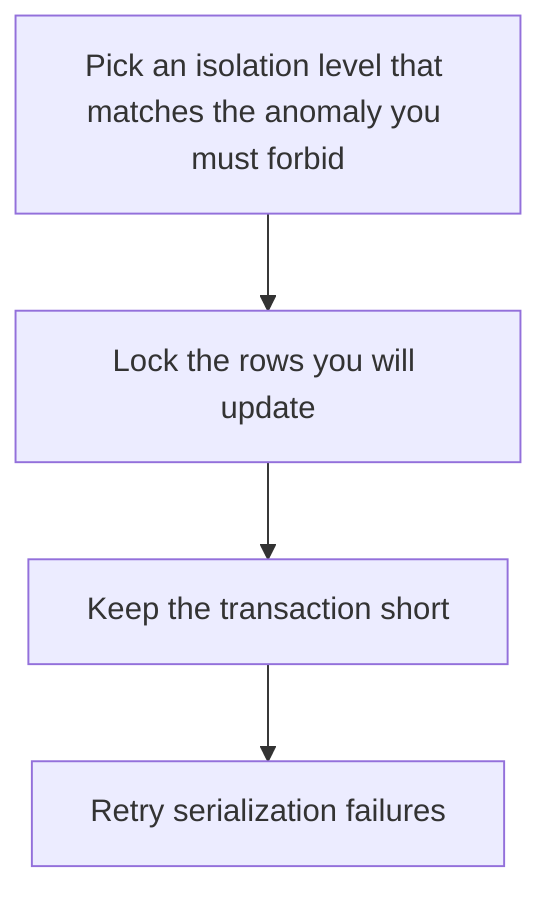

# D09-T011 — Isolation and row-level locking

Topic ID: `D09-T011`
Domain: PostgreSQL Internals
Subdomain: Isolation and row-level locking
Importance: advanced
Complexity: advanced
Dependencies: `D09-T010`, `D09-T001`, `D07-T001`, `D07-T002`, `D08-T001`, `D08-T002`
Execution status of the code in section F: unexecuted

## A. Topic Overview

Isolation decides which anomalies a transaction is allowed to see. PostgreSQL's read committed takes a new snapshot per statement. Repeatable read and serializable keep a snapshot for the transaction. Row-level locks such as FOR UPDATE stop two transactions from updating the same row. They do not by themselves stop phantoms unless the isolation level does. Lock wait is not a deadlock until a cycle exists.

In production this shows up as follows: Two checkout requests read the last seat as free under read committed and both insert. A unique constraint is the backstop. FOR UPDATE on the seat row is the lock. Serializable plus a retry also works.

Interviewers use Isolation and row-level locking to see whether you can state the failure mode, not only the definition. The failure to name is: a read-committed check-then-insert that lets two sessions create the same logical booking

Prerequisites: `D09-T010`, `D09-T001`, `D07-T001`, `D07-T002`, `D08-T001`, `D08-T002`. Later notes should link here instead of repeating the mechanism.

## B. First-Principles Explanation

Isolation decides which anomalies a transaction is allowed to see. PostgreSQL's read committed takes a new snapshot per statement. Repeatable read and serializable keep a snapshot for the transaction. Row-level locks such as FOR UPDATE stop two transactions from updating the same row. They do not by themselves stop phantoms unless the isolation level does. Lock wait is not a deadlock until a cycle exists.

The useful picture is: Isolation is deciding whether you see the menu as it was when you sat down or as it is each time you look up. A row lock is putting your hand on one plate so nobody else takes it.

What has to be true:

1. Pick an isolation level that matches the anomaly you must forbid
2. Lock the rows you will update
3. Keep the transaction short
4. Retry serialization failures

It works when those steps preserve one invariant. It fails when a read-committed check-then-insert that lets two sessions create the same logical booking. The alternative is: you hold a row lock across a user think time

## C. Internal Working and Architecture

Components involved: the caller, the state Isolation and row-level locking mutates or reads, and the observer that reports serialization failures, lock-wait time, and duplicate business keys.

Execution:

1. Pick an isolation level that matches the anomaly you must forbid
2. Lock the rows you will update
3. Keep the transaction short
4. Retry serialization failures

Data moves only along that path. A retry re-enters at step 1, so the operation must say what a duplicate does. Memory and locks stay inside this mechanism. Callers see the result or a typed error, not a half-updated invariant.

State to remember: choose this when two transactions can update related rows. Do not choose it when you hold a row lock across a user think time.

## D. Diagrams and Visual Models



Read the diagram from top to bottom. Each box is one step of Isolation and row-level locking. The failure mode (a read-committed check-then-insert that lets two sessions create the same logical booking) is what you look for when a later box never happens or happens twice.

## E. Examples and Analogies

Analogy: Isolation is deciding whether you see the menu as it was when you sat down or as it is each time you look up. A row lock is putting your hand on one plate so nobody else takes it.

Production example: Two checkout requests read the last seat as free under read committed and both insert. A unique constraint is the backstop. FOR UPDATE on the seat row is the lock. Serializable plus a retry also works.

A small counterexample is enough in an interview. Show the input, apply the steps, and show the broken outcome if someone uses the mechanism outside its rule: a read-committed check-then-insert that lets two sessions create the same logical booking.

## F. Code Examples

The snippet is labeled unexecuted. It illustrates the shape of the idea. It is not a benchmark and it embeds no secret.

```sql
BEGIN;
SELECT id FROM seats WHERE id = 10 FOR UPDATE;
-- decide, then update, then COMMIT
```

After the snippet, check serialization failures, lock-wait time, and duplicate business keys. If that signal moves the wrong way, the snippet is the wrong tool for the workload.

## G. Practical Backend Application

Use Isolation and row-level locking in a service when two transactions can update related rows.

A typical place is the production case already stated: Two checkout requests read the last seat as free under read committed and both insert. A unique constraint is the backstop. FOR UPDATE on the seat row is the lock. Serializable plus a retry also works.

Operationally you alert on serialization failures, lock-wait time, and duplicate business keys. You do not alert only on process uptime. The dashboard should show the failure mode, a success rate, and the saturation signal (queue depth, lock wait, or latency) that predicts it.

## H. Advantages, Limitations and Trade-offs

| Choice | Benefit | Cost | Choose when | Avoid when |
| --- | --- | --- | --- | --- |
| Apply Isolation and row-level locking | two transactions can update related rows | Extra moving parts and a new failure mode | The failure you are preventing is already real | you hold a row lock across a user think time |
| Simpler alternative | Less code and fewer dependencies | a read-committed check-then-insert that lets two sessions create the same logical booking | The workload does not hit the limit | The invariant must hold under concurrency or failure |

Isolation and row-level locking is a trade. State the benefit and the cost in the same sentence when you propose it in a design review.

## I. Common Mistakes and Misconceptions

- Using read committed and assuming the first SELECT still holds.
- Catching a serialization failure and not retrying.
- Locking rows in different orders.
- Treating a diagram of Isolation and row-level locking as proof that the invariant holds in production.
- Copying a default configuration without naming serialization failures, lock-wait time, and duplicate business keys.

## J. Debugging and Troubleshooting

Symptom: a read-committed check-then-insert that lets two sessions create the same logical booking

First check: serialization failures, lock-wait time, and duplicate business keys.

Then compare one healthy instance against one unhealthy instance. Confirm whether retries are duplicating work. Confirm whether a timeout is shorter than the work. Fix the invariant, then watch the same metric for a full peak, not only for the next minute.

Useful questions: did the step order in section C actually happen, or did a caller skip a step? Did a deploy change the data shape that Isolation and row-level locking assumes?

## K. Interview Preparation

### Beginner

#### Q1. What problem does Isolation and row-level locking solve?

**Answer:** Isolation decides which anomalies a transaction is allowed to see. PostgreSQL's read committed takes a new snapshot per statement. Repeatable read and serializable keep a snapshot for the transaction. Row-level locks such as FOR UPDATE stop two transactions from updating the same row. They do not by themselves stop phantoms unless the isolation level does. Lock wait is not a deadlock until a cycle exists. Without it, the usual backend failure is: a read-committed check-then-insert that lets two sessions create the same logical booking.

#### Q2. Where does Isolation and row-level locking sit on a request path?

**Answer:** Isolation and row-level locking is not a library you sprinkle on every call. two transactions can update related rows You notice it when serialization failures, lock-wait time, and duplicate business keys. Name the constraint that makes this choice correct. Say what you would measure to confirm it.

#### Q3. Give a concrete example of Isolation and row-level locking.

**Answer:** Two checkout requests read the last seat as free under read committed and both insert. A unique constraint is the backstop. FOR UPDATE on the seat row is the lock. Serializable plus a retry also works. Walk the input, the state change, and the observable output.

#### Q4. What is a common mix-up around Isolation and row-level locking?

**Answer:** a read-committed check-then-insert that lets two sessions create the same logical booking The corrective check is serialization failures, lock-wait time, and duplicate business keys. Name the constraint that makes this choice correct. Say what you would measure to confirm it. Say which alternative you rejected and why.

#### Q5. When would you skip Isolation and row-level locking?

**Answer:** you hold a row lock across a user think time Skipping is a decision with a measured cost, not a slogan. Name the constraint that makes this choice correct. Say what you would measure to confirm it. Say which alternative you rejected and why.

### Intermediate

#### Q1. What invariant makes Isolation and row-level locking correct?

**Answer:** Isolation decides which anomalies a transaction is allowed to see. PostgreSQL's read committed takes a new snapshot per statement. Repeatable read and serializable keep a snapshot for the transaction. Row-level locks such as FOR UPDATE stop two transactions from updating the same row. They do not by themselves stop phantoms unless the isolation level does. Lock wait is not a deadlock until a cycle exists. State the invariant before you name the tool.

#### Q2. How do you test Isolation and row-level locking?

**Answer:** Assert the failure mode directly: a read-committed check-then-insert that lets two sessions create the same logical booking. The assertion should watch serialization failures, lock-wait time, and duplicate business keys. Include a concurrent or retry case if the bug only appears then. Name the constraint that makes this choice correct.

#### Q3. What signal tells you Isolation and row-level locking is misbehaving in production?

**Answer:** Watch serialization failures, lock-wait time, and duplicate business keys. The user-visible symptom is usually a read-committed check-then-insert that lets two sessions create the same logical booking. Name the constraint that makes this choice correct. Say what you would measure to confirm it.

#### Q4. How would you introduce Isolation and row-level locking into a legacy service?

**Answer:** two transactions can update related rows Ship it behind a metric so you can compare the old path. Roll back if a read-committed check-then-insert that lets two sessions create the same logical booking gets worse. Name the constraint that makes this choice correct. Say what you would measure to confirm it.

#### Q5. What do you trade away by choosing Isolation and row-level locking?

**Answer:** two transactions can update related rows you hold a row lock across a user think time Say the cost in latency, storage, or operational load. Name the constraint that makes this choice correct. Say what you would measure to confirm it. Say which alternative you rejected and why.

### Advanced

#### Q1. What breaks if a dependency of Isolation and row-level locking is slow or down?

**Answer:** a read-committed check-then-insert that lets two sessions create the same logical booking Degrade using the rule: you hold a row lock across a user think time. Timeouts must be shorter than the caller's deadline. Name the constraint that makes this choice correct. Say what you would measure to confirm it.

#### Q2. How does Isolation and row-level locking behave under retries?

**Answer:** Retries repeat work, so Isolation and row-level locking must define what a duplicate does. a read-committed check-then-insert that lets two sessions create the same logical booking Idempotency keys or fences belong next to the write, not in a comment. Name the constraint that makes this choice correct. Say what you would measure to confirm it.

#### Q3. What is the capacity limit of Isolation and row-level locking?

**Answer:** The limit shows up as serialization failures, lock-wait time, and duplicate business keys. Add capacity only after you know whether the bottleneck is CPU, lock wait, or network. Name the constraint that makes this choice correct. Say what you would measure to confirm it.

#### Q4. How do you evolve Isolation and row-level locking without a flag day?

**Answer:** two transactions can update related rows Version the contract or the on-disk format. Readers should tolerate one old and one new shape during the rollout. Name the constraint that makes this choice correct. Say what you would measure to confirm it.

#### Q5. What security or correctness bug hides inside Isolation and row-level locking?

**Answer:** a read-committed check-then-insert that lets two sessions create the same logical booking Check authorization and tenancy at the same boundary as the mechanism. A cache or queue must not widen who can read the data. Name the constraint that makes this choice correct. Say what you would measure to confirm it.

### Scenario

#### Q1. Incident: a read-committed check-then-insert that lets two sessions create the same logical booking. What do you check first?

**Answer:** Start with serialization failures, lock-wait time, and duplicate business keys. Compare a good host and a bad host before you restart anything. Isolation decides which anomalies a transaction is allowed to see. PostgreSQL's read committed takes a new snapshot per statement. Repeatable read and serializable keep a snapshot for the transaction. Row-level locks such as FOR UPDATE stop two transactions from updating the same row. They do not by themselves stop phantoms unless the isolation level does. Lock wait is not a deadlock until a cycle exists.

#### Q2. A reviewer wants the clever version. What data settles it?

**Answer:** two transactions can update related rows you hold a row lock across a user think time Bring serialization failures, lock-wait time, and duplicate business keys from a load test or from production, not a slogan. Name the constraint that makes this choice correct. Say what you would measure to confirm it. Say which alternative you rejected and why.

#### Q3. You have one hour to explain Isolation and row-level locking at a whiteboard.

**Answer:** Draw the happy path in four boxes. Then draw the failure: a read-committed check-then-insert that lets two sessions create the same logical booking. End with the metric you would page on. Name the constraint that makes this choice correct.

#### Q4. The bug only appears under two concurrent callers.

**Answer:** a read-committed check-then-insert that lets two sessions create the same logical booking Reproduce with a barrier so both sides enter the critical window. Confirm the fix with serialization failures, lock-wait time, and duplicate business keys. Name the constraint that makes this choice correct. Say what you would measure to confirm it.

#### Q5. Leadership wants this on every service next week.

**Answer:** you hold a row lock across a user think time two transactions can update related rows Roll it out where the failure mode is already hurting users. Name the constraint that makes this choice correct. Say what you would measure to confirm it. Say which alternative you rejected and why.

### Follow-up

#### Q1. What did you assume about the data size or the clock?

**Answer:** Isolation decides which anomalies a transaction is allowed to see. PostgreSQL's read committed takes a new snapshot per statement. Repeatable read and serializable keep a snapshot for the transaction. Row-level locks such as FOR UPDATE stop two transactions from updating the same row. They do not by themselves stop phantoms unless the isolation level does. Lock wait is not a deadlock until a cycle exists. Clocks are not a total order across machines. State whether the algorithm needs bounded size or a single leader.

#### Q2. What would you measure after the change ships?

**Answer:** Page on serialization failures, lock-wait time, and duplicate business keys. Keep a before/after dashboard for one week. Alert on the failure mode, not only on CPU. Name the constraint that makes this choice correct.

#### Q3. Which neighboring topic did you deliberately not re-teach?

**Answer:** This note owns Isolation and row-level locking. Related identifiers are in section N. Shared ideas are linked, not copied. Name the constraint that makes this choice correct.

## L. Practical Exercises

Solutions are in `EXERCISES/solutions/D09-T011.md`, not in this section.

1. Whiteboard the four steps of Isolation and row-level locking and mark where `a read-committed check-then-insert that lets two sessions create the same logical booking` enters.
2. Read the snippet in section F and write the assertion that would catch that failure. The assertion must mention `serialization failures, lock-wait time, and duplicate business keys`.
3. Argue for or against using Isolation and row-level locking on a service you know. Use the choose and avoid rows from section H. Do not appeal to popularity.

## M. Revision Notes

- Mechanism: Isolation decides which anomalies a transaction is allowed to see.
- Failure: a read-committed check-then-insert that lets two sessions create the same logical booking
- Metric: serialization failures, lock-wait time, and duplicate business keys
- Choose when: two transactions can update related rows
- Avoid when: you hold a row lock across a user think time

## N. Related Topics

Dependencies to review first: `D09-T010`, `D09-T001`, `D07-T001`, `D07-T002`, `D08-T001`, `D08-T002`.

Shared ideas stay in those notes. This note does not restate them.

## O. Completion Criteria

- You can explain Isolation and row-level locking without reading this note, including the failure mode.
- You can draw the diagram in section D from memory.
- You can say when not to use it, using the avoid condition in section H.
- You can name the metric you would watch after shipping it.
