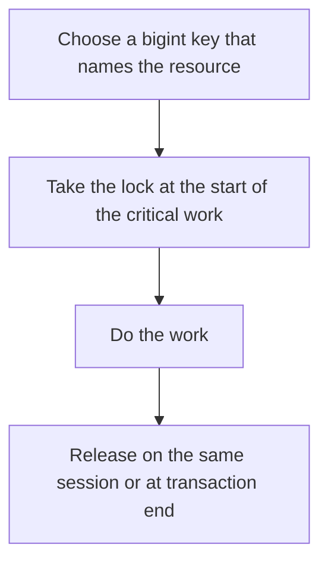

# D09-T012 — Advisory locks

Topic ID: `D09-T012`
Domain: PostgreSQL Internals
Subdomain: Advisory locks
Importance: advanced
Complexity: advanced
Dependencies: `D09-T011`, `D09-T001`, `D07-T001`, `D07-T002`, `D08-T001`, `D08-T002`
Execution status of the code in section F: unexecuted

## A. Topic Overview

An advisory lock is a lock on a key your application defines, not on a table row. PostgreSQL does not know what the key means. Session-level locks last until unlock or disconnect. Transaction-level locks last until commit or rollback. They coordinate application work such as a single worker claiming a job. They do not lock the rows the job will touch unless you also lock those rows.

In production this shows up as follows: A cron cluster uses pg_try_advisory_lock on the job id so only one node runs the payout. If the node dies, a session-level lock disappears with the connection and another node can take it.

Interviewers use Advisory locks to see whether you can state the failure mode, not only the definition. The failure to name is: two application nodes both thinking they hold the lock because one used a session lock and checked the wrong return value

Prerequisites: `D09-T011`, `D09-T001`, `D07-T001`, `D07-T002`, `D08-T001`, `D08-T002`. Later notes should link here instead of repeating the mechanism.

## B. First-Principles Explanation

An advisory lock is a lock on a key your application defines, not on a table row. PostgreSQL does not know what the key means. Session-level locks last until unlock or disconnect. Transaction-level locks last until commit or rollback. They coordinate application work such as a single worker claiming a job. They do not lock the rows the job will touch unless you also lock those rows.

The useful picture is: An advisory lock is a numbered coat hook you and your coworkers agree on. The database only knows the hook number, not whose coat it is.

What has to be true:

1. Choose a bigint key that names the resource
2. Take the lock at the start of the critical work
3. Do the work
4. Release on the same session or at transaction end

It works when those steps preserve one invariant. It fails when two application nodes both thinking they hold the lock because one used a session lock and checked the wrong return value. The alternative is: you needed a row lock or a unique constraint, which actually protects the data

## C. Internal Working and Architecture

Components involved: the caller, the state Advisory locks mutates or reads, and the observer that reports the fraction of workers who acquire the lock, and jobs that run twice.

Execution:

1. Choose a bigint key that names the resource
2. Take the lock at the start of the critical work
3. Do the work
4. Release on the same session or at transaction end

Data moves only along that path. A retry re-enters at step 1, so the operation must say what a duplicate does. Memory and locks stay inside this mechanism. Callers see the result or a typed error, not a half-updated invariant.

State to remember: choose this when you need a cooperative mutex and you do not have a natural row to lock. Do not choose it when you needed a row lock or a unique constraint, which actually protects the data.

## D. Diagrams and Visual Models



Read the diagram from top to bottom. Each box is one step of Advisory locks. The failure mode (two application nodes both thinking they hold the lock because one used a session lock and checked the wrong return value) is what you look for when a later box never happens or happens twice.

## E. Examples and Analogies

Analogy: An advisory lock is a numbered coat hook you and your coworkers agree on. The database only knows the hook number, not whose coat it is.

Production example: A cron cluster uses pg_try_advisory_lock on the job id so only one node runs the payout. If the node dies, a session-level lock disappears with the connection and another node can take it.

A small counterexample is enough in an interview. Show the input, apply the steps, and show the broken outcome if someone uses the mechanism outside its rule: two application nodes both thinking they hold the lock because one used a session lock and checked the wrong return value.

## F. Code Examples

The snippet is labeled unexecuted. It illustrates the shape of the idea. It is not a benchmark and it embeds no secret.

```sql
SELECT pg_try_advisory_lock(42);
-- unexecuted: true means this session holds key 42
```

After the snippet, check the fraction of workers who acquire the lock, and jobs that run twice. If that signal moves the wrong way, the snippet is the wrong tool for the workload.

## G. Practical Backend Application

Use Advisory locks in a service when you need a cooperative mutex and you do not have a natural row to lock.

A typical place is the production case already stated: A cron cluster uses pg_try_advisory_lock on the job id so only one node runs the payout. If the node dies, a session-level lock disappears with the connection and another node can take it.

Operationally you alert on the fraction of workers who acquire the lock, and jobs that run twice. You do not alert only on process uptime. The dashboard should show the failure mode, a success rate, and the saturation signal (queue depth, lock wait, or latency) that predicts it.

## H. Advantages, Limitations and Trade-offs

| Choice | Benefit | Cost | Choose when | Avoid when |
| --- | --- | --- | --- | --- |
| Apply Advisory locks | you need a cooperative mutex and you do not have a natural row to lock | Extra moving parts and a new failure mode | The failure you are preventing is already real | you needed a row lock or a unique constraint, which actually protects the data |
| Simpler alternative | Less code and fewer dependencies | two application nodes both thinking they hold the lock because one used a session lock and checked the wrong return value | The workload does not hit the limit | The invariant must hold under concurrency or failure |

Advisory locks is a trade. State the benefit and the cost in the same sentence when you propose it in a design review.

## I. Common Mistakes and Misconceptions

- Ignoring the boolean from pg_try_advisory_lock.
- Using a transaction lock and then doing work after commit.
- Assuming the lock survives a connection pooler that reuses sessions.
- Treating a diagram of Advisory locks as proof that the invariant holds in production.
- Copying a default configuration without naming the fraction of workers who acquire the lock, and jobs that run twice.

## J. Debugging and Troubleshooting

Symptom: two application nodes both thinking they hold the lock because one used a session lock and checked the wrong return value

First check: the fraction of workers who acquire the lock, and jobs that run twice.

Then compare one healthy instance against one unhealthy instance. Confirm whether retries are duplicating work. Confirm whether a timeout is shorter than the work. Fix the invariant, then watch the same metric for a full peak, not only for the next minute.

Useful questions: did the step order in section C actually happen, or did a caller skip a step? Did a deploy change the data shape that Advisory locks assumes?

## K. Interview Preparation

### Beginner

#### Q1. What problem does Advisory locks solve?

**Answer:** An advisory lock is a lock on a key your application defines, not on a table row. PostgreSQL does not know what the key means. Session-level locks last until unlock or disconnect. Transaction-level locks last until commit or rollback. They coordinate application work such as a single worker claiming a job. They do not lock the rows the job will touch unless you also lock those rows. Without it, the usual backend failure is: two application nodes both thinking they hold the lock because one used a session lock and checked the wrong return value.

#### Q2. Where does Advisory locks sit on a request path?

**Answer:** Advisory locks is not a library you sprinkle on every call. you need a cooperative mutex and you do not have a natural row to lock You notice it when the fraction of workers who acquire the lock, and jobs that run twice. Name the constraint that makes this choice correct. Say what you would measure to confirm it.

#### Q3. Give a concrete example of Advisory locks.

**Answer:** A cron cluster uses pg_try_advisory_lock on the job id so only one node runs the payout. If the node dies, a session-level lock disappears with the connection and another node can take it. Walk the input, the state change, and the observable output. Name the constraint that makes this choice correct.

#### Q4. What is a common mix-up around Advisory locks?

**Answer:** two application nodes both thinking they hold the lock because one used a session lock and checked the wrong return value The corrective check is the fraction of workers who acquire the lock, and jobs that run twice. Name the constraint that makes this choice correct. Say what you would measure to confirm it. Say which alternative you rejected and why.

#### Q5. When would you skip Advisory locks?

**Answer:** you needed a row lock or a unique constraint, which actually protects the data Skipping is a decision with a measured cost, not a slogan. Name the constraint that makes this choice correct. Say what you would measure to confirm it. Say which alternative you rejected and why.

### Intermediate

#### Q1. What invariant makes Advisory locks correct?

**Answer:** An advisory lock is a lock on a key your application defines, not on a table row. PostgreSQL does not know what the key means. Session-level locks last until unlock or disconnect. Transaction-level locks last until commit or rollback. They coordinate application work such as a single worker claiming a job. They do not lock the rows the job will touch unless you also lock those rows. State the invariant before you name the tool.

#### Q2. How do you test Advisory locks?

**Answer:** Assert the failure mode directly: two application nodes both thinking they hold the lock because one used a session lock and checked the wrong return value. The assertion should watch the fraction of workers who acquire the lock, and jobs that run twice. Include a concurrent or retry case if the bug only appears then. Name the constraint that makes this choice correct.

#### Q3. What signal tells you Advisory locks is misbehaving in production?

**Answer:** Watch the fraction of workers who acquire the lock, and jobs that run twice. The user-visible symptom is usually two application nodes both thinking they hold the lock because one used a session lock and checked the wrong return value. Name the constraint that makes this choice correct. Say what you would measure to confirm it.

#### Q4. How would you introduce Advisory locks into a legacy service?

**Answer:** you need a cooperative mutex and you do not have a natural row to lock Ship it behind a metric so you can compare the old path. Roll back if two application nodes both thinking they hold the lock because one used a session lock and checked the wrong return value gets worse. Name the constraint that makes this choice correct. Say what you would measure to confirm it.

#### Q5. What do you trade away by choosing Advisory locks?

**Answer:** you need a cooperative mutex and you do not have a natural row to lock you needed a row lock or a unique constraint, which actually protects the data Say the cost in latency, storage, or operational load. Name the constraint that makes this choice correct. Say what you would measure to confirm it. Say which alternative you rejected and why.

### Advanced

#### Q1. What breaks if a dependency of Advisory locks is slow or down?

**Answer:** two application nodes both thinking they hold the lock because one used a session lock and checked the wrong return value Degrade using the rule: you needed a row lock or a unique constraint, which actually protects the data. Timeouts must be shorter than the caller's deadline. Name the constraint that makes this choice correct. Say what you would measure to confirm it.

#### Q2. How does Advisory locks behave under retries?

**Answer:** Retries repeat work, so Advisory locks must define what a duplicate does. two application nodes both thinking they hold the lock because one used a session lock and checked the wrong return value Idempotency keys or fences belong next to the write, not in a comment. Name the constraint that makes this choice correct. Say what you would measure to confirm it.

#### Q3. What is the capacity limit of Advisory locks?

**Answer:** The limit shows up as the fraction of workers who acquire the lock, and jobs that run twice. Add capacity only after you know whether the bottleneck is CPU, lock wait, or network. Name the constraint that makes this choice correct. Say what you would measure to confirm it.

#### Q4. How do you evolve Advisory locks without a flag day?

**Answer:** you need a cooperative mutex and you do not have a natural row to lock Version the contract or the on-disk format. Readers should tolerate one old and one new shape during the rollout. Name the constraint that makes this choice correct. Say what you would measure to confirm it.

#### Q5. What security or correctness bug hides inside Advisory locks?

**Answer:** two application nodes both thinking they hold the lock because one used a session lock and checked the wrong return value Check authorization and tenancy at the same boundary as the mechanism. A cache or queue must not widen who can read the data. Name the constraint that makes this choice correct. Say what you would measure to confirm it.

### Scenario

#### Q1. Incident: two application nodes both thinking they hold the lock because one used a session lock and checked the wrong return value. What do you check first?

**Answer:** Start with the fraction of workers who acquire the lock, and jobs that run twice. Compare a good host and a bad host before you restart anything. An advisory lock is a lock on a key your application defines, not on a table row. PostgreSQL does not know what the key means. Session-level locks last until unlock or disconnect. Transaction-level locks last until commit or rollback. They coordinate application work such as a single worker claiming a job. They do not lock the rows the job will touch unless you also lock those rows.

#### Q2. A reviewer wants the clever version. What data settles it?

**Answer:** you need a cooperative mutex and you do not have a natural row to lock you needed a row lock or a unique constraint, which actually protects the data Bring the fraction of workers who acquire the lock, and jobs that run twice from a load test or from production, not a slogan. Name the constraint that makes this choice correct. Say what you would measure to confirm it. Say which alternative you rejected and why.

#### Q3. You have one hour to explain Advisory locks at a whiteboard.

**Answer:** Draw the happy path in four boxes. Then draw the failure: two application nodes both thinking they hold the lock because one used a session lock and checked the wrong return value. End with the metric you would page on. Name the constraint that makes this choice correct.

#### Q4. The bug only appears under two concurrent callers.

**Answer:** two application nodes both thinking they hold the lock because one used a session lock and checked the wrong return value Reproduce with a barrier so both sides enter the critical window. Confirm the fix with the fraction of workers who acquire the lock, and jobs that run twice. Name the constraint that makes this choice correct. Say what you would measure to confirm it.

#### Q5. Leadership wants this on every service next week.

**Answer:** you needed a row lock or a unique constraint, which actually protects the data you need a cooperative mutex and you do not have a natural row to lock Roll it out where the failure mode is already hurting users. Name the constraint that makes this choice correct. Say what you would measure to confirm it. Say which alternative you rejected and why.

### Follow-up

#### Q1. What did you assume about the data size or the clock?

**Answer:** An advisory lock is a lock on a key your application defines, not on a table row. PostgreSQL does not know what the key means. Session-level locks last until unlock or disconnect. Transaction-level locks last until commit or rollback. They coordinate application work such as a single worker claiming a job. They do not lock the rows the job will touch unless you also lock those rows. Clocks are not a total order across machines. State whether the algorithm needs bounded size or a single leader.

#### Q2. What would you measure after the change ships?

**Answer:** Page on the fraction of workers who acquire the lock, and jobs that run twice. Keep a before/after dashboard for one week. Alert on the failure mode, not only on CPU. Name the constraint that makes this choice correct.

#### Q3. Which neighboring topic did you deliberately not re-teach?

**Answer:** This note owns Advisory locks. Related identifiers are in section N. Shared ideas are linked, not copied. Name the constraint that makes this choice correct.

## L. Practical Exercises

Solutions are in `EXERCISES/solutions/D09-T012.md`, not in this section.

1. Whiteboard the four steps of Advisory locks and mark where `two application nodes both thinking they hold the lock because one used a session lock and checked the wrong return value` enters.
2. Read the snippet in section F and write the assertion that would catch that failure. The assertion must mention `the fraction of workers who acquire the lock, and jobs that run twice`.
3. Argue for or against using Advisory locks on a service you know. Use the choose and avoid rows from section H. Do not appeal to popularity.

## M. Revision Notes

- Mechanism: An advisory lock is a lock on a key your application defines, not on a table row.
- Failure: two application nodes both thinking they hold the lock because one used a session lock and checked the wrong return value
- Metric: the fraction of workers who acquire the lock, and jobs that run twice
- Choose when: you need a cooperative mutex and you do not have a natural row to lock
- Avoid when: you needed a row lock or a unique constraint, which actually protects the data

## N. Related Topics

Dependencies to review first: `D09-T011`, `D09-T001`, `D07-T001`, `D07-T002`, `D08-T001`, `D08-T002`.

Shared ideas stay in those notes. This note does not restate them.

## O. Completion Criteria

- You can explain Advisory locks without reading this note, including the failure mode.
- You can draw the diagram in section D from memory.
- You can say when not to use it, using the avoid condition in section H.
- You can name the metric you would watch after shipping it.
