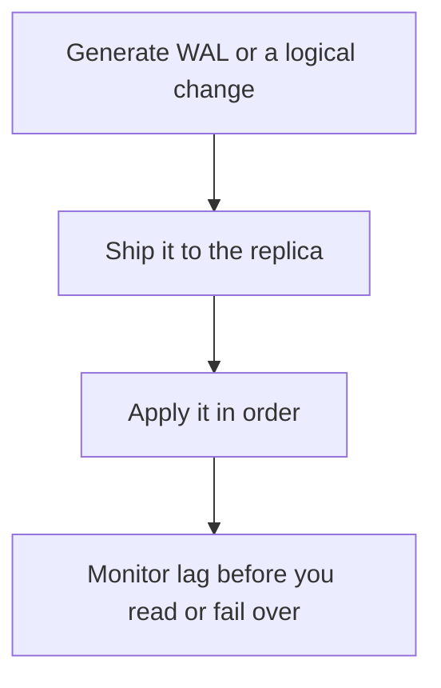

# D09-T013 — Streaming and logical replication

Topic ID: `D09-T013`
Domain: PostgreSQL Internals
Subdomain: Streaming and logical replication
Importance: advanced
Complexity: advanced
Dependencies: `D09-T012`, `D09-T001`, `D07-T001`, `D07-T002`, `D08-T001`, `D08-T002`
Execution status of the code in section F: unexecuted

## A. Topic Overview

Streaming replication ships WAL records to a standby that replays them, producing a physical copy. Logical replication ships row changes from a publication to a subscription, which can be a subset of tables and can land on a different major version or schema shape. Physical replicas are for failover and read scaling of the whole cluster. Logical replication is for selective copy and upgrades. Both lag.

In production this shows up as follows: A read replica for dashboards can be physical. A migration that copies only the users table to a new instance is logical. Failing over to a lagged physical replica loses the commits that never arrived.

Interviewers use Streaming and logical replication to see whether you can state the failure mode, not only the definition. The failure to name is: promoting a replica that has not received the latest commit, or a logical subscriber stuck on one bad row

Prerequisites: `D09-T012`, `D09-T001`, `D07-T001`, `D07-T002`, `D08-T001`, `D08-T002`. Later notes should link here instead of repeating the mechanism.

## B. First-Principles Explanation

Streaming replication ships WAL records to a standby that replays them, producing a physical copy. Logical replication ships row changes from a publication to a subscription, which can be a subset of tables and can land on a different major version or schema shape. Physical replicas are for failover and read scaling of the whole cluster. Logical replication is for selective copy and upgrades. Both lag.

The useful picture is: Streaming replication is photocopying the diary pages. Logical replication is reading the diary and rewriting selected entries into another notebook.

What has to be true:

1. Generate WAL or a logical change
2. Ship it to the replica
3. Apply it in order
4. Monitor lag before you read or fail over

It works when those steps preserve one invariant. It fails when promoting a replica that has not received the latest commit, or a logical subscriber stuck on one bad row. The alternative is: you treat a lagged replica as proof of a durable commit on the primary

## C. Internal Working and Architecture

Components involved: the caller, the state Streaming and logical replication mutates or reads, and the observer that reports replay lag in bytes and seconds, and subscription error state.

Execution:

1. Generate WAL or a logical change
2. Ship it to the replica
3. Apply it in order
4. Monitor lag before you read or fail over

Data moves only along that path. A retry re-enters at step 1, so the operation must say what a duplicate does. Memory and locks stay inside this mechanism. Callers see the result or a typed error, not a half-updated invariant.

State to remember: choose this when you need a copy of the data on another node. Do not choose it when you treat a lagged replica as proof of a durable commit on the primary.

## D. Diagrams and Visual Models



Read the diagram from top to bottom. Each box is one step of Streaming and logical replication. The failure mode (promoting a replica that has not received the latest commit, or a logical subscriber stuck on one bad row) is what you look for when a later box never happens or happens twice.

## E. Examples and Analogies

Analogy: Streaming replication is photocopying the diary pages. Logical replication is reading the diary and rewriting selected entries into another notebook.

Production example: A read replica for dashboards can be physical. A migration that copies only the users table to a new instance is logical. Failing over to a lagged physical replica loses the commits that never arrived.

A small counterexample is enough in an interview. Show the input, apply the steps, and show the broken outcome if someone uses the mechanism outside its rule: promoting a replica that has not received the latest commit, or a logical subscriber stuck on one bad row.

## F. Code Examples

The snippet is labeled unexecuted. It illustrates the shape of the idea. It is not a benchmark and it embeds no secret.

```sql
-- unexecuted: physical replicas apply WAL; logical subscribers apply row changes
SELECT slot_name, confirmed_flush_lsn FROM pg_replication_slots;
```

After the snippet, check replay lag in bytes and seconds, and subscription error state. If that signal moves the wrong way, the snippet is the wrong tool for the workload.

## G. Practical Backend Application

Use Streaming and logical replication in a service when you need a copy of the data on another node.

A typical place is the production case already stated: A read replica for dashboards can be physical. A migration that copies only the users table to a new instance is logical. Failing over to a lagged physical replica loses the commits that never arrived.

Operationally you alert on replay lag in bytes and seconds, and subscription error state. You do not alert only on process uptime. The dashboard should show the failure mode, a success rate, and the saturation signal (queue depth, lock wait, or latency) that predicts it.

## H. Advantages, Limitations and Trade-offs

| Choice | Benefit | Cost | Choose when | Avoid when |
| --- | --- | --- | --- | --- |
| Apply Streaming and logical replication | you need a copy of the data on another node | Extra moving parts and a new failure mode | The failure you are preventing is already real | you treat a lagged replica as proof of a durable commit on the primary |
| Simpler alternative | Less code and fewer dependencies | promoting a replica that has not received the latest commit, or a logical subscriber stuck on one bad row | The workload does not hit the limit | The invariant must hold under concurrency or failure |

Streaming and logical replication is a trade. State the benefit and the cost in the same sentence when you propose it in a design review.

## I. Common Mistakes and Misconceptions

- Reading from a replica that your SLO says must be current.
- Forgetting a replication slot can retain WAL until the disk fills.
- Assuming logical replication copies sequences and DDL the way you hoped.
- Treating a diagram of Streaming and logical replication as proof that the invariant holds in production.
- Copying a default configuration without naming replay lag in bytes and seconds, and subscription error state.

## J. Debugging and Troubleshooting

Symptom: promoting a replica that has not received the latest commit, or a logical subscriber stuck on one bad row

First check: replay lag in bytes and seconds, and subscription error state.

Then compare one healthy instance against one unhealthy instance. Confirm whether retries are duplicating work. Confirm whether a timeout is shorter than the work. Fix the invariant, then watch the same metric for a full peak, not only for the next minute.

Useful questions: did the step order in section C actually happen, or did a caller skip a step? Did a deploy change the data shape that Streaming and logical replication assumes?

## K. Interview Preparation

### Beginner

#### Q1. What problem does Streaming and logical replication solve?

**Answer:** Streaming replication ships WAL records to a standby that replays them, producing a physical copy. Logical replication ships row changes from a publication to a subscription, which can be a subset of tables and can land on a different major version or schema shape. Physical replicas are for failover and read scaling of the whole cluster. Logical replication is for selective copy and upgrades. Both lag. Without it, the usual backend failure is: promoting a replica that has not received the latest commit, or a logical subscriber stuck on one bad row.

#### Q2. Where does Streaming and logical replication sit on a request path?

**Answer:** Streaming and logical replication is not a library you sprinkle on every call. you need a copy of the data on another node You notice it when replay lag in bytes and seconds, and subscription error state. Name the constraint that makes this choice correct. Say what you would measure to confirm it.

#### Q3. Give a concrete example of Streaming and logical replication.

**Answer:** A read replica for dashboards can be physical. A migration that copies only the users table to a new instance is logical. Failing over to a lagged physical replica loses the commits that never arrived. Walk the input, the state change, and the observable output.

#### Q4. What is a common mix-up around Streaming and logical replication?

**Answer:** promoting a replica that has not received the latest commit, or a logical subscriber stuck on one bad row The corrective check is replay lag in bytes and seconds, and subscription error state. Name the constraint that makes this choice correct. Say what you would measure to confirm it. Say which alternative you rejected and why.

#### Q5. When would you skip Streaming and logical replication?

**Answer:** you treat a lagged replica as proof of a durable commit on the primary Skipping is a decision with a measured cost, not a slogan. Name the constraint that makes this choice correct. Say what you would measure to confirm it. Say which alternative you rejected and why.

### Intermediate

#### Q1. What invariant makes Streaming and logical replication correct?

**Answer:** Streaming replication ships WAL records to a standby that replays them, producing a physical copy. Logical replication ships row changes from a publication to a subscription, which can be a subset of tables and can land on a different major version or schema shape. Physical replicas are for failover and read scaling of the whole cluster. Logical replication is for selective copy and upgrades. Both lag. State the invariant before you name the tool.

#### Q2. How do you test Streaming and logical replication?

**Answer:** Assert the failure mode directly: promoting a replica that has not received the latest commit, or a logical subscriber stuck on one bad row. The assertion should watch replay lag in bytes and seconds, and subscription error state. Include a concurrent or retry case if the bug only appears then. Name the constraint that makes this choice correct.

#### Q3. What signal tells you Streaming and logical replication is misbehaving in production?

**Answer:** Watch replay lag in bytes and seconds, and subscription error state. The user-visible symptom is usually promoting a replica that has not received the latest commit, or a logical subscriber stuck on one bad row. Name the constraint that makes this choice correct. Say what you would measure to confirm it.

#### Q4. How would you introduce Streaming and logical replication into a legacy service?

**Answer:** you need a copy of the data on another node Ship it behind a metric so you can compare the old path. Roll back if promoting a replica that has not received the latest commit, or a logical subscriber stuck on one bad row gets worse. Name the constraint that makes this choice correct. Say what you would measure to confirm it.

#### Q5. What do you trade away by choosing Streaming and logical replication?

**Answer:** you need a copy of the data on another node you treat a lagged replica as proof of a durable commit on the primary Say the cost in latency, storage, or operational load. Name the constraint that makes this choice correct. Say what you would measure to confirm it. Say which alternative you rejected and why.

### Advanced

#### Q1. What breaks if a dependency of Streaming and logical replication is slow or down?

**Answer:** promoting a replica that has not received the latest commit, or a logical subscriber stuck on one bad row Degrade using the rule: you treat a lagged replica as proof of a durable commit on the primary. Timeouts must be shorter than the caller's deadline. Name the constraint that makes this choice correct. Say what you would measure to confirm it.

#### Q2. How does Streaming and logical replication behave under retries?

**Answer:** Retries repeat work, so Streaming and logical replication must define what a duplicate does. promoting a replica that has not received the latest commit, or a logical subscriber stuck on one bad row Idempotency keys or fences belong next to the write, not in a comment. Name the constraint that makes this choice correct. Say what you would measure to confirm it.

#### Q3. What is the capacity limit of Streaming and logical replication?

**Answer:** The limit shows up as replay lag in bytes and seconds, and subscription error state. Add capacity only after you know whether the bottleneck is CPU, lock wait, or network. Name the constraint that makes this choice correct. Say what you would measure to confirm it.

#### Q4. How do you evolve Streaming and logical replication without a flag day?

**Answer:** you need a copy of the data on another node Version the contract or the on-disk format. Readers should tolerate one old and one new shape during the rollout. Name the constraint that makes this choice correct. Say what you would measure to confirm it.

#### Q5. What security or correctness bug hides inside Streaming and logical replication?

**Answer:** promoting a replica that has not received the latest commit, or a logical subscriber stuck on one bad row Check authorization and tenancy at the same boundary as the mechanism. A cache or queue must not widen who can read the data. Name the constraint that makes this choice correct. Say what you would measure to confirm it.

### Scenario

#### Q1. Incident: promoting a replica that has not received the latest commit, or a logical subscriber stuck on one bad row. What do you check first?

**Answer:** Start with replay lag in bytes and seconds, and subscription error state. Compare a good host and a bad host before you restart anything. Streaming replication ships WAL records to a standby that replays them, producing a physical copy. Logical replication ships row changes from a publication to a subscription, which can be a subset of tables and can land on a different major version or schema shape. Physical replicas are for failover and read scaling of the whole cluster. Logical replication is for selective copy and upgrades. Both lag.

#### Q2. A reviewer wants the clever version. What data settles it?

**Answer:** you need a copy of the data on another node you treat a lagged replica as proof of a durable commit on the primary Bring replay lag in bytes and seconds, and subscription error state from a load test or from production, not a slogan. Name the constraint that makes this choice correct. Say what you would measure to confirm it. Say which alternative you rejected and why.

#### Q3. You have one hour to explain Streaming and logical replication at a whiteboard.

**Answer:** Draw the happy path in four boxes. Then draw the failure: promoting a replica that has not received the latest commit, or a logical subscriber stuck on one bad row. End with the metric you would page on. Name the constraint that makes this choice correct.

#### Q4. The bug only appears under two concurrent callers.

**Answer:** promoting a replica that has not received the latest commit, or a logical subscriber stuck on one bad row Reproduce with a barrier so both sides enter the critical window. Confirm the fix with replay lag in bytes and seconds, and subscription error state. Name the constraint that makes this choice correct. Say what you would measure to confirm it.

#### Q5. Leadership wants this on every service next week.

**Answer:** you treat a lagged replica as proof of a durable commit on the primary you need a copy of the data on another node Roll it out where the failure mode is already hurting users. Name the constraint that makes this choice correct. Say what you would measure to confirm it. Say which alternative you rejected and why.

### Follow-up

#### Q1. What did you assume about the data size or the clock?

**Answer:** Streaming replication ships WAL records to a standby that replays them, producing a physical copy. Logical replication ships row changes from a publication to a subscription, which can be a subset of tables and can land on a different major version or schema shape. Physical replicas are for failover and read scaling of the whole cluster. Logical replication is for selective copy and upgrades. Both lag. Clocks are not a total order across machines. State whether the algorithm needs bounded size or a single leader.

#### Q2. What would you measure after the change ships?

**Answer:** Page on replay lag in bytes and seconds, and subscription error state. Keep a before/after dashboard for one week. Alert on the failure mode, not only on CPU. Name the constraint that makes this choice correct.

#### Q3. Which neighboring topic did you deliberately not re-teach?

**Answer:** This note owns Streaming and logical replication. Related identifiers are in section N. Shared ideas are linked, not copied. Name the constraint that makes this choice correct.

## L. Practical Exercises

Solutions are in `EXERCISES/solutions/D09-T013.md`, not in this section.

1. Whiteboard the four steps of Streaming and logical replication and mark where `promoting a replica that has not received the latest commit, or a logical subscriber stuck on one bad row` enters.
2. Read the snippet in section F and write the assertion that would catch that failure. The assertion must mention `replay lag in bytes and seconds, and subscription error state`.
3. Argue for or against using Streaming and logical replication on a service you know. Use the choose and avoid rows from section H. Do not appeal to popularity.

## M. Revision Notes

- Mechanism: Streaming replication ships WAL records to a standby that replays them, producing a physical copy.
- Failure: promoting a replica that has not received the latest commit, or a logical subscriber stuck on one bad row
- Metric: replay lag in bytes and seconds, and subscription error state
- Choose when: you need a copy of the data on another node
- Avoid when: you treat a lagged replica as proof of a durable commit on the primary

## N. Related Topics

Dependencies to review first: `D09-T012`, `D09-T001`, `D07-T001`, `D07-T002`, `D08-T001`, `D08-T002`.

Shared ideas stay in those notes. This note does not restate them.

## O. Completion Criteria

- You can explain Streaming and logical replication without reading this note, including the failure mode.
- You can draw the diagram in section D from memory.
- You can say when not to use it, using the avoid condition in section H.
- You can name the metric you would watch after shipping it.
