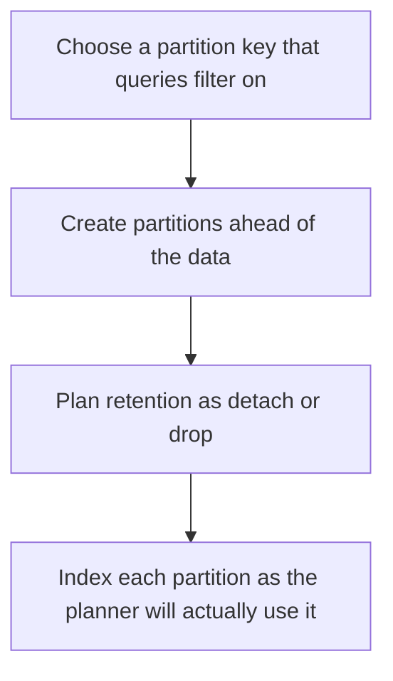

# D09-T014 — Table partitioning

Topic ID: `D09-T014`
Domain: PostgreSQL Internals
Subdomain: Table partitioning
Importance: advanced
Complexity: advanced
Dependencies: `D09-T013`, `D09-T001`, `D07-T001`, `D07-T002`, `D08-T001`, `D08-T002`
Execution status of the code in section F: unexecuted

## A. Topic Overview

Table partitioning splits one logical table into physical partitions, often by time range or by a list of tenants. Queries that include the partition key can prune partitions. Queries that do not include it scan all of them. Unique constraints must include the partition key. Dropping an old partition is metadata work compared with deleting millions of rows.

In production this shows up as follows: An events table partitioned by month drops March by detaching a partition. A query for one customer across all time still touches every month unless a second access path exists.

Interviewers use Table partitioning to see whether you can state the failure mode, not only the definition. The failure to name is: a query without the partition key that opens every partition, or a unique constraint that cannot be enforced globally

Prerequisites: `D09-T013`, `D09-T001`, `D07-T001`, `D07-T002`, `D08-T001`, `D08-T002`. Later notes should link here instead of repeating the mechanism.

## B. First-Principles Explanation

Table partitioning splits one logical table into physical partitions, often by time range or by a list of tenants. Queries that include the partition key can prune partitions. Queries that do not include it scan all of them. Unique constraints must include the partition key. Dropping an old partition is metadata work compared with deleting millions of rows.

The useful picture is: Partitioning is filing cabinets by month. Asking for a customer without saying the month means opening every cabinet.

What has to be true:

1. Choose a partition key that queries filter on
2. Create partitions ahead of the data
3. Plan retention as detach or drop
4. Index each partition as the planner will actually use it

It works when those steps preserve one invariant. It fails when a query without the partition key that opens every partition, or a unique constraint that cannot be enforced globally. The alternative is: you partition a small table and pay planning cost for no pruning

## C. Internal Working and Architecture

Components involved: the caller, the state Table partitioning mutates or reads, and the observer that reports partitions scanned per query, and time to drop an expired partition.

Execution:

1. Choose a partition key that queries filter on
2. Create partitions ahead of the data
3. Plan retention as detach or drop
4. Index each partition as the planner will actually use it

Data moves only along that path. A retry re-enters at step 1, so the operation must say what a duplicate does. Memory and locks stay inside this mechanism. Callers see the result or a typed error, not a half-updated invariant.

State to remember: choose this when retention or prune-friendly queries dominate. Do not choose it when you partition a small table and pay planning cost for no pruning.

## D. Diagrams and Visual Models



Read the diagram from top to bottom. Each box is one step of Table partitioning. The failure mode (a query without the partition key that opens every partition, or a unique constraint that cannot be enforced globally) is what you look for when a later box never happens or happens twice.

## E. Examples and Analogies

Analogy: Partitioning is filing cabinets by month. Asking for a customer without saying the month means opening every cabinet.

Production example: An events table partitioned by month drops March by detaching a partition. A query for one customer across all time still touches every month unless a second access path exists.

A small counterexample is enough in an interview. Show the input, apply the steps, and show the broken outcome if someone uses the mechanism outside its rule: a query without the partition key that opens every partition, or a unique constraint that cannot be enforced globally.

## F. Code Examples

The snippet is labeled unexecuted. It illustrates the shape of the idea. It is not a benchmark and it embeds no secret.

```sql
CREATE TABLE events (
  id bigint,
  created_at timestamptz NOT NULL,
  PRIMARY KEY (id, created_at)
) PARTITION BY RANGE (created_at);
```

After the snippet, check partitions scanned per query, and time to drop an expired partition. If that signal moves the wrong way, the snippet is the wrong tool for the workload.

## G. Practical Backend Application

Use Table partitioning in a service when retention or prune-friendly queries dominate.

A typical place is the production case already stated: An events table partitioned by month drops March by detaching a partition. A query for one customer across all time still touches every month unless a second access path exists.

Operationally you alert on partitions scanned per query, and time to drop an expired partition. You do not alert only on process uptime. The dashboard should show the failure mode, a success rate, and the saturation signal (queue depth, lock wait, or latency) that predicts it.

## H. Advantages, Limitations and Trade-offs

| Choice | Benefit | Cost | Choose when | Avoid when |
| --- | --- | --- | --- | --- |
| Apply Table partitioning | retention or prune-friendly queries dominate | Extra moving parts and a new failure mode | The failure you are preventing is already real | you partition a small table and pay planning cost for no pruning |
| Simpler alternative | Less code and fewer dependencies | a query without the partition key that opens every partition, or a unique constraint that cannot be enforced globally | The workload does not hit the limit | The invariant must hold under concurrency or failure |

Table partitioning is a trade. State the benefit and the cost in the same sentence when you propose it in a design review.

## I. Common Mistakes and Misconceptions

- Omitting the partition key in the primary key.
- Creating no partition for next month and failing inserts.
- Expecting a global unique email across range partitions without the key.
- Treating a diagram of Table partitioning as proof that the invariant holds in production.
- Copying a default configuration without naming partitions scanned per query, and time to drop an expired partition.

## J. Debugging and Troubleshooting

Symptom: a query without the partition key that opens every partition, or a unique constraint that cannot be enforced globally

First check: partitions scanned per query, and time to drop an expired partition.

Then compare one healthy instance against one unhealthy instance. Confirm whether retries are duplicating work. Confirm whether a timeout is shorter than the work. Fix the invariant, then watch the same metric for a full peak, not only for the next minute.

Useful questions: did the step order in section C actually happen, or did a caller skip a step? Did a deploy change the data shape that Table partitioning assumes?

## K. Interview Preparation

### Beginner

#### Q1. What problem does Table partitioning solve?

**Answer:** Table partitioning splits one logical table into physical partitions, often by time range or by a list of tenants. Queries that include the partition key can prune partitions. Queries that do not include it scan all of them. Unique constraints must include the partition key. Dropping an old partition is metadata work compared with deleting millions of rows. Without it, the usual backend failure is: a query without the partition key that opens every partition, or a unique constraint that cannot be enforced globally.

#### Q2. Where does Table partitioning sit on a request path?

**Answer:** Table partitioning is not a library you sprinkle on every call. retention or prune-friendly queries dominate You notice it when partitions scanned per query, and time to drop an expired partition. Name the constraint that makes this choice correct. Say what you would measure to confirm it.

#### Q3. Give a concrete example of Table partitioning.

**Answer:** An events table partitioned by month drops March by detaching a partition. A query for one customer across all time still touches every month unless a second access path exists. Walk the input, the state change, and the observable output. Name the constraint that makes this choice correct.

#### Q4. What is a common mix-up around Table partitioning?

**Answer:** a query without the partition key that opens every partition, or a unique constraint that cannot be enforced globally The corrective check is partitions scanned per query, and time to drop an expired partition. Name the constraint that makes this choice correct. Say what you would measure to confirm it. Say which alternative you rejected and why.

#### Q5. When would you skip Table partitioning?

**Answer:** you partition a small table and pay planning cost for no pruning Skipping is a decision with a measured cost, not a slogan. Name the constraint that makes this choice correct. Say what you would measure to confirm it. Say which alternative you rejected and why.

### Intermediate

#### Q1. What invariant makes Table partitioning correct?

**Answer:** Table partitioning splits one logical table into physical partitions, often by time range or by a list of tenants. Queries that include the partition key can prune partitions. Queries that do not include it scan all of them. Unique constraints must include the partition key. Dropping an old partition is metadata work compared with deleting millions of rows. State the invariant before you name the tool.

#### Q2. How do you test Table partitioning?

**Answer:** Assert the failure mode directly: a query without the partition key that opens every partition, or a unique constraint that cannot be enforced globally. The assertion should watch partitions scanned per query, and time to drop an expired partition. Include a concurrent or retry case if the bug only appears then. Name the constraint that makes this choice correct.

#### Q3. What signal tells you Table partitioning is misbehaving in production?

**Answer:** Watch partitions scanned per query, and time to drop an expired partition. The user-visible symptom is usually a query without the partition key that opens every partition, or a unique constraint that cannot be enforced globally. Name the constraint that makes this choice correct. Say what you would measure to confirm it.

#### Q4. How would you introduce Table partitioning into a legacy service?

**Answer:** retention or prune-friendly queries dominate Ship it behind a metric so you can compare the old path. Roll back if a query without the partition key that opens every partition, or a unique constraint that cannot be enforced globally gets worse. Name the constraint that makes this choice correct. Say what you would measure to confirm it.

#### Q5. What do you trade away by choosing Table partitioning?

**Answer:** retention or prune-friendly queries dominate you partition a small table and pay planning cost for no pruning Say the cost in latency, storage, or operational load. Name the constraint that makes this choice correct. Say what you would measure to confirm it. Say which alternative you rejected and why.

### Advanced

#### Q1. What breaks if a dependency of Table partitioning is slow or down?

**Answer:** a query without the partition key that opens every partition, or a unique constraint that cannot be enforced globally Degrade using the rule: you partition a small table and pay planning cost for no pruning. Timeouts must be shorter than the caller's deadline. Name the constraint that makes this choice correct. Say what you would measure to confirm it.

#### Q2. How does Table partitioning behave under retries?

**Answer:** Retries repeat work, so Table partitioning must define what a duplicate does. a query without the partition key that opens every partition, or a unique constraint that cannot be enforced globally Idempotency keys or fences belong next to the write, not in a comment. Name the constraint that makes this choice correct. Say what you would measure to confirm it.

#### Q3. What is the capacity limit of Table partitioning?

**Answer:** The limit shows up as partitions scanned per query, and time to drop an expired partition. Add capacity only after you know whether the bottleneck is CPU, lock wait, or network. Name the constraint that makes this choice correct. Say what you would measure to confirm it.

#### Q4. How do you evolve Table partitioning without a flag day?

**Answer:** retention or prune-friendly queries dominate Version the contract or the on-disk format. Readers should tolerate one old and one new shape during the rollout. Name the constraint that makes this choice correct. Say what you would measure to confirm it.

#### Q5. What security or correctness bug hides inside Table partitioning?

**Answer:** a query without the partition key that opens every partition, or a unique constraint that cannot be enforced globally Check authorization and tenancy at the same boundary as the mechanism. A cache or queue must not widen who can read the data. Name the constraint that makes this choice correct. Say what you would measure to confirm it.

### Scenario

#### Q1. Incident: a query without the partition key that opens every partition, or a unique constraint that cannot be enforced globally. What do you check first?

**Answer:** Start with partitions scanned per query, and time to drop an expired partition. Compare a good host and a bad host before you restart anything. Table partitioning splits one logical table into physical partitions, often by time range or by a list of tenants. Queries that include the partition key can prune partitions. Queries that do not include it scan all of them. Unique constraints must include the partition key. Dropping an old partition is metadata work compared with deleting millions of rows.

#### Q2. A reviewer wants the clever version. What data settles it?

**Answer:** retention or prune-friendly queries dominate you partition a small table and pay planning cost for no pruning Bring partitions scanned per query, and time to drop an expired partition from a load test or from production, not a slogan. Name the constraint that makes this choice correct. Say what you would measure to confirm it. Say which alternative you rejected and why.

#### Q3. You have one hour to explain Table partitioning at a whiteboard.

**Answer:** Draw the happy path in four boxes. Then draw the failure: a query without the partition key that opens every partition, or a unique constraint that cannot be enforced globally. End with the metric you would page on. Name the constraint that makes this choice correct.

#### Q4. The bug only appears under two concurrent callers.

**Answer:** a query without the partition key that opens every partition, or a unique constraint that cannot be enforced globally Reproduce with a barrier so both sides enter the critical window. Confirm the fix with partitions scanned per query, and time to drop an expired partition. Name the constraint that makes this choice correct. Say what you would measure to confirm it.

#### Q5. Leadership wants this on every service next week.

**Answer:** you partition a small table and pay planning cost for no pruning retention or prune-friendly queries dominate Roll it out where the failure mode is already hurting users. Name the constraint that makes this choice correct. Say what you would measure to confirm it. Say which alternative you rejected and why.

### Follow-up

#### Q1. What did you assume about the data size or the clock?

**Answer:** Table partitioning splits one logical table into physical partitions, often by time range or by a list of tenants. Queries that include the partition key can prune partitions. Queries that do not include it scan all of them. Unique constraints must include the partition key. Dropping an old partition is metadata work compared with deleting millions of rows. Clocks are not a total order across machines. State whether the algorithm needs bounded size or a single leader.

#### Q2. What would you measure after the change ships?

**Answer:** Page on partitions scanned per query, and time to drop an expired partition. Keep a before/after dashboard for one week. Alert on the failure mode, not only on CPU. Name the constraint that makes this choice correct.

#### Q3. Which neighboring topic did you deliberately not re-teach?

**Answer:** This note owns Table partitioning. Related identifiers are in section N. Shared ideas are linked, not copied. Name the constraint that makes this choice correct.

## L. Practical Exercises

Solutions are in `EXERCISES/solutions/D09-T014.md`, not in this section.

1. Whiteboard the four steps of Table partitioning and mark where `a query without the partition key that opens every partition, or a unique constraint that cannot be enforced globally` enters.
2. Read the snippet in section F and write the assertion that would catch that failure. The assertion must mention `partitions scanned per query, and time to drop an expired partition`.
3. Argue for or against using Table partitioning on a service you know. Use the choose and avoid rows from section H. Do not appeal to popularity.

## M. Revision Notes

- Mechanism: Table partitioning splits one logical table into physical partitions, often by time range or by a list of tenants.
- Failure: a query without the partition key that opens every partition, or a unique constraint that cannot be enforced globally
- Metric: partitions scanned per query, and time to drop an expired partition
- Choose when: retention or prune-friendly queries dominate
- Avoid when: you partition a small table and pay planning cost for no pruning

## N. Related Topics

Dependencies to review first: `D09-T013`, `D09-T001`, `D07-T001`, `D07-T002`, `D08-T001`, `D08-T002`.

Shared ideas stay in those notes. This note does not restate them.

## O. Completion Criteria

- You can explain Table partitioning without reading this note, including the failure mode.
- You can draw the diagram in section D from memory.
- You can say when not to use it, using the avoid condition in section H.
- You can name the metric you would watch after shipping it.
