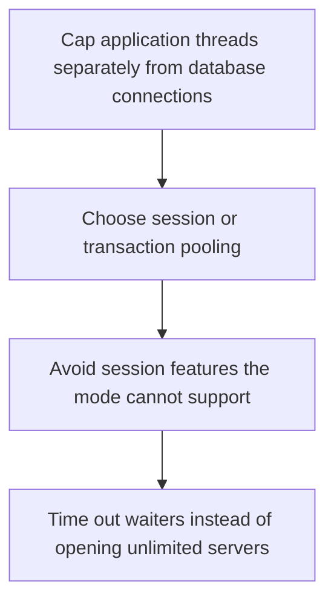

# D09-T015 — Connection poolers

Topic ID: `D09-T015`
Domain: PostgreSQL Internals
Subdomain: Connection poolers
Importance: advanced
Complexity: advanced
Dependencies: `D09-T014`, `D09-T001`, `D07-T001`, `D07-T002`, `D08-T001`, `D08-T002`
Execution status of the code in section F: unexecuted

## A. Topic Overview

A connection pooler sits between the application and PostgreSQL and reuses a smaller set of server connections. Session pooling holds a server connection for a whole client session. Transaction pooling returns it after each transaction and breaks session state such as prepared statements, temporary tables, and session advisory locks. The database's max connections must cover the pooler, not every application thread.

In production this shows up as follows: PgBouncer in transaction mode in front of PostgreSQL lets a web tier with hundreds of workers share dozens of backends. Session-level advisory locks and SET statements then misbehave because the next transaction may run on another backend.

Interviewers use Connection poolers to see whether you can state the failure mode, not only the definition. The failure to name is: a transaction-pooled session advisory lock that releases when the pooler gives the connection to someone else, or max_connections exhausted by bypassing the pooler

Prerequisites: `D09-T014`, `D09-T001`, `D07-T001`, `D07-T002`, `D08-T001`, `D08-T002`. Later notes should link here instead of repeating the mechanism.

## B. First-Principles Explanation

A connection pooler sits between the application and PostgreSQL and reuses a smaller set of server connections. Session pooling holds a server connection for a whole client session. Transaction pooling returns it after each transaction and breaks session state such as prepared statements, temporary tables, and session advisory locks. The database's max connections must cover the pooler, not every application thread.

The useful picture is: A pooler is a switchboard with twenty lines into the database and two hundred callers. Transaction mode hangs up after each call. Session mode leaves the line open and ties up a line even while the caller thinks.

What has to be true:

1. Cap application threads separately from database connections
2. Choose session or transaction pooling
3. Avoid session features the mode cannot support
4. Time out waiters instead of opening unlimited servers

It works when those steps preserve one invariant. It fails when a transaction-pooled session advisory lock that releases when the pooler gives the connection to someone else, or max_connections exhausted by bypassing the pooler. The alternative is: you need session state and you still pick transaction pooling

## C. Internal Working and Architecture

Components involved: the caller, the state Connection poolers mutates or reads, and the observer that reports client wait time for a pooled connection, and the number of server connections versus max_connections.

Execution:

1. Cap application threads separately from database connections
2. Choose session or transaction pooling
3. Avoid session features the mode cannot support
4. Time out waiters instead of opening unlimited servers

Data moves only along that path. A retry re-enters at step 1, so the operation must say what a duplicate does. Memory and locks stay inside this mechanism. Callers see the result or a typed error, not a half-updated invariant.

State to remember: choose this when application concurrency is much higher than the database can serve as one connection each. Do not choose it when you need session state and you still pick transaction pooling.

## D. Diagrams and Visual Models



Read the diagram from top to bottom. Each box is one step of Connection poolers. The failure mode (a transaction-pooled session advisory lock that releases when the pooler gives the connection to someone else, or max_connections exhausted by bypassing the pooler) is what you look for when a later box never happens or happens twice.

## E. Examples and Analogies

Analogy: A pooler is a switchboard with twenty lines into the database and two hundred callers. Transaction mode hangs up after each call. Session mode leaves the line open and ties up a line even while the caller thinks.

Production example: PgBouncer in transaction mode in front of PostgreSQL lets a web tier with hundreds of workers share dozens of backends. Session-level advisory locks and SET statements then misbehave because the next transaction may run on another backend.

A small counterexample is enough in an interview. Show the input, apply the steps, and show the broken outcome if someone uses the mechanism outside its rule: a transaction-pooled session advisory lock that releases when the pooler gives the connection to someone else, or max_connections exhausted by bypassing the pooler.

## F. Code Examples

The snippet is labeled unexecuted. It illustrates the shape of the idea. It is not a benchmark and it embeds no secret.

```python
# unexecuted shape: one pool, a hard max, a wait timeout
class Settings:
    max_db_connections = 20
    acquire_timeout_s = 2
```

After the snippet, check client wait time for a pooled connection, and the number of server connections versus max_connections. If that signal moves the wrong way, the snippet is the wrong tool for the workload.

## G. Practical Backend Application

Use Connection poolers in a service when application concurrency is much higher than the database can serve as one connection each.

A typical place is the production case already stated: PgBouncer in transaction mode in front of PostgreSQL lets a web tier with hundreds of workers share dozens of backends. Session-level advisory locks and SET statements then misbehave because the next transaction may run on another backend.

Operationally you alert on client wait time for a pooled connection, and the number of server connections versus max_connections. You do not alert only on process uptime. The dashboard should show the failure mode, a success rate, and the saturation signal (queue depth, lock wait, or latency) that predicts it.

## H. Advantages, Limitations and Trade-offs

| Choice | Benefit | Cost | Choose when | Avoid when |
| --- | --- | --- | --- | --- |
| Apply Connection poolers | application concurrency is much higher than the database can serve as one connection each | Extra moving parts and a new failure mode | The failure you are preventing is already real | you need session state and you still pick transaction pooling |
| Simpler alternative | Less code and fewer dependencies | a transaction-pooled session advisory lock that releases when the pooler gives the connection to someone else, or max_connections exhausted by bypassing the pooler | The workload does not hit the limit | The invariant must hold under concurrency or failure |

Connection poolers is a trade. State the benefit and the cost in the same sentence when you propose it in a design review.

## I. Common Mistakes and Misconceptions

- Pointing every replica and the pooler at the same max_connections budget carelessly.
- Using prepared statements in transaction mode without the pooler's support.
- Hiding a slow query by adding pool capacity.
- Treating a diagram of Connection poolers as proof that the invariant holds in production.
- Copying a default configuration without naming client wait time for a pooled connection, and the number of server connections versus max_connections.

## J. Debugging and Troubleshooting

Symptom: a transaction-pooled session advisory lock that releases when the pooler gives the connection to someone else, or max_connections exhausted by bypassing the pooler

First check: client wait time for a pooled connection, and the number of server connections versus max_connections.

Then compare one healthy instance against one unhealthy instance. Confirm whether retries are duplicating work. Confirm whether a timeout is shorter than the work. Fix the invariant, then watch the same metric for a full peak, not only for the next minute.

Useful questions: did the step order in section C actually happen, or did a caller skip a step? Did a deploy change the data shape that Connection poolers assumes?

## K. Interview Preparation

### Beginner

#### Q1. What problem does Connection poolers solve?

**Answer:** A connection pooler sits between the application and PostgreSQL and reuses a smaller set of server connections. Session pooling holds a server connection for a whole client session. Transaction pooling returns it after each transaction and breaks session state such as prepared statements, temporary tables, and session advisory locks. The database's max connections must cover the pooler, not every application thread. Without it, the usual backend failure is: a transaction-pooled session advisory lock that releases when the pooler gives the connection to someone else, or max_connections exhausted by bypassing the pooler.

#### Q2. Where does Connection poolers sit on a request path?

**Answer:** Connection poolers is not a library you sprinkle on every call. application concurrency is much higher than the database can serve as one connection each You notice it when client wait time for a pooled connection, and the number of server connections versus max_connections. Name the constraint that makes this choice correct. Say what you would measure to confirm it.

#### Q3. Give a concrete example of Connection poolers.

**Answer:** PgBouncer in transaction mode in front of PostgreSQL lets a web tier with hundreds of workers share dozens of backends. Session-level advisory locks and SET statements then misbehave because the next transaction may run on another backend. Walk the input, the state change, and the observable output. Name the constraint that makes this choice correct.

#### Q4. What is a common mix-up around Connection poolers?

**Answer:** a transaction-pooled session advisory lock that releases when the pooler gives the connection to someone else, or max_connections exhausted by bypassing the pooler The corrective check is client wait time for a pooled connection, and the number of server connections versus max_connections. Name the constraint that makes this choice correct. Say what you would measure to confirm it. Say which alternative you rejected and why.

#### Q5. When would you skip Connection poolers?

**Answer:** you need session state and you still pick transaction pooling Skipping is a decision with a measured cost, not a slogan. Name the constraint that makes this choice correct. Say what you would measure to confirm it. Say which alternative you rejected and why.

### Intermediate

#### Q1. What invariant makes Connection poolers correct?

**Answer:** A connection pooler sits between the application and PostgreSQL and reuses a smaller set of server connections. Session pooling holds a server connection for a whole client session. Transaction pooling returns it after each transaction and breaks session state such as prepared statements, temporary tables, and session advisory locks. The database's max connections must cover the pooler, not every application thread. State the invariant before you name the tool.

#### Q2. How do you test Connection poolers?

**Answer:** Assert the failure mode directly: a transaction-pooled session advisory lock that releases when the pooler gives the connection to someone else, or max_connections exhausted by bypassing the pooler. The assertion should watch client wait time for a pooled connection, and the number of server connections versus max_connections. Include a concurrent or retry case if the bug only appears then. Name the constraint that makes this choice correct.

#### Q3. What signal tells you Connection poolers is misbehaving in production?

**Answer:** Watch client wait time for a pooled connection, and the number of server connections versus max_connections. The user-visible symptom is usually a transaction-pooled session advisory lock that releases when the pooler gives the connection to someone else, or max_connections exhausted by bypassing the pooler. Name the constraint that makes this choice correct. Say what you would measure to confirm it.

#### Q4. How would you introduce Connection poolers into a legacy service?

**Answer:** application concurrency is much higher than the database can serve as one connection each Ship it behind a metric so you can compare the old path. Roll back if a transaction-pooled session advisory lock that releases when the pooler gives the connection to someone else, or max_connections exhausted by bypassing the pooler gets worse. Name the constraint that makes this choice correct. Say what you would measure to confirm it.

#### Q5. What do you trade away by choosing Connection poolers?

**Answer:** application concurrency is much higher than the database can serve as one connection each you need session state and you still pick transaction pooling Say the cost in latency, storage, or operational load. Name the constraint that makes this choice correct. Say what you would measure to confirm it. Say which alternative you rejected and why.

### Advanced

#### Q1. What breaks if a dependency of Connection poolers is slow or down?

**Answer:** a transaction-pooled session advisory lock that releases when the pooler gives the connection to someone else, or max_connections exhausted by bypassing the pooler Degrade using the rule: you need session state and you still pick transaction pooling. Timeouts must be shorter than the caller's deadline. Name the constraint that makes this choice correct. Say what you would measure to confirm it.

#### Q2. How does Connection poolers behave under retries?

**Answer:** Retries repeat work, so Connection poolers must define what a duplicate does. a transaction-pooled session advisory lock that releases when the pooler gives the connection to someone else, or max_connections exhausted by bypassing the pooler Idempotency keys or fences belong next to the write, not in a comment. Name the constraint that makes this choice correct. Say what you would measure to confirm it.

#### Q3. What is the capacity limit of Connection poolers?

**Answer:** The limit shows up as client wait time for a pooled connection, and the number of server connections versus max_connections. Add capacity only after you know whether the bottleneck is CPU, lock wait, or network. Name the constraint that makes this choice correct. Say what you would measure to confirm it.

#### Q4. How do you evolve Connection poolers without a flag day?

**Answer:** application concurrency is much higher than the database can serve as one connection each Version the contract or the on-disk format. Readers should tolerate one old and one new shape during the rollout. Name the constraint that makes this choice correct. Say what you would measure to confirm it.

#### Q5. What security or correctness bug hides inside Connection poolers?

**Answer:** a transaction-pooled session advisory lock that releases when the pooler gives the connection to someone else, or max_connections exhausted by bypassing the pooler Check authorization and tenancy at the same boundary as the mechanism. A cache or queue must not widen who can read the data. Name the constraint that makes this choice correct. Say what you would measure to confirm it.

### Scenario

#### Q1. Incident: a transaction-pooled session advisory lock that releases when the pooler gives the connection to someone else, or max_connections exhausted by bypassing the pooler. What do you check first?

**Answer:** Start with client wait time for a pooled connection, and the number of server connections versus max_connections. Compare a good host and a bad host before you restart anything. A connection pooler sits between the application and PostgreSQL and reuses a smaller set of server connections. Session pooling holds a server connection for a whole client session. Transaction pooling returns it after each transaction and breaks session state such as prepared statements, temporary tables, and session advisory locks. The database's max connections must cover the pooler, not every application thread.

#### Q2. A reviewer wants the clever version. What data settles it?

**Answer:** application concurrency is much higher than the database can serve as one connection each you need session state and you still pick transaction pooling Bring client wait time for a pooled connection, and the number of server connections versus max_connections from a load test or from production, not a slogan. Name the constraint that makes this choice correct. Say what you would measure to confirm it. Say which alternative you rejected and why.

#### Q3. You have one hour to explain Connection poolers at a whiteboard.

**Answer:** Draw the happy path in four boxes. Then draw the failure: a transaction-pooled session advisory lock that releases when the pooler gives the connection to someone else, or max_connections exhausted by bypassing the pooler. End with the metric you would page on. Name the constraint that makes this choice correct.

#### Q4. The bug only appears under two concurrent callers.

**Answer:** a transaction-pooled session advisory lock that releases when the pooler gives the connection to someone else, or max_connections exhausted by bypassing the pooler Reproduce with a barrier so both sides enter the critical window. Confirm the fix with client wait time for a pooled connection, and the number of server connections versus max_connections. Name the constraint that makes this choice correct. Say what you would measure to confirm it.

#### Q5. Leadership wants this on every service next week.

**Answer:** you need session state and you still pick transaction pooling application concurrency is much higher than the database can serve as one connection each Roll it out where the failure mode is already hurting users. Name the constraint that makes this choice correct. Say what you would measure to confirm it. Say which alternative you rejected and why.

### Follow-up

#### Q1. What did you assume about the data size or the clock?

**Answer:** A connection pooler sits between the application and PostgreSQL and reuses a smaller set of server connections. Session pooling holds a server connection for a whole client session. Transaction pooling returns it after each transaction and breaks session state such as prepared statements, temporary tables, and session advisory locks. The database's max connections must cover the pooler, not every application thread. Clocks are not a total order across machines. State whether the algorithm needs bounded size or a single leader.

#### Q2. What would you measure after the change ships?

**Answer:** Page on client wait time for a pooled connection, and the number of server connections versus max_connections. Keep a before/after dashboard for one week. Alert on the failure mode, not only on CPU. Name the constraint that makes this choice correct.

#### Q3. Which neighboring topic did you deliberately not re-teach?

**Answer:** This note owns Connection poolers. Related identifiers are in section N. Shared ideas are linked, not copied. Name the constraint that makes this choice correct.

## L. Practical Exercises

Solutions are in `EXERCISES/solutions/D09-T015.md`, not in this section.

1. Whiteboard the four steps of Connection poolers and mark where `a transaction-pooled session advisory lock that releases when the pooler gives the connection to someone else, or max_connections exhausted by bypassing the pooler` enters.
2. Read the snippet in section F and write the assertion that would catch that failure. The assertion must mention `client wait time for a pooled connection, and the number of server connections versus max_connections`.
3. Argue for or against using Connection poolers on a service you know. Use the choose and avoid rows from section H. Do not appeal to popularity.

## M. Revision Notes

- Mechanism: A connection pooler sits between the application and PostgreSQL and reuses a smaller set of server connections.
- Failure: a transaction-pooled session advisory lock that releases when the pooler gives the connection to someone else, or max_connections exhausted by bypassing the pooler
- Metric: client wait time for a pooled connection, and the number of server connections versus max_connections
- Choose when: application concurrency is much higher than the database can serve as one connection each
- Avoid when: you need session state and you still pick transaction pooling

## N. Related Topics

Dependencies to review first: `D09-T014`, `D09-T001`, `D07-T001`, `D07-T002`, `D08-T001`, `D08-T002`.

Shared ideas stay in those notes. This note does not restate them.

## O. Completion Criteria

- You can explain Connection poolers without reading this note, including the failure mode.
- You can draw the diagram in section D from memory.
- You can say when not to use it, using the avoid condition in section H.
- You can name the metric you would watch after shipping it.
