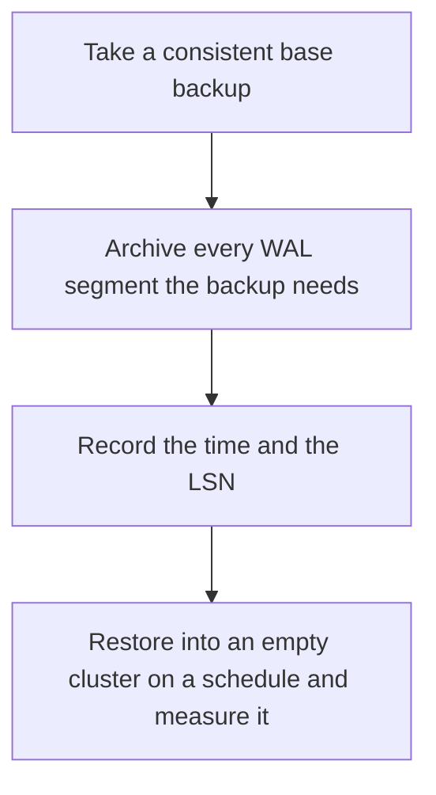

# D09-T017 — Backup and recovery

Topic ID: `D09-T017`
Domain: PostgreSQL Internals
Subdomain: Backup and recovery
Importance: advanced
Complexity: advanced
Dependencies: `D09-T016`, `D09-T001`, `D07-T001`, `D07-T002`, `D08-T001`, `D08-T002`
Execution status of the code in section F: unexecuted

## A. Topic Overview

A backup is a copy you can restore. A base backup plus WAL archives lets you perform point-in-time recovery to a chosen LSN or time. A logical dump is portable and slower to restore at size. A replica is not a backup, because a bad statement replicates. Recovery must be drilled. An untested backup is a hope.

In production this shows up as follows: Someone runs DELETE without a WHERE. Streaming replicas apply it. Only a point-in-time restore from before the delete brings the rows back.

Interviewers use Backup and recovery to see whether you can state the failure mode, not only the definition. The failure to name is: a base backup whose WAL was deleted, so restore cannot reach consistency

Prerequisites: `D09-T016`, `D09-T001`, `D07-T001`, `D07-T002`, `D08-T001`, `D08-T002`. Later notes should link here instead of repeating the mechanism.

## B. First-Principles Explanation

A backup is a copy you can restore. A base backup plus WAL archives lets you perform point-in-time recovery to a chosen LSN or time. A logical dump is portable and slower to restore at size. A replica is not a backup, because a bad statement replicates. Recovery must be drilled. An untested backup is a hope.

The useful picture is: A backup is a spare ledger in another building. A replica is a clerk copying your current ledger, including the page you accidentally tore out.

What has to be true:

1. Take a consistent base backup
2. Archive every WAL segment the backup needs
3. Record the time and the LSN
4. Restore into an empty cluster on a schedule and measure it

It works when those steps preserve one invariant. It fails when a base backup whose WAL was deleted, so restore cannot reach consistency. The alternative is: you keep only a replica and call it a backup

## C. Internal Working and Architecture

Components involved: the caller, the state Backup and recovery mutates or reads, and the observer that reports time since the last successful restore drill, and restore duration.

Execution:

1. Take a consistent base backup
2. Archive every WAL segment the backup needs
3. Record the time and the LSN
4. Restore into an empty cluster on a schedule and measure it

Data moves only along that path. A retry re-enters at step 1, so the operation must say what a duplicate does. Memory and locks stay inside this mechanism. Callers see the result or a typed error, not a half-updated invariant.

State to remember: choose this when you need to survive dropped tables, bad deploys, or a destroyed volume. Do not choose it when you keep only a replica and call it a backup.

## D. Diagrams and Visual Models



Read the diagram from top to bottom. Each box is one step of Backup and recovery. The failure mode (a base backup whose WAL was deleted, so restore cannot reach consistency) is what you look for when a later box never happens or happens twice.

## E. Examples and Analogies

Analogy: A backup is a spare ledger in another building. A replica is a clerk copying your current ledger, including the page you accidentally tore out.

Production example: Someone runs DELETE without a WHERE. Streaming replicas apply it. Only a point-in-time restore from before the delete brings the rows back.

A small counterexample is enough in an interview. Show the input, apply the steps, and show the broken outcome if someone uses the mechanism outside its rule: a base backup whose WAL was deleted, so restore cannot reach consistency.

## F. Code Examples

The snippet is labeled unexecuted. It illustrates the shape of the idea. It is not a benchmark and it embeds no secret.

```sql
-- unexecuted: a dump is not a PITR story by itself
-- pg_dump for logical copy; base backup + WAL archive for point-in-time recovery
```

After the snippet, check time since the last successful restore drill, and restore duration. If that signal moves the wrong way, the snippet is the wrong tool for the workload.

## G. Practical Backend Application

Use Backup and recovery in a service when you need to survive dropped tables, bad deploys, or a destroyed volume.

A typical place is the production case already stated: Someone runs DELETE without a WHERE. Streaming replicas apply it. Only a point-in-time restore from before the delete brings the rows back.

Operationally you alert on time since the last successful restore drill, and restore duration. You do not alert only on process uptime. The dashboard should show the failure mode, a success rate, and the saturation signal (queue depth, lock wait, or latency) that predicts it.

## H. Advantages, Limitations and Trade-offs

| Choice | Benefit | Cost | Choose when | Avoid when |
| --- | --- | --- | --- | --- |
| Apply Backup and recovery | you need to survive dropped tables, bad deploys, or a destroyed volume | Extra moving parts and a new failure mode | The failure you are preventing is already real | you keep only a replica and call it a backup |
| Simpler alternative | Less code and fewer dependencies | a base backup whose WAL was deleted, so restore cannot reach consistency | The workload does not hit the limit | The invariant must hold under concurrency or failure |

Backup and recovery is a trade. State the benefit and the cost in the same sentence when you propose it in a design review.

## I. Common Mistakes and Misconceptions

- Never restoring.
- Storing the backup on the same disk as the database.
- Archiving WAL with gaps.
- Treating a diagram of Backup and recovery as proof that the invariant holds in production.
- Copying a default configuration without naming time since the last successful restore drill, and restore duration.

## J. Debugging and Troubleshooting

Symptom: a base backup whose WAL was deleted, so restore cannot reach consistency

First check: time since the last successful restore drill, and restore duration.

Then compare one healthy instance against one unhealthy instance. Confirm whether retries are duplicating work. Confirm whether a timeout is shorter than the work. Fix the invariant, then watch the same metric for a full peak, not only for the next minute.

Useful questions: did the step order in section C actually happen, or did a caller skip a step? Did a deploy change the data shape that Backup and recovery assumes?

## K. Interview Preparation

### Beginner

#### Q1. What problem does Backup and recovery solve?

**Answer:** A backup is a copy you can restore. A base backup plus WAL archives lets you perform point-in-time recovery to a chosen LSN or time. A logical dump is portable and slower to restore at size. A replica is not a backup, because a bad statement replicates. Recovery must be drilled. An untested backup is a hope. Without it, the usual backend failure is: a base backup whose WAL was deleted, so restore cannot reach consistency.

#### Q2. Where does Backup and recovery sit on a request path?

**Answer:** Backup and recovery is not a library you sprinkle on every call. you need to survive dropped tables, bad deploys, or a destroyed volume You notice it when time since the last successful restore drill, and restore duration. Name the constraint that makes this choice correct. Say what you would measure to confirm it.

#### Q3. Give a concrete example of Backup and recovery.

**Answer:** Someone runs DELETE without a WHERE. Streaming replicas apply it. Only a point-in-time restore from before the delete brings the rows back. Walk the input, the state change, and the observable output.

#### Q4. What is a common mix-up around Backup and recovery?

**Answer:** a base backup whose WAL was deleted, so restore cannot reach consistency The corrective check is time since the last successful restore drill, and restore duration. Name the constraint that makes this choice correct. Say what you would measure to confirm it. Say which alternative you rejected and why.

#### Q5. When would you skip Backup and recovery?

**Answer:** you keep only a replica and call it a backup Skipping is a decision with a measured cost, not a slogan. Name the constraint that makes this choice correct. Say what you would measure to confirm it. Say which alternative you rejected and why.

### Intermediate

#### Q1. What invariant makes Backup and recovery correct?

**Answer:** A backup is a copy you can restore. A base backup plus WAL archives lets you perform point-in-time recovery to a chosen LSN or time. A logical dump is portable and slower to restore at size. A replica is not a backup, because a bad statement replicates. Recovery must be drilled. An untested backup is a hope. State the invariant before you name the tool.

#### Q2. How do you test Backup and recovery?

**Answer:** Assert the failure mode directly: a base backup whose WAL was deleted, so restore cannot reach consistency. The assertion should watch time since the last successful restore drill, and restore duration. Include a concurrent or retry case if the bug only appears then. Name the constraint that makes this choice correct.

#### Q3. What signal tells you Backup and recovery is misbehaving in production?

**Answer:** Watch time since the last successful restore drill, and restore duration. The user-visible symptom is usually a base backup whose WAL was deleted, so restore cannot reach consistency. Name the constraint that makes this choice correct. Say what you would measure to confirm it.

#### Q4. How would you introduce Backup and recovery into a legacy service?

**Answer:** you need to survive dropped tables, bad deploys, or a destroyed volume Ship it behind a metric so you can compare the old path. Roll back if a base backup whose WAL was deleted, so restore cannot reach consistency gets worse. Name the constraint that makes this choice correct. Say what you would measure to confirm it.

#### Q5. What do you trade away by choosing Backup and recovery?

**Answer:** you need to survive dropped tables, bad deploys, or a destroyed volume you keep only a replica and call it a backup Say the cost in latency, storage, or operational load. Name the constraint that makes this choice correct. Say what you would measure to confirm it. Say which alternative you rejected and why.

### Advanced

#### Q1. What breaks if a dependency of Backup and recovery is slow or down?

**Answer:** a base backup whose WAL was deleted, so restore cannot reach consistency Degrade using the rule: you keep only a replica and call it a backup. Timeouts must be shorter than the caller's deadline. Name the constraint that makes this choice correct. Say what you would measure to confirm it.

#### Q2. How does Backup and recovery behave under retries?

**Answer:** Retries repeat work, so Backup and recovery must define what a duplicate does. a base backup whose WAL was deleted, so restore cannot reach consistency Idempotency keys or fences belong next to the write, not in a comment. Name the constraint that makes this choice correct. Say what you would measure to confirm it.

#### Q3. What is the capacity limit of Backup and recovery?

**Answer:** The limit shows up as time since the last successful restore drill, and restore duration. Add capacity only after you know whether the bottleneck is CPU, lock wait, or network. Name the constraint that makes this choice correct. Say what you would measure to confirm it.

#### Q4. How do you evolve Backup and recovery without a flag day?

**Answer:** you need to survive dropped tables, bad deploys, or a destroyed volume Version the contract or the on-disk format. Readers should tolerate one old and one new shape during the rollout. Name the constraint that makes this choice correct. Say what you would measure to confirm it.

#### Q5. What security or correctness bug hides inside Backup and recovery?

**Answer:** a base backup whose WAL was deleted, so restore cannot reach consistency Check authorization and tenancy at the same boundary as the mechanism. A cache or queue must not widen who can read the data. Name the constraint that makes this choice correct. Say what you would measure to confirm it.

### Scenario

#### Q1. Incident: a base backup whose WAL was deleted, so restore cannot reach consistency. What do you check first?

**Answer:** Start with time since the last successful restore drill, and restore duration. Compare a good host and a bad host before you restart anything. A backup is a copy you can restore. A base backup plus WAL archives lets you perform point-in-time recovery to a chosen LSN or time. A logical dump is portable and slower to restore at size. A replica is not a backup, because a bad statement replicates. Recovery must be drilled. An untested backup is a hope.

#### Q2. A reviewer wants the clever version. What data settles it?

**Answer:** you need to survive dropped tables, bad deploys, or a destroyed volume you keep only a replica and call it a backup Bring time since the last successful restore drill, and restore duration from a load test or from production, not a slogan. Name the constraint that makes this choice correct. Say what you would measure to confirm it. Say which alternative you rejected and why.

#### Q3. You have one hour to explain Backup and recovery at a whiteboard.

**Answer:** Draw the happy path in four boxes. Then draw the failure: a base backup whose WAL was deleted, so restore cannot reach consistency. End with the metric you would page on. Name the constraint that makes this choice correct.

#### Q4. The bug only appears under two concurrent callers.

**Answer:** a base backup whose WAL was deleted, so restore cannot reach consistency Reproduce with a barrier so both sides enter the critical window. Confirm the fix with time since the last successful restore drill, and restore duration. Name the constraint that makes this choice correct. Say what you would measure to confirm it.

#### Q5. Leadership wants this on every service next week.

**Answer:** you keep only a replica and call it a backup you need to survive dropped tables, bad deploys, or a destroyed volume Roll it out where the failure mode is already hurting users. Name the constraint that makes this choice correct. Say what you would measure to confirm it. Say which alternative you rejected and why.

### Follow-up

#### Q1. What did you assume about the data size or the clock?

**Answer:** A backup is a copy you can restore. A base backup plus WAL archives lets you perform point-in-time recovery to a chosen LSN or time. A logical dump is portable and slower to restore at size. A replica is not a backup, because a bad statement replicates. Recovery must be drilled. An untested backup is a hope. Clocks are not a total order across machines. State whether the algorithm needs bounded size or a single leader.

#### Q2. What would you measure after the change ships?

**Answer:** Page on time since the last successful restore drill, and restore duration. Keep a before/after dashboard for one week. Alert on the failure mode, not only on CPU. Name the constraint that makes this choice correct.

#### Q3. Which neighboring topic did you deliberately not re-teach?

**Answer:** This note owns Backup and recovery. Related identifiers are in section N. Shared ideas are linked, not copied. Name the constraint that makes this choice correct.

## L. Practical Exercises

Solutions are in `EXERCISES/solutions/D09-T017.md`, not in this section.

1. Whiteboard the four steps of Backup and recovery and mark where `a base backup whose WAL was deleted, so restore cannot reach consistency` enters.
2. Read the snippet in section F and write the assertion that would catch that failure. The assertion must mention `time since the last successful restore drill, and restore duration`.
3. Argue for or against using Backup and recovery on a service you know. Use the choose and avoid rows from section H. Do not appeal to popularity.

## M. Revision Notes

- Mechanism: A backup is a copy you can restore.
- Failure: a base backup whose WAL was deleted, so restore cannot reach consistency
- Metric: time since the last successful restore drill, and restore duration
- Choose when: you need to survive dropped tables, bad deploys, or a destroyed volume
- Avoid when: you keep only a replica and call it a backup

## N. Related Topics

Dependencies to review first: `D09-T016`, `D09-T001`, `D07-T001`, `D07-T002`, `D08-T001`, `D08-T002`.

Shared ideas stay in those notes. This note does not restate them.

## O. Completion Criteria

- You can explain Backup and recovery without reading this note, including the failure mode.
- You can draw the diagram in section D from memory.
- You can say when not to use it, using the avoid condition in section H.
- You can name the metric you would watch after shipping it.
