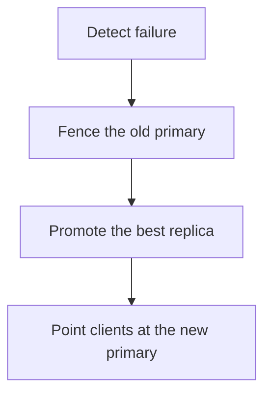

# D09-T018 — High availability and failover

Topic ID: `D09-T018`
Domain: PostgreSQL Internals
Subdomain: High availability and failover
Importance: advanced
Complexity: advanced
Dependencies: `D09-T017`, `D09-T001`, `D07-T001`, `D07-T002`, `D08-T001`, `D08-T002`
Execution status of the code in section F: unexecuted

## A. Topic Overview

High availability means a standby can take over when the primary fails. Failover promotes a replica. It should be automated only with fencing so the old primary cannot keep accepting writes. Split brain is two nodes accepting writes. The decision uses health checks plus replication position, not a single missed ping. Recovery time includes detection, promotion, and client reconnect.

In production this shows up as follows: A primary dies. The orchestrator fences it, promotes the replica with the smallest lag, and updates the connection endpoint. Clients retry idempotent work. Writes that were acknowledged and not shipped are still lost if the replica was behind.

Interviewers use High availability and failover to see whether you can state the failure mode, not only the definition. The failure to name is: split brain, or promoting a replica that is missing the latest transactions

Prerequisites: `D09-T017`, `D09-T001`, `D07-T001`, `D07-T002`, `D08-T001`, `D08-T002`. Later notes should link here instead of repeating the mechanism.

## B. First-Principles Explanation

High availability means a standby can take over when the primary fails. Failover promotes a replica. It should be automated only with fencing so the old primary cannot keep accepting writes. Split brain is two nodes accepting writes. The decision uses health checks plus replication position, not a single missed ping. Recovery time includes detection, promotion, and client reconnect.

The useful picture is: Failover is handing the only pen to the deputy after you have taken the pen away from the person who left. If both keep the pen, you have two ledgers.

What has to be true:

1. Detect failure
2. Fence the old primary
3. Promote the best replica
4. Point clients at the new primary

It works when those steps preserve one invariant. It fails when split brain, or promoting a replica that is missing the latest transactions. The alternative is: you automate promotion without fencing

## C. Internal Working and Architecture

Components involved: the caller, the state High availability and failover mutates or reads, and the observer that reports recovery time in a game day, and whether the old primary can still accept writes.

Execution:

1. Detect failure
2. Fence the old primary
3. Promote the best replica
4. Point clients at the new primary

Data moves only along that path. A retry re-enters at step 1, so the operation must say what a duplicate does. Memory and locks stay inside this mechanism. Callers see the result or a typed error, not a half-updated invariant.

State to remember: choose this when you have a defined recovery-time objective and more than one node. Do not choose it when you automate promotion without fencing.

## D. Diagrams and Visual Models



Read the diagram from top to bottom. Each box is one step of High availability and failover. The failure mode (split brain, or promoting a replica that is missing the latest transactions) is what you look for when a later box never happens or happens twice.

## E. Examples and Analogies

Analogy: Failover is handing the only pen to the deputy after you have taken the pen away from the person who left. If both keep the pen, you have two ledgers.

Production example: A primary dies. The orchestrator fences it, promotes the replica with the smallest lag, and updates the connection endpoint. Clients retry idempotent work. Writes that were acknowledged and not shipped are still lost if the replica was behind.

A small counterexample is enough in an interview. Show the input, apply the steps, and show the broken outcome if someone uses the mechanism outside its rule: split brain, or promoting a replica that is missing the latest transactions.

## F. Code Examples

The snippet is labeled unexecuted. It illustrates the shape of the idea. It is not a benchmark and it embeds no secret.

```python
def may_promote(lag_bytes, limit, old_primary_fenced):
    return old_primary_fenced and lag_bytes <= limit
```

After the snippet, check recovery time in a game day, and whether the old primary can still accept writes. If that signal moves the wrong way, the snippet is the wrong tool for the workload.

## G. Practical Backend Application

Use High availability and failover in a service when you have a defined recovery-time objective and more than one node.

A typical place is the production case already stated: A primary dies. The orchestrator fences it, promotes the replica with the smallest lag, and updates the connection endpoint. Clients retry idempotent work. Writes that were acknowledged and not shipped are still lost if the replica was behind.

Operationally you alert on recovery time in a game day, and whether the old primary can still accept writes. You do not alert only on process uptime. The dashboard should show the failure mode, a success rate, and the saturation signal (queue depth, lock wait, or latency) that predicts it.

## H. Advantages, Limitations and Trade-offs

| Choice | Benefit | Cost | Choose when | Avoid when |
| --- | --- | --- | --- | --- |
| Apply High availability and failover | you have a defined recovery-time objective and more than one node | Extra moving parts and a new failure mode | The failure you are preventing is already real | you automate promotion without fencing |
| Simpler alternative | Less code and fewer dependencies | split brain, or promoting a replica that is missing the latest transactions | The workload does not hit the limit | The invariant must hold under concurrency or failure |

High availability and failover is a trade. State the benefit and the cost in the same sentence when you propose it in a design review.

## I. Common Mistakes and Misconceptions

- Two writers after a network partition.
- Health checks that flap.
- Forgetting connection strings and poolers still point at the old primary.
- Treating a diagram of High availability and failover as proof that the invariant holds in production.
- Copying a default configuration without naming recovery time in a game day, and whether the old primary can still accept writes.

## J. Debugging and Troubleshooting

Symptom: split brain, or promoting a replica that is missing the latest transactions

First check: recovery time in a game day, and whether the old primary can still accept writes.

Then compare one healthy instance against one unhealthy instance. Confirm whether retries are duplicating work. Confirm whether a timeout is shorter than the work. Fix the invariant, then watch the same metric for a full peak, not only for the next minute.

Useful questions: did the step order in section C actually happen, or did a caller skip a step? Did a deploy change the data shape that High availability and failover assumes?

## K. Interview Preparation

### Beginner

#### Q1. What problem does High availability and failover solve?

**Answer:** High availability means a standby can take over when the primary fails. Failover promotes a replica. It should be automated only with fencing so the old primary cannot keep accepting writes. Split brain is two nodes accepting writes. The decision uses health checks plus replication position, not a single missed ping. Recovery time includes detection, promotion, and client reconnect. Without it, the usual backend failure is: split brain, or promoting a replica that is missing the latest transactions.

#### Q2. Where does High availability and failover sit on a request path?

**Answer:** High availability and failover is not a library you sprinkle on every call. you have a defined recovery-time objective and more than one node You notice it when recovery time in a game day, and whether the old primary can still accept writes. Name the constraint that makes this choice correct. Say what you would measure to confirm it.

#### Q3. Give a concrete example of High availability and failover.

**Answer:** A primary dies. The orchestrator fences it, promotes the replica with the smallest lag, and updates the connection endpoint. Clients retry idempotent work. Writes that were acknowledged and not shipped are still lost if the replica was behind. Walk the input, the state change, and the observable output.

#### Q4. What is a common mix-up around High availability and failover?

**Answer:** split brain, or promoting a replica that is missing the latest transactions The corrective check is recovery time in a game day, and whether the old primary can still accept writes. Name the constraint that makes this choice correct. Say what you would measure to confirm it. Say which alternative you rejected and why.

#### Q5. When would you skip High availability and failover?

**Answer:** you automate promotion without fencing Skipping is a decision with a measured cost, not a slogan. Name the constraint that makes this choice correct. Say what you would measure to confirm it. Say which alternative you rejected and why.

### Intermediate

#### Q1. What invariant makes High availability and failover correct?

**Answer:** High availability means a standby can take over when the primary fails. Failover promotes a replica. It should be automated only with fencing so the old primary cannot keep accepting writes. Split brain is two nodes accepting writes. The decision uses health checks plus replication position, not a single missed ping. Recovery time includes detection, promotion, and client reconnect. State the invariant before you name the tool.

#### Q2. How do you test High availability and failover?

**Answer:** Assert the failure mode directly: split brain, or promoting a replica that is missing the latest transactions. The assertion should watch recovery time in a game day, and whether the old primary can still accept writes. Include a concurrent or retry case if the bug only appears then. Name the constraint that makes this choice correct.

#### Q3. What signal tells you High availability and failover is misbehaving in production?

**Answer:** Watch recovery time in a game day, and whether the old primary can still accept writes. The user-visible symptom is usually split brain, or promoting a replica that is missing the latest transactions. Name the constraint that makes this choice correct. Say what you would measure to confirm it.

#### Q4. How would you introduce High availability and failover into a legacy service?

**Answer:** you have a defined recovery-time objective and more than one node Ship it behind a metric so you can compare the old path. Roll back if split brain, or promoting a replica that is missing the latest transactions gets worse. Name the constraint that makes this choice correct. Say what you would measure to confirm it.

#### Q5. What do you trade away by choosing High availability and failover?

**Answer:** you have a defined recovery-time objective and more than one node you automate promotion without fencing Say the cost in latency, storage, or operational load. Name the constraint that makes this choice correct. Say what you would measure to confirm it. Say which alternative you rejected and why.

### Advanced

#### Q1. What breaks if a dependency of High availability and failover is slow or down?

**Answer:** split brain, or promoting a replica that is missing the latest transactions Degrade using the rule: you automate promotion without fencing. Timeouts must be shorter than the caller's deadline. Name the constraint that makes this choice correct. Say what you would measure to confirm it.

#### Q2. How does High availability and failover behave under retries?

**Answer:** Retries repeat work, so High availability and failover must define what a duplicate does. split brain, or promoting a replica that is missing the latest transactions Idempotency keys or fences belong next to the write, not in a comment. Name the constraint that makes this choice correct. Say what you would measure to confirm it.

#### Q3. What is the capacity limit of High availability and failover?

**Answer:** The limit shows up as recovery time in a game day, and whether the old primary can still accept writes. Add capacity only after you know whether the bottleneck is CPU, lock wait, or network. Name the constraint that makes this choice correct. Say what you would measure to confirm it.

#### Q4. How do you evolve High availability and failover without a flag day?

**Answer:** you have a defined recovery-time objective and more than one node Version the contract or the on-disk format. Readers should tolerate one old and one new shape during the rollout. Name the constraint that makes this choice correct. Say what you would measure to confirm it.

#### Q5. What security or correctness bug hides inside High availability and failover?

**Answer:** split brain, or promoting a replica that is missing the latest transactions Check authorization and tenancy at the same boundary as the mechanism. A cache or queue must not widen who can read the data. Name the constraint that makes this choice correct. Say what you would measure to confirm it.

### Scenario

#### Q1. Incident: split brain, or promoting a replica that is missing the latest transactions. What do you check first?

**Answer:** Start with recovery time in a game day, and whether the old primary can still accept writes. Compare a good host and a bad host before you restart anything. High availability means a standby can take over when the primary fails. Failover promotes a replica. It should be automated only with fencing so the old primary cannot keep accepting writes. Split brain is two nodes accepting writes. The decision uses health checks plus replication position, not a single missed ping. Recovery time includes detection, promotion, and client reconnect.

#### Q2. A reviewer wants the clever version. What data settles it?

**Answer:** you have a defined recovery-time objective and more than one node you automate promotion without fencing Bring recovery time in a game day, and whether the old primary can still accept writes from a load test or from production, not a slogan. Name the constraint that makes this choice correct. Say what you would measure to confirm it. Say which alternative you rejected and why.

#### Q3. You have one hour to explain High availability and failover at a whiteboard.

**Answer:** Draw the happy path in four boxes. Then draw the failure: split brain, or promoting a replica that is missing the latest transactions. End with the metric you would page on. Name the constraint that makes this choice correct.

#### Q4. The bug only appears under two concurrent callers.

**Answer:** split brain, or promoting a replica that is missing the latest transactions Reproduce with a barrier so both sides enter the critical window. Confirm the fix with recovery time in a game day, and whether the old primary can still accept writes. Name the constraint that makes this choice correct. Say what you would measure to confirm it.

#### Q5. Leadership wants this on every service next week.

**Answer:** you automate promotion without fencing you have a defined recovery-time objective and more than one node Roll it out where the failure mode is already hurting users. Name the constraint that makes this choice correct. Say what you would measure to confirm it. Say which alternative you rejected and why.

### Follow-up

#### Q1. What did you assume about the data size or the clock?

**Answer:** High availability means a standby can take over when the primary fails. Failover promotes a replica. It should be automated only with fencing so the old primary cannot keep accepting writes. Split brain is two nodes accepting writes. The decision uses health checks plus replication position, not a single missed ping. Recovery time includes detection, promotion, and client reconnect. Clocks are not a total order across machines. State whether the algorithm needs bounded size or a single leader.

#### Q2. What would you measure after the change ships?

**Answer:** Page on recovery time in a game day, and whether the old primary can still accept writes. Keep a before/after dashboard for one week. Alert on the failure mode, not only on CPU. Name the constraint that makes this choice correct.

#### Q3. Which neighboring topic did you deliberately not re-teach?

**Answer:** This note owns High availability and failover. Related identifiers are in section N. Shared ideas are linked, not copied. Name the constraint that makes this choice correct.

## L. Practical Exercises

Solutions are in `EXERCISES/solutions/D09-T018.md`, not in this section.

1. Whiteboard the four steps of High availability and failover and mark where `split brain, or promoting a replica that is missing the latest transactions` enters.
2. Read the snippet in section F and write the assertion that would catch that failure. The assertion must mention `recovery time in a game day, and whether the old primary can still accept writes`.
3. Argue for or against using High availability and failover on a service you know. Use the choose and avoid rows from section H. Do not appeal to popularity.

## M. Revision Notes

- Mechanism: High availability means a standby can take over when the primary fails.
- Failure: split brain, or promoting a replica that is missing the latest transactions
- Metric: recovery time in a game day, and whether the old primary can still accept writes
- Choose when: you have a defined recovery-time objective and more than one node
- Avoid when: you automate promotion without fencing

## N. Related Topics

Dependencies to review first: `D09-T017`, `D09-T001`, `D07-T001`, `D07-T002`, `D08-T001`, `D08-T002`.

Shared ideas stay in those notes. This note does not restate them.

## O. Completion Criteria

- You can explain High availability and failover without reading this note, including the failure mode.
- You can draw the diagram in section D from memory.
- You can say when not to use it, using the avoid condition in section H.
- You can name the metric you would watch after shipping it.
