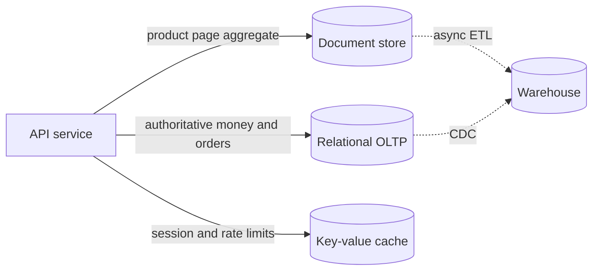

# D10-T001 — SQL vs NoSQL trade-offs

Topic ID: `D10-T001`
Domain: NoSQL Databases
Subdomain: SQL vs NoSQL trade-offs
Importance: common
Complexity: intermediate
Dependencies: `D07-T001`, `D07-T002`
Execution status of the code in section F: illustrative (schema design sketch)

## A. Topic Overview

Relational databases organize data in tables with a declared schema, constraints, and a query language (SQL) that can join across entities. NoSQL systems relax one or more of those properties—fixed schema, join-heavy access, or single-node writes—in exchange for horizontal scale, flexible shapes, or specialized access paths.

The trade-off exists because a general-purpose relational engine pays coordination cost for arbitrary ad hoc queries and strong transactional guarantees on many rows. When your production workload is a small set of well-known read and write patterns at very high volume, paying that cost on every request is wasteful.

In backend interviews this topic filters candidates who pick databases by brand instead of by access pattern, consistency needs, and operational model. Strong answers name what you give up (joins, multi-row invariants, ad hoc analytics) and what you gain (partition tolerance, schema agility, simpler hot-path latency).

Prerequisites: relational fundamentals (`D07-T001`, `D07-T002`). Later NoSQL topics assume you can articulate why a workload might leave SQL.

## B. First-Principles Explanation

A database is storage plus a contract: what shapes are legal, how you read and write, and what guarantees hold after a failure or under concurrency. SQL systems centralize that contract in the schema and enforce it at write time with constraints and transactions.

NoSQL is not one thing. It is a family: key-value, document, wide-column, and graph engines each optimize a different unit of access (a key lookup, a document, a partition row, a traversal). They still have schemas—often implicit in application code—and still have consistency rules, but those rules are usually weaker or scoped to a partition.

What happens when you choose:

1. You list the queries and writes the service must serve in production, not the ones a reporting tool might want someday.
2. You decide which invariants must be atomic (balance transfer) versus which can be repaired (denormalized display name).
3. You match the store to partition keys, replication, and consistency knobs you can operate.
4. You accept migration and dual-write cost if the choice was wrong.

Why it works: specialization removes work from the hot path. Limitations: cross-entity reporting, ad hoc filters, and global secondary indexes become application problems or separate pipelines. Alternatives include staying on SQL with read replicas, caching, sharding middleware, or polyglot persistence (SQL for ledger, NoSQL for sessions).

Terms: **OLTP** is transactional serving traffic. **OLAP** is analytical scans. **Polyglot persistence** uses multiple stores by bounded context.

## C. Internal Working and Architecture

Components in a typical service boundary:

- The **OLTP SQL** tier handles authoritative rows, foreign keys, and multi-statement transactions.
- A **NoSQL** tier holds session state, product catalog denormalized for reads, or time-series events partitioned by device.
- **Search or warehouse** systems absorb full-text and aggregate workloads SQL was never meant to serve at scale.

Execution for a read-mostly product page:

1. Request hits API with product id.
2. Cache (Redis) is checked; on miss, document store returns embedded variants and reviews snapshot.
3. Inventory count may still come from SQL or a dedicated inventory service with stronger invariants.

Data flow: writes that need uniqueness across users still land in SQL; writes that are idempotent per user session may land in DynamoDB with conditional expressions. State is per partition in NoSQL; global uniqueness is harder and often delegated to SQL or a coordination service.

Memory and disk: relational pages and B-tree indexes favor range scans and joins. LSM-based NoSQL favors append-heavy writes and compaction; read amplification depends on how many indexes you maintain.

## D. Diagrams and Visual Models



Read left to right as request paths. Solid lines are online serving; dashed lines are asynchronous analytics, not user-facing latency.

## E. Examples and Analogies

Analogy: SQL is a library catalog with a strict filing system—you can find any book combination if you know how to query the index cards. NoSQL is a set of labeled bins optimized for the three questions your store clerks ask every minute; asking a fourth question means opening many bins by hand.

Technical example: storing user profiles with nested addresses fits a document database when you always load the whole profile by user id. Storing ledger entries that must sum to zero across accounts fits SQL transactions.

Backend example: a startup keeps everything in PostgreSQL until search latency and write fan-out on the social feed hurt p99. They add Cassandra for the feed timeline keyed by user id and keep billing in Postgres—polyglot persistence, not a wholesale migration.

Do not choose NoSQL to avoid learning indexes. Do not choose SQL for a global session table with millions of writes per second on a single hot key without a sharding plan.

## F. Code Examples

Illustrative access-pattern checklist (not executable SQL):

```text
Workload: checkout
- Write: create order row + decrement inventory (must be atomic) -> SQL transaction
- Read: product details by sku -> document or SQL with cache
- Read: cart by session id -> key-value TTL store

Workload: activity feed
- Write: append event to follower partitions -> wide-column / document per access pattern
- Read: last N events for user U -> partition key = U, sort by time desc
```

How to use: fill this table before any vendor proof-of-concept. Expected outcome: at least one workload stays on SQL even when other workloads move.

## G. Practical Backend Application

A payments microservice keeps accounts and transfers in PostgreSQL with serializable or strong read committed isolation. A notification service stores device tokens in DynamoDB keyed by user id with on-demand capacity. The API gateway rate-limits using Redis strings with TTL.

Concurrent requests: SQL row locks scope contention to related accounts. NoSQL partitions scope contention to a single partition key—design keys so hot users do not share a partition with everyone else.

Error handling: when the document store is stale relative to SQL, return explicit version fields and let the client refresh. Security: NoSQL does not remove authorization; every request still validates tenant scope. Observability: track p99 per store and replication lag per region. Scaling: add read replicas or caches before abandoning SQL; add partitions before bigger nodes.

## H. Advantages, Limitations and Trade-offs

| Choice | Benefit | Cost | Choose when | Avoid when |
| --- | --- | --- | --- | --- |
| SQL OLTP | Joins, constraints, familiar ops | Vertical scale limits, join cost at huge QPS | Money, inventory, complex invariants | Single-key hot spot at global write QPS |
| Document DB | Flexible nested shapes, fast key lookups | Unbounded document growth, index explosion | Read-by-id aggregates | Heavy cross-document transactions |
| Key-value | Minimal latency, simple scaling | No ad hoc query | Cache, locks, feature flags | Reporting without export |
| Wide-column | Huge partitioned writes | Query tied to partition design | Feeds, metrics, IoT | Arbitrary filters on non-key fields |
| Graph | Traversals in few hops | Operational niche | Fraud rings, permissions graphs | Simple CRUD dashboards |

Under load, the wrong store shows up as throttling on one partition, table scans, or replica lag—not as a mysterious “NoSQL is faster.”

## I. Common Mistakes and Misconceptions

- “NoSQL has no schema.” Application code and validation are the schema; migrations are harder because the database will not reject bad shapes.
- “SQL cannot scale.” Many teams scale Postgres with replicas, partitioning, and careful query design; NoSQL also fails without key design.
- Picking MongoDB or DynamoDB because the tutorial used it, without writing access patterns first.
- Expecting cross-partition ACID everywhere in distributed NoSQL; use SQL or sagas instead.
- Running analytics on the primary NoSQL table instead of streaming to a warehouse.

Weak interview answer: “NoSQL is for big data.” Strong answer: names access patterns, consistency, and one invariant you keep in SQL.

## J. Debugging and Troubleshooting

Symptoms: p99 spikes only on one API route, rising replication lag, or “works in dev” with ten rows.

Diagnosis:

1. List the failing query’s access pattern—does it match the primary key or index?
2. Check whether the route recently started scanning or joining across partitions.
3. Compare error rates between SQL and NoSQL dependencies in traces.
4. Review migrations that embedded huge arrays or removed a uniqueness constraint from SQL without adding application checks.

Immediate mitigation: add cache for read-heavy keys, throttle writers to hot partitions, or route authoritative reads to SQL. Long-term: redesign keys, add GSIs deliberately, or move invariants back to SQL.

Metrics: throttled requests, scan count, replica lag, transaction conflict rate.

## K. Interview Preparation

### Beginner

#### Q1. What does “NoSQL” mean in practice?

**Answer:** It is a label for databases that are not primarily relational SQL engines with join-centric query models. They include key-value, document, wide-column, and graph systems with different data models. The common thread is optimizing specific access patterns and horizontal partitioning rather than arbitrary ad hoc queries. Interviewers want you to name a category, not a single product.

#### Q2. When is SQL still the better default?

**Answer:** When you need multi-row transactions, foreign keys, and ad hoc reporting over normalized data. Ledgers, reservations, and inventory with strict invariants map cleanly to relational constraints. SQL also gives mature backup, migration, and operator tooling in most organizations. NoSQL wins when those features are unused on the hot path and partition scale dominates.

#### Q3. What is polyglot persistence?

**Answer:** Using more than one database technology in one system, each for a bounded workload. Billing might stay in PostgreSQL while sessions live in Redis and activity feeds in Cassandra. The trade-off is operational complexity and eventual consistency between stores. You need clear ownership of which store is authoritative for each fact.

#### Q4. What is an access pattern?

**Answer:** It is a concrete read or write your service performs repeatedly, with key fields and cardinality. Example: “fetch last 50 notifications for user id U ordered by time.” Schema and partition design must make that pattern a single keyed lookup or a bounded range scan. Interviewers use access patterns to see if you design data before picking vendors.

#### Q5. Does NoSQL eliminate the need for data modeling?

**Answer:** No; it moves modeling from declarative SQL schema to partition keys, sort keys, and document shape. Bad modeling still causes hot partitions, unbounded documents, and expensive secondary indexes. The database simply will not rescue you with a join. Strong candidates sketch keys on a whiteboard before discussing MongoDB versus DynamoDB.

### Intermediate

#### Q1. How do joins differ between SQL and document stores?

**Answer:** SQL joins relate rows at query time using foreign keys and indexes. Document stores often embed related data or store multiple query-oriented documents per entity. Embedding speeds reads but complicates updates when the embedded data changes for many parents. Referencing keeps writes smaller but needs a second lookup or batch fetch.

#### Q2. What consistency guarantees do you typically give up moving hot state to NoSQL?

**Answer:** You may accept eventual consistency across replicas or limited transactional scope to a single partition or document. Global uniqueness and serializable isolation across arbitrary keys are harder and more expensive. You compensate with idempotent writes, version vectors, or keeping money in SQL. The user-visible symptom of weak consistency is stale reads right after a write.

#### Q3. How should teams decide between scaling SQL and adopting NoSQL?

**Answer:** First optimize queries, indexes, connection pooling, and read replicas on SQL. Measure whether contention is global or keyed, and whether transactions must span entities. If the bottleneck is a few partitionable access patterns at very high write rates, model those patterns in a NoSQL store. Keep authoritative financial data in SQL unless you invest in distributed transaction patterns you can operate.

#### Q4. What operational costs rise with polyglot persistence?

**Answer:** You run more backups, monitoring dashboards, on-call runbooks, and failure modes. Data duplicated across stores needs a sync strategy—CDC, dual writes, or event sourcing—with clear reconciliation. Security reviews must cover IAM per store and network paths. Hiring and training must cover multiple engines instead of one DBA skill set.

#### Q5. How do CAP theorem intuitions apply to interview trade-off questions?

**Answer:** During a network partition you choose between strong consistency and availability for reads and writes on the affected nodes. Most distributed NoSQL defaults favor availability and partition tolerance with tunable consistency per request. SQL single-primary clusters often pause or reject writes on partition to preserve consistency. Candidates should connect CAP to business impact, not recite the acronym alone.

### Advanced

#### Q1. How would you migrate a monolithic SQL catalog to a document store without downtime?

**Answer:** Identify read patterns that are key-based and tolerate slightly stale denormalized fields. Dual-write new documents on change while still reading SQL until backfill completes. Compare checksums or shadow-read diffs before flipping traffic. Keep SKUs and prices authoritative in SQL until you implement compensating transactions for price changes across documents.

#### Q2. When is a NewSQL or distributed SQL layer appropriate?

**Answer:** When you need SQL semantics and horizontal sharding without rewriting the app to partition-key thinking. These systems still require thoughtful shard keys and may limit cross-shard transactions. They trade operational maturity and cost against hand-rolled Cassandra modeling. Use them when the team’s skill is SQL-first and access patterns are relational but outgrow single-node Postgres.

#### Q3. How do you prevent “split brain” between SQL and a cache of SQL rows?

**Answer:** Treat SQL as source of truth and cache as derived state with TTL and explicit invalidation on writes. Use version stamps in cache values to detect stale reads. On cache miss, load from SQL and repopulate; never write business logic that commits only to cache. For distributed caches, accept that invalidation races happen and keep TTLs short on contentious keys.

#### Q4. What signals mean you chose the wrong primary store?

**Answer:** Rising p99 on scans, frequent manual resharding, engineers adding application joins across hundreds of keys, or finance refusing to trust balances. Another signal is running heavy ETL out of the operational store because analytics cannot run safely there. The fix is often narrowing NoSQL scope or reintroducing SQL for invariants, not buying larger nodes indefinitely.

#### Q5. How do schema migrations differ in SQL versus schemaless document stores?

**Answer:** SQL migrations are versioned DDL applied before code expects new columns. Document stores allow heterogeneous documents in one collection, so old code and new code coexist longer. You still need backfill jobs to add fields, build indexes online, and retire old shapes. The absence of DDL does not remove the need for rollout planning and data quality checks.

### Scenarios

#### Q1. A social app stores the entire feed in PostgreSQL with a join per home page load. Traffic doubles and p99 explodes. What do you propose?

**Answer:** Profile the query: likely a fan-out join across followers and posts. Move timeline reads to a store partitioned by viewer or author with precomputed buckets, keeping posts authoritative in SQL or an event log. Use async fan-out on write to populate timelines. Keep SQL for content moderation and deletes that must be consistent.

#### Q2. Finance insists all money stays in SQL, but product wants DynamoDB for everything. How do you facilitate?

**Answer:** Document bounded contexts: ledger and payouts remain SQL with ACID transfers. Product catalog and session state can be NoSQL if access patterns are keyed. Define integration via events so NoSQL displays prices from published snapshots, not mutable live joins. Run a workshop listing invariants; anything that must never double-spend stays relational.

#### Q3. You inherited a MongoDB collection with 200 fields and no indexes except `_id`. Search is slow. Is MongoDB wrong?

**Answer:** The engine may be fine while the deployment pattern is wrong. Add compound indexes matching filter and sort fields, prune unused fields, and cap document size. If queries require arbitrary filters across many fields, move search to OpenSearch or keep those dimensions in SQL. The mistake is treating schemaless as indexless.

#### Q4. A startup asks “SQL or NoSQL for MVP?” with three engineers. What is a pragmatic answer?

**Answer:** Default to PostgreSQL until measured pain on a specific hot path. MVPs change schema often; SQL migrations plus JSON columns cover many flexible shapes. Introduce Redis or a document store when session volume or nested read patterns justify another moving part. Defer Cassandra until you have partition-key clarity and operators who can run it.

#### Q5. After moving sessions to Redis, users report random logouts. What failed?

**Answer:** Likely TTL eviction, memory pressure causing LRU drops, or writing to the wrong logical database index in a cluster. Sessions are not authoritative long-term state but still need consistent key naming and TTL aligned with refresh tokens. Check maxmemory policy and whether deploys flush instances. Mitigate with persistent session store or sticky refresh flow through SQL.

### Follow-ups

#### Q1. How does this connect to `D07-T002` normalization?

**Answer:** Normalization reduces update anomalies in relational models. NoSQL denormalization trades update cost for read efficiency. Interviewers chain the topics to see if you know when third normal form still matters. Money and identity usually stay normalized in SQL even when display data denormalizes elsewhere.

#### Q2. What role does caching play relative to choosing NoSQL?

**Answer:** A cache speeds reads of data that already lives elsewhere; it is not a substitute for partitionable write scaling. Redis on top of SQL solves many read problems cheaper than migrating schemas. NoSQL helps when the working set and write rate exceed what SQL plus cache can place on one shard. Combine them: SQL source of truth, Redis hot keys, NoSQL specialized timelines.

#### Q3. Where do change-data-capture streams fit?

**Answer:** CDC exports row changes from SQL to populate search indexes, warehouses, and denormalized NoSQL documents. It decouples OLTP schema from read models without dual-write races if ordering is handled per entity. Failures show up as lagging search results or stale feeds. Operate consumers idempotently with offsets.

## L. Practical Exercises

Solutions are in `EXERCISES/solutions/D10-T001.md`. Try these before opening that file.

### Exercise 1 — access patterns

For an e-commerce API (browse catalog, cart, checkout, order history), list at least four access patterns and assign each to SQL, document, key-value, or wide-column with one-sentence justification. Acceptance: checkout and inventory updates are not placed on a eventually consistent cache alone.

### Exercise 2 — debugging

p99 on `GET /home` rose after moving user profiles from Postgres to MongoDB. Logs show 40 MB documents and full collection scans. Identify two design errors and propose two fixes without naming benchmark numbers. Acceptance: you mention document size and missing indexes or wrong query shape.

### Exercise 3 — trade-off

Your team debates DynamoDB versus Postgres for a multi-tenant SaaS audit log with tenant id, user id, timestamp, and JSON payload. Writes are append-only; reads are by tenant for the last seven days. Argue for each store and pick one with explicit consistency and query trade-offs. Acceptance: you mention partition key choice and retention, not “Dynamo is web scale.”

## M. Revision Notes

- Pick the store after access patterns and invariants, not before.
- SQL: joins, constraints, transactions. NoSQL: partition keys, denormalization, tunable consistency.
- Polyglot persistence is normal at scale; operate the integration explicitly.
- Weak consistency shows up as stale reads—design UX and authority accordingly.
- CAP is about partition behavior, not a popularity contest between logos.

Flashcards:

- What is an access pattern? A repeated query/write shape with keys and cardinality.
- When keep SQL? Multi-row invariants and ad hoc relational reporting.
- What is polyglot persistence? Multiple databases by bounded workload.

## N. Related Topics

Understand this before: `D07-T001`, `D07-T002`.

This topic supports: `D10-T002` key-value, `D10-T003` documents, `D10-T006` access-pattern modeling, `D10-T019` workload choice.

Often confused with: caching versus primary store, and “schemaless” versus “no data model.”

Interviewers combine this with `D08-T001` replication basics and `D13-T006` distributed consistency.

## O. Completion Criteria

- Name four NoSQL categories and one ideal workload each without vendor slogans.
- Draw a polyglot architecture for checkout plus sessions plus feed.
- Fill an access-pattern table and justify SQL versus NoSQL per row.
- Explain one invariant you would never move out of SQL without sagas.
- Debug stale reads after a SQL-to-NoSQL migration using authority and versioning.
- Answer a CAP scenario with business impact, not jargon alone.
