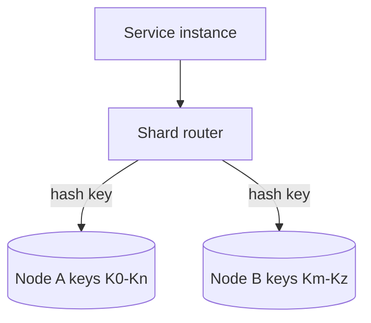

# D10-T002 — Key-value stores

Topic ID: `D10-T002`
Domain: NoSQL Databases
Subdomain: Key-value stores
Importance: common
Complexity: intermediate
Dependencies: `D10-T001`, `D07-T001`, `D07-T002`
Execution status of the code in section F: illustrative (Redis protocol sketch)

## A. Topic Overview

A key-value store maps an opaque key to a blob value with minimal query expressiveness beyond get, set, and delete. Engines such as Redis, Memcached, and DynamoDB’s item API (at the logical level) optimize single-key latency and horizontal partition by key.

The model exists because many backend problems are literally “fetch or update this one record by id” with no join. Sessions, feature flags, rate-limit counters, and distributed locks do not need SQL parsing overhead.

Interviewers use key-value stores to test whether you distinguish cache from source of truth, understand TTL eviction, and design keys that avoid cross-slot contention in clustered Redis.

Prerequisites: `D10-T001` trade-offs. Connects to `D11-T001` caching and `D10-T009` TTL.

## B. First-Principles Explanation

At the storage layer, a hash function or routing table maps a key string to a partition. The value is an opaque byte sequence; the engine does not interpret nested fields unless you add a data structure module (Redis hashes, lists).

Reads and writes are O(1) relative to dataset size for a single key, modulo network hop and persistence mode. Range queries are not native unless the product adds sorted-set or LSM secondary structures.

Why it works: the server does almost no planning per request. Limitations: no ad hoc query, no multi-key transaction unless explicitly offered (Redis MULTI, DynamoDB transact write with limits). Alternatives: embed small keyed state in SQL with a narrow table and aggressive indexing.

Terms: **TTL** expires keys automatically. **Eviction** removes keys when memory is full. **Hot key** is a key receiving disproportionate traffic.

## C. Internal Working and Architecture

Client sends `GET key` / `SET key value` to a proxy or shard router. The router consults a consistent hash ring or configuration service to pick a node. On Redis Cluster, keys in the same hash slot can be touched in one multi-key command.

Persistence paths:

- Pure memory with optional RDB/AOF snapshots (Redis).
- Memory with replication to replicas for read scaling.
- Disk-backed LSM with partition leadership (DynamoDB).

Data flow for rate limiting: API increments `ratelimit:{userId}:{minute}` with `INCR` and sets TTL on first touch. State is the integer counter; no schema beyond naming convention.

Failure: if a node dies, replicas promote or clients retry another partition; unreplicated writes may be lost—design idempotent limits.

## D. Diagrams and Visual Models



Each key lands on exactly one primary partition unless you use client-side replication to multiple systems.

## E. Examples and Analogies

Analogy: a coat check ticket. You hand the ticket (key) and receive one bag (value). You cannot ask “all bags where color is blue” without opening every bag.

Backend: OAuth refresh token storage `session:{uuid}` → JSON blob with expiry metadata and TTL aligned to token lifetime.

Anti-pattern: storing the only copy of an order in Redis without AOF/cluster persistence you trust—treat as cache unless durability is configured and tested.

## F. Code Examples

Redis-style session write (illustrative):

```text
SET session:8f3c... "{\"userId\":\"u42\",\"roles\":[\"member\"]}" EX 3600
GET session:8f3c...
DEL session:8f3c...   # logout
```

DynamoDB single-item put uses partition key `sessionId` and optional attributes; conditional expressions prevent overwrite races.

Run against local Redis or LocalStack only in dev; this snippet is documentation, not a committed test.

## G. Practical Backend Application

Place key-value behind an interface `SessionStore` so integration tests use an in-memory map. Use structured key prefixes (`tenant:session:id`) to avoid collisions in shared clusters.

Concurrency: `INCR` is atomic per key; compare-and-set via `WATCH`/`MULTI` or DynamoDB `ConditionExpression`. Security: never put PII in keys logged by proxies. Observability: track hit ratio, evicted keys, and per-key command latency outliers.

## H. Advantages, Limitations and Trade-offs

| Choice | Benefit | Cost | Choose when | Avoid when |
| --- | --- | --- | --- | --- |
| Redis memory | Sub-millisecond reads | RAM cost, eviction | Sessions, locks, hot counters | Sole store for money |
| Memcached | Simple cache | No rich structures | HTML fragment cache | Durability needed |
| DynamoDB item API | Managed partitions | Per-request pricing model | Durable keyed state at scale | Heavy relational reporting |
| SQL narrow table | ACID, backups | Row lock contention | Low-QPS keyed config | Millions of writes/s on one key |

## I. Common Mistakes and Misconceptions

- Using Redis as the only order database without durability guarantees.
- Giant values (multi-MB JSON) in a single key—blocks network and replication.
- Keys without tenant prefix in multi-tenant SaaS.
- Ignoring `maxmemory-policy` and wondering why sessions vanish.
- Assuming `GET` after `SET` is strongly consistent across global replicas without reading your vendor docs.

## J. Debugging and Troubleshooting

Symptoms: sudden auth failures, rate limits always zero, or cluster `MOVED` loops.

Diagnosis:

1. Check memory usage and eviction counters.
2. Verify key TTL and clock skew across nodes.
3. Confirm clients use the same cluster endpoint and TLS settings.
4. Inspect hot keys via slowlog or vendor hot-key reports.

Metrics: evicted keys/sec, connected clients, replication offset lag.

## K. Interview Preparation

### Beginner

#### Q1. What is a key-value store?

**Answer:** It is a database that retrieves data only by a unique key, returning an opaque value. Operations are typically put, get, and delete without SQL-style joins. The simplicity enables predictable latency and horizontal sharding by hashing the key. Examples include Redis for in-memory use and DynamoDB items accessed by primary key.

#### Q2. How is a key-value cache different from a primary database?

**Answer:** A cache holds a copy of data optimized for speed; the authoritative version usually lives in SQL or durable NoSQL. Caches tolerate loss on eviction; primaries do not. Reads may be stale until TTL expires or invalidation runs. Interviewers want you to name the source of truth explicitly.

#### Q3. What is TTL used for in key-value systems?

**Answer:** Time-to-live automatically deletes or expires a key after a duration. It suits sessions, OTP codes, and rate-limit windows without manual cleanup jobs. TTL is approximate on some systems under load. Always align TTL with business expiry, not an arbitrary default.

#### Q4. What is a hot key problem in key-value stores?

**Answer:** A hot key receives far more traffic than other keys on its shard. One Redis node or DynamoDB partition saturates while others are idle. Symptoms are latency spikes and throttling on a single partition. Mitigations include sharding the logical key, write buffering, or local aggregation.

#### Q5. Can key-value stores run transactions?

**Answer:** Some offer limited multi-key transactions on the same partition or slot. Redis `MULTI`/`EXEC` is atomic per connection scope with constraints in cluster mode. DynamoDB transact writes cap item count and must include partition-key planning. They are not a replacement for arbitrary SQL transactions.

### Intermediate

#### Q1. How do you design key names for multi-tenant SaaS?

**Answer:** Prefix every key with `tenantId` and a namespace segment such as `session` or `lock`. This prevents accidental cross-tenant reads if a bug passes the wrong id. It also helps operators inspect traffic per tenant during incidents. Document naming rules in an ADR so all services stay consistent.

#### Q2. When would you choose Redis hashes versus a JSON string value?

**Answer:** Hashes allow field-level updates without rewriting a large JSON blob. JSON strings are simpler for opaque serialization from your ORM. Hashes suit counters and small field sets; JSON suits nested structures your client already parses. Cluster slot rules still apply to the whole key.

#### Q3. How does consistent hashing help scale key-value clusters?

**Answer:** Adding nodes moves only a fraction of key ranges instead of rebalancing everything. Clients or proxies route keys through a hash ring. Rebalancing still causes brief cache misses during moves. Plan maintenance windows and client retry logic accordingly.

#### Q4. What durability modes matter for Redis-backed sessions?

**Answer:** Pure memory loses data on restart unless RDB snapshots or AOF append logs are enabled and fsync policy is understood. Replication adds redundancy but asynchronous replication can lose the last writes on failover. For strict session durability, pair short TTLs with refresh tokens stored in SQL.

#### Q5. How do conditional writes work in keyed APIs?

**Answer:** The client sends an expected version or `attribute_not_exists` condition. The store applies the write only if the condition holds, giving optimistic concurrency without locks. Failed conditions map to HTTP 409 style conflicts in your API. This pattern implements idempotent create and compare-and-swap updates.

### Advanced

#### Q1. How would you implement a distributed lock on Redis?

**Answer:** Use `SET lock:resource randomToken NX PX ttl` and release with a Lua script that deletes only if the token matches. TTL prevents deadlocks if a process crashes. Redlock across independent masters is controversial; prefer fencing tokens for critical sections. For money movement, use SQL row locks or a dedicated coordination service.

#### Q2. When is DynamoDB a key-value store versus a document store?

**Answer:** It is key-value when you access whole items by primary key without secondary indexes. It becomes document-like when you query nested attributes and maintain GSIs for alternate access paths. The distinction is usage, not marketing. Modeling still starts from partition and sort keys.

#### Q3. How do you migrate off a overloaded Redis cluster?

**Answer:** Introduce a second cluster with dual-write or write-through proxy, backfill cold keys, and shift reads with feature flags. Watch hot keys that must be split across logical shards. Validate TTL and serialization compatibility before cutover. Roll back if error rates rise on conditional writes.

#### Q4. What security issues are unique to Redis?

**Answer:** Unauthenticated instances on private networks still get scanned; require AUTH and TLS. Keys and values may contain secrets logged in slow queries. Command injection appears if you concatenate user input into `EVAL` scripts. Restrict commands with ACLs and never expose Redis directly to the internet.

#### Q5. How do memcached and Redis differ operationally?

**Answer:** Memcached is multithreaded and simple, with LRU eviction and no built-in persistence. Redis is single-threaded per process but rich data types and optional durability. Choose Memcached for pure cache layers; choose Redis when you need structures, pub/sub, or optional persistence. Both need hot-key planning at scale.

### Scenarios

#### Q1. All users share one API key in Redis `ratelimit:global` and p99 spiked. Fix?

**Answer:** The key is a hot partition; per-user or per-tenant counters spread load. Add jitter to TTL boundaries to avoid synchronized expirations. Consider local token buckets in each app instance with periodic sync for coarse limits. Monitor `INCR` latency on that key specifically.

#### Q2. After deploy, sessions exist but roles are empty intermittently.

**Answer:** Likely a race: partial JSON written without atomic update, or read from a replica lagging the primary. Use hash fields or single `SET` of complete JSON; read from primary for authz immediately after login. Add version field and reject stale reads in middleware.

#### Q3. Memcached hit ratio dropped after adding a new microservice.

**Answer:** The service may use a different key namespace, doubling cache footprint or bypassing cache entirely. Align key conventions and TTL with the monolith. Check whether the new service points at an empty cluster. Warm critical keys on deploy if cold cache causes DB storms.

#### Q4. DynamoDB throttles on a single partition key used for global config.

**Answer:** Global config became a hot key; replicate config to each instance with periodic refresh, or shard config keys by service name. Use eventually consistent reads if acceptable. For writes, funnel updates through a queue so only one writer touches the key per second.

#### Q5. Redis memory maxed; evictions rose; DB load followed.

**Answer:** Eviction policy dropped hot cache entries, causing thundering herd to SQL. Increase memory, shorten TTL on low-value keys, or add a second cache tier. Identify large keys with `MEMORY USAGE`. Prevent unbounded session growth per user device.

### Follow-ups

#### Q1. How does this relate to `D10-T003` document databases?

**Answer:** Documents also use keys but expose field paths and indexes inside the value. Key-value stays opaque unless you add modules. Choose documents when you query nested fields; choose pure KV for minimal latency counters and locks.

#### Q2. Where does Redis fit in `D11-T001` caching?

**Answer:** Caching explains why repeated reads skip the database. Redis implements that pattern with TTL and eviction policies. The key-value topic focuses on data model and operations, while caching adds invalidation strategy and consistency with SQL.

#### Q3. How do quorums apply to replicated key-value nodes?

**Answer:** Replicas may require a quorum of acknowledgements before acknowledging a write, trading latency for durability. Redis default replication is asynchronous unless you wait on `WAIT`. See `D10-T013` for formal quorum math.

## L. Practical Exercises

Solutions are in `EXERCISES/solutions/D10-T002.md`. Try these before opening that file.

### Exercise 1 — design

Design Redis keys for tenant-scoped rate limiting per user and per IP with one-minute windows. Acceptance: keys include tenant id; hot global key avoided.

### Exercise 2 — debugging

Sessions disappear every hour exactly on the hour. List two causes and how you would confirm each. Acceptance: mention TTL alignment or cron flush, not vague “Redis broke.”

### Exercise 3 — trade-off

Choose Redis versus DynamoDB for storing idempotency keys for payment retries with 24-hour retention. Acceptance: durability, conditional writes, and ops burden appear in the answer.

## M. Revision Notes

- Key-value = get/set by key; opaque value unless modules add structure.
- Distinguish cache versus source of truth.
- Hot keys dominate shard load; spread logical keys.
- TTL and eviction policies cause real outages.
- Conditional writes enable safe concurrency on a single item.

## N. Related Topics

`D10-T001`, `D10-T009` TTL, `D10-T011` hot partitions, `D11-T001` caching.

## O. Completion Criteria

- Sketch shard routing for a keyed API.
- Design tenant-prefixed keys for three use cases.
- Explain Redis durability options without hand-waving.
- Debug eviction-driven DB overload.
- Compare Redis locks versus SQL row locks for payments.
