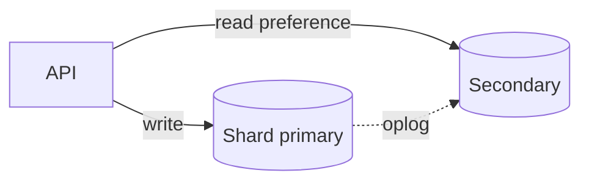

# D10-T003 — Document databases

Topic ID: `D10-T003`
Domain: NoSQL Databases
Subdomain: Document databases
Importance: common
Complexity: intermediate
Dependencies: `D10-T002`, `D10-T001`, `D07-T001`, `D07-T002`
Execution status of the code in section F: illustrative

## A. Topic Overview

Document databases store records as self-contained documents (often JSON or BSON) in collections, instead of normalizing every field into join tables. MongoDB is the common interview example: flexible schema, rich query operators, single-document atomicity, and aggregation pipelines for analytics-shaped workloads.

They fit when you usually load or update a whole aggregate by id—user profile with preferences, product with variants, order snapshot for display—and when join latency on every request is unacceptable at your traffic level.

Interviewers probe document size limits, index design, embed-versus-reference choices, and when multi-document transactions are still inferior to SQL for money.

Prerequisites: `D10-T001`, `D10-T002`. Leads into wide-column modeling (`D10-T004`) and MongoDB depth (`D10-T015`, `D10-T016`).

## B. First-Principles Explanation

A document is a tree of fields the database can index and query by path. The storage engine still shards by a shard key, maintains B-tree or similar indexes, and replicates writes to secondaries.

Schema flexibility means heterogeneous documents can coexist, but application validators and migrations still matter. Atomicity is typically per document unless you start a multi-document transaction.

Compared to key-value, documents expose query predicates on nested fields. Compared to SQL, cross-document joins are manual ($lookup, application fan-out, or denormalization).

## C. Internal Working and Architecture

MongoDB routes operations through mongos to shard primaries based on shard key. Secondaries replicate the oplog; read preference chooses primary or secondary. WiredTiger stores documents with MVCC; indexes are separate B-trees.

Writes update all indexes touching affected fields. Aggregations execute as pipeline stages, often benefiting from `$match` early to shrink working sets.



## D. Diagrams and Visual Models

Read writes to primary; stale reads happen when reading secondaries before replication catches up. Design shard key to colocate documents accessed together.

## E. Examples and Analogies

Analogy: a folder per customer containing forms, instead of a filing room where name, address, and orders live in separate cabinets linked by ID.

Embed shipping address on `orders` for invoice PDF generation; reference `userId` when profile changes often and orders must keep historical snapshots.

## F. Code Examples

```javascript
db.users.updateOne(
  { _id: ObjectId("...") },
  { $set: { "profile.displayName": "Ada" }, $inc: { version: 1 } }
);
db.orders.createIndex({ userId: 1, status: 1, createdAt: -1 });
```

Validate with `explain("executionStats")` for IXSCAN on hot APIs.

## G. Practical Backend Application

Cap array lengths (reviews, events) in API validation. Use change streams or CDC to project into SQL or search. For multi-tenant data, include `tenantId` in shard key or every unique index prefix.

## H. Advantages, Limitations and Trade-offs

| Choice | Benefit | Cost | Choose when | Avoid when |
| --- | --- | --- | --- | --- |
| Embedded arrays | One read | 16 MB doc limit, fan-out updates | Bounded child lists | Unbounded event streams |
| $lookup join | Normalized refs | Pipeline cost | Admin reports | User-facing hot path |
| Secondary read | Scale reads | Stale data | Catalog browse | Post-payment read |
| Multi-doc transaction | Cross-doc ACID | Latency, limits | Small invariants | Global ledger |

## I. Common Mistakes and Misconceptions

- Unbounded `$push` into events arrays on every click.
- Shard key `createdAt` alone causing hot shard.
- Assuming MongoDB removes need for indexes.
- Using transactions to fix bad embed/reference design.
- Storing only in Mongo what finance still considers authoritative without reconciliation.

## J. Debugging and Troubleshooting

Symptoms: COLLSCAN, document too large, replication lag reads.

1. `explain` hot queries; add compound indexes matching filter+sort.
2. Check average document size via `$collStats`.
3. Verify read preference after writes for user-facing flows.
4. Correlate slow aggregations with missing `$match` index.

## K. Interview Preparation

### Beginner

#### Q1. What is a document database?

**Answer:** It stores records as self-contained documents with nested fields, usually in collections rather than normalized tables. Queries target fields and paths inside the document. MongoDB is the canonical interview example with BSON storage and rich operators. The model optimizes aggregate reads by id over ad hoc relational joins.

#### Q2. How is BSON different from JSON?

**Answer:** BSON is a binary encoding with additional types such as `ObjectId`, `Date`, and `Decimal128`. Drivers map between language types and BSON on the wire. JSON in APIs is not identical to BSON storage semantics for dates and decimals. Interviewers check whether you know types affect sorting and equality.

#### Q3. What is single-document atomicity?

**Answer:** All field updates in one document commit together on a single primary. No other client sees a half-updated document for that `_id`. This does not span documents unless you use a transaction. It is the default tool for counter bumps and nested field updates.

#### Q4. When should you embed versus reference?

**Answer:** Embed when child data is always read with the parent and changes rarely. Reference when many parents share one child or the child updates independently often. Embedding trades write amplification on change for read speed. Cap embed size to avoid document limits.

#### Q5. What is the MongoDB document size limit?

**Answer:** A single document cannot exceed 16 MB. Large binaries belong in object storage with pointers in the document. Unbounded arrays are a common way teams hit the limit unexpectedly. Design pagination and bucketing before production traffic.

### Intermediate

#### Q1. How do compound indexes interact with sort and filter?

**Answer:** Equality filters on leading index fields, then range, then sort direction must match index order or the planner cannot use the index efficiently. Missing a field in the middle often causes in-memory sorts. Design indexes from explain plans of real APIs. Drop redundant indexes that write amplification without read benefit.

#### Q2. What does `$lookup` cost?

**Answer:** It is a left outer join between collections in the aggregation framework. Each input document may trigger work on the foreign collection. It is fine for reporting pipelines, risky for high-QPS online paths. Prefer embedding or precomputed views for hot reads.

#### Q3. How does sharding choose a shard for a document?

**Answer:** The shard key value is hashed or ranged to a chunk owned by a shard. Poor shard keys skew load to one shard. Include high-cardinality fields like `userId` for user-scoped data. Changing shard key later is a major migration.

#### Q4. What are change streams used for?

**Answer:** They tail the oplog and emit insert/update/delete events to consumers. Use them to invalidate caches, project to search indexes, or replicate to warehouses. Ordering is per collection with resume tokens. They decouple OLTP documents from derived systems.

#### Q5. How do read preferences affect consistency?

**Answer:** Reading from secondaries may return stale data relative to the primary. `primary` avoids stale reads at the cost of load on the leader. `primaryPreferred` is a common compromise. User-facing flows after writes should read from primary or use causal consistency tokens if enabled.

### Advanced

#### Q1. When are multi-document transactions appropriate in MongoDB?

**Answer:** Use them for short updates spanning few documents on the same replica set when business rules require atomicity. They add overhead versus single-document updates. Cross-shard transactions are heavier still. Prefer SQL or sagas for complex money flows unless scope is truly small.

#### Q2. How do you migrate schema in a schemaless collection?

**Answer:** Roll out dual-write or backfill jobs adding new fields with defaults. Use aggregation `$out` or batched updates to rewrite shapes. Build new indexes online before switching queries. Monitor for documents missing required fields in validators.

#### Q3. What is a covered query?

**Answer:** The index contains all fields returned and filtered so the engine never fetches the document. It reduces IO dramatically on large documents. Project only indexed fields in the query. Explain plans show `TOTAL_KEYS_EXAMINED` without fetches when covered.

#### Q4. How do multikey indexes work?

**Answer:** Indexes on array fields create index entries per array element. They enable queries on array members but increase index size. Compound multikey indexes have restrictions on multiple arrays. Model arrays carefully when indexing.

#### Q5. Compare MongoDB to DynamoDB documents.

**Answer:** Both store JSON-like items. DynamoDB requires explicit partition and sort keys per table and GSIs per access pattern. MongoDB offers richer ad hoc queries within a shard at the cost of index discipline. Choose based on ops model and query flexibility needs.

### Scenarios

#### Q1. Orders API scans entire collection after a release.

**Answer:** A new filter field lacks an index or `$or` prevents index use. Capture `explain` from production-like data. Add compound index matching equality filters and sort. Roll back the query change if index build is slow and traffic is high.

#### Q2. Invoice PDF shows old merchant name after rebrand.

**Answer:** Merchant name was embedded denormalized on orders without versioned snapshots. Fix forward with immutable snapshot fields at order time. Backfill historical PDFs if legally required. Reference live merchant only for admin tools, not invoices.

#### Q3. One tenant dominates disk and QPS.

**Answer:** Shard key may not include `tenantId`, letting one tenant concentrate chunks. Reshard with tenant in key or isolate tenant to dedicated cluster. Rate-limit tenant at API layer while migrating. Monitor per-tenant metrics proactively.

#### Q4. Aggregation pipeline times out on `$group` without `$match`.

**Answer:** Full collection scan groups are expensive. Push `$match` first using selective predicates and indexes. Allow disk use only as temporary relief, not architecture. Pre-aggregate via batch jobs for dashboards.

#### Q5. Finance demands SQL but product uses Mongo for catalog.

**Answer:** Keep prices and tax in SQL as authority; Mongo stores merchandising fields synced via CDC. Display stale marketing copy briefly OK; stale price is not. Document ownership in ADR and test reconciliation jobs.

### Follow-ups

#### Q1. Link to `D10-T007` embedding?

**Answer:** Embedding is the core document modeling decision covered in depth there. This topic introduces the mechanism; that topic compares trade-offs systematically. Interview loops often combine both.

#### Q2. Link to `D10-T015` aggregation?

**Answer:** Aggregation pipelines are the analytics and transform layer on documents. Indexes and `$match` stage design dominate performance. Study both together before interviews.

#### Q3. Link to SQL normalization?

**Answer:** Third normal form still applies to authoritative money data in SQL. Documents intentionally denormalize for read paths. Use each where its invariants belong.

## L. Practical Exercises

Solutions: `EXERCISES/solutions/D10-T003.md`.

### Exercise 1 — design

Three access patterns with Mongo indexes and optional Dynamo item keys.

### Exercise 2 — debugging

Hot shard and COLLSCAN mitigation.

### Exercise 3 — trade-off

SQL authority vs Mongo catalog.

## M. Revision Notes

- Documents = nested aggregates; 16 MB cap; index for every hot query.
- Embed vs reference drives write fan-out.
- Read secondaries = possible staleness.
- Transactions are a scalpel, not default.
- Mongo + SQL polyglot is common.

## N. Related Topics

`D10-T002`, `D10-T004`, `D10-T007`, `D10-T015`, `D10-T016`.

## O. Completion Criteria

- Design embed/reference for a catalog and orders API.
- Read explain output for IXSCAN vs COLLSCAN.
- Size a document with arrays safely.
- Answer transaction scope limits.
- Sketch sharding key for multi-tenant users.
