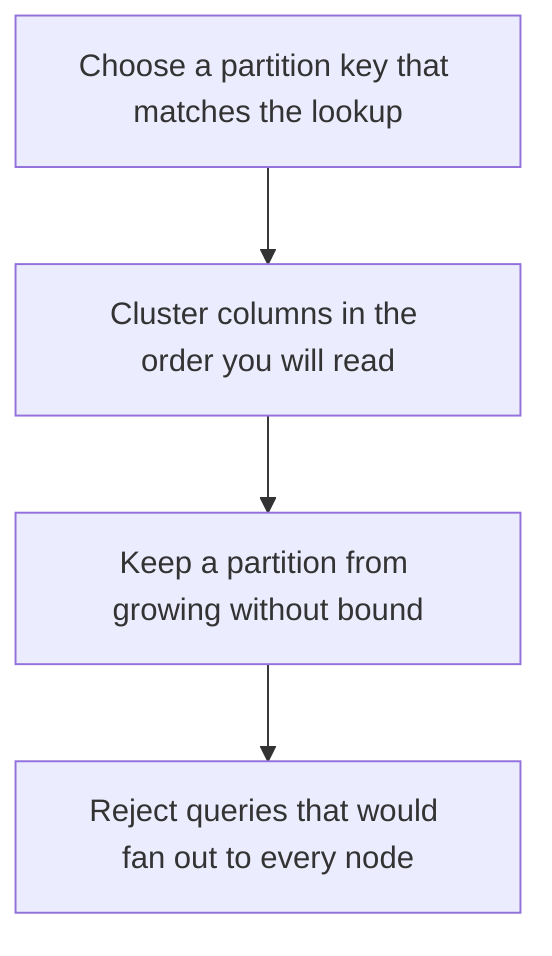

# D10-T004 — Wide-column databases

Topic ID: `D10-T004`
Domain: NoSQL Databases
Subdomain: Wide-column databases
Importance: common
Complexity: intermediate
Dependencies: `D10-T003`, `D10-T001`, `D07-T001`, `D07-T002`
Execution status of the code in section F: unexecuted

## A. Topic Overview

A wide-column store groups rows by a partition key and stores many columns or cells inside that partition, often sorted by a clustering key. Cassandra and Bigtable are the reference designs. Reads are fast when they hit one partition. A query that scans every partition is a distributed full scan. The data model is the query model.

In production this shows up as follows: A timeline stored as user_id plus time stays on one partition and reads the latest page cheaply. Storing it by a random id makes the home timeline a scatter-gather.

Interviewers use Wide-column databases to see whether you can state the failure mode, not only the definition. The failure to name is: a hot partition or a query that fans out because the WHERE clause is not the partition key

Prerequisites: `D10-T003`, `D10-T001`, `D07-T001`, `D07-T002`. Later notes should link here instead of repeating the mechanism.

## B. First-Principles Explanation

A wide-column store groups rows by a partition key and stores many columns or cells inside that partition, often sorted by a clustering key. Cassandra and Bigtable are the reference designs. Reads are fast when they hit one partition. A query that scans every partition is a distributed full scan. The data model is the query model.

The useful picture is: A wide-column partition is one filing cabinet. The clustering key is the order of folders inside it. Asking every cabinet in the building is not a lookup.

What has to be true:

1. Choose a partition key that matches the lookup
2. Cluster columns in the order you will read
3. Keep a partition from growing without bound
4. Reject queries that would fan out to every node

It works when those steps preserve one invariant. It fails when a hot partition or a query that fans out because the WHERE clause is not the partition key. The alternative is: you need ad hoc queries across many partitions

## C. Internal Working and Architecture

Components involved: the caller, the state Wide-column databases mutates or reads, and the observer that reports partition size, p99 of the primary query, and fan-out count.

Execution:

1. Choose a partition key that matches the lookup
2. Cluster columns in the order you will read
3. Keep a partition from growing without bound
4. Reject queries that would fan out to every node

Data moves only along that path. A retry re-enters at step 1, so the operation must say what a duplicate does. Memory and locks stay inside this mechanism. Callers see the result or a typed error, not a half-updated invariant.

State to remember: choose this when the access path is a known key and a range inside one partition. Do not choose it when you need ad hoc queries across many partitions.

## D. Diagrams and Visual Models



Read the diagram from top to bottom. Each box is one step of Wide-column databases. The failure mode (a hot partition or a query that fans out because the WHERE clause is not the partition key) is what you look for when a later box never happens or happens twice.

## E. Examples and Analogies

Analogy: A wide-column partition is one filing cabinet. The clustering key is the order of folders inside it. Asking every cabinet in the building is not a lookup.

Production example: A timeline stored as user_id plus time stays on one partition and reads the latest page cheaply. Storing it by a random id makes the home timeline a scatter-gather.

A small counterexample is enough in an interview. Show the input, apply the steps, and show the broken outcome if someone uses the mechanism outside its rule: a hot partition or a query that fans out because the WHERE clause is not the partition key.

## F. Code Examples

The snippet is labeled unexecuted. It illustrates the shape of the idea. It is not a benchmark and it embeds no secret.

```python
def partition_key(user_id):
    return user_id  # queries must include this key
```

After the snippet, check partition size, p99 of the primary query, and fan-out count. If that signal moves the wrong way, the snippet is the wrong tool for the workload.

## G. Practical Backend Application

Use Wide-column databases in a service when the access path is a known key and a range inside one partition.

A typical place is the production case already stated: A timeline stored as user_id plus time stays on one partition and reads the latest page cheaply. Storing it by a random id makes the home timeline a scatter-gather.

Operationally you alert on partition size, p99 of the primary query, and fan-out count. You do not alert only on process uptime. The dashboard should show the failure mode, a success rate, and the saturation signal (queue depth, lock wait, or latency) that predicts it.

## H. Advantages, Limitations and Trade-offs

| Choice | Benefit | Cost | Choose when | Avoid when |
| --- | --- | --- | --- | --- |
| Apply Wide-column databases | the access path is a known key and a range inside one partition | Extra moving parts and a new failure mode | The failure you are preventing is already real | you need ad hoc queries across many partitions |
| Simpler alternative | Less code and fewer dependencies | a hot partition or a query that fans out because the WHERE clause is not the partition key | The workload does not hit the limit | The invariant must hold under concurrency or failure |

Wide-column databases is a trade. State the benefit and the cost in the same sentence when you propose it in a design review.

## I. Common Mistakes and Misconceptions

- Using a timestamp alone as the partition key.
- Letting a partition grow forever.
- Adding a secondary index and expecting it to be as cheap as the primary key.
- Treating a diagram of Wide-column databases as proof that the invariant holds in production.
- Copying a default configuration without naming partition size, p99 of the primary query, and fan-out count.

## J. Debugging and Troubleshooting

Symptom: a hot partition or a query that fans out because the WHERE clause is not the partition key

First check: partition size, p99 of the primary query, and fan-out count.

Then compare one healthy instance against one unhealthy instance. Confirm whether retries are duplicating work. Confirm whether a timeout is shorter than the work. Fix the invariant, then watch the same metric for a full peak, not only for the next minute.

Useful questions: did the step order in section C actually happen, or did a caller skip a step? Did a deploy change the data shape that Wide-column databases assumes?

## K. Interview Preparation

### Beginner

#### Q1. What problem does Wide-column databases solve?

**Answer:** A wide-column store groups rows by a partition key and stores many columns or cells inside that partition, often sorted by a clustering key. Cassandra and Bigtable are the reference designs. Reads are fast when they hit one partition. A query that scans every partition is a distributed full scan. The data model is the query model. Without it, the usual backend failure is: a hot partition or a query that fans out because the WHERE clause is not the partition key.

#### Q2. Where does Wide-column databases sit on a request path?

**Answer:** Wide-column databases is not a library you sprinkle on every call. the access path is a known key and a range inside one partition You notice it when partition size, p99 of the primary query, and fan-out count. Name the constraint that makes this choice correct. Say what you would measure to confirm it.

#### Q3. Give a concrete example of Wide-column databases.

**Answer:** A timeline stored as user_id plus time stays on one partition and reads the latest page cheaply. Storing it by a random id makes the home timeline a scatter-gather. Walk the input, the state change, and the observable output. Name the constraint that makes this choice correct.

#### Q4. What is a common mix-up around Wide-column databases?

**Answer:** a hot partition or a query that fans out because the WHERE clause is not the partition key The corrective check is partition size, p99 of the primary query, and fan-out count. Name the constraint that makes this choice correct. Say what you would measure to confirm it. Say which alternative you rejected and why.

#### Q5. When would you skip Wide-column databases?

**Answer:** you need ad hoc queries across many partitions Skipping is a decision with a measured cost, not a slogan. Name the constraint that makes this choice correct. Say what you would measure to confirm it. Say which alternative you rejected and why.

### Intermediate

#### Q1. What invariant makes Wide-column databases correct?

**Answer:** A wide-column store groups rows by a partition key and stores many columns or cells inside that partition, often sorted by a clustering key. Cassandra and Bigtable are the reference designs. Reads are fast when they hit one partition. A query that scans every partition is a distributed full scan. The data model is the query model. State the invariant before you name the tool.

#### Q2. How do you test Wide-column databases?

**Answer:** Assert the failure mode directly: a hot partition or a query that fans out because the WHERE clause is not the partition key. The assertion should watch partition size, p99 of the primary query, and fan-out count. Include a concurrent or retry case if the bug only appears then. Name the constraint that makes this choice correct.

#### Q3. What signal tells you Wide-column databases is misbehaving in production?

**Answer:** Watch partition size, p99 of the primary query, and fan-out count. The user-visible symptom is usually a hot partition or a query that fans out because the WHERE clause is not the partition key. Name the constraint that makes this choice correct. Say what you would measure to confirm it.

#### Q4. How would you introduce Wide-column databases into a legacy service?

**Answer:** the access path is a known key and a range inside one partition Ship it behind a metric so you can compare the old path. Roll back if a hot partition or a query that fans out because the WHERE clause is not the partition key gets worse. Name the constraint that makes this choice correct. Say what you would measure to confirm it.

#### Q5. What do you trade away by choosing Wide-column databases?

**Answer:** the access path is a known key and a range inside one partition you need ad hoc queries across many partitions Say the cost in latency, storage, or operational load. Name the constraint that makes this choice correct. Say what you would measure to confirm it. Say which alternative you rejected and why.

### Advanced

#### Q1. What breaks if a dependency of Wide-column databases is slow or down?

**Answer:** a hot partition or a query that fans out because the WHERE clause is not the partition key Degrade using the rule: you need ad hoc queries across many partitions. Timeouts must be shorter than the caller's deadline. Name the constraint that makes this choice correct. Say what you would measure to confirm it.

#### Q2. How does Wide-column databases behave under retries?

**Answer:** Retries repeat work, so Wide-column databases must define what a duplicate does. a hot partition or a query that fans out because the WHERE clause is not the partition key Idempotency keys or fences belong next to the write, not in a comment. Name the constraint that makes this choice correct. Say what you would measure to confirm it.

#### Q3. What is the capacity limit of Wide-column databases?

**Answer:** The limit shows up as partition size, p99 of the primary query, and fan-out count. Add capacity only after you know whether the bottleneck is CPU, lock wait, or network. Name the constraint that makes this choice correct. Say what you would measure to confirm it.

#### Q4. How do you evolve Wide-column databases without a flag day?

**Answer:** the access path is a known key and a range inside one partition Version the contract or the on-disk format. Readers should tolerate one old and one new shape during the rollout. Name the constraint that makes this choice correct. Say what you would measure to confirm it.

#### Q5. What security or correctness bug hides inside Wide-column databases?

**Answer:** a hot partition or a query that fans out because the WHERE clause is not the partition key Check authorization and tenancy at the same boundary as the mechanism. A cache or queue must not widen who can read the data. Name the constraint that makes this choice correct. Say what you would measure to confirm it.

### Scenario

#### Q1. Incident: a hot partition or a query that fans out because the WHERE clause is not the partition key. What do you check first?

**Answer:** Start with partition size, p99 of the primary query, and fan-out count. Compare a good host and a bad host before you restart anything. A wide-column store groups rows by a partition key and stores many columns or cells inside that partition, often sorted by a clustering key. Cassandra and Bigtable are the reference designs. Reads are fast when they hit one partition. A query that scans every partition is a distributed full scan. The data model is the query model.

#### Q2. A reviewer wants the clever version. What data settles it?

**Answer:** the access path is a known key and a range inside one partition you need ad hoc queries across many partitions Bring partition size, p99 of the primary query, and fan-out count from a load test or from production, not a slogan. Name the constraint that makes this choice correct. Say what you would measure to confirm it. Say which alternative you rejected and why.

#### Q3. You have one hour to explain Wide-column databases at a whiteboard.

**Answer:** Draw the happy path in four boxes. Then draw the failure: a hot partition or a query that fans out because the WHERE clause is not the partition key. End with the metric you would page on. Name the constraint that makes this choice correct.

#### Q4. The bug only appears under two concurrent callers.

**Answer:** a hot partition or a query that fans out because the WHERE clause is not the partition key Reproduce with a barrier so both sides enter the critical window. Confirm the fix with partition size, p99 of the primary query, and fan-out count. Name the constraint that makes this choice correct. Say what you would measure to confirm it.

#### Q5. Leadership wants this on every service next week.

**Answer:** you need ad hoc queries across many partitions the access path is a known key and a range inside one partition Roll it out where the failure mode is already hurting users. Name the constraint that makes this choice correct. Say what you would measure to confirm it. Say which alternative you rejected and why.

### Follow-up

#### Q1. What did you assume about the data size or the clock?

**Answer:** A wide-column store groups rows by a partition key and stores many columns or cells inside that partition, often sorted by a clustering key. Cassandra and Bigtable are the reference designs. Reads are fast when they hit one partition. A query that scans every partition is a distributed full scan. The data model is the query model. Clocks are not a total order across machines. State whether the algorithm needs bounded size or a single leader.

#### Q2. What would you measure after the change ships?

**Answer:** Page on partition size, p99 of the primary query, and fan-out count. Keep a before/after dashboard for one week. Alert on the failure mode, not only on CPU. Name the constraint that makes this choice correct.

#### Q3. Which neighboring topic did you deliberately not re-teach?

**Answer:** This note owns Wide-column databases. Related identifiers are in section N. Shared ideas are linked, not copied. Name the constraint that makes this choice correct.

## L. Practical Exercises

Solutions are in `EXERCISES/solutions/D10-T004.md`, not in this section.

1. Whiteboard the four steps of Wide-column databases and mark where `a hot partition or a query that fans out because the WHERE clause is not the partition key` enters.
2. Read the snippet in section F and write the assertion that would catch that failure. The assertion must mention `partition size, p99 of the primary query, and fan-out count`.
3. Argue for or against using Wide-column databases on a service you know. Use the choose and avoid rows from section H. Do not appeal to popularity.

## M. Revision Notes

- Mechanism: A wide-column store groups rows by a partition key and stores many columns or cells inside that partition, often sorted by a clustering key.
- Failure: a hot partition or a query that fans out because the WHERE clause is not the partition key
- Metric: partition size, p99 of the primary query, and fan-out count
- Choose when: the access path is a known key and a range inside one partition
- Avoid when: you need ad hoc queries across many partitions

## N. Related Topics

Dependencies to review first: `D10-T003`, `D10-T001`, `D07-T001`, `D07-T002`.

Shared ideas stay in those notes. This note does not restate them.

## O. Completion Criteria

- You can explain Wide-column databases without reading this note, including the failure mode.
- You can draw the diagram in section D from memory.
- You can say when not to use it, using the avoid condition in section H.
- You can name the metric you would watch after shipping it.
