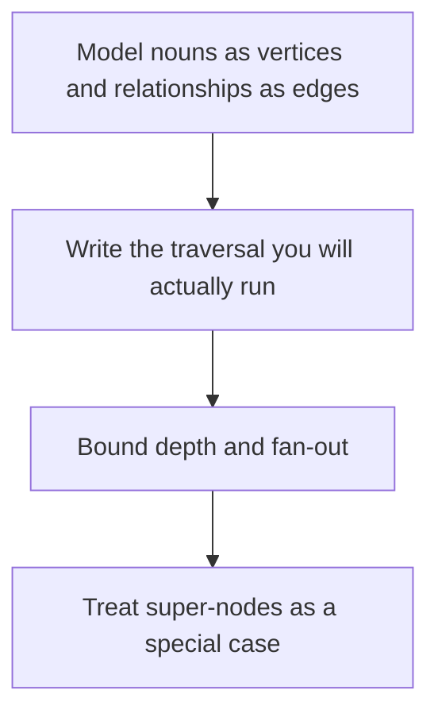

# D10-T005 — Graph databases

Topic ID: `D10-T005`
Domain: NoSQL Databases
Subdomain: Graph databases
Importance: common
Complexity: intermediate
Dependencies: `D10-T004`, `D10-T001`, `D07-T001`, `D07-T002`
Execution status of the code in section F: unexecuted

## A. Topic Overview

A graph database stores entities as vertices and relationships as edges, and it is built to traverse them. The cost follows the size of the traversed neighborhood, not a join of whole tables. A super-node with millions of edges turns a 'friend of friend' query into a scan. Graphs are a poor fit for bulk columnar analytics.

In production this shows up as follows: A permission system stores users, groups, and resources as a graph and traverses 'member of' edges. One group that contains every contractor becomes a super-node and the check gets slow.

Interviewers use Graph databases to see whether you can state the failure mode, not only the definition. The failure to name is: a traversal that touches a super-node and times out, or using a graph to replace a simple key lookup

Prerequisites: `D10-T004`, `D10-T001`, `D07-T001`, `D07-T002`. Later notes should link here instead of repeating the mechanism.

## B. First-Principles Explanation

A graph database stores entities as vertices and relationships as edges, and it is built to traverse them. The cost follows the size of the traversed neighborhood, not a join of whole tables. A super-node with millions of edges turns a 'friend of friend' query into a scan. Graphs are a poor fit for bulk columnar analytics.

The useful picture is: A graph query is walking from person to person along named roads. It is fast until you reach the town square where every road meets.

What has to be true:

1. Model nouns as vertices and relationships as edges
2. Write the traversal you will actually run
3. Bound depth and fan-out
4. Treat super-nodes as a special case

It works when those steps preserve one invariant. It fails when a traversal that touches a super-node and times out, or using a graph to replace a simple key lookup. The alternative is: the question is a key lookup or a large aggregation

## C. Internal Working and Architecture

Components involved: the caller, the state Graph databases mutates or reads, and the observer that reports vertices visited per query and latency of the deepest allowed traversal.

Execution:

1. Model nouns as vertices and relationships as edges
2. Write the traversal you will actually run
3. Bound depth and fan-out
4. Treat super-nodes as a special case

Data moves only along that path. A retry re-enters at step 1, so the operation must say what a duplicate does. Memory and locks stay inside this mechanism. Callers see the result or a typed error, not a half-updated invariant.

State to remember: choose this when the product question is a relationship traversal of bounded depth. Do not choose it when the question is a key lookup or a large aggregation.

## D. Diagrams and Visual Models



Read the diagram from top to bottom. Each box is one step of Graph databases. The failure mode (a traversal that touches a super-node and times out, or using a graph to replace a simple key lookup) is what you look for when a later box never happens or happens twice.

## E. Examples and Analogies

Analogy: A graph query is walking from person to person along named roads. It is fast until you reach the town square where every road meets.

Production example: A permission system stores users, groups, and resources as a graph and traverses 'member of' edges. One group that contains every contractor becomes a super-node and the check gets slow.

A small counterexample is enough in an interview. Show the input, apply the steps, and show the broken outcome if someone uses the mechanism outside its rule: a traversal that touches a super-node and times out, or using a graph to replace a simple key lookup.

## F. Code Examples

The snippet is labeled unexecuted. It illustrates the shape of the idea. It is not a benchmark and it embeds no secret.

```python
def friends_of_friends(graph, user, limit):
    seen = set()
    for friend in graph.neighbors(user):
        for other in graph.neighbors(friend):
            if len(seen) >= limit:
                return seen
            seen.add(other)
    return seen
```

After the snippet, check vertices visited per query and latency of the deepest allowed traversal. If that signal moves the wrong way, the snippet is the wrong tool for the workload.

## G. Practical Backend Application

Use Graph databases in a service when the product question is a relationship traversal of bounded depth.

A typical place is the production case already stated: A permission system stores users, groups, and resources as a graph and traverses 'member of' edges. One group that contains every contractor becomes a super-node and the check gets slow.

Operationally you alert on vertices visited per query and latency of the deepest allowed traversal. You do not alert only on process uptime. The dashboard should show the failure mode, a success rate, and the saturation signal (queue depth, lock wait, or latency) that predicts it.

## H. Advantages, Limitations and Trade-offs

| Choice | Benefit | Cost | Choose when | Avoid when |
| --- | --- | --- | --- | --- |
| Apply Graph databases | the product question is a relationship traversal of bounded depth | Extra moving parts and a new failure mode | The failure you are preventing is already real | the question is a key lookup or a large aggregation |
| Simpler alternative | Less code and fewer dependencies | a traversal that touches a super-node and times out, or using a graph to replace a simple key lookup | The workload does not hit the limit | The invariant must hold under concurrency or failure |

Graph databases is a trade. State the benefit and the cost in the same sentence when you propose it in a design review.

## I. Common Mistakes and Misconceptions

- Unlimited depth.
- No plan for super-nodes.
- Rebuilding a relational report as a graph because graphs sound flexible.
- Treating a diagram of Graph databases as proof that the invariant holds in production.
- Copying a default configuration without naming vertices visited per query and latency of the deepest allowed traversal.

## J. Debugging and Troubleshooting

Symptom: a traversal that touches a super-node and times out, or using a graph to replace a simple key lookup

First check: vertices visited per query and latency of the deepest allowed traversal.

Then compare one healthy instance against one unhealthy instance. Confirm whether retries are duplicating work. Confirm whether a timeout is shorter than the work. Fix the invariant, then watch the same metric for a full peak, not only for the next minute.

Useful questions: did the step order in section C actually happen, or did a caller skip a step? Did a deploy change the data shape that Graph databases assumes?

## K. Interview Preparation

### Beginner

#### Q1. What problem does Graph databases solve?

**Answer:** A graph database stores entities as vertices and relationships as edges, and it is built to traverse them. The cost follows the size of the traversed neighborhood, not a join of whole tables. A super-node with millions of edges turns a 'friend of friend' query into a scan. Graphs are a poor fit for bulk columnar analytics. Without it, the usual backend failure is: a traversal that touches a super-node and times out, or using a graph to replace a simple key lookup.

#### Q2. Where does Graph databases sit on a request path?

**Answer:** Graph databases is not a library you sprinkle on every call. the product question is a relationship traversal of bounded depth You notice it when vertices visited per query and latency of the deepest allowed traversal. Name the constraint that makes this choice correct. Say what you would measure to confirm it.

#### Q3. Give a concrete example of Graph databases.

**Answer:** A permission system stores users, groups, and resources as a graph and traverses 'member of' edges. One group that contains every contractor becomes a super-node and the check gets slow. Walk the input, the state change, and the observable output. Name the constraint that makes this choice correct.

#### Q4. What is a common mix-up around Graph databases?

**Answer:** a traversal that touches a super-node and times out, or using a graph to replace a simple key lookup The corrective check is vertices visited per query and latency of the deepest allowed traversal. Name the constraint that makes this choice correct. Say what you would measure to confirm it. Say which alternative you rejected and why.

#### Q5. When would you skip Graph databases?

**Answer:** the question is a key lookup or a large aggregation Skipping is a decision with a measured cost, not a slogan. Name the constraint that makes this choice correct. Say what you would measure to confirm it. Say which alternative you rejected and why.

### Intermediate

#### Q1. What invariant makes Graph databases correct?

**Answer:** A graph database stores entities as vertices and relationships as edges, and it is built to traverse them. The cost follows the size of the traversed neighborhood, not a join of whole tables. A super-node with millions of edges turns a 'friend of friend' query into a scan. Graphs are a poor fit for bulk columnar analytics. State the invariant before you name the tool.

#### Q2. How do you test Graph databases?

**Answer:** Assert the failure mode directly: a traversal that touches a super-node and times out, or using a graph to replace a simple key lookup. The assertion should watch vertices visited per query and latency of the deepest allowed traversal. Include a concurrent or retry case if the bug only appears then. Name the constraint that makes this choice correct.

#### Q3. What signal tells you Graph databases is misbehaving in production?

**Answer:** Watch vertices visited per query and latency of the deepest allowed traversal. The user-visible symptom is usually a traversal that touches a super-node and times out, or using a graph to replace a simple key lookup. Name the constraint that makes this choice correct. Say what you would measure to confirm it.

#### Q4. How would you introduce Graph databases into a legacy service?

**Answer:** the product question is a relationship traversal of bounded depth Ship it behind a metric so you can compare the old path. Roll back if a traversal that touches a super-node and times out, or using a graph to replace a simple key lookup gets worse. Name the constraint that makes this choice correct. Say what you would measure to confirm it.

#### Q5. What do you trade away by choosing Graph databases?

**Answer:** the product question is a relationship traversal of bounded depth the question is a key lookup or a large aggregation Say the cost in latency, storage, or operational load. Name the constraint that makes this choice correct. Say what you would measure to confirm it. Say which alternative you rejected and why.

### Advanced

#### Q1. What breaks if a dependency of Graph databases is slow or down?

**Answer:** a traversal that touches a super-node and times out, or using a graph to replace a simple key lookup Degrade using the rule: the question is a key lookup or a large aggregation. Timeouts must be shorter than the caller's deadline. Name the constraint that makes this choice correct. Say what you would measure to confirm it.

#### Q2. How does Graph databases behave under retries?

**Answer:** Retries repeat work, so Graph databases must define what a duplicate does. a traversal that touches a super-node and times out, or using a graph to replace a simple key lookup Idempotency keys or fences belong next to the write, not in a comment. Name the constraint that makes this choice correct. Say what you would measure to confirm it.

#### Q3. What is the capacity limit of Graph databases?

**Answer:** The limit shows up as vertices visited per query and latency of the deepest allowed traversal. Add capacity only after you know whether the bottleneck is CPU, lock wait, or network. Name the constraint that makes this choice correct. Say what you would measure to confirm it.

#### Q4. How do you evolve Graph databases without a flag day?

**Answer:** the product question is a relationship traversal of bounded depth Version the contract or the on-disk format. Readers should tolerate one old and one new shape during the rollout. Name the constraint that makes this choice correct. Say what you would measure to confirm it.

#### Q5. What security or correctness bug hides inside Graph databases?

**Answer:** a traversal that touches a super-node and times out, or using a graph to replace a simple key lookup Check authorization and tenancy at the same boundary as the mechanism. A cache or queue must not widen who can read the data. Name the constraint that makes this choice correct. Say what you would measure to confirm it.

### Scenario

#### Q1. Incident: a traversal that touches a super-node and times out, or using a graph to replace a simple key lookup. What do you check first?

**Answer:** Start with vertices visited per query and latency of the deepest allowed traversal. Compare a good host and a bad host before you restart anything. A graph database stores entities as vertices and relationships as edges, and it is built to traverse them. The cost follows the size of the traversed neighborhood, not a join of whole tables. A super-node with millions of edges turns a 'friend of friend' query into a scan. Graphs are a poor fit for bulk columnar analytics.

#### Q2. A reviewer wants the clever version. What data settles it?

**Answer:** the product question is a relationship traversal of bounded depth the question is a key lookup or a large aggregation Bring vertices visited per query and latency of the deepest allowed traversal from a load test or from production, not a slogan. Name the constraint that makes this choice correct. Say what you would measure to confirm it. Say which alternative you rejected and why.

#### Q3. You have one hour to explain Graph databases at a whiteboard.

**Answer:** Draw the happy path in four boxes. Then draw the failure: a traversal that touches a super-node and times out, or using a graph to replace a simple key lookup. End with the metric you would page on. Name the constraint that makes this choice correct.

#### Q4. The bug only appears under two concurrent callers.

**Answer:** a traversal that touches a super-node and times out, or using a graph to replace a simple key lookup Reproduce with a barrier so both sides enter the critical window. Confirm the fix with vertices visited per query and latency of the deepest allowed traversal. Name the constraint that makes this choice correct. Say what you would measure to confirm it.

#### Q5. Leadership wants this on every service next week.

**Answer:** the question is a key lookup or a large aggregation the product question is a relationship traversal of bounded depth Roll it out where the failure mode is already hurting users. Name the constraint that makes this choice correct. Say what you would measure to confirm it. Say which alternative you rejected and why.

### Follow-up

#### Q1. What did you assume about the data size or the clock?

**Answer:** A graph database stores entities as vertices and relationships as edges, and it is built to traverse them. The cost follows the size of the traversed neighborhood, not a join of whole tables. A super-node with millions of edges turns a 'friend of friend' query into a scan. Graphs are a poor fit for bulk columnar analytics. Clocks are not a total order across machines. State whether the algorithm needs bounded size or a single leader.

#### Q2. What would you measure after the change ships?

**Answer:** Page on vertices visited per query and latency of the deepest allowed traversal. Keep a before/after dashboard for one week. Alert on the failure mode, not only on CPU. Name the constraint that makes this choice correct.

#### Q3. Which neighboring topic did you deliberately not re-teach?

**Answer:** This note owns Graph databases. Related identifiers are in section N. Shared ideas are linked, not copied. Name the constraint that makes this choice correct.

## L. Practical Exercises

Solutions are in `EXERCISES/solutions/D10-T005.md`, not in this section.

1. Whiteboard the four steps of Graph databases and mark where `a traversal that touches a super-node and times out, or using a graph to replace a simple key lookup` enters.
2. Read the snippet in section F and write the assertion that would catch that failure. The assertion must mention `vertices visited per query and latency of the deepest allowed traversal`.
3. Argue for or against using Graph databases on a service you know. Use the choose and avoid rows from section H. Do not appeal to popularity.

## M. Revision Notes

- Mechanism: A graph database stores entities as vertices and relationships as edges, and it is built to traverse them.
- Failure: a traversal that touches a super-node and times out, or using a graph to replace a simple key lookup
- Metric: vertices visited per query and latency of the deepest allowed traversal
- Choose when: the product question is a relationship traversal of bounded depth
- Avoid when: the question is a key lookup or a large aggregation

## N. Related Topics

Dependencies to review first: `D10-T004`, `D10-T001`, `D07-T001`, `D07-T002`.

Shared ideas stay in those notes. This note does not restate them.

## O. Completion Criteria

- You can explain Graph databases without reading this note, including the failure mode.
- You can draw the diagram in section D from memory.
- You can say when not to use it, using the avoid condition in section H.
- You can name the metric you would watch after shipping it.
