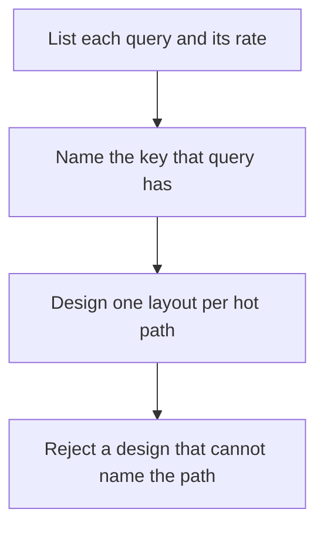

# D10-T006 — Data modeling for access patterns

Topic ID: `D10-T006`
Domain: NoSQL Databases
Subdomain: Data modeling for access patterns
Importance: common
Complexity: intermediate
Dependencies: `D10-T005`, `D10-T001`, `D07-T001`, `D07-T002`
Execution status of the code in section F: unexecuted

## A. Topic Overview

Access-pattern modeling starts from the queries and writes the store must serve, then shapes keys, partitions, and indexes to those paths. A table that is elegant and does not match a query will be scanned. List the read and write rate of each path before you pick a database. Patterns that conflict, such as 'fetch by user' and 'fetch by time across users,' often need two layouts.

In production this shows up as follows: An orders service reads by order id and lists by user id. One primary key cannot optimize both. A second table or a secondary index is an explicit choice with a write cost.

Interviewers use Data modeling for access patterns to see whether you can state the failure mode, not only the definition. The failure to name is: a single generic document shape that makes the hottest query a collection scan

Prerequisites: `D10-T005`, `D10-T001`, `D07-T001`, `D07-T002`. Later notes should link here instead of repeating the mechanism.

## B. First-Principles Explanation

Access-pattern modeling starts from the queries and writes the store must serve, then shapes keys, partitions, and indexes to those paths. A table that is elegant and does not match a query will be scanned. List the read and write rate of each path before you pick a database. Patterns that conflict, such as 'fetch by user' and 'fetch by time across users,' often need two layouts.

The useful picture is: You build the shelves for the way people actually take boxes down, not for a taxonomy that looks neat in a diagram.

What has to be true:

1. List each query and its rate
2. Name the key that query has
3. Design one layout per hot path
4. Reject a design that cannot name the path

It works when those steps preserve one invariant. It fails when a single generic document shape that makes the hottest query a collection scan. The alternative is: you design a universal schema and hope indexes appear later

## C. Internal Working and Architecture

Components involved: the caller, the state Data modeling for access patterns mutates or reads, and the observer that reports the fraction of requests served by a key lookup versus a scan.

Execution:

1. List each query and its rate
2. Name the key that query has
3. Design one layout per hot path
4. Reject a design that cannot name the path

Data moves only along that path. A retry re-enters at step 1, so the operation must say what a duplicate does. Memory and locks stay inside this mechanism. Callers see the result or a typed error, not a half-updated invariant.

State to remember: choose this when you can name the hot queries. Do not choose it when you design a universal schema and hope indexes appear later.

## D. Diagrams and Visual Models



Read the diagram from top to bottom. Each box is one step of Data modeling for access patterns. The failure mode (a single generic document shape that makes the hottest query a collection scan) is what you look for when a later box never happens or happens twice.

## E. Examples and Analogies

Analogy: You build the shelves for the way people actually take boxes down, not for a taxonomy that looks neat in a diagram.

Production example: An orders service reads by order id and lists by user id. One primary key cannot optimize both. A second table or a secondary index is an explicit choice with a write cost.

A small counterexample is enough in an interview. Show the input, apply the steps, and show the broken outcome if someone uses the mechanism outside its rule: a single generic document shape that makes the hottest query a collection scan.

## F. Code Examples

The snippet is labeled unexecuted. It illustrates the shape of the idea. It is not a benchmark and it embeds no secret.

```python
PATHS = [
    ('get_order', 'order_id', 'point'),
    ('list_user_orders', 'user_id', 'partition'),
]
```

After the snippet, check the fraction of requests served by a key lookup versus a scan. If that signal moves the wrong way, the snippet is the wrong tool for the workload.

## G. Practical Backend Application

Use Data modeling for access patterns in a service when you can name the hot queries.

A typical place is the production case already stated: An orders service reads by order id and lists by user id. One primary key cannot optimize both. A second table or a secondary index is an explicit choice with a write cost.

Operationally you alert on the fraction of requests served by a key lookup versus a scan. You do not alert only on process uptime. The dashboard should show the failure mode, a success rate, and the saturation signal (queue depth, lock wait, or latency) that predicts it.

## H. Advantages, Limitations and Trade-offs

| Choice | Benefit | Cost | Choose when | Avoid when |
| --- | --- | --- | --- | --- |
| Apply Data modeling for access patterns | you can name the hot queries | Extra moving parts and a new failure mode | The failure you are preventing is already real | you design a universal schema and hope indexes appear later |
| Simpler alternative | Less code and fewer dependencies | a single generic document shape that makes the hottest query a collection scan | The workload does not hit the limit | The invariant must hold under concurrency or failure |

Data modeling for access patterns is a trade. State the benefit and the cost in the same sentence when you propose it in a design review.

## I. Common Mistakes and Misconceptions

- Starting from entities instead of queries.
- Ignoring write amplification of the second path.
- Load-testing only the point read.
- Treating a diagram of Data modeling for access patterns as proof that the invariant holds in production.
- Copying a default configuration without naming the fraction of requests served by a key lookup versus a scan.

## J. Debugging and Troubleshooting

Symptom: a single generic document shape that makes the hottest query a collection scan

First check: the fraction of requests served by a key lookup versus a scan.

Then compare one healthy instance against one unhealthy instance. Confirm whether retries are duplicating work. Confirm whether a timeout is shorter than the work. Fix the invariant, then watch the same metric for a full peak, not only for the next minute.

Useful questions: did the step order in section C actually happen, or did a caller skip a step? Did a deploy change the data shape that Data modeling for access patterns assumes?

## K. Interview Preparation

### Beginner

#### Q1. What problem does Data modeling for access patterns solve?

**Answer:** Access-pattern modeling starts from the queries and writes the store must serve, then shapes keys, partitions, and indexes to those paths. A table that is elegant and does not match a query will be scanned. List the read and write rate of each path before you pick a database. Patterns that conflict, such as 'fetch by user' and 'fetch by time across users,' often need two layouts. Without it, the usual backend failure is: a single generic document shape that makes the hottest query a collection scan.

#### Q2. Where does Data modeling for access patterns sit on a request path?

**Answer:** Data modeling for access patterns is not a library you sprinkle on every call. you can name the hot queries You notice it when the fraction of requests served by a key lookup versus a scan. Name the constraint that makes this choice correct. Say what you would measure to confirm it.

#### Q3. Give a concrete example of Data modeling for access patterns.

**Answer:** An orders service reads by order id and lists by user id. One primary key cannot optimize both. A second table or a secondary index is an explicit choice with a write cost. Walk the input, the state change, and the observable output.

#### Q4. What is a common mix-up around Data modeling for access patterns?

**Answer:** a single generic document shape that makes the hottest query a collection scan The corrective check is the fraction of requests served by a key lookup versus a scan. Name the constraint that makes this choice correct. Say what you would measure to confirm it. Say which alternative you rejected and why.

#### Q5. When would you skip Data modeling for access patterns?

**Answer:** you design a universal schema and hope indexes appear later Skipping is a decision with a measured cost, not a slogan. Name the constraint that makes this choice correct. Say what you would measure to confirm it. Say which alternative you rejected and why.

### Intermediate

#### Q1. What invariant makes Data modeling for access patterns correct?

**Answer:** Access-pattern modeling starts from the queries and writes the store must serve, then shapes keys, partitions, and indexes to those paths. A table that is elegant and does not match a query will be scanned. List the read and write rate of each path before you pick a database. Patterns that conflict, such as 'fetch by user' and 'fetch by time across users,' often need two layouts. State the invariant before you name the tool.

#### Q2. How do you test Data modeling for access patterns?

**Answer:** Assert the failure mode directly: a single generic document shape that makes the hottest query a collection scan. The assertion should watch the fraction of requests served by a key lookup versus a scan. Include a concurrent or retry case if the bug only appears then. Name the constraint that makes this choice correct.

#### Q3. What signal tells you Data modeling for access patterns is misbehaving in production?

**Answer:** Watch the fraction of requests served by a key lookup versus a scan. The user-visible symptom is usually a single generic document shape that makes the hottest query a collection scan. Name the constraint that makes this choice correct. Say what you would measure to confirm it.

#### Q4. How would you introduce Data modeling for access patterns into a legacy service?

**Answer:** you can name the hot queries Ship it behind a metric so you can compare the old path. Roll back if a single generic document shape that makes the hottest query a collection scan gets worse. Name the constraint that makes this choice correct. Say what you would measure to confirm it.

#### Q5. What do you trade away by choosing Data modeling for access patterns?

**Answer:** you can name the hot queries you design a universal schema and hope indexes appear later Say the cost in latency, storage, or operational load. Name the constraint that makes this choice correct. Say what you would measure to confirm it. Say which alternative you rejected and why.

### Advanced

#### Q1. What breaks if a dependency of Data modeling for access patterns is slow or down?

**Answer:** a single generic document shape that makes the hottest query a collection scan Degrade using the rule: you design a universal schema and hope indexes appear later. Timeouts must be shorter than the caller's deadline. Name the constraint that makes this choice correct. Say what you would measure to confirm it.

#### Q2. How does Data modeling for access patterns behave under retries?

**Answer:** Retries repeat work, so Data modeling for access patterns must define what a duplicate does. a single generic document shape that makes the hottest query a collection scan Idempotency keys or fences belong next to the write, not in a comment. Name the constraint that makes this choice correct. Say what you would measure to confirm it.

#### Q3. What is the capacity limit of Data modeling for access patterns?

**Answer:** The limit shows up as the fraction of requests served by a key lookup versus a scan. Add capacity only after you know whether the bottleneck is CPU, lock wait, or network. Name the constraint that makes this choice correct. Say what you would measure to confirm it.

#### Q4. How do you evolve Data modeling for access patterns without a flag day?

**Answer:** you can name the hot queries Version the contract or the on-disk format. Readers should tolerate one old and one new shape during the rollout. Name the constraint that makes this choice correct. Say what you would measure to confirm it.

#### Q5. What security or correctness bug hides inside Data modeling for access patterns?

**Answer:** a single generic document shape that makes the hottest query a collection scan Check authorization and tenancy at the same boundary as the mechanism. A cache or queue must not widen who can read the data. Name the constraint that makes this choice correct. Say what you would measure to confirm it.

### Scenario

#### Q1. Incident: a single generic document shape that makes the hottest query a collection scan. What do you check first?

**Answer:** Start with the fraction of requests served by a key lookup versus a scan. Compare a good host and a bad host before you restart anything. Access-pattern modeling starts from the queries and writes the store must serve, then shapes keys, partitions, and indexes to those paths. A table that is elegant and does not match a query will be scanned. List the read and write rate of each path before you pick a database. Patterns that conflict, such as 'fetch by user' and 'fetch by time across users,' often need two layouts.

#### Q2. A reviewer wants the clever version. What data settles it?

**Answer:** you can name the hot queries you design a universal schema and hope indexes appear later Bring the fraction of requests served by a key lookup versus a scan from a load test or from production, not a slogan. Name the constraint that makes this choice correct. Say what you would measure to confirm it. Say which alternative you rejected and why.

#### Q3. You have one hour to explain Data modeling for access patterns at a whiteboard.

**Answer:** Draw the happy path in four boxes. Then draw the failure: a single generic document shape that makes the hottest query a collection scan. End with the metric you would page on. Name the constraint that makes this choice correct.

#### Q4. The bug only appears under two concurrent callers.

**Answer:** a single generic document shape that makes the hottest query a collection scan Reproduce with a barrier so both sides enter the critical window. Confirm the fix with the fraction of requests served by a key lookup versus a scan. Name the constraint that makes this choice correct. Say what you would measure to confirm it.

#### Q5. Leadership wants this on every service next week.

**Answer:** you design a universal schema and hope indexes appear later you can name the hot queries Roll it out where the failure mode is already hurting users. Name the constraint that makes this choice correct. Say what you would measure to confirm it. Say which alternative you rejected and why.

### Follow-up

#### Q1. What did you assume about the data size or the clock?

**Answer:** Access-pattern modeling starts from the queries and writes the store must serve, then shapes keys, partitions, and indexes to those paths. A table that is elegant and does not match a query will be scanned. List the read and write rate of each path before you pick a database. Patterns that conflict, such as 'fetch by user' and 'fetch by time across users,' often need two layouts. Clocks are not a total order across machines. State whether the algorithm needs bounded size or a single leader.

#### Q2. What would you measure after the change ships?

**Answer:** Page on the fraction of requests served by a key lookup versus a scan. Keep a before/after dashboard for one week. Alert on the failure mode, not only on CPU. Name the constraint that makes this choice correct.

#### Q3. Which neighboring topic did you deliberately not re-teach?

**Answer:** This note owns Data modeling for access patterns. Related identifiers are in section N. Shared ideas are linked, not copied. Name the constraint that makes this choice correct.

## L. Practical Exercises

Solutions are in `EXERCISES/solutions/D10-T006.md`, not in this section.

1. Whiteboard the four steps of Data modeling for access patterns and mark where `a single generic document shape that makes the hottest query a collection scan` enters.
2. Read the snippet in section F and write the assertion that would catch that failure. The assertion must mention `the fraction of requests served by a key lookup versus a scan`.
3. Argue for or against using Data modeling for access patterns on a service you know. Use the choose and avoid rows from section H. Do not appeal to popularity.

## M. Revision Notes

- Mechanism: Access-pattern modeling starts from the queries and writes the store must serve, then shapes keys, partitions, and indexes to those paths.
- Failure: a single generic document shape that makes the hottest query a collection scan
- Metric: the fraction of requests served by a key lookup versus a scan
- Choose when: you can name the hot queries
- Avoid when: you design a universal schema and hope indexes appear later

## N. Related Topics

Dependencies to review first: `D10-T005`, `D10-T001`, `D07-T001`, `D07-T002`.

Shared ideas stay in those notes. This note does not restate them.

## O. Completion Criteria

- You can explain Data modeling for access patterns without reading this note, including the failure mode.
- You can draw the diagram in section D from memory.
- You can say when not to use it, using the avoid condition in section H.
- You can name the metric you would watch after shipping it.
