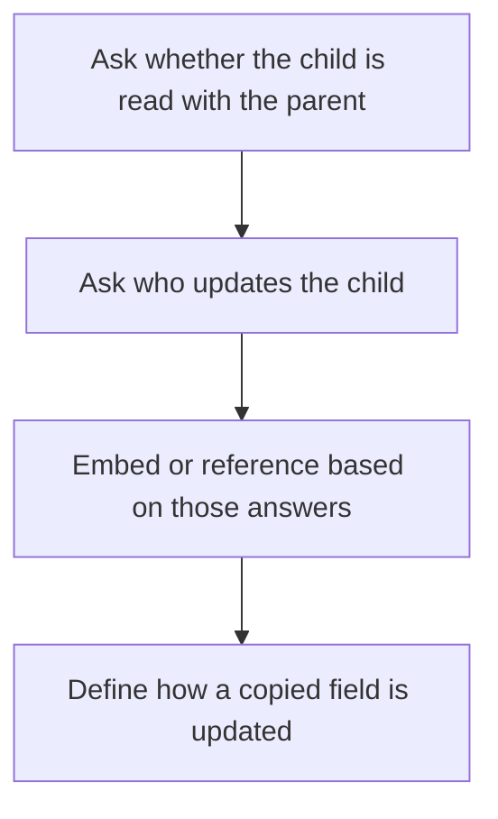

# D10-T007 — Denormalization and embedding vs referencing

Topic ID: `D10-T007`
Domain: NoSQL Databases
Subdomain: Denormalization and embedding vs referencing
Importance: core
Complexity: intermediate
Dependencies: `D10-T006`, `D10-T001`, `D07-T001`, `D07-T002`
Execution status of the code in section F: unexecuted

## A. Topic Overview

Denormalization copies data so a read can finish from one place. Embedding stores a child inside the parent document. Referencing stores an id and reads the child elsewhere, sometimes in a second query. Embedding wins when the child is small, owned by the parent, and read with it. Referencing wins when the child is large, shared, or updated on its own. The cost is stale copies and write amplification.

In production this shows up as follows: A comment thread embeds the last fifty comments in the post document so the page is one read. The user record stays referenced because the same user appears on many posts and changes their display name.

Interviewers use Denormalization and embedding vs referencing to see whether you can state the failure mode, not only the definition. The failure to name is: an embedded array that grows without bound, or a referenced profile that is joined on every request and was the latency you tried to remove

Prerequisites: `D10-T006`, `D10-T001`, `D07-T001`, `D07-T002`. Later notes should link here instead of repeating the mechanism.

## B. First-Principles Explanation

Denormalization copies data so a read can finish from one place. Embedding stores a child inside the parent document. Referencing stores an id and reads the child elsewhere, sometimes in a second query. Embedding wins when the child is small, owned by the parent, and read with it. Referencing wins when the child is large, shared, or updated on its own. The cost is stale copies and write amplification.

The useful picture is: Embedding is printing the author's name on every copy of a pamphlet. Referencing is printing a catalog number and keeping one author card.

What has to be true:

1. Ask whether the child is read with the parent
2. Ask who updates the child
3. Embed or reference based on those answers
4. Define how a copied field is updated

It works when those steps preserve one invariant. It fails when an embedded array that grows without bound, or a referenced profile that is joined on every request and was the latency you tried to remove. The alternative is: the embedded child is unbounded or shared and frequently updated

## C. Internal Working and Architecture

Components involved: the caller, the state Denormalization and embedding vs referencing mutates or reads, and the observer that reports document size, extra reads per request, and stale-copy incidents.

Execution:

1. Ask whether the child is read with the parent
2. Ask who updates the child
3. Embed or reference based on those answers
4. Define how a copied field is updated

Data moves only along that path. A retry re-enters at step 1, so the operation must say what a duplicate does. Memory and locks stay inside this mechanism. Callers see the result or a typed error, not a half-updated invariant.

State to remember: choose this when one read must return the whole aggregate. Do not choose it when the embedded child is unbounded or shared and frequently updated.

## D. Diagrams and Visual Models



Read the diagram from top to bottom. Each box is one step of Denormalization and embedding vs referencing. The failure mode (an embedded array that grows without bound, or a referenced profile that is joined on every request and was the latency you tried to remove) is what you look for when a later box never happens or happens twice.

## E. Examples and Analogies

Analogy: Embedding is printing the author's name on every copy of a pamphlet. Referencing is printing a catalog number and keeping one author card.

Production example: A comment thread embeds the last fifty comments in the post document so the page is one read. The user record stays referenced because the same user appears on many posts and changes their display name.

A small counterexample is enough in an interview. Show the input, apply the steps, and show the broken outcome if someone uses the mechanism outside its rule: an embedded array that grows without bound, or a referenced profile that is joined on every request and was the latency you tried to remove.

## F. Code Examples

The snippet is labeled unexecuted. It illustrates the shape of the idea. It is not a benchmark and it embeds no secret.

```python
def embed(child_count, shared):
    return child_count < 100 and not shared
```

After the snippet, check document size, extra reads per request, and stale-copy incidents. If that signal moves the wrong way, the snippet is the wrong tool for the workload.

## G. Practical Backend Application

Use Denormalization and embedding vs referencing in a service when one read must return the whole aggregate.

A typical place is the production case already stated: A comment thread embeds the last fifty comments in the post document so the page is one read. The user record stays referenced because the same user appears on many posts and changes their display name.

Operationally you alert on document size, extra reads per request, and stale-copy incidents. You do not alert only on process uptime. The dashboard should show the failure mode, a success rate, and the saturation signal (queue depth, lock wait, or latency) that predicts it.

## H. Advantages, Limitations and Trade-offs

| Choice | Benefit | Cost | Choose when | Avoid when |
| --- | --- | --- | --- | --- |
| Apply Denormalization and embedding vs referencing | one read must return the whole aggregate | Extra moving parts and a new failure mode | The failure you are preventing is already real | the embedded child is unbounded or shared and frequently updated |
| Simpler alternative | Less code and fewer dependencies | an embedded array that grows without bound, or a referenced profile that is joined on every request and was the latency you tried to remove | The workload does not hit the limit | The invariant must hold under concurrency or failure |

Denormalization and embedding vs referencing is a trade. State the benefit and the cost in the same sentence when you propose it in a design review.

## I. Common Mistakes and Misconceptions

- Embedding unbounded arrays.
- Denormalizing without a story for updates.
- Referencing everything and calling it normalized purity.
- Treating a diagram of Denormalization and embedding vs referencing as proof that the invariant holds in production.
- Copying a default configuration without naming document size, extra reads per request, and stale-copy incidents.

## J. Debugging and Troubleshooting

Symptom: an embedded array that grows without bound, or a referenced profile that is joined on every request and was the latency you tried to remove

First check: document size, extra reads per request, and stale-copy incidents.

Then compare one healthy instance against one unhealthy instance. Confirm whether retries are duplicating work. Confirm whether a timeout is shorter than the work. Fix the invariant, then watch the same metric for a full peak, not only for the next minute.

Useful questions: did the step order in section C actually happen, or did a caller skip a step? Did a deploy change the data shape that Denormalization and embedding vs referencing assumes?

## K. Interview Preparation

### Beginner

#### Q1. What problem does Denormalization and embedding vs referencing solve?

**Answer:** Denormalization copies data so a read can finish from one place. Embedding stores a child inside the parent document. Referencing stores an id and reads the child elsewhere, sometimes in a second query. Embedding wins when the child is small, owned by the parent, and read with it. Referencing wins when the child is large, shared, or updated on its own. The cost is stale copies and write amplification. Without it, the usual backend failure is: an embedded array that grows without bound, or a referenced profile that is joined on every request and was the latency you tried to remove.

#### Q2. Where does Denormalization and embedding vs referencing sit on a request path?

**Answer:** Denormalization and embedding vs referencing is not a library you sprinkle on every call. one read must return the whole aggregate You notice it when document size, extra reads per request, and stale-copy incidents. Name the constraint that makes this choice correct. Say what you would measure to confirm it.

#### Q3. Give a concrete example of Denormalization and embedding vs referencing.

**Answer:** A comment thread embeds the last fifty comments in the post document so the page is one read. The user record stays referenced because the same user appears on many posts and changes their display name. Walk the input, the state change, and the observable output. Name the constraint that makes this choice correct.

#### Q4. What is a common mix-up around Denormalization and embedding vs referencing?

**Answer:** an embedded array that grows without bound, or a referenced profile that is joined on every request and was the latency you tried to remove The corrective check is document size, extra reads per request, and stale-copy incidents. Name the constraint that makes this choice correct. Say what you would measure to confirm it. Say which alternative you rejected and why.

#### Q5. When would you skip Denormalization and embedding vs referencing?

**Answer:** the embedded child is unbounded or shared and frequently updated Skipping is a decision with a measured cost, not a slogan. Name the constraint that makes this choice correct. Say what you would measure to confirm it. Say which alternative you rejected and why.

### Intermediate

#### Q1. What invariant makes Denormalization and embedding vs referencing correct?

**Answer:** Denormalization copies data so a read can finish from one place. Embedding stores a child inside the parent document. Referencing stores an id and reads the child elsewhere, sometimes in a second query. Embedding wins when the child is small, owned by the parent, and read with it. Referencing wins when the child is large, shared, or updated on its own. The cost is stale copies and write amplification. State the invariant before you name the tool.

#### Q2. How do you test Denormalization and embedding vs referencing?

**Answer:** Assert the failure mode directly: an embedded array that grows without bound, or a referenced profile that is joined on every request and was the latency you tried to remove. The assertion should watch document size, extra reads per request, and stale-copy incidents. Include a concurrent or retry case if the bug only appears then. Name the constraint that makes this choice correct.

#### Q3. What signal tells you Denormalization and embedding vs referencing is misbehaving in production?

**Answer:** Watch document size, extra reads per request, and stale-copy incidents. The user-visible symptom is usually an embedded array that grows without bound, or a referenced profile that is joined on every request and was the latency you tried to remove. Name the constraint that makes this choice correct. Say what you would measure to confirm it.

#### Q4. How would you introduce Denormalization and embedding vs referencing into a legacy service?

**Answer:** one read must return the whole aggregate Ship it behind a metric so you can compare the old path. Roll back if an embedded array that grows without bound, or a referenced profile that is joined on every request and was the latency you tried to remove gets worse. Name the constraint that makes this choice correct. Say what you would measure to confirm it.

#### Q5. What do you trade away by choosing Denormalization and embedding vs referencing?

**Answer:** one read must return the whole aggregate the embedded child is unbounded or shared and frequently updated Say the cost in latency, storage, or operational load. Name the constraint that makes this choice correct. Say what you would measure to confirm it. Say which alternative you rejected and why.

### Advanced

#### Q1. What breaks if a dependency of Denormalization and embedding vs referencing is slow or down?

**Answer:** an embedded array that grows without bound, or a referenced profile that is joined on every request and was the latency you tried to remove Degrade using the rule: the embedded child is unbounded or shared and frequently updated. Timeouts must be shorter than the caller's deadline. Name the constraint that makes this choice correct. Say what you would measure to confirm it.

#### Q2. How does Denormalization and embedding vs referencing behave under retries?

**Answer:** Retries repeat work, so Denormalization and embedding vs referencing must define what a duplicate does. an embedded array that grows without bound, or a referenced profile that is joined on every request and was the latency you tried to remove Idempotency keys or fences belong next to the write, not in a comment. Name the constraint that makes this choice correct. Say what you would measure to confirm it.

#### Q3. What is the capacity limit of Denormalization and embedding vs referencing?

**Answer:** The limit shows up as document size, extra reads per request, and stale-copy incidents. Add capacity only after you know whether the bottleneck is CPU, lock wait, or network. Name the constraint that makes this choice correct. Say what you would measure to confirm it.

#### Q4. How do you evolve Denormalization and embedding vs referencing without a flag day?

**Answer:** one read must return the whole aggregate Version the contract or the on-disk format. Readers should tolerate one old and one new shape during the rollout. Name the constraint that makes this choice correct. Say what you would measure to confirm it.

#### Q5. What security or correctness bug hides inside Denormalization and embedding vs referencing?

**Answer:** an embedded array that grows without bound, or a referenced profile that is joined on every request and was the latency you tried to remove Check authorization and tenancy at the same boundary as the mechanism. A cache or queue must not widen who can read the data. Name the constraint that makes this choice correct. Say what you would measure to confirm it.

### Scenario

#### Q1. Incident: an embedded array that grows without bound, or a referenced profile that is joined on every request and was the latency you tried to remove. What do you check first?

**Answer:** Start with document size, extra reads per request, and stale-copy incidents. Compare a good host and a bad host before you restart anything. Denormalization copies data so a read can finish from one place. Embedding stores a child inside the parent document. Referencing stores an id and reads the child elsewhere, sometimes in a second query. Embedding wins when the child is small, owned by the parent, and read with it. Referencing wins when the child is large, shared, or updated on its own. The cost is stale copies and write amplification.

#### Q2. A reviewer wants the clever version. What data settles it?

**Answer:** one read must return the whole aggregate the embedded child is unbounded or shared and frequently updated Bring document size, extra reads per request, and stale-copy incidents from a load test or from production, not a slogan. Name the constraint that makes this choice correct. Say what you would measure to confirm it. Say which alternative you rejected and why.

#### Q3. You have one hour to explain Denormalization and embedding vs referencing at a whiteboard.

**Answer:** Draw the happy path in four boxes. Then draw the failure: an embedded array that grows without bound, or a referenced profile that is joined on every request and was the latency you tried to remove. End with the metric you would page on. Name the constraint that makes this choice correct.

#### Q4. The bug only appears under two concurrent callers.

**Answer:** an embedded array that grows without bound, or a referenced profile that is joined on every request and was the latency you tried to remove Reproduce with a barrier so both sides enter the critical window. Confirm the fix with document size, extra reads per request, and stale-copy incidents. Name the constraint that makes this choice correct. Say what you would measure to confirm it.

#### Q5. Leadership wants this on every service next week.

**Answer:** the embedded child is unbounded or shared and frequently updated one read must return the whole aggregate Roll it out where the failure mode is already hurting users. Name the constraint that makes this choice correct. Say what you would measure to confirm it. Say which alternative you rejected and why.

### Follow-up

#### Q1. What did you assume about the data size or the clock?

**Answer:** Denormalization copies data so a read can finish from one place. Embedding stores a child inside the parent document. Referencing stores an id and reads the child elsewhere, sometimes in a second query. Embedding wins when the child is small, owned by the parent, and read with it. Referencing wins when the child is large, shared, or updated on its own. The cost is stale copies and write amplification. Clocks are not a total order across machines. State whether the algorithm needs bounded size or a single leader.

#### Q2. What would you measure after the change ships?

**Answer:** Page on document size, extra reads per request, and stale-copy incidents. Keep a before/after dashboard for one week. Alert on the failure mode, not only on CPU. Name the constraint that makes this choice correct.

#### Q3. Which neighboring topic did you deliberately not re-teach?

**Answer:** This note owns Denormalization and embedding vs referencing. Related identifiers are in section N. Shared ideas are linked, not copied. Name the constraint that makes this choice correct.

## L. Practical Exercises

Solutions are in `EXERCISES/solutions/D10-T007.md`, not in this section.

1. Whiteboard the four steps of Denormalization and embedding vs referencing and mark where `an embedded array that grows without bound, or a referenced profile that is joined on every request and was the latency you tried to remove` enters.
2. Read the snippet in section F and write the assertion that would catch that failure. The assertion must mention `document size, extra reads per request, and stale-copy incidents`.
3. Argue for or against using Denormalization and embedding vs referencing on a service you know. Use the choose and avoid rows from section H. Do not appeal to popularity.

## M. Revision Notes

- Mechanism: Denormalization copies data so a read can finish from one place.
- Failure: an embedded array that grows without bound, or a referenced profile that is joined on every request and was the latency you tried to remove
- Metric: document size, extra reads per request, and stale-copy incidents
- Choose when: one read must return the whole aggregate
- Avoid when: the embedded child is unbounded or shared and frequently updated

## N. Related Topics

Dependencies to review first: `D10-T006`, `D10-T001`, `D07-T001`, `D07-T002`.

Shared ideas stay in those notes. This note does not restate them.

## O. Completion Criteria

- You can explain Denormalization and embedding vs referencing without reading this note, including the failure mode.
- You can draw the diagram in section D from memory.
- You can say when not to use it, using the avoid condition in section H.
- You can name the metric you would watch after shipping it.
