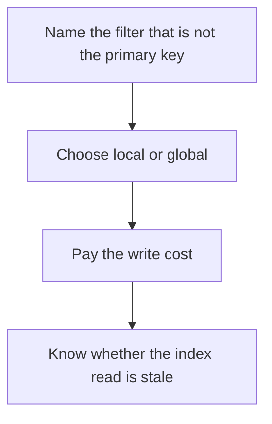

# D10-T008 — Secondary indexes

Topic ID: `D10-T008`
Domain: NoSQL Databases
Subdomain: Secondary indexes
Importance: core
Complexity: intermediate
Dependencies: `D10-T007`, `D10-T001`, `D07-T001`, `D07-T002`
Execution status of the code in section F: unexecuted

## A. Topic Overview

A secondary index locates rows by an attribute that is not the primary key. In a distributed database it is either local to each partition, which makes writes cheaper and queries a scatter, or global, which makes the query one lookup and the write a distributed update. Secondary indexes lag in eventually consistent systems. They are not free on the write path.

In production this shows up as follows: Finding orders by email in a user-id partitioned store needs a secondary structure. A global index answers in one hop and makes every order write update another partition.

Interviewers use Secondary indexes to see whether you can state the failure mode, not only the definition. The failure to name is: a query that fans out to every local index, or a global index that fails and blocks the write

Prerequisites: `D10-T007`, `D10-T001`, `D07-T001`, `D07-T002`. Later notes should link here instead of repeating the mechanism.

## B. First-Principles Explanation

A secondary index locates rows by an attribute that is not the primary key. In a distributed database it is either local to each partition, which makes writes cheaper and queries a scatter, or global, which makes the query one lookup and the write a distributed update. Secondary indexes lag in eventually consistent systems. They are not free on the write path.

The useful picture is: A secondary index is a second catalog by subject. Every new book must be filed twice. If each branch keeps its own subject catalog, a subject search visits every branch.

What has to be true:

1. Name the filter that is not the primary key
2. Choose local or global
3. Pay the write cost
4. Know whether the index read is stale

It works when those steps preserve one invariant. It fails when a query that fans out to every local index, or a global index that fails and blocks the write. The alternative is: you add indexes for hypothetical reports and slow the write path

## C. Internal Working and Architecture

Components involved: the caller, the state Secondary indexes mutates or reads, and the observer that reports write latency added by index maintenance, and fan-out of secondary lookups.

Execution:

1. Name the filter that is not the primary key
2. Choose local or global
3. Pay the write cost
4. Know whether the index read is stale

Data moves only along that path. A retry re-enters at step 1, so the operation must say what a duplicate does. Memory and locks stay inside this mechanism. Callers see the result or a typed error, not a half-updated invariant.

State to remember: choose this when a real query filters on a non-primary attribute. Do not choose it when you add indexes for hypothetical reports and slow the write path.

## D. Diagrams and Visual Models



Read the diagram from top to bottom. Each box is one step of Secondary indexes. The failure mode (a query that fans out to every local index, or a global index that fails and blocks the write) is what you look for when a later box never happens or happens twice.

## E. Examples and Analogies

Analogy: A secondary index is a second catalog by subject. Every new book must be filed twice. If each branch keeps its own subject catalog, a subject search visits every branch.

Production example: Finding orders by email in a user-id partitioned store needs a secondary structure. A global index answers in one hop and makes every order write update another partition.

A small counterexample is enough in an interview. Show the input, apply the steps, and show the broken outcome if someone uses the mechanism outside its rule: a query that fans out to every local index, or a global index that fails and blocks the write.

## F. Code Examples

The snippet is labeled unexecuted. It illustrates the shape of the idea. It is not a benchmark and it embeds no secret.

```python
def index_write_cost(global_index, partitions):
    return partitions if global_index else 1
```

After the snippet, check write latency added by index maintenance, and fan-out of secondary lookups. If that signal moves the wrong way, the snippet is the wrong tool for the workload.

## G. Practical Backend Application

Use Secondary indexes in a service when a real query filters on a non-primary attribute.

A typical place is the production case already stated: Finding orders by email in a user-id partitioned store needs a secondary structure. A global index answers in one hop and makes every order write update another partition.

Operationally you alert on write latency added by index maintenance, and fan-out of secondary lookups. You do not alert only on process uptime. The dashboard should show the failure mode, a success rate, and the saturation signal (queue depth, lock wait, or latency) that predicts it.

## H. Advantages, Limitations and Trade-offs

| Choice | Benefit | Cost | Choose when | Avoid when |
| --- | --- | --- | --- | --- |
| Apply Secondary indexes | a real query filters on a non-primary attribute | Extra moving parts and a new failure mode | The failure you are preventing is already real | you add indexes for hypothetical reports and slow the write path |
| Simpler alternative | Less code and fewer dependencies | a query that fans out to every local index, or a global index that fails and blocks the write | The workload does not hit the limit | The invariant must hold under concurrency or failure |

Secondary indexes is a trade. State the benefit and the cost in the same sentence when you propose it in a design review.

## I. Common Mistakes and Misconceptions

- Assuming a secondary index is as consistent as the base row.
- Building a global index without a write budget.
- Scanning because the index was local and nobody measured fan-out.
- Treating a diagram of Secondary indexes as proof that the invariant holds in production.
- Copying a default configuration without naming write latency added by index maintenance, and fan-out of secondary lookups.

## J. Debugging and Troubleshooting

Symptom: a query that fans out to every local index, or a global index that fails and blocks the write

First check: write latency added by index maintenance, and fan-out of secondary lookups.

Then compare one healthy instance against one unhealthy instance. Confirm whether retries are duplicating work. Confirm whether a timeout is shorter than the work. Fix the invariant, then watch the same metric for a full peak, not only for the next minute.

Useful questions: did the step order in section C actually happen, or did a caller skip a step? Did a deploy change the data shape that Secondary indexes assumes?

## K. Interview Preparation

### Beginner

#### Q1. What problem does Secondary indexes solve?

**Answer:** A secondary index locates rows by an attribute that is not the primary key. In a distributed database it is either local to each partition, which makes writes cheaper and queries a scatter, or global, which makes the query one lookup and the write a distributed update. Secondary indexes lag in eventually consistent systems. They are not free on the write path. Without it, the usual backend failure is: a query that fans out to every local index, or a global index that fails and blocks the write.

#### Q2. Where does Secondary indexes sit on a request path?

**Answer:** Secondary indexes is not a library you sprinkle on every call. a real query filters on a non-primary attribute You notice it when write latency added by index maintenance, and fan-out of secondary lookups. Name the constraint that makes this choice correct. Say what you would measure to confirm it.

#### Q3. Give a concrete example of Secondary indexes.

**Answer:** Finding orders by email in a user-id partitioned store needs a secondary structure. A global index answers in one hop and makes every order write update another partition. Walk the input, the state change, and the observable output. Name the constraint that makes this choice correct.

#### Q4. What is a common mix-up around Secondary indexes?

**Answer:** a query that fans out to every local index, or a global index that fails and blocks the write The corrective check is write latency added by index maintenance, and fan-out of secondary lookups. Name the constraint that makes this choice correct. Say what you would measure to confirm it. Say which alternative you rejected and why.

#### Q5. When would you skip Secondary indexes?

**Answer:** you add indexes for hypothetical reports and slow the write path Skipping is a decision with a measured cost, not a slogan. Name the constraint that makes this choice correct. Say what you would measure to confirm it. Say which alternative you rejected and why.

### Intermediate

#### Q1. What invariant makes Secondary indexes correct?

**Answer:** A secondary index locates rows by an attribute that is not the primary key. In a distributed database it is either local to each partition, which makes writes cheaper and queries a scatter, or global, which makes the query one lookup and the write a distributed update. Secondary indexes lag in eventually consistent systems. They are not free on the write path. State the invariant before you name the tool.

#### Q2. How do you test Secondary indexes?

**Answer:** Assert the failure mode directly: a query that fans out to every local index, or a global index that fails and blocks the write. The assertion should watch write latency added by index maintenance, and fan-out of secondary lookups. Include a concurrent or retry case if the bug only appears then. Name the constraint that makes this choice correct.

#### Q3. What signal tells you Secondary indexes is misbehaving in production?

**Answer:** Watch write latency added by index maintenance, and fan-out of secondary lookups. The user-visible symptom is usually a query that fans out to every local index, or a global index that fails and blocks the write. Name the constraint that makes this choice correct. Say what you would measure to confirm it.

#### Q4. How would you introduce Secondary indexes into a legacy service?

**Answer:** a real query filters on a non-primary attribute Ship it behind a metric so you can compare the old path. Roll back if a query that fans out to every local index, or a global index that fails and blocks the write gets worse. Name the constraint that makes this choice correct. Say what you would measure to confirm it.

#### Q5. What do you trade away by choosing Secondary indexes?

**Answer:** a real query filters on a non-primary attribute you add indexes for hypothetical reports and slow the write path Say the cost in latency, storage, or operational load. Name the constraint that makes this choice correct. Say what you would measure to confirm it. Say which alternative you rejected and why.

### Advanced

#### Q1. What breaks if a dependency of Secondary indexes is slow or down?

**Answer:** a query that fans out to every local index, or a global index that fails and blocks the write Degrade using the rule: you add indexes for hypothetical reports and slow the write path. Timeouts must be shorter than the caller's deadline. Name the constraint that makes this choice correct. Say what you would measure to confirm it.

#### Q2. How does Secondary indexes behave under retries?

**Answer:** Retries repeat work, so Secondary indexes must define what a duplicate does. a query that fans out to every local index, or a global index that fails and blocks the write Idempotency keys or fences belong next to the write, not in a comment. Name the constraint that makes this choice correct. Say what you would measure to confirm it.

#### Q3. What is the capacity limit of Secondary indexes?

**Answer:** The limit shows up as write latency added by index maintenance, and fan-out of secondary lookups. Add capacity only after you know whether the bottleneck is CPU, lock wait, or network. Name the constraint that makes this choice correct. Say what you would measure to confirm it.

#### Q4. How do you evolve Secondary indexes without a flag day?

**Answer:** a real query filters on a non-primary attribute Version the contract or the on-disk format. Readers should tolerate one old and one new shape during the rollout. Name the constraint that makes this choice correct. Say what you would measure to confirm it.

#### Q5. What security or correctness bug hides inside Secondary indexes?

**Answer:** a query that fans out to every local index, or a global index that fails and blocks the write Check authorization and tenancy at the same boundary as the mechanism. A cache or queue must not widen who can read the data. Name the constraint that makes this choice correct. Say what you would measure to confirm it.

### Scenario

#### Q1. Incident: a query that fans out to every local index, or a global index that fails and blocks the write. What do you check first?

**Answer:** Start with write latency added by index maintenance, and fan-out of secondary lookups. Compare a good host and a bad host before you restart anything. A secondary index locates rows by an attribute that is not the primary key. In a distributed database it is either local to each partition, which makes writes cheaper and queries a scatter, or global, which makes the query one lookup and the write a distributed update. Secondary indexes lag in eventually consistent systems. They are not free on the write path.

#### Q2. A reviewer wants the clever version. What data settles it?

**Answer:** a real query filters on a non-primary attribute you add indexes for hypothetical reports and slow the write path Bring write latency added by index maintenance, and fan-out of secondary lookups from a load test or from production, not a slogan. Name the constraint that makes this choice correct. Say what you would measure to confirm it. Say which alternative you rejected and why.

#### Q3. You have one hour to explain Secondary indexes at a whiteboard.

**Answer:** Draw the happy path in four boxes. Then draw the failure: a query that fans out to every local index, or a global index that fails and blocks the write. End with the metric you would page on. Name the constraint that makes this choice correct.

#### Q4. The bug only appears under two concurrent callers.

**Answer:** a query that fans out to every local index, or a global index that fails and blocks the write Reproduce with a barrier so both sides enter the critical window. Confirm the fix with write latency added by index maintenance, and fan-out of secondary lookups. Name the constraint that makes this choice correct. Say what you would measure to confirm it.

#### Q5. Leadership wants this on every service next week.

**Answer:** you add indexes for hypothetical reports and slow the write path a real query filters on a non-primary attribute Roll it out where the failure mode is already hurting users. Name the constraint that makes this choice correct. Say what you would measure to confirm it. Say which alternative you rejected and why.

### Follow-up

#### Q1. What did you assume about the data size or the clock?

**Answer:** A secondary index locates rows by an attribute that is not the primary key. In a distributed database it is either local to each partition, which makes writes cheaper and queries a scatter, or global, which makes the query one lookup and the write a distributed update. Secondary indexes lag in eventually consistent systems. They are not free on the write path. Clocks are not a total order across machines. State whether the algorithm needs bounded size or a single leader.

#### Q2. What would you measure after the change ships?

**Answer:** Page on write latency added by index maintenance, and fan-out of secondary lookups. Keep a before/after dashboard for one week. Alert on the failure mode, not only on CPU. Name the constraint that makes this choice correct.

#### Q3. Which neighboring topic did you deliberately not re-teach?

**Answer:** This note owns Secondary indexes. Related identifiers are in section N. Shared ideas are linked, not copied. Name the constraint that makes this choice correct.

## L. Practical Exercises

Solutions are in `EXERCISES/solutions/D10-T008.md`, not in this section.

1. Whiteboard the four steps of Secondary indexes and mark where `a query that fans out to every local index, or a global index that fails and blocks the write` enters.
2. Read the snippet in section F and write the assertion that would catch that failure. The assertion must mention `write latency added by index maintenance, and fan-out of secondary lookups`.
3. Argue for or against using Secondary indexes on a service you know. Use the choose and avoid rows from section H. Do not appeal to popularity.

## M. Revision Notes

- Mechanism: A secondary index locates rows by an attribute that is not the primary key.
- Failure: a query that fans out to every local index, or a global index that fails and blocks the write
- Metric: write latency added by index maintenance, and fan-out of secondary lookups
- Choose when: a real query filters on a non-primary attribute
- Avoid when: you add indexes for hypothetical reports and slow the write path

## N. Related Topics

Dependencies to review first: `D10-T007`, `D10-T001`, `D07-T001`, `D07-T002`.

Shared ideas stay in those notes. This note does not restate them.

## O. Completion Criteria

- You can explain Secondary indexes without reading this note, including the failure mode.
- You can draw the diagram in section D from memory.
- You can say when not to use it, using the avoid condition in section H.
- You can name the metric you would watch after shipping it.
