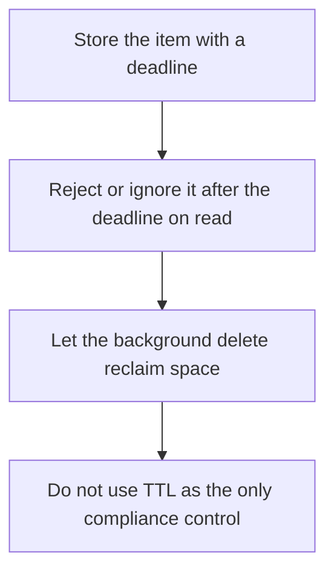

# D10-T009 — TTL and expiration

Topic ID: `D10-T009`
Domain: NoSQL Databases
Subdomain: TTL and expiration
Importance: common
Complexity: intermediate
Dependencies: `D10-T008`, `D10-T001`, `D07-T001`, `D07-T002`
Execution status of the code in section F: unexecuted

## A. Topic Overview

A TTL expires an item after a duration. The store deletes it lazily or with a background process. Expiration is not a transaction. A read might still see an item around its deadline, and a delete might lag. TTL is for caches, sessions, and ephemeral events, not for legal retention. If the expiry must be exact, the application has to check a timestamp too.

In production this shows up as follows: A password-reset token lives for fifteen minutes. The row carries an expiry timestamp the checker enforces, and a TTL eventually deletes it. Logout of a session uses an explicit delete, not only a TTL.

Interviewers use TTL and expiration to see whether you can state the failure mode, not only the definition. The failure to name is: a session that is still accepted after logout because expiry is lazy, or a disk fill because deletes cannot keep up

Prerequisites: `D10-T008`, `D10-T001`, `D07-T001`, `D07-T002`. Later notes should link here instead of repeating the mechanism.

## B. First-Principles Explanation

A TTL expires an item after a duration. The store deletes it lazily or with a background process. Expiration is not a transaction. A read might still see an item around its deadline, and a delete might lag. TTL is for caches, sessions, and ephemeral events, not for legal retention. If the expiry must be exact, the application has to check a timestamp too.

The useful picture is: TTL is a carton of milk with a date. The store may not pull it off the shelf the second the clock hits midnight, so the buyer still has to read the date.

What has to be true:

1. Store the item with a deadline
2. Reject or ignore it after the deadline on read
3. Let the background delete reclaim space
4. Do not use TTL as the only compliance control

It works when those steps preserve one invariant. It fails when a session that is still accepted after logout because expiry is lazy, or a disk fill because deletes cannot keep up. The alternative is: you need a precise legal deletion time or an audit trail of the delete

## C. Internal Working and Architecture

Components involved: the caller, the state TTL and expiration mutates or reads, and the observer that reports expired-but-present reads, and the lag of the expiry worker.

Execution:

1. Store the item with a deadline
2. Reject or ignore it after the deadline on read
3. Let the background delete reclaim space
4. Do not use TTL as the only compliance control

Data moves only along that path. A retry re-enters at step 1, so the operation must say what a duplicate does. Memory and locks stay inside this mechanism. Callers see the result or a typed error, not a half-updated invariant.

State to remember: choose this when the data is allowed to disappear and a little lateness is acceptable. Do not choose it when you need a precise legal deletion time or an audit trail of the delete.

## D. Diagrams and Visual Models



Read the diagram from top to bottom. Each box is one step of TTL and expiration. The failure mode (a session that is still accepted after logout because expiry is lazy, or a disk fill because deletes cannot keep up) is what you look for when a later box never happens or happens twice.

## E. Examples and Analogies

Analogy: TTL is a carton of milk with a date. The store may not pull it off the shelf the second the clock hits midnight, so the buyer still has to read the date.

Production example: A password-reset token lives for fifteen minutes. The row carries an expiry timestamp the checker enforces, and a TTL eventually deletes it. Logout of a session uses an explicit delete, not only a TTL.

A small counterexample is enough in an interview. Show the input, apply the steps, and show the broken outcome if someone uses the mechanism outside its rule: a session that is still accepted after logout because expiry is lazy, or a disk fill because deletes cannot keep up.

## F. Code Examples

The snippet is labeled unexecuted. It illustrates the shape of the idea. It is not a benchmark and it embeds no secret.

```python
import time

def alive(expires_at, now=None):
    now = time.time() if now is None else now
    return now < expires_at
```

After the snippet, check expired-but-present reads, and the lag of the expiry worker. If that signal moves the wrong way, the snippet is the wrong tool for the workload.

## G. Practical Backend Application

Use TTL and expiration in a service when the data is allowed to disappear and a little lateness is acceptable.

A typical place is the production case already stated: A password-reset token lives for fifteen minutes. The row carries an expiry timestamp the checker enforces, and a TTL eventually deletes it. Logout of a session uses an explicit delete, not only a TTL.

Operationally you alert on expired-but-present reads, and the lag of the expiry worker. You do not alert only on process uptime. The dashboard should show the failure mode, a success rate, and the saturation signal (queue depth, lock wait, or latency) that predicts it.

## H. Advantages, Limitations and Trade-offs

| Choice | Benefit | Cost | Choose when | Avoid when |
| --- | --- | --- | --- | --- |
| Apply TTL and expiration | the data is allowed to disappear and a little lateness is acceptable | Extra moving parts and a new failure mode | The failure you are preventing is already real | you need a precise legal deletion time or an audit trail of the delete |
| Simpler alternative | Less code and fewer dependencies | a session that is still accepted after logout because expiry is lazy, or a disk fill because deletes cannot keep up | The workload does not hit the limit | The invariant must hold under concurrency or failure |

TTL and expiration is a trade. State the benefit and the cost in the same sentence when you propose it in a design review.

## I. Common Mistakes and Misconceptions

- Using TTL as a security revoke.
- Assuming deletion is immediate.
- Setting a TTL so long that the table is an unbounded log.
- Treating a diagram of TTL and expiration as proof that the invariant holds in production.
- Copying a default configuration without naming expired-but-present reads, and the lag of the expiry worker.

## J. Debugging and Troubleshooting

Symptom: a session that is still accepted after logout because expiry is lazy, or a disk fill because deletes cannot keep up

First check: expired-but-present reads, and the lag of the expiry worker.

Then compare one healthy instance against one unhealthy instance. Confirm whether retries are duplicating work. Confirm whether a timeout is shorter than the work. Fix the invariant, then watch the same metric for a full peak, not only for the next minute.

Useful questions: did the step order in section C actually happen, or did a caller skip a step? Did a deploy change the data shape that TTL and expiration assumes?

## K. Interview Preparation

### Beginner

#### Q1. What problem does TTL and expiration solve?

**Answer:** A TTL expires an item after a duration. The store deletes it lazily or with a background process. Expiration is not a transaction. A read might still see an item around its deadline, and a delete might lag. TTL is for caches, sessions, and ephemeral events, not for legal retention. If the expiry must be exact, the application has to check a timestamp too. Without it, the usual backend failure is: a session that is still accepted after logout because expiry is lazy, or a disk fill because deletes cannot keep up.

#### Q2. Where does TTL and expiration sit on a request path?

**Answer:** TTL and expiration is not a library you sprinkle on every call. the data is allowed to disappear and a little lateness is acceptable You notice it when expired-but-present reads, and the lag of the expiry worker. Name the constraint that makes this choice correct. Say what you would measure to confirm it.

#### Q3. Give a concrete example of TTL and expiration.

**Answer:** A password-reset token lives for fifteen minutes. The row carries an expiry timestamp the checker enforces, and a TTL eventually deletes it. Logout of a session uses an explicit delete, not only a TTL. Walk the input, the state change, and the observable output.

#### Q4. What is a common mix-up around TTL and expiration?

**Answer:** a session that is still accepted after logout because expiry is lazy, or a disk fill because deletes cannot keep up The corrective check is expired-but-present reads, and the lag of the expiry worker. Name the constraint that makes this choice correct. Say what you would measure to confirm it. Say which alternative you rejected and why.

#### Q5. When would you skip TTL and expiration?

**Answer:** you need a precise legal deletion time or an audit trail of the delete Skipping is a decision with a measured cost, not a slogan. Name the constraint that makes this choice correct. Say what you would measure to confirm it. Say which alternative you rejected and why.

### Intermediate

#### Q1. What invariant makes TTL and expiration correct?

**Answer:** A TTL expires an item after a duration. The store deletes it lazily or with a background process. Expiration is not a transaction. A read might still see an item around its deadline, and a delete might lag. TTL is for caches, sessions, and ephemeral events, not for legal retention. If the expiry must be exact, the application has to check a timestamp too. State the invariant before you name the tool.

#### Q2. How do you test TTL and expiration?

**Answer:** Assert the failure mode directly: a session that is still accepted after logout because expiry is lazy, or a disk fill because deletes cannot keep up. The assertion should watch expired-but-present reads, and the lag of the expiry worker. Include a concurrent or retry case if the bug only appears then. Name the constraint that makes this choice correct.

#### Q3. What signal tells you TTL and expiration is misbehaving in production?

**Answer:** Watch expired-but-present reads, and the lag of the expiry worker. The user-visible symptom is usually a session that is still accepted after logout because expiry is lazy, or a disk fill because deletes cannot keep up. Name the constraint that makes this choice correct. Say what you would measure to confirm it.

#### Q4. How would you introduce TTL and expiration into a legacy service?

**Answer:** the data is allowed to disappear and a little lateness is acceptable Ship it behind a metric so you can compare the old path. Roll back if a session that is still accepted after logout because expiry is lazy, or a disk fill because deletes cannot keep up gets worse. Name the constraint that makes this choice correct. Say what you would measure to confirm it.

#### Q5. What do you trade away by choosing TTL and expiration?

**Answer:** the data is allowed to disappear and a little lateness is acceptable you need a precise legal deletion time or an audit trail of the delete Say the cost in latency, storage, or operational load. Name the constraint that makes this choice correct. Say what you would measure to confirm it. Say which alternative you rejected and why.

### Advanced

#### Q1. What breaks if a dependency of TTL and expiration is slow or down?

**Answer:** a session that is still accepted after logout because expiry is lazy, or a disk fill because deletes cannot keep up Degrade using the rule: you need a precise legal deletion time or an audit trail of the delete. Timeouts must be shorter than the caller's deadline. Name the constraint that makes this choice correct. Say what you would measure to confirm it.

#### Q2. How does TTL and expiration behave under retries?

**Answer:** Retries repeat work, so TTL and expiration must define what a duplicate does. a session that is still accepted after logout because expiry is lazy, or a disk fill because deletes cannot keep up Idempotency keys or fences belong next to the write, not in a comment. Name the constraint that makes this choice correct. Say what you would measure to confirm it.

#### Q3. What is the capacity limit of TTL and expiration?

**Answer:** The limit shows up as expired-but-present reads, and the lag of the expiry worker. Add capacity only after you know whether the bottleneck is CPU, lock wait, or network. Name the constraint that makes this choice correct. Say what you would measure to confirm it.

#### Q4. How do you evolve TTL and expiration without a flag day?

**Answer:** the data is allowed to disappear and a little lateness is acceptable Version the contract or the on-disk format. Readers should tolerate one old and one new shape during the rollout. Name the constraint that makes this choice correct. Say what you would measure to confirm it.

#### Q5. What security or correctness bug hides inside TTL and expiration?

**Answer:** a session that is still accepted after logout because expiry is lazy, or a disk fill because deletes cannot keep up Check authorization and tenancy at the same boundary as the mechanism. A cache or queue must not widen who can read the data. Name the constraint that makes this choice correct. Say what you would measure to confirm it.

### Scenario

#### Q1. Incident: a session that is still accepted after logout because expiry is lazy, or a disk fill because deletes cannot keep up. What do you check first?

**Answer:** Start with expired-but-present reads, and the lag of the expiry worker. Compare a good host and a bad host before you restart anything. A TTL expires an item after a duration. The store deletes it lazily or with a background process. Expiration is not a transaction. A read might still see an item around its deadline, and a delete might lag. TTL is for caches, sessions, and ephemeral events, not for legal retention. If the expiry must be exact, the application has to check a timestamp too.

#### Q2. A reviewer wants the clever version. What data settles it?

**Answer:** the data is allowed to disappear and a little lateness is acceptable you need a precise legal deletion time or an audit trail of the delete Bring expired-but-present reads, and the lag of the expiry worker from a load test or from production, not a slogan. Name the constraint that makes this choice correct. Say what you would measure to confirm it. Say which alternative you rejected and why.

#### Q3. You have one hour to explain TTL and expiration at a whiteboard.

**Answer:** Draw the happy path in four boxes. Then draw the failure: a session that is still accepted after logout because expiry is lazy, or a disk fill because deletes cannot keep up. End with the metric you would page on. Name the constraint that makes this choice correct.

#### Q4. The bug only appears under two concurrent callers.

**Answer:** a session that is still accepted after logout because expiry is lazy, or a disk fill because deletes cannot keep up Reproduce with a barrier so both sides enter the critical window. Confirm the fix with expired-but-present reads, and the lag of the expiry worker. Name the constraint that makes this choice correct. Say what you would measure to confirm it.

#### Q5. Leadership wants this on every service next week.

**Answer:** you need a precise legal deletion time or an audit trail of the delete the data is allowed to disappear and a little lateness is acceptable Roll it out where the failure mode is already hurting users. Name the constraint that makes this choice correct. Say what you would measure to confirm it. Say which alternative you rejected and why.

### Follow-up

#### Q1. What did you assume about the data size or the clock?

**Answer:** A TTL expires an item after a duration. The store deletes it lazily or with a background process. Expiration is not a transaction. A read might still see an item around its deadline, and a delete might lag. TTL is for caches, sessions, and ephemeral events, not for legal retention. If the expiry must be exact, the application has to check a timestamp too. Clocks are not a total order across machines. State whether the algorithm needs bounded size or a single leader.

#### Q2. What would you measure after the change ships?

**Answer:** Page on expired-but-present reads, and the lag of the expiry worker. Keep a before/after dashboard for one week. Alert on the failure mode, not only on CPU. Name the constraint that makes this choice correct.

#### Q3. Which neighboring topic did you deliberately not re-teach?

**Answer:** This note owns TTL and expiration. Related identifiers are in section N. Shared ideas are linked, not copied. Name the constraint that makes this choice correct.

## L. Practical Exercises

Solutions are in `EXERCISES/solutions/D10-T009.md`, not in this section.

1. Whiteboard the four steps of TTL and expiration and mark where `a session that is still accepted after logout because expiry is lazy, or a disk fill because deletes cannot keep up` enters.
2. Read the snippet in section F and write the assertion that would catch that failure. The assertion must mention `expired-but-present reads, and the lag of the expiry worker`.
3. Argue for or against using TTL and expiration on a service you know. Use the choose and avoid rows from section H. Do not appeal to popularity.

## M. Revision Notes

- Mechanism: A TTL expires an item after a duration.
- Failure: a session that is still accepted after logout because expiry is lazy, or a disk fill because deletes cannot keep up
- Metric: expired-but-present reads, and the lag of the expiry worker
- Choose when: the data is allowed to disappear and a little lateness is acceptable
- Avoid when: you need a precise legal deletion time or an audit trail of the delete

## N. Related Topics

Dependencies to review first: `D10-T008`, `D10-T001`, `D07-T001`, `D07-T002`.

Shared ideas stay in those notes. This note does not restate them.

## O. Completion Criteria

- You can explain TTL and expiration without reading this note, including the failure mode.
- You can draw the diagram in section D from memory.
- You can say when not to use it, using the avoid condition in section H.
- You can name the metric you would watch after shipping it.
