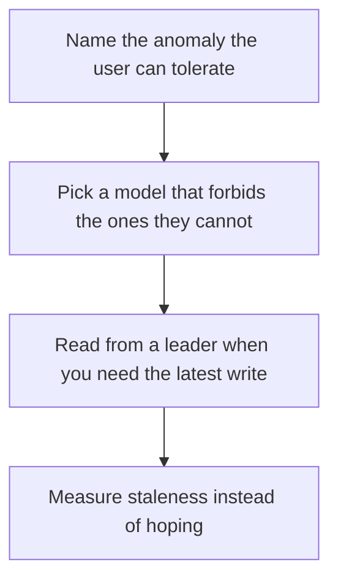

# D10-T010 — Consistency models

Topic ID: `D10-T010`
Domain: NoSQL Databases
Subdomain: Consistency models
Importance: common
Complexity: intermediate
Dependencies: `D10-T009`, `D10-T001`, `D07-T001`, `D07-T002`
Execution status of the code in section F: unexecuted

## A. Topic Overview

A consistency model states what a read may return after writes. Strong consistency lets a read see the latest acknowledged write. Eventual consistency lets replicas disagree for a while. Causal consistency preserves the order of related operations. The model is a contract with anomalies, not a slogan. Choose it per operation, because a payment and a page view do not need the same contract.

In production this shows up as follows: A profile edit must be read-your-writes for the author, so that read hits the primary. A product view can be seconds stale. Using one model for both either overpays or loses edits.

Interviewers use Consistency models to see whether you can state the failure mode, not only the definition. The failure to name is: reading a replica and telling a user their write failed because the read missed it

Prerequisites: `D10-T009`, `D10-T001`, `D07-T001`, `D07-T002`. Later notes should link here instead of repeating the mechanism.

## B. First-Principles Explanation

A consistency model states what a read may return after writes. Strong consistency lets a read see the latest acknowledged write. Eventual consistency lets replicas disagree for a while. Causal consistency preserves the order of related operations. The model is a contract with anomalies, not a slogan. Choose it per operation, because a payment and a page view do not need the same contract.

The useful picture is: Consistency is the promise about which version of a document you are allowed to be handed. Eventual means the clerks compare notes later. Strong means they check the latest page first.

What has to be true:

1. Name the anomaly the user can tolerate
2. Pick a model that forbids the ones they cannot
3. Read from a leader when you need the latest write
4. Measure staleness instead of hoping

It works when those steps preserve one invariant. It fails when reading a replica and telling a user their write failed because the read missed it. The alternative is: you call the database 'consistent' without naming an anomaly

## C. Internal Working and Architecture

Components involved: the caller, the state Consistency models mutates or reads, and the observer that reports stale-read rate and user-visible lost updates.

Execution:

1. Name the anomaly the user can tolerate
2. Pick a model that forbids the ones they cannot
3. Read from a leader when you need the latest write
4. Measure staleness instead of hoping

Data moves only along that path. A retry re-enters at step 1, so the operation must say what a duplicate does. Memory and locks stay inside this mechanism. Callers see the result or a typed error, not a half-updated invariant.

State to remember: choose this when you can say which anomalies are unacceptable. Do not choose it when you call the database 'consistent' without naming an anomaly.

## D. Diagrams and Visual Models



Read the diagram from top to bottom. Each box is one step of Consistency models. The failure mode (reading a replica and telling a user their write failed because the read missed it) is what you look for when a later box never happens or happens twice.

## E. Examples and Analogies

Analogy: Consistency is the promise about which version of a document you are allowed to be handed. Eventual means the clerks compare notes later. Strong means they check the latest page first.

Production example: A profile edit must be read-your-writes for the author, so that read hits the primary. A product view can be seconds stale. Using one model for both either overpays or loses edits.

A small counterexample is enough in an interview. Show the input, apply the steps, and show the broken outcome if someone uses the mechanism outside its rule: reading a replica and telling a user their write failed because the read missed it.

## F. Code Examples

The snippet is labeled unexecuted. It illustrates the shape of the idea. It is not a benchmark and it embeds no secret.

```python
def read_from_leader(need_latest):
    return need_latest
```

After the snippet, check stale-read rate and user-visible lost updates. If that signal moves the wrong way, the snippet is the wrong tool for the workload.

## G. Practical Backend Application

Use Consistency models in a service when you can say which anomalies are unacceptable.

A typical place is the production case already stated: A profile edit must be read-your-writes for the author, so that read hits the primary. A product view can be seconds stale. Using one model for both either overpays or loses edits.

Operationally you alert on stale-read rate and user-visible lost updates. You do not alert only on process uptime. The dashboard should show the failure mode, a success rate, and the saturation signal (queue depth, lock wait, or latency) that predicts it.

## H. Advantages, Limitations and Trade-offs

| Choice | Benefit | Cost | Choose when | Avoid when |
| --- | --- | --- | --- | --- |
| Apply Consistency models | you can say which anomalies are unacceptable | Extra moving parts and a new failure mode | The failure you are preventing is already real | you call the database 'consistent' without naming an anomaly |
| Simpler alternative | Less code and fewer dependencies | reading a replica and telling a user their write failed because the read missed it | The workload does not hit the limit | The invariant must hold under concurrency or failure |

Consistency models is a trade. State the benefit and the cost in the same sentence when you propose it in a design review.

## I. Common Mistakes and Misconceptions

- Equating replication with strong consistency.
- Using quorum reads everywhere by habit.
- Ignoring the client's own retry.
- Treating a diagram of Consistency models as proof that the invariant holds in production.
- Copying a default configuration without naming stale-read rate and user-visible lost updates.

## J. Debugging and Troubleshooting

Symptom: reading a replica and telling a user their write failed because the read missed it

First check: stale-read rate and user-visible lost updates.

Then compare one healthy instance against one unhealthy instance. Confirm whether retries are duplicating work. Confirm whether a timeout is shorter than the work. Fix the invariant, then watch the same metric for a full peak, not only for the next minute.

Useful questions: did the step order in section C actually happen, or did a caller skip a step? Did a deploy change the data shape that Consistency models assumes?

## K. Interview Preparation

### Beginner

#### Q1. What problem does Consistency models solve?

**Answer:** A consistency model states what a read may return after writes. Strong consistency lets a read see the latest acknowledged write. Eventual consistency lets replicas disagree for a while. Causal consistency preserves the order of related operations. The model is a contract with anomalies, not a slogan. Choose it per operation, because a payment and a page view do not need the same contract. Without it, the usual backend failure is: reading a replica and telling a user their write failed because the read missed it.

#### Q2. Where does Consistency models sit on a request path?

**Answer:** Consistency models is not a library you sprinkle on every call. you can say which anomalies are unacceptable You notice it when stale-read rate and user-visible lost updates. Name the constraint that makes this choice correct. Say what you would measure to confirm it.

#### Q3. Give a concrete example of Consistency models.

**Answer:** A profile edit must be read-your-writes for the author, so that read hits the primary. A product view can be seconds stale. Using one model for both either overpays or loses edits. Walk the input, the state change, and the observable output.

#### Q4. What is a common mix-up around Consistency models?

**Answer:** reading a replica and telling a user their write failed because the read missed it The corrective check is stale-read rate and user-visible lost updates. Name the constraint that makes this choice correct. Say what you would measure to confirm it. Say which alternative you rejected and why.

#### Q5. When would you skip Consistency models?

**Answer:** you call the database 'consistent' without naming an anomaly Skipping is a decision with a measured cost, not a slogan. Name the constraint that makes this choice correct. Say what you would measure to confirm it. Say which alternative you rejected and why.

### Intermediate

#### Q1. What invariant makes Consistency models correct?

**Answer:** A consistency model states what a read may return after writes. Strong consistency lets a read see the latest acknowledged write. Eventual consistency lets replicas disagree for a while. Causal consistency preserves the order of related operations. The model is a contract with anomalies, not a slogan. Choose it per operation, because a payment and a page view do not need the same contract. State the invariant before you name the tool.

#### Q2. How do you test Consistency models?

**Answer:** Assert the failure mode directly: reading a replica and telling a user their write failed because the read missed it. The assertion should watch stale-read rate and user-visible lost updates. Include a concurrent or retry case if the bug only appears then. Name the constraint that makes this choice correct.

#### Q3. What signal tells you Consistency models is misbehaving in production?

**Answer:** Watch stale-read rate and user-visible lost updates. The user-visible symptom is usually reading a replica and telling a user their write failed because the read missed it. Name the constraint that makes this choice correct. Say what you would measure to confirm it.

#### Q4. How would you introduce Consistency models into a legacy service?

**Answer:** you can say which anomalies are unacceptable Ship it behind a metric so you can compare the old path. Roll back if reading a replica and telling a user their write failed because the read missed it gets worse. Name the constraint that makes this choice correct. Say what you would measure to confirm it.

#### Q5. What do you trade away by choosing Consistency models?

**Answer:** you can say which anomalies are unacceptable you call the database 'consistent' without naming an anomaly Say the cost in latency, storage, or operational load. Name the constraint that makes this choice correct. Say what you would measure to confirm it. Say which alternative you rejected and why.

### Advanced

#### Q1. What breaks if a dependency of Consistency models is slow or down?

**Answer:** reading a replica and telling a user their write failed because the read missed it Degrade using the rule: you call the database 'consistent' without naming an anomaly. Timeouts must be shorter than the caller's deadline. Name the constraint that makes this choice correct. Say what you would measure to confirm it.

#### Q2. How does Consistency models behave under retries?

**Answer:** Retries repeat work, so Consistency models must define what a duplicate does. reading a replica and telling a user their write failed because the read missed it Idempotency keys or fences belong next to the write, not in a comment. Name the constraint that makes this choice correct. Say what you would measure to confirm it.

#### Q3. What is the capacity limit of Consistency models?

**Answer:** The limit shows up as stale-read rate and user-visible lost updates. Add capacity only after you know whether the bottleneck is CPU, lock wait, or network. Name the constraint that makes this choice correct. Say what you would measure to confirm it.

#### Q4. How do you evolve Consistency models without a flag day?

**Answer:** you can say which anomalies are unacceptable Version the contract or the on-disk format. Readers should tolerate one old and one new shape during the rollout. Name the constraint that makes this choice correct. Say what you would measure to confirm it.

#### Q5. What security or correctness bug hides inside Consistency models?

**Answer:** reading a replica and telling a user their write failed because the read missed it Check authorization and tenancy at the same boundary as the mechanism. A cache or queue must not widen who can read the data. Name the constraint that makes this choice correct. Say what you would measure to confirm it.

### Scenario

#### Q1. Incident: reading a replica and telling a user their write failed because the read missed it. What do you check first?

**Answer:** Start with stale-read rate and user-visible lost updates. Compare a good host and a bad host before you restart anything. A consistency model states what a read may return after writes. Strong consistency lets a read see the latest acknowledged write. Eventual consistency lets replicas disagree for a while. Causal consistency preserves the order of related operations. The model is a contract with anomalies, not a slogan. Choose it per operation, because a payment and a page view do not need the same contract.

#### Q2. A reviewer wants the clever version. What data settles it?

**Answer:** you can say which anomalies are unacceptable you call the database 'consistent' without naming an anomaly Bring stale-read rate and user-visible lost updates from a load test or from production, not a slogan. Name the constraint that makes this choice correct. Say what you would measure to confirm it. Say which alternative you rejected and why.

#### Q3. You have one hour to explain Consistency models at a whiteboard.

**Answer:** Draw the happy path in four boxes. Then draw the failure: reading a replica and telling a user their write failed because the read missed it. End with the metric you would page on. Name the constraint that makes this choice correct.

#### Q4. The bug only appears under two concurrent callers.

**Answer:** reading a replica and telling a user their write failed because the read missed it Reproduce with a barrier so both sides enter the critical window. Confirm the fix with stale-read rate and user-visible lost updates. Name the constraint that makes this choice correct. Say what you would measure to confirm it.

#### Q5. Leadership wants this on every service next week.

**Answer:** you call the database 'consistent' without naming an anomaly you can say which anomalies are unacceptable Roll it out where the failure mode is already hurting users. Name the constraint that makes this choice correct. Say what you would measure to confirm it. Say which alternative you rejected and why.

### Follow-up

#### Q1. What did you assume about the data size or the clock?

**Answer:** A consistency model states what a read may return after writes. Strong consistency lets a read see the latest acknowledged write. Eventual consistency lets replicas disagree for a while. Causal consistency preserves the order of related operations. The model is a contract with anomalies, not a slogan. Choose it per operation, because a payment and a page view do not need the same contract. Clocks are not a total order across machines. State whether the algorithm needs bounded size or a single leader.

#### Q2. What would you measure after the change ships?

**Answer:** Page on stale-read rate and user-visible lost updates. Keep a before/after dashboard for one week. Alert on the failure mode, not only on CPU. Name the constraint that makes this choice correct.

#### Q3. Which neighboring topic did you deliberately not re-teach?

**Answer:** This note owns Consistency models. Related identifiers are in section N. Shared ideas are linked, not copied. Name the constraint that makes this choice correct.

## L. Practical Exercises

Solutions are in `EXERCISES/solutions/D10-T010.md`, not in this section.

1. Whiteboard the four steps of Consistency models and mark where `reading a replica and telling a user their write failed because the read missed it` enters.
2. Read the snippet in section F and write the assertion that would catch that failure. The assertion must mention `stale-read rate and user-visible lost updates`.
3. Argue for or against using Consistency models on a service you know. Use the choose and avoid rows from section H. Do not appeal to popularity.

## M. Revision Notes

- Mechanism: A consistency model states what a read may return after writes.
- Failure: reading a replica and telling a user their write failed because the read missed it
- Metric: stale-read rate and user-visible lost updates
- Choose when: you can say which anomalies are unacceptable
- Avoid when: you call the database 'consistent' without naming an anomaly

## N. Related Topics

Dependencies to review first: `D10-T009`, `D10-T001`, `D07-T001`, `D07-T002`.

Shared ideas stay in those notes. This note does not restate them.

## O. Completion Criteria

- You can explain Consistency models without reading this note, including the failure mode.
- You can draw the diagram in section D from memory.
- You can say when not to use it, using the avoid condition in section H.
- You can name the metric you would watch after shipping it.
