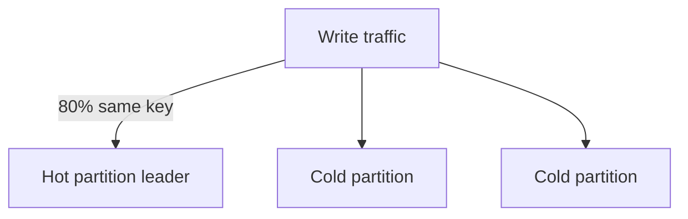

# D10-T011 — Partition keys and hot partitions

Topic ID: `D10-T011`
Domain: NoSQL Databases
Subdomain: Partition keys and hot partitions
Importance: common
Complexity: intermediate
Dependencies: `D10-T010`, `D10-T001`, `D07-T001`, `D07-T002`
Execution status of the code in section F: illustrative

## A. Topic Overview

A partition key (hash key, shard key) decides which physical shard stores a row or item. When traffic skews to a few key values, one partition becomes a **hot partition**—throttling, elevated latency, and uneven CPU while other shards stay idle.

The problem appears in DynamoDB, Cassandra, MongoDB sharded clusters, and Redis Cluster. Interviewers describe celebrity users, global counters, login storms on a single tenant, or time-based keys without salting.

Fixes include better key design, write sharding, caching, queues, and splitting logical entities—not only raising provisioned capacity.

Prerequisites: consistency models (`D10-T010`), access-pattern modeling (`D10-T006`).

## B. First-Principles Explanation

Distributed stores partition data so each node handles a subset of keys. Routing is deterministic: `hash(partition_key) mod num_shards`. Perfectly uniform keys spread load; skewed distributions concentrate writes and reads on one leader.

Hot partitions are a modeling bug visible at scale, not a mysterious cloud failure. Metrics show throttle events per partition, not only average table CPU.

## C. Internal Working and Architecture

DynamoDB splits partitions when size or throughput grows; each partition still has throughput limits. Cassandra nodes own token ranges; hot rows in one range stress one replica set. MongoDB chunks migrate slowly compared to traffic spikes.



## D. Diagrams and Visual Models

Identify which access pattern maps to the hot key before scaling capacity. Splitting users across suffix buckets changes read paths—design merge logic up front.

## E. Examples and Analogies

Analogy: one checkout lane open at a stadium—adding lanes elsewhere does not help if everyone queues at lane one.

DynamoDB `PK=GLOBAL#counter` for likes is hot; use `PK=POST#id#SHARD#n` with N parallel counters aggregated on read or via stream.

Cassandra: partition key only `country` when one country dominates row width.

## F. Code Examples

```text
# Write sharding sketch (logical)
counter_key = f"likes:{postId}:{userId % 8}"
INCR counter_key
# read: sum shards 0..7
```

```javascript
// Mongo: avoid monotonic shard key alone
sh.shardCollection("db.events", { tenantId: 1, userId: 1 });
```

## G. Practical Backend Application

Load-test with skewed distributions, not uniform random keys. Alert on per-partition throttles. Document key design in ADRs. For global config, replicate to edge caches instead of hammering one item.

## H. Advantages, Limitations and Trade-offs

| Mitigation | Benefit | Cost |
| --- | --- | --- |
| Random write suffix | Spreads writes | Read aggregation |
| Per-entity queue | Serializes safely | Latency |
| Cache hot reads | Lowers read heat | Staleness |
| Dedicated shard/tenant | Isolation | Ops complexity |

## I. Common Mistakes and Misconceptions

- Raising RCU/WCU without changing keys.
- Using timestamp-only partition keys for high write rates.
- Putting all tenants on `tenantId=default`.
- Ignoring GSI hot keys separate from base table.

## J. Debugging and Troubleshooting

1. CloudWatch `ThrottledRequests` + partition key in logs (redacted).
2. Compare key cardinality histograms.
3. Replay traffic with skew in staging.
4. Validate mitigation does not break ordering guarantees.

## K. Interview Preparation

### Beginner

#### Q1. What is a partition key?

**Answer:** It is the attribute that determines which shard stores an item or row. All items sharing the same partition key in DynamoDB live in one partition collection until split. The key must come from access patterns, not pretty names. Wrong keys cause skew at scale.

#### Q2. What is a hot partition?

**Answer:** It is a shard receiving far more IO than others because key values skew. One celebrity user or global counter can trigger it. Symptoms include throttling while average metrics look healthy. Fixing it is modeling work, not only capacity.

#### Q3. How is a sort key different?

**Answer:** Within one partition key, sort keys order multiple items for range queries. They do not spread load across partitions by themselves. High traffic still needs a high-cardinality partition key. Combine user id partition with time sort for timelines.

#### Q4. Can you fix hot partitions by adding replicas?

**Answer:** Replicas help read-heavy skew if reads distribute, but a single hot write key still hits one leader. Write sharding or queues address write heat. Read replicas do not split write load on one primary key. Understand read versus write bottlenecks.

#### Q5. What is write sharding?

**Answer:** It splits one logical counter into N physical keys using a hash suffix. Writes spread; reads sum or merge results. You trade read complexity for write scalability. Use when correctness allows approximate or assembled totals.

### Intermediate

#### Q1. Why are timestamps risky as partition keys?

**Answer:** High write rates to “current minute” concentrate on one key. Everyone logging `event_time=now` shares a partition. Bucket time coarsely or add a high-cardinality prefix like `deviceId`. Never use minute-level key alone for firehose ingest.

#### Q2. How do DynamoDB adaptive capacity and partitions interact?

**Answer:** Partitions split as data or traffic grows but each still has limits. Burst credits help briefly; sustained hot keys throttle. Design keys assuming limits return after bursts. Monitor per-partition metrics where exposed.

#### Q3. How does celebrity fan-out differ from hot partition?

**Answer:** Fan-out is many writes to many follower partitions—often acceptable if spread. Celebrity with one partition key for all followers’ inbox is hot. Async fan-out workers smooth spikes. Distinguish skewed key from high total QPS evenly spread.

#### Q4. What role does caching play for hot reads?

**Answer:** Edge cache absorbs read-heavy configuration keys. TTL must be short enough for acceptable staleness. Writes still need sharding if write-heavy. Cache does not fix write hot keys alone.

#### Q5. How do you test for hot keys before launch?

**Answer:** Load tests with Zipf or measured skew distributions, not uniform random. Inject synthetic celebrity tenants. Watch throttle metrics and p99 per API. Fix keys in staging, not after viral event.

### Advanced

#### Q1. Design keys for a global leaderboard.

**Answer:** Partition by game or region, not one global key. Use approximate top-K via sorted sets sharded by score buckets or periodic batch rank. Exact global rank at massive scale needs specialized structures. Accept eventual consistency on ranks if product allows.

#### Q2. How do GSI hot keys happen?

**Answer:** A GSI projects an attribute with low cardinality as its partition key, like `status=OPEN` for all tenants. All open orders share GSI partitions. Invert keys: `tenantId#status` as GSI PK. Monitor GSI throttles separately from base table.

#### Q3. Explain salting versus sharding suffix buckets.

**Answer:** Salting adds random prefix to spread writes; reads must query all salts. Suffix buckets use deterministic hash mod N for predictable fan-in. Choose based on read latency budget. Document merge logic in API contracts.

#### Q4. MongoDB chunk migration and hot shards?

**Answer:** Jumbo chunks or balancer lag leave traffic on overloaded shard. Shard key with tenant and user spreads load. Monitor `sh.status()` and chunk distribution. Resharding is a planned migration with dual writes.

#### Q5. Redis Cluster hot hash slot?

**Answer:** Many keys can map to same slot if tagged `{tenant}` poorly or single key overused. Split logical data across keys. Use local rate limits per instance for coarse global limits. Monitor `CLUSTER INFO` and hot key warnings.

### Scenarios

#### Q1. DynamoDB throttles on `CONFIG#GLOBAL` item.

**Answer:** Move config to cache with TTL on each instance, or versioned S3 object polled periodically. Writes to config remain rare; reads were hot. Split rarely updated fields from frequently read blob. Validate throttle metrics drop.

#### Q2. Viral post likes spike one partition.

**Answer:** Shard like counters per post id suffix; aggregate for display asynchronously. Consider approximate counts for UI. Protect database with pre-aggregated streams to analytics. Do not single-key `INCR` global counter.

#### Q3. Login storm on shared SaaS `tenantId=demo`.

**Answer:** Demo tenant shares partition with production if key poorly designed. Namespace tenants in partition key. Rate-limit demo at gateway. Migrate demo data to isolated table or account.

#### Q4. Cassandra write latency on one node.

**Answer:** Check token range load; repair skewed partition sizes. Ensure partition key includes high-cardinality component. Avoid wide rows from unbounded clustering columns. Run `nodetool tablehistograms`.

#### Q5. After key redesign, reads return incomplete totals.

**Answer:** Read path forgot to merge sharded counters. Add integration tests summing all buckets. Feature-flag rollout with shadow comparison to old key. Document temporary dual-write period.

### Follow-ups

#### Q1. Link to `D10-T006` access patterns?

**Answer:** Access patterns determine whether a key can ever spread load. Hot partitions are failed pattern implementation. Redesign patterns before capacity purchases.

#### Q2. Link to `D10-T017` DynamoDB keys?

**Answer:** Dynamo PK/SK design is the primary lever to avoid hot partitions. Study single-table patterns with cardinality in PK. GSIs inherit same skew rules.

#### Q3. Link to quorums?

**Answer:** Hot leaders also stress replication pipelines to replicas. Quorum latency rises with overloaded primary. Fixing keys reduces replica catch-up backlog.

## L. Practical Exercises

See `EXERCISES/D10-T011.md` and solutions file.

## M. Revision Notes

- Skew breaks scale; averages lie.
- High-cardinality partition keys first.
- Write sharding needs read merge plan.
- GSIs can be hotter than base table.
- Test with Zipf, not uniform.

## N. Related Topics

`D10-T006`, `D10-T010`, `D10-T012`, `D10-T017`, `D10-T018`.

## O. Completion Criteria

- Redesign a hot global counter key.
- Explain throttle metrics vs average CPU.
- Compare cache vs write sharding mitigations.
- Spot bad timestamp partition keys.
- Answer celebrity scenario with async fan-out option.
