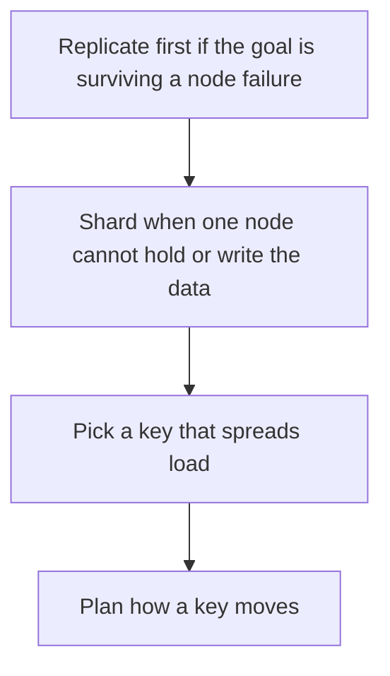

# D10-T012 — Replication and sharding

Topic ID: `D10-T012`
Domain: NoSQL Databases
Subdomain: Replication and sharding
Importance: common
Complexity: intermediate
Dependencies: `D10-T011`, `D10-T001`, `D07-T001`, `D07-T002`
Execution status of the code in section F: unexecuted

## A. Topic Overview

Replication copies data so a node can fail or serve reads. Sharding splits data so no single node holds everything. Replication does not add write capacity on a single-leader system. Sharding does, and it forces a partition key. Resharding moves data. A shard that is also unreplicated is one disk away from data loss.

In production this shows up as follows: A MongoDB replica set keeps a primary and secondaries. When the working set no longer fits one primary, the collection is sharded by a high-cardinality key and each shard is itself a replica set.

Interviewers use Replication and sharding to see whether you can state the failure mode, not only the definition. The failure to name is: a hot shard, or a replica set of one that people called highly available

Prerequisites: `D10-T011`, `D10-T001`, `D07-T001`, `D07-T002`. Later notes should link here instead of repeating the mechanism.

## B. First-Principles Explanation

Replication copies data so a node can fail or serve reads. Sharding splits data so no single node holds everything. Replication does not add write capacity on a single-leader system. Sharding does, and it forces a partition key. Resharding moves data. A shard that is also unreplicated is one disk away from data loss.

The useful picture is: Replication is carbon copies. Sharding is tearing the phone book into volumes. Copies help when a volume burns. Volumes help when one book is too heavy. They solve different problems.

What has to be true:

1. Replicate first if the goal is surviving a node failure
2. Shard when one node cannot hold or write the data
3. Pick a key that spreads load
4. Plan how a key moves

It works when those steps preserve one invariant. It fails when a hot shard, or a replica set of one that people called highly available. The alternative is: you shard a dataset that fits on one machine and then pay scatter-gather forever

## C. Internal Working and Architecture

Components involved: the caller, the state Replication and sharding mutates or reads, and the observer that reports bytes and QPS per shard, and whether every shard has a replica.

Execution:

1. Replicate first if the goal is surviving a node failure
2. Shard when one node cannot hold or write the data
3. Pick a key that spreads load
4. Plan how a key moves

Data moves only along that path. A retry re-enters at step 1, so the operation must say what a duplicate does. Memory and locks stay inside this mechanism. Callers see the result or a typed error, not a half-updated invariant.

State to remember: choose this when you are separating failure tolerance from capacity. Do not choose it when you shard a dataset that fits on one machine and then pay scatter-gather forever.

## D. Diagrams and Visual Models



Read the diagram from top to bottom. Each box is one step of Replication and sharding. The failure mode (a hot shard, or a replica set of one that people called highly available) is what you look for when a later box never happens or happens twice.

## E. Examples and Analogies

Analogy: Replication is carbon copies. Sharding is tearing the phone book into volumes. Copies help when a volume burns. Volumes help when one book is too heavy. They solve different problems.

Production example: A MongoDB replica set keeps a primary and secondaries. When the working set no longer fits one primary, the collection is sharded by a high-cardinality key and each shard is itself a replica set.

A small counterexample is enough in an interview. Show the input, apply the steps, and show the broken outcome if someone uses the mechanism outside its rule: a hot shard, or a replica set of one that people called highly available.

## F. Code Examples

The snippet is labeled unexecuted. It illustrates the shape of the idea. It is not a benchmark and it embeds no secret.

```python
def shard_for(key, n):
    return hash(key) % n
```

After the snippet, check bytes and QPS per shard, and whether every shard has a replica. If that signal moves the wrong way, the snippet is the wrong tool for the workload.

## G. Practical Backend Application

Use Replication and sharding in a service when you are separating failure tolerance from capacity.

A typical place is the production case already stated: A MongoDB replica set keeps a primary and secondaries. When the working set no longer fits one primary, the collection is sharded by a high-cardinality key and each shard is itself a replica set.

Operationally you alert on bytes and QPS per shard, and whether every shard has a replica. You do not alert only on process uptime. The dashboard should show the failure mode, a success rate, and the saturation signal (queue depth, lock wait, or latency) that predicts it.

## H. Advantages, Limitations and Trade-offs

| Choice | Benefit | Cost | Choose when | Avoid when |
| --- | --- | --- | --- | --- |
| Apply Replication and sharding | you are separating failure tolerance from capacity | Extra moving parts and a new failure mode | The failure you are preventing is already real | you shard a dataset that fits on one machine and then pay scatter-gather forever |
| Simpler alternative | Less code and fewer dependencies | a hot shard, or a replica set of one that people called highly available | The workload does not hit the limit | The invariant must hold under concurrency or failure |

Replication and sharding is a trade. State the benefit and the cost in the same sentence when you propose it in a design review.

## I. Common Mistakes and Misconceptions

- Sharding without replication.
- Using a monotonically increasing shard key.
- Assuming replicas increase write throughput on a single primary.
- Treating a diagram of Replication and sharding as proof that the invariant holds in production.
- Copying a default configuration without naming bytes and QPS per shard, and whether every shard has a replica.

## J. Debugging and Troubleshooting

Symptom: a hot shard, or a replica set of one that people called highly available

First check: bytes and QPS per shard, and whether every shard has a replica.

Then compare one healthy instance against one unhealthy instance. Confirm whether retries are duplicating work. Confirm whether a timeout is shorter than the work. Fix the invariant, then watch the same metric for a full peak, not only for the next minute.

Useful questions: did the step order in section C actually happen, or did a caller skip a step? Did a deploy change the data shape that Replication and sharding assumes?

## K. Interview Preparation

### Beginner

#### Q1. What problem does Replication and sharding solve?

**Answer:** Replication copies data so a node can fail or serve reads. Sharding splits data so no single node holds everything. Replication does not add write capacity on a single-leader system. Sharding does, and it forces a partition key. Resharding moves data. A shard that is also unreplicated is one disk away from data loss. Without it, the usual backend failure is: a hot shard, or a replica set of one that people called highly available.

#### Q2. Where does Replication and sharding sit on a request path?

**Answer:** Replication and sharding is not a library you sprinkle on every call. you are separating failure tolerance from capacity You notice it when bytes and QPS per shard, and whether every shard has a replica. Name the constraint that makes this choice correct. Say what you would measure to confirm it.

#### Q3. Give a concrete example of Replication and sharding.

**Answer:** A MongoDB replica set keeps a primary and secondaries. When the working set no longer fits one primary, the collection is sharded by a high-cardinality key and each shard is itself a replica set. Walk the input, the state change, and the observable output. Name the constraint that makes this choice correct.

#### Q4. What is a common mix-up around Replication and sharding?

**Answer:** a hot shard, or a replica set of one that people called highly available The corrective check is bytes and QPS per shard, and whether every shard has a replica. Name the constraint that makes this choice correct. Say what you would measure to confirm it. Say which alternative you rejected and why.

#### Q5. When would you skip Replication and sharding?

**Answer:** you shard a dataset that fits on one machine and then pay scatter-gather forever Skipping is a decision with a measured cost, not a slogan. Name the constraint that makes this choice correct. Say what you would measure to confirm it. Say which alternative you rejected and why.

### Intermediate

#### Q1. What invariant makes Replication and sharding correct?

**Answer:** Replication copies data so a node can fail or serve reads. Sharding splits data so no single node holds everything. Replication does not add write capacity on a single-leader system. Sharding does, and it forces a partition key. Resharding moves data. A shard that is also unreplicated is one disk away from data loss. State the invariant before you name the tool.

#### Q2. How do you test Replication and sharding?

**Answer:** Assert the failure mode directly: a hot shard, or a replica set of one that people called highly available. The assertion should watch bytes and QPS per shard, and whether every shard has a replica. Include a concurrent or retry case if the bug only appears then. Name the constraint that makes this choice correct.

#### Q3. What signal tells you Replication and sharding is misbehaving in production?

**Answer:** Watch bytes and QPS per shard, and whether every shard has a replica. The user-visible symptom is usually a hot shard, or a replica set of one that people called highly available. Name the constraint that makes this choice correct. Say what you would measure to confirm it.

#### Q4. How would you introduce Replication and sharding into a legacy service?

**Answer:** you are separating failure tolerance from capacity Ship it behind a metric so you can compare the old path. Roll back if a hot shard, or a replica set of one that people called highly available gets worse. Name the constraint that makes this choice correct. Say what you would measure to confirm it.

#### Q5. What do you trade away by choosing Replication and sharding?

**Answer:** you are separating failure tolerance from capacity you shard a dataset that fits on one machine and then pay scatter-gather forever Say the cost in latency, storage, or operational load. Name the constraint that makes this choice correct. Say what you would measure to confirm it. Say which alternative you rejected and why.

### Advanced

#### Q1. What breaks if a dependency of Replication and sharding is slow or down?

**Answer:** a hot shard, or a replica set of one that people called highly available Degrade using the rule: you shard a dataset that fits on one machine and then pay scatter-gather forever. Timeouts must be shorter than the caller's deadline. Name the constraint that makes this choice correct. Say what you would measure to confirm it.

#### Q2. How does Replication and sharding behave under retries?

**Answer:** Retries repeat work, so Replication and sharding must define what a duplicate does. a hot shard, or a replica set of one that people called highly available Idempotency keys or fences belong next to the write, not in a comment. Name the constraint that makes this choice correct. Say what you would measure to confirm it.

#### Q3. What is the capacity limit of Replication and sharding?

**Answer:** The limit shows up as bytes and QPS per shard, and whether every shard has a replica. Add capacity only after you know whether the bottleneck is CPU, lock wait, or network. Name the constraint that makes this choice correct. Say what you would measure to confirm it.

#### Q4. How do you evolve Replication and sharding without a flag day?

**Answer:** you are separating failure tolerance from capacity Version the contract or the on-disk format. Readers should tolerate one old and one new shape during the rollout. Name the constraint that makes this choice correct. Say what you would measure to confirm it.

#### Q5. What security or correctness bug hides inside Replication and sharding?

**Answer:** a hot shard, or a replica set of one that people called highly available Check authorization and tenancy at the same boundary as the mechanism. A cache or queue must not widen who can read the data. Name the constraint that makes this choice correct. Say what you would measure to confirm it.

### Scenario

#### Q1. Incident: a hot shard, or a replica set of one that people called highly available. What do you check first?

**Answer:** Start with bytes and QPS per shard, and whether every shard has a replica. Compare a good host and a bad host before you restart anything. Replication copies data so a node can fail or serve reads. Sharding splits data so no single node holds everything. Replication does not add write capacity on a single-leader system. Sharding does, and it forces a partition key. Resharding moves data. A shard that is also unreplicated is one disk away from data loss.

#### Q2. A reviewer wants the clever version. What data settles it?

**Answer:** you are separating failure tolerance from capacity you shard a dataset that fits on one machine and then pay scatter-gather forever Bring bytes and QPS per shard, and whether every shard has a replica from a load test or from production, not a slogan. Name the constraint that makes this choice correct. Say what you would measure to confirm it. Say which alternative you rejected and why.

#### Q3. You have one hour to explain Replication and sharding at a whiteboard.

**Answer:** Draw the happy path in four boxes. Then draw the failure: a hot shard, or a replica set of one that people called highly available. End with the metric you would page on. Name the constraint that makes this choice correct.

#### Q4. The bug only appears under two concurrent callers.

**Answer:** a hot shard, or a replica set of one that people called highly available Reproduce with a barrier so both sides enter the critical window. Confirm the fix with bytes and QPS per shard, and whether every shard has a replica. Name the constraint that makes this choice correct. Say what you would measure to confirm it.

#### Q5. Leadership wants this on every service next week.

**Answer:** you shard a dataset that fits on one machine and then pay scatter-gather forever you are separating failure tolerance from capacity Roll it out where the failure mode is already hurting users. Name the constraint that makes this choice correct. Say what you would measure to confirm it. Say which alternative you rejected and why.

### Follow-up

#### Q1. What did you assume about the data size or the clock?

**Answer:** Replication copies data so a node can fail or serve reads. Sharding splits data so no single node holds everything. Replication does not add write capacity on a single-leader system. Sharding does, and it forces a partition key. Resharding moves data. A shard that is also unreplicated is one disk away from data loss. Clocks are not a total order across machines. State whether the algorithm needs bounded size or a single leader.

#### Q2. What would you measure after the change ships?

**Answer:** Page on bytes and QPS per shard, and whether every shard has a replica. Keep a before/after dashboard for one week. Alert on the failure mode, not only on CPU. Name the constraint that makes this choice correct.

#### Q3. Which neighboring topic did you deliberately not re-teach?

**Answer:** This note owns Replication and sharding. Related identifiers are in section N. Shared ideas are linked, not copied. Name the constraint that makes this choice correct.

## L. Practical Exercises

Solutions are in `EXERCISES/solutions/D10-T012.md`, not in this section.

1. Whiteboard the four steps of Replication and sharding and mark where `a hot shard, or a replica set of one that people called highly available` enters.
2. Read the snippet in section F and write the assertion that would catch that failure. The assertion must mention `bytes and QPS per shard, and whether every shard has a replica`.
3. Argue for or against using Replication and sharding on a service you know. Use the choose and avoid rows from section H. Do not appeal to popularity.

## M. Revision Notes

- Mechanism: Replication copies data so a node can fail or serve reads.
- Failure: a hot shard, or a replica set of one that people called highly available
- Metric: bytes and QPS per shard, and whether every shard has a replica
- Choose when: you are separating failure tolerance from capacity
- Avoid when: you shard a dataset that fits on one machine and then pay scatter-gather forever

## N. Related Topics

Dependencies to review first: `D10-T011`, `D10-T001`, `D07-T001`, `D07-T002`.

Shared ideas stay in those notes. This note does not restate them.

## O. Completion Criteria

- You can explain Replication and sharding without reading this note, including the failure mode.
- You can draw the diagram in section D from memory.
- You can say when not to use it, using the avoid condition in section H.
- You can name the metric you would watch after shipping it.
