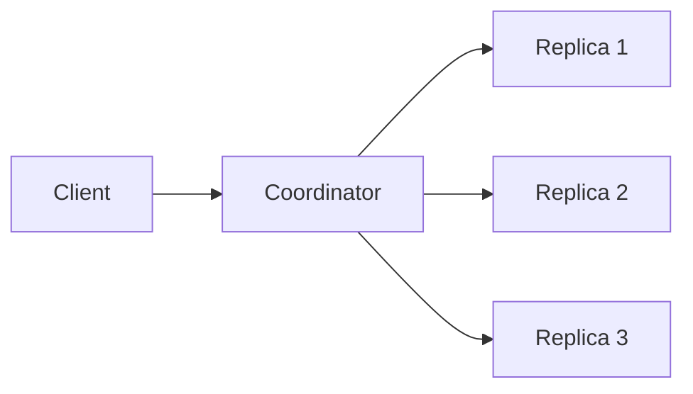

# D10-T013 — Quorums

Topic ID: `D10-T013`
Domain: NoSQL Databases
Subdomain: Quorums
Importance: common
Complexity: intermediate
Dependencies: `D10-T012`, `D10-T001`, `D07-T001`, `D07-T002`
Execution status of the code in section F: illustrative

## A. Topic Overview

A **quorum** is the minimum number of replicas that must participate in a read or write before the coordinator acknowledges the client. For `N` replicas, choosing write quorum `W` and read quorum `R` trades latency, durability, and consistency.

Classic rule: if `W + R > N`, overlapping quorums prevent returning stale values after a successful write under certain failure models. Dynamo-style systems also use sloppy quorums and hinted handoff during partitions.

Interviewers expect you to reason about `N=3` examples, not memorize vendor marketing. Connect quorums to `D10-T014` eventual consistency and `D10-T010` consistency models.

## B. First-Principles Explanation

Replication copies data for availability. Without quorum rules, a client might read a replica that missed the latest write. Quorums force reads and writes to intersect so at least one node in the read set saw the latest write quorum.

Higher `W` improves durability; higher `R` improves read freshness; both increase latency and failure sensitivity when nodes are down.

## C. Internal Working and Architecture

Coordinator sends write to all `N` replicas, waits for `W` acknowledgements, then responds. Read sends to `N`, waits for `R` responses, returns latest version by timestamp or vector clock.



## D. Diagrams and Visual Models

When a node is down, relaxed quorums may write to alternate nodes (sloppy quorum) and repair later—understand your system's guarantees during that window.

## E. Examples and Analogies

Analogy: three judges must sign a ruling; you pick how many signatures required to publish (`W`) and how many to verify an old ruling (`R`).

`N=3, W=2, R=2`: tolerate one replica loss while keeping strong overlap.

`N=3, W=1, R=1`: fast but stale reads possible.

## F. Code Examples

```text
# Illustrative tuning (conceptual, not vendor CLI)
replication_factor N = 3
write_quorum W = 2
read_quorum R = 2
# W + R > N  =>  2 + 2 > 3
```

Cassandra `QUORUM` consistency level maps to these ideas per replication factor.

## G. Practical Backend Application

Document consistency levels per API: config reads may use `ONE`, balance reads use `QUORUM` or strong SQL. Tune per use case, not globally. Monitor replica lag and repair jobs.

## H. Advantages, Limitations and Trade-offs

| Setting | Benefit | Cost |
| --- | --- | --- |
| High W | Durability | Write latency |
| High R | Fresher reads | Read latency |
| W=1,R=1 | Speed | Stale/anomaly risk |
| Strong all | Linearizable | Partition unavailability |

## I. Common Mistakes and Misconceptions

- Assuming any replicated system is strongly consistent.
- Ignoring sloppy quorum repair windows.
- Using `QUORUM` without matching replication factor math.
- Forgetting client retries after timeout can duplicate writes without idempotency.

## J. Debugging and Troubleshooting

Symptoms: divergent values across replicas, rising read repair, post-outage anomalies.

1. Check replication factor and effective consistency level.
2. Inspect failed nodes and hinted handoff queues.
3. Verify application idempotency keys on retries.
4. Run repair/anti-entropy after cluster recovery.

## K. Interview Preparation

### Beginner

#### Q1. What is a quorum in replicated storage?

**Answer:** It is the count of replicas that must respond to a read or write before the operation succeeds. You configure separate write and read quorums against replication factor N. Quorums balance durability, consistency, and availability. They are a core distributed-systems interview topic tied to NoSQL replication.

#### Q2. What is replication factor N?

**Answer:** N is how many replicas store each partition of data. Higher N improves fault tolerance but multiplies storage and write work. Quorum rules are always defined relative to N. A single-node database has N=1 with different failure trade-offs.

#### Q3. Why might W plus R be greater than N?

**Answer:** It guarantees read and write replica sets overlap so a read sees at least one node that participated in the latest write quorum. This prevents returning arbitrarily stale data in the classic model. It is a design choice, not automatic in every product setting. Interviewers want the inequality explained, not recited blindly.

#### Q4. What happens when fewer than W nodes are available?

**Answer:** The write fails or times out rather than acknowledging a risky partial write. Operators see write errors during outages. Clients should retry with idempotency. Some systems allow relaxed W temporarily with explicit inconsistency risk.

#### Q5. How do quorums relate to CAP during partitions?

**Answer:** During a network split, strict quorums may reject operations to preserve consistency. Relaxed quorums favor availability with reconciliation later. The business chooses which side to favor per operation type. Payments often pause rather than guess.

### Intermediate

#### Q1. Compare W=1,R=1 versus W=2,R=2 for N=3.

**Answer:** W=1,R=1 minimizes latency and maximizes availability during failures but allows stale reads. W=2,R=2 tolerates one replica loss while keeping quorum overlap for stronger guarantees. Choose based on whether stale config or stale money is worse. Many systems mix levels per API route.

#### Q2. What is hinted handoff?

**Answer:** When the intended replica is down, the coordinator stores the write temporarily on another node. Later it forwards the hint to the correct replica. This keeps writes available during faults. Reads during the window may need repair before consistency returns.

#### Q3. What is a sloppy quorum?

**Answer:** It accepts writes outside the preferred replica set during failures to maintain availability. Merkle trees and read repair fix divergence afterward. It is not free strong consistency. Understand your vendor's documentation before claiming linearizability.

#### Q4. How do vector clocks interact with quorums?

**Answer:** When concurrent writes happen during partitions, replicas may diverge with sibling versions. Quorum reads may return multiple versions requiring application merge. Last-write-wins is simpler but lossy. CRDTs avoid some merges for specific data types.

#### Q5. Why are idempotent writes required with quorum retries?

**Answer:** Clients often retry on timeout unsure if the write succeeded. Without idempotency keys, retries may double-apply effects. Stores may have applied W replicas but client never got ack. Idempotency makes retries safe.

### Advanced

#### Q1. Prove overlap intuition for N=5, W=3, R=3.

**Answer:** Any write touches at least three replicas; any read touches at least three. By pigeonhole, at least one replica is in both sets. That replica can serve the latest committed write if reads fetch version metadata correctly. Real systems add leader epochs and failure modes that complicate the proof. Use this as design intuition, not a theorem for all configs.

#### Q2. How does DynamoDB synchronous replication differ from quorum math?

**Answer:** Managed services expose consistency knobs like strong reads and transactions rather than raw W and R. Under the hood, replication still faces the same trade-offs. Read the consistency model per API call. Do not assume default reads are strongly consistent across regions.

#### Q3. When would you choose ALL consistency in Cassandra?

**Answer:** When you need every replica to acknowledge for a critical write despite latency cost. Rare for user-facing hot paths. Useful for small-cluster administrative operations or strong guarantees on low-QPS metadata. Watch impact on availability during node loss.

#### Q4. How do read repairs work?

**Answer:** During a quorum read, the coordinator compares versions across replicas and writes back missing updates. This heals entropy over time. It adds latency to that read path. Scheduled repair jobs complement opportunistic read repair.

#### Q5. Quorum versus Raft leader commit index?

**Answer:** Raft commits when a majority of followers acknowledge the leader's log entry. That is a quorum on the commit decision. Reads through the leader are linearizable; follower reads may lag unless fenced. Map Raft majorities to W/R thinking for interviews.

### Scenarios

#### Q1. After one AZ failure, users see old feature flags.

**Answer:** Reads likely used R=1 from lagging replica or cache. Increase R or read from leader region after writes. Verify replication factor spans AZs correctly. Run repair after recovery.

#### Q2. Write timeouts spike but data eventually appears.

**Answer:** W quorum met late while client retried, causing duplicates without idempotency. Add idempotency keys and backoff. Tune client timeout above p99 replication latency. Alert on duplicate side effects.

#### Q3. Cassandra repair running constantly after partition.

**Answer:** Sloppy writes and hinted handoff left divergence. Schedule full repair, verify gc_grace and tombstones. Reduce consistency looseness during steady state to limit divergence rate.

#### Q4. Strong consistency requested globally—latency unacceptable.

**Answer:** Scope strong reads to entities that need it; use eventual for feeds. Multi-region strong reads pay RTT tax. Consider single-region authority with async replication for display data.

#### Q5. N=3 cluster, two nodes down—can you write?

**Answer:** With W=2, writes cannot succeed—only one node live. That preserves safety rather than accepting partial W=1 if configured strictly. Ops must restore a replica or temporarily lower W with explicit risk acceptance and stakeholder sign-off.

### Follow-ups

#### Q1. Link to `D10-T014` eventual consistency?

**Answer:** Low R and W produce eventual consistency behaviors users notice. Quorums are the dial on that spectrum. Pair technical settings with UX mitigation.

#### Q2. Link to `D10-T012` replication?

**Answer:** Quorums sit on top of replication topology. Shard placement and RF define N per partition. Design both together.

#### Q3. Link to observability?

**Answer:** Track write latency percentiles, repair rates, and read version conflicts. Quorum issues appear as tail latency before average CPU maxes.

## L. Practical Exercises

See `EXERCISES/D10-T013.md`.

## M. Revision Notes

- N, W, R and W+R>N intuition.
- Hinted handoff and sloppy quorums exist.
- Idempotent retries mandatory.
- Not all managed APIs expose W/R directly.
- Match consistency to business risk.

## N. Related Topics

`D10-T012`, `D10-T010`, `D10-T014`, `D08-T001`.

## O. Completion Criteria

- Compute overlap for sample N,W,R.
- Explain hinted handoff scenario.
- Pick quorums for config vs payment token.
- Debug stale reads after AZ failure.
- Contrast quorum with Raft majority commit.
