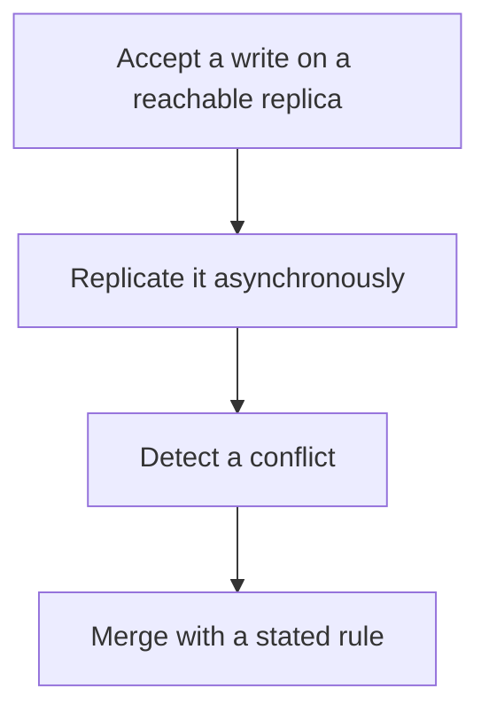

# D10-T014 — Eventual consistency

Topic ID: `D10-T014`
Domain: NoSQL Databases
Subdomain: Eventual consistency
Importance: common
Complexity: intermediate
Dependencies: `D10-T013`, `D10-T001`, `D07-T001`, `D07-T002`
Execution status of the code in section F: unexecuted

## A. Topic Overview

Eventual consistency means that if writes stop, replicas converge to the same value. It does not say when, and it does not say what a read returns before that. Conflicts need a rule: last write wins, a merge function, or an application repair. Clients observe stale reads, and sometimes two different values. It is a good trade for high availability during a partition if the data can merge.

In production this shows up as follows: A shopping cart can merge line items. A bank balance cannot use last-write-wins. The cart is a candidate for eventual consistency. The balance is not.

Interviewers use Eventual consistency to see whether you can state the failure mode, not only the definition. The failure to name is: last-write-wins dropping a slower but more important update, such as a stock decrement

Prerequisites: `D10-T013`, `D10-T001`, `D07-T001`, `D07-T002`. Later notes should link here instead of repeating the mechanism.

## B. First-Principles Explanation

Eventual consistency means that if writes stop, replicas converge to the same value. It does not say when, and it does not say what a read returns before that. Conflicts need a rule: last write wins, a merge function, or an application repair. Clients observe stale reads, and sometimes two different values. It is a good trade for high availability during a partition if the data can merge.

The useful picture is: Eventual consistency is two notebooks that get compared at the end of the day. Until then, they disagree. The comparison rule decides which pencil mark survives.

What has to be true:

1. Accept a write on a reachable replica
2. Replicate it asynchronously
3. Detect a conflict
4. Merge with a stated rule

It works when those steps preserve one invariant. It fails when last-write-wins dropping a slower but more important update, such as a stock decrement. The alternative is: the operation is a decrement or a unique constraint you cannot reconcile after the fact

## C. Internal Working and Architecture

Components involved: the caller, the state Eventual consistency mutates or reads, and the observer that reports replica divergence time and lost-update count.

Execution:

1. Accept a write on a reachable replica
2. Replicate it asynchronously
3. Detect a conflict
4. Merge with a stated rule

Data moves only along that path. A retry re-enters at step 1, so the operation must say what a duplicate does. Memory and locks stay inside this mechanism. Callers see the result or a typed error, not a half-updated invariant.

State to remember: choose this when the data has a merge rule and availability beats freshness. Do not choose it when the operation is a decrement or a unique constraint you cannot reconcile after the fact.

## D. Diagrams and Visual Models



Read the diagram from top to bottom. Each box is one step of Eventual consistency. The failure mode (last-write-wins dropping a slower but more important update, such as a stock decrement) is what you look for when a later box never happens or happens twice.

## E. Examples and Analogies

Analogy: Eventual consistency is two notebooks that get compared at the end of the day. Until then, they disagree. The comparison rule decides which pencil mark survives.

Production example: A shopping cart can merge line items. A bank balance cannot use last-write-wins. The cart is a candidate for eventual consistency. The balance is not.

A small counterexample is enough in an interview. Show the input, apply the steps, and show the broken outcome if someone uses the mechanism outside its rule: last-write-wins dropping a slower but more important update, such as a stock decrement.

## F. Code Examples

The snippet is labeled unexecuted. It illustrates the shape of the idea. It is not a benchmark and it embeds no secret.

```python
def last_write_wins(a, b):
    return a if a['ts'] >= b['ts'] else b
```

After the snippet, check replica divergence time and lost-update count. If that signal moves the wrong way, the snippet is the wrong tool for the workload.

## G. Practical Backend Application

Use Eventual consistency in a service when the data has a merge rule and availability beats freshness.

A typical place is the production case already stated: A shopping cart can merge line items. A bank balance cannot use last-write-wins. The cart is a candidate for eventual consistency. The balance is not.

Operationally you alert on replica divergence time and lost-update count. You do not alert only on process uptime. The dashboard should show the failure mode, a success rate, and the saturation signal (queue depth, lock wait, or latency) that predicts it.

## H. Advantages, Limitations and Trade-offs

| Choice | Benefit | Cost | Choose when | Avoid when |
| --- | --- | --- | --- | --- |
| Apply Eventual consistency | the data has a merge rule and availability beats freshness | Extra moving parts and a new failure mode | The failure you are preventing is already real | the operation is a decrement or a unique constraint you cannot reconcile after the fact |
| Simpler alternative | Less code and fewer dependencies | last-write-wins dropping a slower but more important update, such as a stock decrement | The workload does not hit the limit | The invariant must hold under concurrency or failure |

Eventual consistency is a trade. State the benefit and the cost in the same sentence when you propose it in a design review.

## I. Common Mistakes and Misconceptions

- Using eventual consistency for payments.
- Having no conflict rule.
- Describing a bug as 'eventual' when the replicas never converge.
- Treating a diagram of Eventual consistency as proof that the invariant holds in production.
- Copying a default configuration without naming replica divergence time and lost-update count.

## J. Debugging and Troubleshooting

Symptom: last-write-wins dropping a slower but more important update, such as a stock decrement

First check: replica divergence time and lost-update count.

Then compare one healthy instance against one unhealthy instance. Confirm whether retries are duplicating work. Confirm whether a timeout is shorter than the work. Fix the invariant, then watch the same metric for a full peak, not only for the next minute.

Useful questions: did the step order in section C actually happen, or did a caller skip a step? Did a deploy change the data shape that Eventual consistency assumes?

## K. Interview Preparation

### Beginner

#### Q1. What problem does Eventual consistency solve?

**Answer:** Eventual consistency means that if writes stop, replicas converge to the same value. It does not say when, and it does not say what a read returns before that. Conflicts need a rule: last write wins, a merge function, or an application repair. Clients observe stale reads, and sometimes two different values. It is a good trade for high availability during a partition if the data can merge. Without it, the usual backend failure is: last-write-wins dropping a slower but more important update, such as a stock decrement.

#### Q2. Where does Eventual consistency sit on a request path?

**Answer:** Eventual consistency is not a library you sprinkle on every call. the data has a merge rule and availability beats freshness You notice it when replica divergence time and lost-update count. Name the constraint that makes this choice correct. Say what you would measure to confirm it.

#### Q3. Give a concrete example of Eventual consistency.

**Answer:** A shopping cart can merge line items. A bank balance cannot use last-write-wins. The cart is a candidate for eventual consistency. The balance is not. Walk the input, the state change, and the observable output.

#### Q4. What is a common mix-up around Eventual consistency?

**Answer:** last-write-wins dropping a slower but more important update, such as a stock decrement The corrective check is replica divergence time and lost-update count. Name the constraint that makes this choice correct. Say what you would measure to confirm it. Say which alternative you rejected and why.

#### Q5. When would you skip Eventual consistency?

**Answer:** the operation is a decrement or a unique constraint you cannot reconcile after the fact Skipping is a decision with a measured cost, not a slogan. Name the constraint that makes this choice correct. Say what you would measure to confirm it. Say which alternative you rejected and why.

### Intermediate

#### Q1. What invariant makes Eventual consistency correct?

**Answer:** Eventual consistency means that if writes stop, replicas converge to the same value. It does not say when, and it does not say what a read returns before that. Conflicts need a rule: last write wins, a merge function, or an application repair. Clients observe stale reads, and sometimes two different values. It is a good trade for high availability during a partition if the data can merge. State the invariant before you name the tool.

#### Q2. How do you test Eventual consistency?

**Answer:** Assert the failure mode directly: last-write-wins dropping a slower but more important update, such as a stock decrement. The assertion should watch replica divergence time and lost-update count. Include a concurrent or retry case if the bug only appears then. Name the constraint that makes this choice correct.

#### Q3. What signal tells you Eventual consistency is misbehaving in production?

**Answer:** Watch replica divergence time and lost-update count. The user-visible symptom is usually last-write-wins dropping a slower but more important update, such as a stock decrement. Name the constraint that makes this choice correct. Say what you would measure to confirm it.

#### Q4. How would you introduce Eventual consistency into a legacy service?

**Answer:** the data has a merge rule and availability beats freshness Ship it behind a metric so you can compare the old path. Roll back if last-write-wins dropping a slower but more important update, such as a stock decrement gets worse. Name the constraint that makes this choice correct. Say what you would measure to confirm it.

#### Q5. What do you trade away by choosing Eventual consistency?

**Answer:** the data has a merge rule and availability beats freshness the operation is a decrement or a unique constraint you cannot reconcile after the fact Say the cost in latency, storage, or operational load. Name the constraint that makes this choice correct. Say what you would measure to confirm it. Say which alternative you rejected and why.

### Advanced

#### Q1. What breaks if a dependency of Eventual consistency is slow or down?

**Answer:** last-write-wins dropping a slower but more important update, such as a stock decrement Degrade using the rule: the operation is a decrement or a unique constraint you cannot reconcile after the fact. Timeouts must be shorter than the caller's deadline. Name the constraint that makes this choice correct. Say what you would measure to confirm it.

#### Q2. How does Eventual consistency behave under retries?

**Answer:** Retries repeat work, so Eventual consistency must define what a duplicate does. last-write-wins dropping a slower but more important update, such as a stock decrement Idempotency keys or fences belong next to the write, not in a comment. Name the constraint that makes this choice correct. Say what you would measure to confirm it.

#### Q3. What is the capacity limit of Eventual consistency?

**Answer:** The limit shows up as replica divergence time and lost-update count. Add capacity only after you know whether the bottleneck is CPU, lock wait, or network. Name the constraint that makes this choice correct. Say what you would measure to confirm it.

#### Q4. How do you evolve Eventual consistency without a flag day?

**Answer:** the data has a merge rule and availability beats freshness Version the contract or the on-disk format. Readers should tolerate one old and one new shape during the rollout. Name the constraint that makes this choice correct. Say what you would measure to confirm it.

#### Q5. What security or correctness bug hides inside Eventual consistency?

**Answer:** last-write-wins dropping a slower but more important update, such as a stock decrement Check authorization and tenancy at the same boundary as the mechanism. A cache or queue must not widen who can read the data. Name the constraint that makes this choice correct. Say what you would measure to confirm it.

### Scenario

#### Q1. Incident: last-write-wins dropping a slower but more important update, such as a stock decrement. What do you check first?

**Answer:** Start with replica divergence time and lost-update count. Compare a good host and a bad host before you restart anything. Eventual consistency means that if writes stop, replicas converge to the same value. It does not say when, and it does not say what a read returns before that. Conflicts need a rule: last write wins, a merge function, or an application repair. Clients observe stale reads, and sometimes two different values. It is a good trade for high availability during a partition if the data can merge.

#### Q2. A reviewer wants the clever version. What data settles it?

**Answer:** the data has a merge rule and availability beats freshness the operation is a decrement or a unique constraint you cannot reconcile after the fact Bring replica divergence time and lost-update count from a load test or from production, not a slogan. Name the constraint that makes this choice correct. Say what you would measure to confirm it. Say which alternative you rejected and why.

#### Q3. You have one hour to explain Eventual consistency at a whiteboard.

**Answer:** Draw the happy path in four boxes. Then draw the failure: last-write-wins dropping a slower but more important update, such as a stock decrement. End with the metric you would page on. Name the constraint that makes this choice correct.

#### Q4. The bug only appears under two concurrent callers.

**Answer:** last-write-wins dropping a slower but more important update, such as a stock decrement Reproduce with a barrier so both sides enter the critical window. Confirm the fix with replica divergence time and lost-update count. Name the constraint that makes this choice correct. Say what you would measure to confirm it.

#### Q5. Leadership wants this on every service next week.

**Answer:** the operation is a decrement or a unique constraint you cannot reconcile after the fact the data has a merge rule and availability beats freshness Roll it out where the failure mode is already hurting users. Name the constraint that makes this choice correct. Say what you would measure to confirm it. Say which alternative you rejected and why.

### Follow-up

#### Q1. What did you assume about the data size or the clock?

**Answer:** Eventual consistency means that if writes stop, replicas converge to the same value. It does not say when, and it does not say what a read returns before that. Conflicts need a rule: last write wins, a merge function, or an application repair. Clients observe stale reads, and sometimes two different values. It is a good trade for high availability during a partition if the data can merge. Clocks are not a total order across machines. State whether the algorithm needs bounded size or a single leader.

#### Q2. What would you measure after the change ships?

**Answer:** Page on replica divergence time and lost-update count. Keep a before/after dashboard for one week. Alert on the failure mode, not only on CPU. Name the constraint that makes this choice correct.

#### Q3. Which neighboring topic did you deliberately not re-teach?

**Answer:** This note owns Eventual consistency. Related identifiers are in section N. Shared ideas are linked, not copied. Name the constraint that makes this choice correct.

## L. Practical Exercises

Solutions are in `EXERCISES/solutions/D10-T014.md`, not in this section.

1. Whiteboard the four steps of Eventual consistency and mark where `last-write-wins dropping a slower but more important update, such as a stock decrement` enters.
2. Read the snippet in section F and write the assertion that would catch that failure. The assertion must mention `replica divergence time and lost-update count`.
3. Argue for or against using Eventual consistency on a service you know. Use the choose and avoid rows from section H. Do not appeal to popularity.

## M. Revision Notes

- Mechanism: Eventual consistency means that if writes stop, replicas converge to the same value.
- Failure: last-write-wins dropping a slower but more important update, such as a stock decrement
- Metric: replica divergence time and lost-update count
- Choose when: the data has a merge rule and availability beats freshness
- Avoid when: the operation is a decrement or a unique constraint you cannot reconcile after the fact

## N. Related Topics

Dependencies to review first: `D10-T013`, `D10-T001`, `D07-T001`, `D07-T002`.

Shared ideas stay in those notes. This note does not restate them.

## O. Completion Criteria

- You can explain Eventual consistency without reading this note, including the failure mode.
- You can draw the diagram in section D from memory.
- You can say when not to use it, using the avoid condition in section H.
- You can name the metric you would watch after shipping it.
