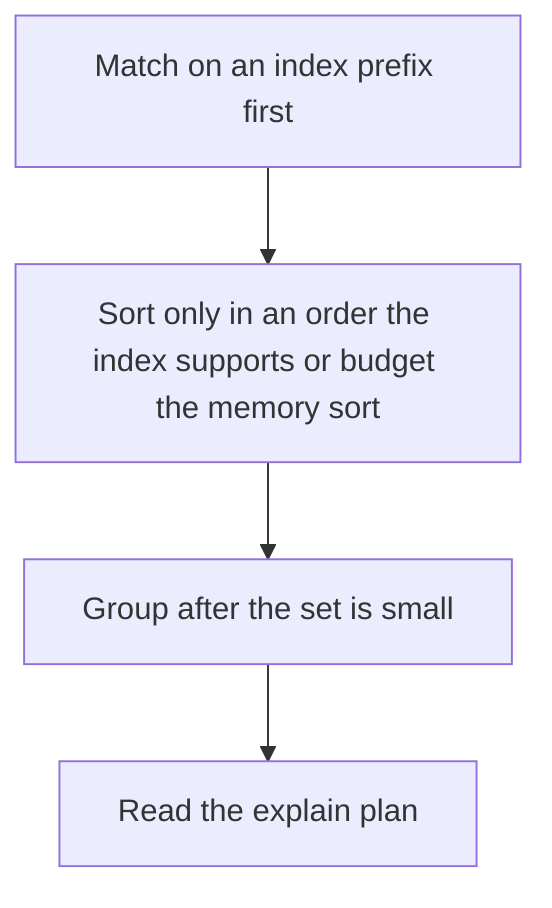

# D10-T015 — MongoDB indexes and aggregation pipelines

Topic ID: `D10-T015`
Domain: NoSQL Databases
Subdomain: MongoDB indexes and aggregation pipelines
Importance: core
Complexity: intermediate
Dependencies: `D10-T014`, `D10-T001`, `D07-T001`, `D07-T002`
Execution status of the code in section F: unexecuted

## A. Topic Overview

MongoDB indexes are B-trees on fields or compound keys. The query uses an index when the predicate matches a prefix of the compound key. Aggregation pipelines transform documents through stages such as match, group, sort, and lookup. An early match uses an index. A lookup is a join and can be expensive. Explain shows whether a stage is a collection scan.

In production this shows up as follows: A feed query matches userId and sorts by createdAt, so the index is that pair. An aggregation that unwinds a huge array before matching scans the collection and spills.

Interviewers use MongoDB indexes and aggregation pipelines to see whether you can state the failure mode, not only the definition. The failure to name is: a pipeline that lookups a large collection before it filters, or a compound index whose field order does not match the query

Prerequisites: `D10-T014`, `D10-T001`, `D07-T001`, `D07-T002`. Later notes should link here instead of repeating the mechanism.

## B. First-Principles Explanation

MongoDB indexes are B-trees on fields or compound keys. The query uses an index when the predicate matches a prefix of the compound key. Aggregation pipelines transform documents through stages such as match, group, sort, and lookup. An early match uses an index. A lookup is a join and can be expensive. Explain shows whether a stage is a collection scan.

The useful picture is: A compound index is a phone book sorted by city and then by name. You can find a city, or a city plus a name. You cannot jump straight to a name in every city.

What has to be true:

1. Match on an index prefix first
2. Sort only in an order the index supports or budget the memory sort
3. Group after the set is small
4. Read the explain plan

It works when those steps preserve one invariant. It fails when a pipeline that lookups a large collection before it filters, or a compound index whose field order does not match the query. The alternative is: you add an index per field and never look at explain

## C. Internal Working and Architecture

Components involved: the caller, the state MongoDB indexes and aggregation pipelines mutates or reads, and the observer that reports documents examined versus returned, and aggregation memory spills.

Execution:

1. Match on an index prefix first
2. Sort only in an order the index supports or budget the memory sort
3. Group after the set is small
4. Read the explain plan

Data moves only along that path. A retry re-enters at step 1, so the operation must say what a duplicate does. Memory and locks stay inside this mechanism. Callers see the result or a typed error, not a half-updated invariant.

State to remember: choose this when you have a MongoDB predicate or pipeline to justify. Do not choose it when you add an index per field and never look at explain.

## D. Diagrams and Visual Models



Read the diagram from top to bottom. Each box is one step of MongoDB indexes and aggregation pipelines. The failure mode (a pipeline that lookups a large collection before it filters, or a compound index whose field order does not match the query) is what you look for when a later box never happens or happens twice.

## E. Examples and Analogies

Analogy: A compound index is a phone book sorted by city and then by name. You can find a city, or a city plus a name. You cannot jump straight to a name in every city.

Production example: A feed query matches userId and sorts by createdAt, so the index is that pair. An aggregation that unwinds a huge array before matching scans the collection and spills.

A small counterexample is enough in an interview. Show the input, apply the steps, and show the broken outcome if someone uses the mechanism outside its rule: a pipeline that lookups a large collection before it filters, or a compound index whose field order does not match the query.

## F. Code Examples

The snippet is labeled unexecuted. It illustrates the shape of the idea. It is not a benchmark and it embeds no secret.

```javascript
db.orders.createIndex({ userId: 1, createdAt: -1 })
```

After the snippet, check documents examined versus returned, and aggregation memory spills. If that signal moves the wrong way, the snippet is the wrong tool for the workload.

## G. Practical Backend Application

Use MongoDB indexes and aggregation pipelines in a service when you have a MongoDB predicate or pipeline to justify.

A typical place is the production case already stated: A feed query matches userId and sorts by createdAt, so the index is that pair. An aggregation that unwinds a huge array before matching scans the collection and spills.

Operationally you alert on documents examined versus returned, and aggregation memory spills. You do not alert only on process uptime. The dashboard should show the failure mode, a success rate, and the saturation signal (queue depth, lock wait, or latency) that predicts it.

## H. Advantages, Limitations and Trade-offs

| Choice | Benefit | Cost | Choose when | Avoid when |
| --- | --- | --- | --- | --- |
| Apply MongoDB indexes and aggregation pipelines | you have a MongoDB predicate or pipeline to justify | Extra moving parts and a new failure mode | The failure you are preventing is already real | you add an index per field and never look at explain |
| Simpler alternative | Less code and fewer dependencies | a pipeline that lookups a large collection before it filters, or a compound index whose field order does not match the query | The workload does not hit the limit | The invariant must hold under concurrency or failure |

MongoDB indexes and aggregation pipelines is a trade. State the benefit and the cost in the same sentence when you propose it in a design review.

## I. Common Mistakes and Misconceptions

- Leading the index with a low-selectivity field the query does not equality-match.
- Using $lookup as a habit.
- Allowing disk spills to hide a bad stage order.
- Treating a diagram of MongoDB indexes and aggregation pipelines as proof that the invariant holds in production.
- Copying a default configuration without naming documents examined versus returned, and aggregation memory spills.

## J. Debugging and Troubleshooting

Symptom: a pipeline that lookups a large collection before it filters, or a compound index whose field order does not match the query

First check: documents examined versus returned, and aggregation memory spills.

Then compare one healthy instance against one unhealthy instance. Confirm whether retries are duplicating work. Confirm whether a timeout is shorter than the work. Fix the invariant, then watch the same metric for a full peak, not only for the next minute.

Useful questions: did the step order in section C actually happen, or did a caller skip a step? Did a deploy change the data shape that MongoDB indexes and aggregation pipelines assumes?

## K. Interview Preparation

### Beginner

#### Q1. What problem does MongoDB indexes and aggregation pipelines solve?

**Answer:** MongoDB indexes are B-trees on fields or compound keys. The query uses an index when the predicate matches a prefix of the compound key. Aggregation pipelines transform documents through stages such as match, group, sort, and lookup. An early match uses an index. A lookup is a join and can be expensive. Explain shows whether a stage is a collection scan. Without it, the usual backend failure is: a pipeline that lookups a large collection before it filters, or a compound index whose field order does not match the query.

#### Q2. Where does MongoDB indexes and aggregation pipelines sit on a request path?

**Answer:** MongoDB indexes and aggregation pipelines is not a library you sprinkle on every call. you have a MongoDB predicate or pipeline to justify You notice it when documents examined versus returned, and aggregation memory spills. Name the constraint that makes this choice correct. Say what you would measure to confirm it.

#### Q3. Give a concrete example of MongoDB indexes and aggregation pipelines.

**Answer:** A feed query matches userId and sorts by createdAt, so the index is that pair. An aggregation that unwinds a huge array before matching scans the collection and spills. Walk the input, the state change, and the observable output. Name the constraint that makes this choice correct.

#### Q4. What is a common mix-up around MongoDB indexes and aggregation pipelines?

**Answer:** a pipeline that lookups a large collection before it filters, or a compound index whose field order does not match the query The corrective check is documents examined versus returned, and aggregation memory spills. Name the constraint that makes this choice correct. Say what you would measure to confirm it. Say which alternative you rejected and why.

#### Q5. When would you skip MongoDB indexes and aggregation pipelines?

**Answer:** you add an index per field and never look at explain Skipping is a decision with a measured cost, not a slogan. Name the constraint that makes this choice correct. Say what you would measure to confirm it. Say which alternative you rejected and why.

### Intermediate

#### Q1. What invariant makes MongoDB indexes and aggregation pipelines correct?

**Answer:** MongoDB indexes are B-trees on fields or compound keys. The query uses an index when the predicate matches a prefix of the compound key. Aggregation pipelines transform documents through stages such as match, group, sort, and lookup. An early match uses an index. A lookup is a join and can be expensive. Explain shows whether a stage is a collection scan. State the invariant before you name the tool.

#### Q2. How do you test MongoDB indexes and aggregation pipelines?

**Answer:** Assert the failure mode directly: a pipeline that lookups a large collection before it filters, or a compound index whose field order does not match the query. The assertion should watch documents examined versus returned, and aggregation memory spills. Include a concurrent or retry case if the bug only appears then. Name the constraint that makes this choice correct.

#### Q3. What signal tells you MongoDB indexes and aggregation pipelines is misbehaving in production?

**Answer:** Watch documents examined versus returned, and aggregation memory spills. The user-visible symptom is usually a pipeline that lookups a large collection before it filters, or a compound index whose field order does not match the query. Name the constraint that makes this choice correct. Say what you would measure to confirm it.

#### Q4. How would you introduce MongoDB indexes and aggregation pipelines into a legacy service?

**Answer:** you have a MongoDB predicate or pipeline to justify Ship it behind a metric so you can compare the old path. Roll back if a pipeline that lookups a large collection before it filters, or a compound index whose field order does not match the query gets worse. Name the constraint that makes this choice correct. Say what you would measure to confirm it.

#### Q5. What do you trade away by choosing MongoDB indexes and aggregation pipelines?

**Answer:** you have a MongoDB predicate or pipeline to justify you add an index per field and never look at explain Say the cost in latency, storage, or operational load. Name the constraint that makes this choice correct. Say what you would measure to confirm it. Say which alternative you rejected and why.

### Advanced

#### Q1. What breaks if a dependency of MongoDB indexes and aggregation pipelines is slow or down?

**Answer:** a pipeline that lookups a large collection before it filters, or a compound index whose field order does not match the query Degrade using the rule: you add an index per field and never look at explain. Timeouts must be shorter than the caller's deadline. Name the constraint that makes this choice correct. Say what you would measure to confirm it.

#### Q2. How does MongoDB indexes and aggregation pipelines behave under retries?

**Answer:** Retries repeat work, so MongoDB indexes and aggregation pipelines must define what a duplicate does. a pipeline that lookups a large collection before it filters, or a compound index whose field order does not match the query Idempotency keys or fences belong next to the write, not in a comment. Name the constraint that makes this choice correct. Say what you would measure to confirm it.

#### Q3. What is the capacity limit of MongoDB indexes and aggregation pipelines?

**Answer:** The limit shows up as documents examined versus returned, and aggregation memory spills. Add capacity only after you know whether the bottleneck is CPU, lock wait, or network. Name the constraint that makes this choice correct. Say what you would measure to confirm it.

#### Q4. How do you evolve MongoDB indexes and aggregation pipelines without a flag day?

**Answer:** you have a MongoDB predicate or pipeline to justify Version the contract or the on-disk format. Readers should tolerate one old and one new shape during the rollout. Name the constraint that makes this choice correct. Say what you would measure to confirm it.

#### Q5. What security or correctness bug hides inside MongoDB indexes and aggregation pipelines?

**Answer:** a pipeline that lookups a large collection before it filters, or a compound index whose field order does not match the query Check authorization and tenancy at the same boundary as the mechanism. A cache or queue must not widen who can read the data. Name the constraint that makes this choice correct. Say what you would measure to confirm it.

### Scenario

#### Q1. Incident: a pipeline that lookups a large collection before it filters, or a compound index whose field order does not match the query. What do you check first?

**Answer:** Start with documents examined versus returned, and aggregation memory spills. Compare a good host and a bad host before you restart anything. MongoDB indexes are B-trees on fields or compound keys. The query uses an index when the predicate matches a prefix of the compound key. Aggregation pipelines transform documents through stages such as match, group, sort, and lookup. An early match uses an index. A lookup is a join and can be expensive. Explain shows whether a stage is a collection scan.

#### Q2. A reviewer wants the clever version. What data settles it?

**Answer:** you have a MongoDB predicate or pipeline to justify you add an index per field and never look at explain Bring documents examined versus returned, and aggregation memory spills from a load test or from production, not a slogan. Name the constraint that makes this choice correct. Say what you would measure to confirm it. Say which alternative you rejected and why.

#### Q3. You have one hour to explain MongoDB indexes and aggregation pipelines at a whiteboard.

**Answer:** Draw the happy path in four boxes. Then draw the failure: a pipeline that lookups a large collection before it filters, or a compound index whose field order does not match the query. End with the metric you would page on. Name the constraint that makes this choice correct.

#### Q4. The bug only appears under two concurrent callers.

**Answer:** a pipeline that lookups a large collection before it filters, or a compound index whose field order does not match the query Reproduce with a barrier so both sides enter the critical window. Confirm the fix with documents examined versus returned, and aggregation memory spills. Name the constraint that makes this choice correct. Say what you would measure to confirm it.

#### Q5. Leadership wants this on every service next week.

**Answer:** you add an index per field and never look at explain you have a MongoDB predicate or pipeline to justify Roll it out where the failure mode is already hurting users. Name the constraint that makes this choice correct. Say what you would measure to confirm it. Say which alternative you rejected and why.

### Follow-up

#### Q1. What did you assume about the data size or the clock?

**Answer:** MongoDB indexes are B-trees on fields or compound keys. The query uses an index when the predicate matches a prefix of the compound key. Aggregation pipelines transform documents through stages such as match, group, sort, and lookup. An early match uses an index. A lookup is a join and can be expensive. Explain shows whether a stage is a collection scan. Clocks are not a total order across machines. State whether the algorithm needs bounded size or a single leader.

#### Q2. What would you measure after the change ships?

**Answer:** Page on documents examined versus returned, and aggregation memory spills. Keep a before/after dashboard for one week. Alert on the failure mode, not only on CPU. Name the constraint that makes this choice correct.

#### Q3. Which neighboring topic did you deliberately not re-teach?

**Answer:** This note owns MongoDB indexes and aggregation pipelines. Related identifiers are in section N. Shared ideas are linked, not copied. Name the constraint that makes this choice correct.

## L. Practical Exercises

Solutions are in `EXERCISES/solutions/D10-T015.md`, not in this section.

1. Whiteboard the four steps of MongoDB indexes and aggregation pipelines and mark where `a pipeline that lookups a large collection before it filters, or a compound index whose field order does not match the query` enters.
2. Read the snippet in section F and write the assertion that would catch that failure. The assertion must mention `documents examined versus returned, and aggregation memory spills`.
3. Argue for or against using MongoDB indexes and aggregation pipelines on a service you know. Use the choose and avoid rows from section H. Do not appeal to popularity.

## M. Revision Notes

- Mechanism: MongoDB indexes are B-trees on fields or compound keys.
- Failure: a pipeline that lookups a large collection before it filters, or a compound index whose field order does not match the query
- Metric: documents examined versus returned, and aggregation memory spills
- Choose when: you have a MongoDB predicate or pipeline to justify
- Avoid when: you add an index per field and never look at explain

## N. Related Topics

Dependencies to review first: `D10-T014`, `D10-T001`, `D07-T001`, `D07-T002`.

Shared ideas stay in those notes. This note does not restate them.

## O. Completion Criteria

- You can explain MongoDB indexes and aggregation pipelines without reading this note, including the failure mode.
- You can draw the diagram in section D from memory.
- You can say when not to use it, using the avoid condition in section H.
- You can name the metric you would watch after shipping it.
