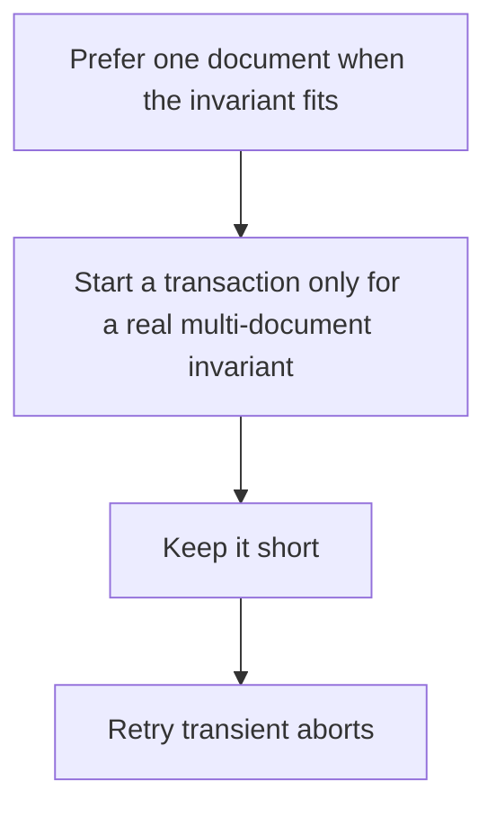

# D10-T016 — MongoDB transactions

Topic ID: `D10-T016`
Domain: NoSQL Databases
Subdomain: MongoDB transactions
Importance: core
Complexity: intermediate
Dependencies: `D10-T015`, `D10-T001`, `D07-T001`, `D07-T002`
Execution status of the code in section F: unexecuted

## A. Topic Overview

A MongoDB multi-document transaction lets several reads and writes commit or abort together on a replica set. It is not free the way a single-document write is. Single-document writes are already atomic. Transactions need a replica set, have a lifetime limit, and can abort on conflicts. If the data is modeled so one document is the aggregate, you often do not need a transaction.

In production this shows up as follows: Transferring credits between two account documents needs a transaction or an application outbox. Updating fields inside one order document does not.

Interviewers use MongoDB transactions to see whether you can state the failure mode, not only the definition. The failure to name is: a long transaction that times out, or using a transaction to paper over a data model that should have been one document

Prerequisites: `D10-T015`, `D10-T001`, `D07-T001`, `D07-T002`. Later notes should link here instead of repeating the mechanism.

## B. First-Principles Explanation

A MongoDB multi-document transaction lets several reads and writes commit or abort together on a replica set. It is not free the way a single-document write is. Single-document writes are already atomic. Transactions need a replica set, have a lifetime limit, and can abort on conflicts. If the data is modeled so one document is the aggregate, you often do not need a transaction.

The useful picture is: A single document write is one sealed envelope. A multi-document transaction is a rubber band around several envelopes, and the rubber band has a timer.

What has to be true:

1. Prefer one document when the invariant fits
2. Start a transaction only for a real multi-document invariant
3. Keep it short
4. Retry transient aborts

It works when those steps preserve one invariant. It fails when a long transaction that times out, or using a transaction to paper over a data model that should have been one document. The alternative is: you wrap every write in a transaction by default

## C. Internal Working and Architecture

Components involved: the caller, the state MongoDB transactions mutates or reads, and the observer that reports transaction abort rate and duration.

Execution:

1. Prefer one document when the invariant fits
2. Start a transaction only for a real multi-document invariant
3. Keep it short
4. Retry transient aborts

Data moves only along that path. A retry re-enters at step 1, so the operation must say what a duplicate does. Memory and locks stay inside this mechanism. Callers see the result or a typed error, not a half-updated invariant.

State to remember: choose this when an invariant really spans documents. Do not choose it when you wrap every write in a transaction by default.

## D. Diagrams and Visual Models



Read the diagram from top to bottom. Each box is one step of MongoDB transactions. The failure mode (a long transaction that times out, or using a transaction to paper over a data model that should have been one document) is what you look for when a later box never happens or happens twice.

## E. Examples and Analogies

Analogy: A single document write is one sealed envelope. A multi-document transaction is a rubber band around several envelopes, and the rubber band has a timer.

Production example: Transferring credits between two account documents needs a transaction or an application outbox. Updating fields inside one order document does not.

A small counterexample is enough in an interview. Show the input, apply the steps, and show the broken outcome if someone uses the mechanism outside its rule: a long transaction that times out, or using a transaction to paper over a data model that should have been one document.

## F. Code Examples

The snippet is labeled unexecuted. It illustrates the shape of the idea. It is not a benchmark and it embeds no secret.

```javascript
session.startTransaction()
// unexecuted: several writes, then commit, retry on transient error
```

After the snippet, check transaction abort rate and duration. If that signal moves the wrong way, the snippet is the wrong tool for the workload.

## G. Practical Backend Application

Use MongoDB transactions in a service when an invariant really spans documents.

A typical place is the production case already stated: Transferring credits between two account documents needs a transaction or an application outbox. Updating fields inside one order document does not.

Operationally you alert on transaction abort rate and duration. You do not alert only on process uptime. The dashboard should show the failure mode, a success rate, and the saturation signal (queue depth, lock wait, or latency) that predicts it.

## H. Advantages, Limitations and Trade-offs

| Choice | Benefit | Cost | Choose when | Avoid when |
| --- | --- | --- | --- | --- |
| Apply MongoDB transactions | an invariant really spans documents | Extra moving parts and a new failure mode | The failure you are preventing is already real | you wrap every write in a transaction by default |
| Simpler alternative | Less code and fewer dependencies | a long transaction that times out, or using a transaction to paper over a data model that should have been one document | The workload does not hit the limit | The invariant must hold under concurrency or failure |

MongoDB transactions is a trade. State the benefit and the cost in the same sentence when you propose it in a design review.

## I. Common Mistakes and Misconceptions

- Holding a transaction open across a user action.
- Ignoring TransientTransactionError retries.
- Assuming multi-document transactions exist on a standalone node.
- Treating a diagram of MongoDB transactions as proof that the invariant holds in production.
- Copying a default configuration without naming transaction abort rate and duration.

## J. Debugging and Troubleshooting

Symptom: a long transaction that times out, or using a transaction to paper over a data model that should have been one document

First check: transaction abort rate and duration.

Then compare one healthy instance against one unhealthy instance. Confirm whether retries are duplicating work. Confirm whether a timeout is shorter than the work. Fix the invariant, then watch the same metric for a full peak, not only for the next minute.

Useful questions: did the step order in section C actually happen, or did a caller skip a step? Did a deploy change the data shape that MongoDB transactions assumes?

## K. Interview Preparation

### Beginner

#### Q1. What problem does MongoDB transactions solve?

**Answer:** A MongoDB multi-document transaction lets several reads and writes commit or abort together on a replica set. It is not free the way a single-document write is. Single-document writes are already atomic. Transactions need a replica set, have a lifetime limit, and can abort on conflicts. If the data is modeled so one document is the aggregate, you often do not need a transaction. Without it, the usual backend failure is: a long transaction that times out, or using a transaction to paper over a data model that should have been one document.

#### Q2. Where does MongoDB transactions sit on a request path?

**Answer:** MongoDB transactions is not a library you sprinkle on every call. an invariant really spans documents You notice it when transaction abort rate and duration. Name the constraint that makes this choice correct. Say what you would measure to confirm it.

#### Q3. Give a concrete example of MongoDB transactions.

**Answer:** Transferring credits between two account documents needs a transaction or an application outbox. Updating fields inside one order document does not. Walk the input, the state change, and the observable output. Name the constraint that makes this choice correct.

#### Q4. What is a common mix-up around MongoDB transactions?

**Answer:** a long transaction that times out, or using a transaction to paper over a data model that should have been one document The corrective check is transaction abort rate and duration. Name the constraint that makes this choice correct. Say what you would measure to confirm it. Say which alternative you rejected and why.

#### Q5. When would you skip MongoDB transactions?

**Answer:** you wrap every write in a transaction by default Skipping is a decision with a measured cost, not a slogan. Name the constraint that makes this choice correct. Say what you would measure to confirm it. Say which alternative you rejected and why.

### Intermediate

#### Q1. What invariant makes MongoDB transactions correct?

**Answer:** A MongoDB multi-document transaction lets several reads and writes commit or abort together on a replica set. It is not free the way a single-document write is. Single-document writes are already atomic. Transactions need a replica set, have a lifetime limit, and can abort on conflicts. If the data is modeled so one document is the aggregate, you often do not need a transaction. State the invariant before you name the tool.

#### Q2. How do you test MongoDB transactions?

**Answer:** Assert the failure mode directly: a long transaction that times out, or using a transaction to paper over a data model that should have been one document. The assertion should watch transaction abort rate and duration. Include a concurrent or retry case if the bug only appears then. Name the constraint that makes this choice correct.

#### Q3. What signal tells you MongoDB transactions is misbehaving in production?

**Answer:** Watch transaction abort rate and duration. The user-visible symptom is usually a long transaction that times out, or using a transaction to paper over a data model that should have been one document. Name the constraint that makes this choice correct. Say what you would measure to confirm it.

#### Q4. How would you introduce MongoDB transactions into a legacy service?

**Answer:** an invariant really spans documents Ship it behind a metric so you can compare the old path. Roll back if a long transaction that times out, or using a transaction to paper over a data model that should have been one document gets worse. Name the constraint that makes this choice correct. Say what you would measure to confirm it.

#### Q5. What do you trade away by choosing MongoDB transactions?

**Answer:** an invariant really spans documents you wrap every write in a transaction by default Say the cost in latency, storage, or operational load. Name the constraint that makes this choice correct. Say what you would measure to confirm it. Say which alternative you rejected and why.

### Advanced

#### Q1. What breaks if a dependency of MongoDB transactions is slow or down?

**Answer:** a long transaction that times out, or using a transaction to paper over a data model that should have been one document Degrade using the rule: you wrap every write in a transaction by default. Timeouts must be shorter than the caller's deadline. Name the constraint that makes this choice correct. Say what you would measure to confirm it.

#### Q2. How does MongoDB transactions behave under retries?

**Answer:** Retries repeat work, so MongoDB transactions must define what a duplicate does. a long transaction that times out, or using a transaction to paper over a data model that should have been one document Idempotency keys or fences belong next to the write, not in a comment. Name the constraint that makes this choice correct. Say what you would measure to confirm it.

#### Q3. What is the capacity limit of MongoDB transactions?

**Answer:** The limit shows up as transaction abort rate and duration. Add capacity only after you know whether the bottleneck is CPU, lock wait, or network. Name the constraint that makes this choice correct. Say what you would measure to confirm it.

#### Q4. How do you evolve MongoDB transactions without a flag day?

**Answer:** an invariant really spans documents Version the contract or the on-disk format. Readers should tolerate one old and one new shape during the rollout. Name the constraint that makes this choice correct. Say what you would measure to confirm it.

#### Q5. What security or correctness bug hides inside MongoDB transactions?

**Answer:** a long transaction that times out, or using a transaction to paper over a data model that should have been one document Check authorization and tenancy at the same boundary as the mechanism. A cache or queue must not widen who can read the data. Name the constraint that makes this choice correct. Say what you would measure to confirm it.

### Scenario

#### Q1. Incident: a long transaction that times out, or using a transaction to paper over a data model that should have been one document. What do you check first?

**Answer:** Start with transaction abort rate and duration. Compare a good host and a bad host before you restart anything. A MongoDB multi-document transaction lets several reads and writes commit or abort together on a replica set. It is not free the way a single-document write is. Single-document writes are already atomic. Transactions need a replica set, have a lifetime limit, and can abort on conflicts. If the data is modeled so one document is the aggregate, you often do not need a transaction.

#### Q2. A reviewer wants the clever version. What data settles it?

**Answer:** an invariant really spans documents you wrap every write in a transaction by default Bring transaction abort rate and duration from a load test or from production, not a slogan. Name the constraint that makes this choice correct. Say what you would measure to confirm it. Say which alternative you rejected and why.

#### Q3. You have one hour to explain MongoDB transactions at a whiteboard.

**Answer:** Draw the happy path in four boxes. Then draw the failure: a long transaction that times out, or using a transaction to paper over a data model that should have been one document. End with the metric you would page on. Name the constraint that makes this choice correct.

#### Q4. The bug only appears under two concurrent callers.

**Answer:** a long transaction that times out, or using a transaction to paper over a data model that should have been one document Reproduce with a barrier so both sides enter the critical window. Confirm the fix with transaction abort rate and duration. Name the constraint that makes this choice correct. Say what you would measure to confirm it.

#### Q5. Leadership wants this on every service next week.

**Answer:** you wrap every write in a transaction by default an invariant really spans documents Roll it out where the failure mode is already hurting users. Name the constraint that makes this choice correct. Say what you would measure to confirm it. Say which alternative you rejected and why.

### Follow-up

#### Q1. What did you assume about the data size or the clock?

**Answer:** A MongoDB multi-document transaction lets several reads and writes commit or abort together on a replica set. It is not free the way a single-document write is. Single-document writes are already atomic. Transactions need a replica set, have a lifetime limit, and can abort on conflicts. If the data is modeled so one document is the aggregate, you often do not need a transaction. Clocks are not a total order across machines. State whether the algorithm needs bounded size or a single leader.

#### Q2. What would you measure after the change ships?

**Answer:** Page on transaction abort rate and duration. Keep a before/after dashboard for one week. Alert on the failure mode, not only on CPU. Name the constraint that makes this choice correct.

#### Q3. Which neighboring topic did you deliberately not re-teach?

**Answer:** This note owns MongoDB transactions. Related identifiers are in section N. Shared ideas are linked, not copied. Name the constraint that makes this choice correct.

## L. Practical Exercises

Solutions are in `EXERCISES/solutions/D10-T016.md`, not in this section.

1. Whiteboard the four steps of MongoDB transactions and mark where `a long transaction that times out, or using a transaction to paper over a data model that should have been one document` enters.
2. Read the snippet in section F and write the assertion that would catch that failure. The assertion must mention `transaction abort rate and duration`.
3. Argue for or against using MongoDB transactions on a service you know. Use the choose and avoid rows from section H. Do not appeal to popularity.

## M. Revision Notes

- Mechanism: A MongoDB multi-document transaction lets several reads and writes commit or abort together on a replica set.
- Failure: a long transaction that times out, or using a transaction to paper over a data model that should have been one document
- Metric: transaction abort rate and duration
- Choose when: an invariant really spans documents
- Avoid when: you wrap every write in a transaction by default

## N. Related Topics

Dependencies to review first: `D10-T015`, `D10-T001`, `D07-T001`, `D07-T002`.

Shared ideas stay in those notes. This note does not restate them.

## O. Completion Criteria

- You can explain MongoDB transactions without reading this note, including the failure mode.
- You can draw the diagram in section D from memory.
- You can say when not to use it, using the avoid condition in section H.
- You can name the metric you would watch after shipping it.
