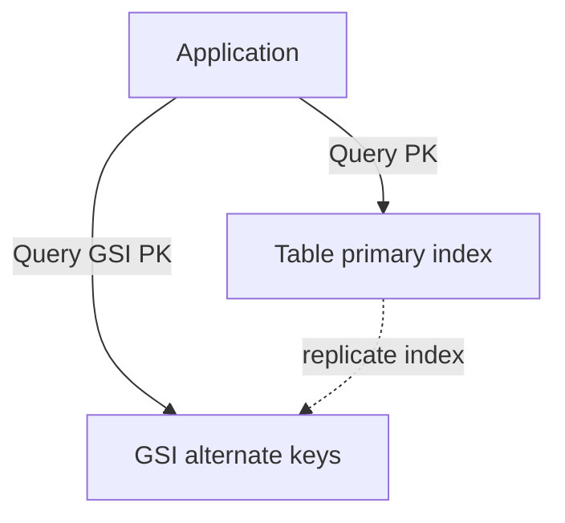

# D10-T017 — DynamoDB partition and sort keys

Topic ID: `D10-T017`
Domain: NoSQL Databases
Subdomain: DynamoDB partition and sort keys
Importance: common
Complexity: intermediate
Dependencies: `D10-T016`, `D10-T001`, `D07-T001`, `D07-T002`
Execution status of the code in section F: illustrative

## A. Topic Overview

DynamoDB items live in tables keyed by a **partition key** (PK) and optional **sort key** (SK). All items sharing the same PK form an **item collection** sorted by SK, enabling efficient range queries within one partition.

**Global secondary indexes (GSIs)** project alternate PK/SK pairs for additional access patterns at write-amplification cost. Interviewers focus on single-table design, sparse GSIs, hot partitions, and conditional writes—not invented throughput numbers.

Prerequisites: hot partitions (`D10-T011`), secondary indexes (`D10-T008`), access patterns (`D10-T006`).

## B. First-Principles Explanation

DynamoDB routes `GetItem` and `Query` by exact PK (and SK conditions). `Scan` reads every partition and is unsuitable for online APIs at scale. The data model is the API: if a query is not supported by PK/SK or GSI, it is the wrong store or needs a pipeline.

Single-table design encodes multiple entity types in one table using prefixed keys like `PK=USER#u1`, `SK=PROFILE` versus `SK=ORDER#2025-10-12#id`.

## C. Internal Working and Architecture

Partitions split as storage or traffic grows; each partition has throughput limits. GSIs are separate indexes maintained asynchronously with their own capacity. Strongly consistent reads and transact writes cost more and scope to defined items.



## D. Diagrams and Visual Models

One Query call should hit one partition or one GSI partition unless you fan-out intentionally. Design adjacency lists for many-to-many with careful PK/SK patterns.

## E. Examples and Analogies

Analogy: a filing cabinet drawer (PK) with folders sorted alphabetically (SK); a GSI is a second card catalog sorted by a different field.

Orders by user: `PK=USER#42`, `SK=ORDER#timestamp#id`. Orders by status for admin: GSI `GSI1PK=TENANT#t1#STATUS#OPEN`, `GSI1SK=DATE#...`.

## F. Code Examples

```text
PutItem:
  PK = TENANT#acme#USER#7
  SK = PROFILE
  attrs: email, version

Query:
  KeyConditionExpression: PK = :pk AND begins_with(SK, :orderPrefix)
```

Use `ConditionExpression attribute_not_exists(PK)` for idempotent create.

## G. Practical Backend Application

Encode tenant in PK for isolation. Use `version` attribute with conditional updates for optimistic locking. Prefer `Query` over `Scan`. Export streams to OpenSearch for full-text needs.

## H. Advantages, Limitations and Trade-offs

| Pattern | Benefit | Cost |
| --- | --- | --- |
| Single-table | One transact scope | Learning curve |
| Sparse GSI | Index subset of items | GSI maintenance |
| Write sharding on PK | Reduces hot keys | Complex reads |
| Multiple tables | Clear boundaries | Cross-table transactions limited |

## I. Common Mistakes and Misconceptions

- Scanning for “list all users.”
- GSI with low-cardinality PK (`status=OPEN` globally).
- Omitting tenant prefix in multi-tenant SaaS.
- Assuming GSIs are strongly consistent with base table immediately.

## J. Debugging and Troubleshooting

1. Enable returned consumed capacity on staging queries.
2. Identify throttled partitions in metrics.
3. Validate item appears under expected PK/SK prefix typos.
4. Check GSI projection type (KEYS_ONLY vs ALL).

## K. Interview Preparation

### Beginner

#### Q1. What is a DynamoDB partition key?

**Answer:** It is the hash key that determines which partition stores an item. All items with the same partition key are stored together and can be queried in one `Query` call. It must be chosen from high-cardinality access patterns. Poor PK choice causes hot partitions.

#### Q2. What is a sort key used for?

**Answer:** It orders multiple items under the same partition key. You can range query with `begins_with`, `between`, or comparisons on SK. It enables one-to-many relationships within a partition. Without SK, each PK holds at most one item per table design.

#### Q3. When do you need a GSI?

**Answer:** When an access pattern requires querying by an attribute that is not the table's PK/SK. GSIs have their own partition and sort keys. They add write cost on every base table update affecting projected attributes. Design GSIs deliberately, not speculatively.

#### Q4. What is the difference between Query and Scan?

**Answer:** `Query` requires a partition key equality condition and is efficient. `Scan` reads every item in the table and is for rare batch jobs. Online APIs should not use Scan at user traffic levels. Filters after Scan still consume read capacity.

#### Q5. What is a conditional write?

**Answer:** `PutItem` or `UpdateItem` with `ConditionExpression` fails if the condition is false. It enables optimistic locking and idempotent creates. Failed conditions appear as `ConditionalCheckFailedException`. Map to HTTP 409 in APIs.

### Intermediate

#### Q1. Explain single-table design in one minute.

**Answer:** Multiple entity types share one table with prefixed PK/SK patterns. Related items colocate for transactional or query efficiency. Overloading GSIs encodes tertiary access patterns. It trades schema clarity in SQL sense for access-pattern clarity.

#### Q2. What is a sparse GSI?

**Answer:** Only items containing a specific attribute appear in the GSI. Useful for “all open orders” without indexing closed orders. Reduces GSI size and write amplification. Requires consistent attribute presence rules in application code.

#### Q3. How do you model many-to-many relationships?

**Answer:** Adjacency list: write link items under both participant PKs or use a separate link table pattern in same table with `PK=USER#u`, `SK=GROUP#g`. Query both directions may need two item types or GSI inversion. Avoid Scan to discover edges.

#### Q4. What are hot partitions in DynamoDB?

**Answer:** Skewed PK values throttle despite high table capacity. Mitigate with write sharding suffixes, caching, or queues. See `D10-T011` for mitigation patterns. Metrics show throttling per partition key in advanced tooling.

#### Q5. How do streams help?

**Answer:** DynamoDB Streams emit item change records to Lambda or Kinesis consumers. Use for CDC to search indexes, caches, or warehouses. Ordering is per shard key. Consumers must be idempotent.

### Advanced

#### Q1. TransactWriteItems limits and design impact?

**Answer:** Transactions bundle up to 25 items with conditions across tables in an account region. They are not for long business workflows. Prefer colocated items under one PK when possible. Cross-partition transactions still consume capacity on all involved partitions.

#### Q2. How do you migrate PK design live?

**Answer:** Dual-write new items under new keys while readers try new then old. Backfill with migration workers. Use feature flags per tenant. Delete old keys after verification window.

#### Q3. TTL attribute behavior?

**Answer:** DynamoDB deletes expired items eventually; not instant for compliance proofs. TTL must be Unix epoch on a dedicated attribute enabled on table. See `D10-T009` for UX implications.

#### Q4. Global tables and key design?

**Answer:** Multi-region replication adds last-writer-wins conflicts without careful versioning. Prefer single-region authority for financial items. Use version attributes and conditional writes to detect conflicts.

#### Q5. When is DynamoDB wrong versus SQL?

**Answer:** Ad hoc joins, complex reporting, and arbitrary filters without GSIs fit SQL or warehouse. DynamoDB wins for known keyed access at scale with ops simplicity. Polyglot persistence is normal.

### Scenarios

#### Q1. Query returns empty but item visible in console.

**Answer:** Wrong table, region, or SK prefix in `begins_with`. PK case sensitivity and string formatting (`USER#1` vs `USER#01`) matter. Add integration tests for key builders.

#### Q2. GSI throttles while base table is fine.

**Answer:** GSI has separate capacity or on-demand scaling; hot GSI PK skew. Redesign GSI keys with tenant prefix. Project fewer attributes to reduce size.

#### Q3. Need full-text search on product title.

**Answer:** DynamoDB is not a search engine. Stream to OpenSearch or use SQL with trigram index. Keep Dynamo for keyed product fetch by id.

#### Q4. Cart and orders in one transaction nightly batch only.

**Answer:** Online checkout should use SQL or short transact on few items. Batch reconciliation can use Scan in off-peak with caution. Separate OLTP paths.

#### Q5. Multi-tenant isolation audit.

**Answer:** Every PK must include `tenantId` or IAM policy scopes access. Integration tests attempt cross-tenant key access. Log conditional failures as security signals.

### Follow-ups

#### Q1. Link to `D10-T008` GSIs?

**Answer:** GSIs are secondary indexes generalized; DynamoDB makes their cost explicit per index. Same trade-offs apply to Mongo indexes.

#### Q2. Link to Cassandra?

**Answer:** Cassandra partition plus clustering columns mirror PK/SK thinking with different query rules. Compare `D10-T018`.

#### Q3. Link to idempotency?

**Answer:** Conditional puts implement idempotent API handlers for payment retries. Pair with client idempotency keys.

## L. Practical Exercises

See `EXERCISES/D10-T017.md`.

## M. Revision Notes

- PK/SK first; Scan never on hot path.
- GSIs cost writes; sparse when possible.
- Single-table is pattern, not dogma.
- Condition expressions for concurrency.
- Streams for derived indexes.

## N. Related Topics

`D10-T011`, `D10-T008`, `D10-T018`, `D10-T009`.

## O. Completion Criteria

- Design PK/SK + one GSI for tenant orders.
- Explain Query vs Scan trade-off.
- Mitigate hot partition on config key.
- Use conditional write for versioned update.
- Sketch stream consumer for search index.
