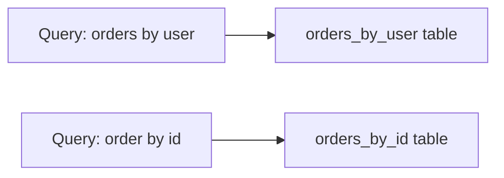

# D10-T018 — Cassandra data modeling

Topic ID: `D10-T018`
Domain: NoSQL Databases
Subdomain: Cassandra data modeling
Importance: common
Complexity: intermediate
Dependencies: `D10-T017`, `D10-T001`, `D07-T001`, `D07-T002`
Execution status of the code in section F: illustrative

## A. Topic Overview

Apache Cassandra models data in tables with a **partition key** (and optional **clustering columns**) chosen for **query-first** design: typically one table per query pattern, not one table per entity like SQL.

Rows with the same partition key live on one replica set; clustering order defines sort within the partition. Interviewers stress partition size limits, multi-table duplication, tunable consistency, and avoiding unbounded wide rows.

Pair with DynamoDB partition thinking (`D10-T017`) and wide-column basics (`D10-T004`).

## B. First-Principles Explanation

Cassandra does not favor joins or flexible secondary access. You denormalize and duplicate data across tables so each application query hits one partition with a known key. The partition key determines token placement; clustering columns sort rows inside the partition.

Writes are append-friendly LSM storage; reads pay if you must scan many clustering rows within a hot partition.

## C. Internal Working and Architecture

Client drivers pick coordinators; coordinators route to replicas owning the partition token. Consistency level (`ONE`, `QUORUM`, `LOCAL_QUORUM`) sets effective W/R per request. Materialized views and secondary indexes exist but have constraints—prefer explicit tables.



## D. Diagrams and Visual Models

Duplicate data across `orders_by_user` and `orders_by_id` is intentional; async repair keeps replicas consistent over time.

## E. Examples and Analogies

Analogy: multiple specialized phone books (by last name, by company) instead of one book trying to answer every lookup.

Device telemetry: partition `(tenant_id, device_id, day_bucket)` clustering `event_time` to bound row width.

## F. Code Examples

```sql
CREATE TABLE orders_by_user (
  user_id uuid,
  created_at timestamp,
  order_id uuid,
  total decimal,
  PRIMARY KEY ((user_id), created_at, order_id)
) WITH CLUSTERING ORDER BY (created_at DESC);
```

Query: `SELECT * FROM orders_by_user WHERE user_id=? LIMIT 50;`

## G. Practical Backend Application

Cap partition width with time buckets. Use lightweight transactions sparingly for compare-and-set. Run repairs and monitor tombstones. Align consistency level per operation—analytics may use `ONE`, money-adjacent metadata `QUORUM`.

## H. Advantages, Limitations and Trade-offs

| Choice | Benefit | Cost |
| --- | --- | --- |
| Table per query | Fast predictable reads | Duplication |
| Wide rows | Fewer tables | Read amplification |
| LWT | Conditional row update | Contention |
| Secondary index | Ad hoc filter | Hidden scatter queries |

## I. Common Mistakes and Misconceptions

- One giant table with only `id` partition and many clustering columns unbounded.
- Using secondary index on high-cardinality filter without partition key.
- Expecting SQL migrations mindset on schema changes.
- Ignoring gc_grace_seconds around deletes.

## J. Debugging and Troubleshooting

1. `nodetool tablestats` / partition size estimates.
2. Trace slow queries with partition key in logs.
3. Check consistency level and replica lag after failures.
4. Tombstone warnings in logs.

## K. Interview Preparation

### Beginner

#### Q1. What is query-first modeling in Cassandra?

**Answer:** You design tables around each production query shape, often creating multiple tables for the same data. The partition key must be present in every query predicate. Clustering columns define order within the partition. This inverts normalized ER modeling.

#### Q2. What is a partition key in CQL?

**Answer:** Columns in the outer parentheses of `PRIMARY KEY ((a,b), c)` hash to a token range. All rows sharing that key live together. Choose keys with high cardinality and even distribution. Skew causes hot nodes.

#### Q3. What are clustering columns?

**Answer:** They sort rows within a partition for range scans. `CLUSTERING ORDER BY` controls ascending or descending. They are not a substitute for a selective partition key. Unbounded clustering ranges create wide partitions.

#### Q4. Why duplicate data across tables?

**Answer:** Each query pattern gets its own partition access path without joins. Updates must fan out to all tables storing the fact. This is deliberate denormalization. Eventual consistency across tables is handled via batch jobs or idempotent consumers.

#### Q5. How does Cassandra differ from MongoDB sharding?

**Answer:** Cassandra always requires partition key in queries; Mongo allows more ad hoc indexes within a shard. Both suffer hot shards if keys skew. Cassandra culture emphasizes explicit table-per-query more strongly. Ops models differ (self-hosted vs Atlas).

### Intermediate

#### Q1. How do you bucket time in partitions?

**Answer:** Add `day` or `hour` to partition key to limit rows per partition for high-rate sensors. Queries specify the bucket or query recent buckets sequentially. Archival compacts old buckets to cold storage. Prevents single partition growing without bound.

#### Q2. When use lightweight transactions (LWT)?

**Answer:** For infrequent compare-and-set such as reserving a slot when contention is low. LWT uses Paxos and is slower than normal writes. Not a replacement for SQL transactions across partitions. Prefer idempotent workflow in SQL for money.

#### Q3. What is wrong with secondary indexes in Cassandra?

**Answer:** They often cause hidden queries to many partitions unless the index partition is selective. They are tempting for ad hoc filters but dangerous at scale. Prefer explicit lookup tables. Monitor index query latency.

#### Q4. Explain consistency levels briefly.

**Answer:** `ONE` is fast and may be stale; `QUORUM` uses majority of replicas; `LOCAL_QUORUM` limits to local datacenter replicas. Pick per operation based on staleness tolerance. See `D10-T013` for quorum overlap intuition.

#### Q5. How do tombstones affect performance?

**Answer:** Deletes write tombstone markers until `gc_grace` expires. Wide partitions with many deletes slow reads and compaction. Use TTL for expiring data when appropriate. Avoid delete-heavy churn on wide rows.

### Advanced

#### Q1. Materialized views caveats?

**Answer:** Views generate underlying tables asynchronously; they can amplify writes and surprise operators. Many teams prefer explicit tables maintained by application or stream processors. Understand your Cassandra version's view limitations before adopting.

#### Q2. Multi-datacenter replication design?

**Answer:** `NetworkTopologyStrategy` places replicas per DC; `LOCAL_QUORUM` avoids cross-DC latency on reads. Conflicts resolve with timestamps unless LWT used. Consider active-active only with clear conflict rules.

#### Q3. Compaction strategy impact?

**Answer:** Size-tiered vs leveled compaction changes read amplification and disk usage. Time-window compaction suits TTL time-series. Wrong strategy shows up as read latency spikes during compaction.

#### Q4. Compare Cassandra to DynamoDB for feeds.

**Answer:** Both need partitionable keys; Cassandra offers tunable consistency and self-hosting; DynamoDB offers managed scaling. Neither fixes celebrity hot keys without design. Team ops skill often decides.

#### Q5. When migrate off Cassandra?

**Answer:** When access patterns became relational reporting heavy or ops burden exceeds value. Plan dual-write and validation. Keep Cassandra for remaining high-write keyed paths only.

### Scenarios

#### Q1. One device_id partition exceeds gigabytes.

**Answer:** Missing time bucket in partition key; backfill into bucketed table and dual-read during migration. Stop writes to old table via feature flag.

#### Q2. Secondary index query timeouts globally.

**Answer:** Index scatter on high cardinality; replace with lookup table keyed by search attribute hash. Warm cache for hot lookups.

#### Q3. After delete storm, reads slow.

**Answer:** Tombstone accumulation; run compaction tuning, reduce delete pattern, wait gc_grace. Consider TTL instead of explicit deletes for ephemeral data.

#### Q4. Need strong inventory decrement.

**Answer:** LWT on inventory row may work for low contention SKUs; high contention needs SQL row lock or reservation queue. Do not pretend LWT is global ACID.

#### Q5. Analytics team wants SQL joins on Cassandra.

**Answer:** Export to warehouse via CDC; do not run joins on OLTP cluster. Cassandra OLTP tables stay query-shaped.

### Follow-ups

#### Q1. Link to `D10-T004` wide-column?

**Answer:** Cassandra is the exemplar wide-column store in interviews. HBase shares partition plus column family thinking.

#### Q2. Link to hot partitions?

**Answer:** Skewed partition keys break Cassandra nodes the same way as DynamoDB throttles. Design keys before cluster sizing.

#### Q3. Link to quorums?

**Answer:** Consistency levels map to replica quorum participation per request. Tune with failure and staleness requirements.

## L. Practical Exercises

See `EXERCISES/D10-T018.md`.

## M. Revision Notes

- Query-first; table per query pattern.
- Partition key in every query.
- Bucket time; cap partition width.
- LWT for rare CAS, not money workflows.
- Secondary indexes are dangerous default.

## N. Related Topics

`D10-T004`, `D10-T011`, `D10-T013`, `D10-T017`.

## O. Completion Criteria

- Design two tables for same entity, two queries.
- Pick consistency level for two APIs.
- Explain tombstone risk on deletes.
- Avoid bad secondary index pattern.
- Compare Cassandra vs Dynamo for one workload.
