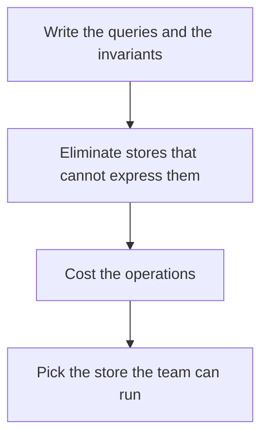

# D10-T019 — Choosing the right database for a workload

Topic ID: `D10-T019`
Domain: NoSQL Databases
Subdomain: Choosing the right database for a workload
Importance: common
Complexity: intermediate
Dependencies: `D10-T018`, `D10-T001`, `D07-T001`, `D07-T002`
Execution status of the code in section F: unexecuted

## A. Topic Overview

Choosing a database starts from the access pattern, the consistency need, the size, and the operational skills you have. A relational database is the default when queries are ad hoc and invariants are transactional. A key-value or wide-column store fits a known primary-key path at high throughput. A search engine fits text queries. A cache is not a database. One system can use more than one store if the boundary is explicit.

In production this shows up as follows: Orders with payments and ad hoc support queries belong in PostgreSQL. Session tokens belong in Redis. Product text search belongs in a search index fed by the database, not instead of it.

Interviewers use Choosing the right database for a workload to see whether you can state the failure mode, not only the definition. The failure to name is: choosing a specialized store for a workload that is ordinary SQL, or the reverse, forcing a join-shaped workload onto a key-value store

Prerequisites: `D10-T018`, `D10-T001`, `D07-T001`, `D07-T002`. Later notes should link here instead of repeating the mechanism.

## B. First-Principles Explanation

Choosing a database starts from the access pattern, the consistency need, the size, and the operational skills you have. A relational database is the default when queries are ad hoc and invariants are transactional. A key-value or wide-column store fits a known primary-key path at high throughput. A search engine fits text queries. A cache is not a database. One system can use more than one store if the boundary is explicit.

The useful picture is: Picking a database is picking a vehicle after you know the cargo and the roads, not before.

What has to be true:

1. Write the queries and the invariants
2. Eliminate stores that cannot express them
3. Cost the operations
4. Pick the store the team can run

It works when those steps preserve one invariant. It fails when choosing a specialized store for a workload that is ordinary SQL, or the reverse, forcing a join-shaped workload onto a key-value store. The alternative is: the choice is fashionable or already on someone's résumé

## C. Internal Working and Architecture

Components involved: the caller, the state Choosing the right database for a workload mutates or reads, and the observer that reports whether the primary query is a point read, a transaction, or a search, and the on-call burden.

Execution:

1. Write the queries and the invariants
2. Eliminate stores that cannot express them
3. Cost the operations
4. Pick the store the team can run

Data moves only along that path. A retry re-enters at step 1, so the operation must say what a duplicate does. Memory and locks stay inside this mechanism. Callers see the result or a typed error, not a half-updated invariant.

State to remember: choose this when the query and the failure mode are written down. Do not choose it when the choice is fashionable or already on someone's résumé.

## D. Diagrams and Visual Models



Read the diagram from top to bottom. Each box is one step of Choosing the right database for a workload. The failure mode (choosing a specialized store for a workload that is ordinary SQL, or the reverse, forcing a join-shaped workload onto a key-value store) is what you look for when a later box never happens or happens twice.

## E. Examples and Analogies

Analogy: Picking a database is picking a vehicle after you know the cargo and the roads, not before.

Production example: Orders with payments and ad hoc support queries belong in PostgreSQL. Session tokens belong in Redis. Product text search belongs in a search index fed by the database, not instead of it.

A small counterexample is enough in an interview. Show the input, apply the steps, and show the broken outcome if someone uses the mechanism outside its rule: choosing a specialized store for a workload that is ordinary SQL, or the reverse, forcing a join-shaped workload onto a key-value store.

## F. Code Examples

The snippet is labeled unexecuted. It illustrates the shape of the idea. It is not a benchmark and it embeds no secret.

```python
def pick(ad_hoc_sql, search, known_key):
    if search:
        return 'search index'
    if ad_hoc_sql:
        return 'relational'
    if known_key:
        return 'key-value or wide-column'
    return 'write the query first'
```

After the snippet, check whether the primary query is a point read, a transaction, or a search, and the on-call burden. If that signal moves the wrong way, the snippet is the wrong tool for the workload.

## G. Practical Backend Application

Use Choosing the right database for a workload in a service when the query and the failure mode are written down.

A typical place is the production case already stated: Orders with payments and ad hoc support queries belong in PostgreSQL. Session tokens belong in Redis. Product text search belongs in a search index fed by the database, not instead of it.

Operationally you alert on whether the primary query is a point read, a transaction, or a search, and the on-call burden. You do not alert only on process uptime. The dashboard should show the failure mode, a success rate, and the saturation signal (queue depth, lock wait, or latency) that predicts it.

## H. Advantages, Limitations and Trade-offs

| Choice | Benefit | Cost | Choose when | Avoid when |
| --- | --- | --- | --- | --- |
| Apply Choosing the right database for a workload | the query and the failure mode are written down | Extra moving parts and a new failure mode | The failure you are preventing is already real | the choice is fashionable or already on someone's résumé |
| Simpler alternative | Less code and fewer dependencies | choosing a specialized store for a workload that is ordinary SQL, or the reverse, forcing a join-shaped workload onto a key-value store | The workload does not hit the limit | The invariant must hold under concurrency or failure |

Choosing the right database for a workload is a trade. State the benefit and the cost in the same sentence when you propose it in a design review.

## I. Common Mistakes and Misconceptions

- Using the cache as the system of record.
- Introducing a second database for one query without an ownership story.
- Ignoring operational cost.
- Treating a diagram of Choosing the right database for a workload as proof that the invariant holds in production.
- Copying a default configuration without naming whether the primary query is a point read, a transaction, or a search, and the on-call burden.

## J. Debugging and Troubleshooting

Symptom: choosing a specialized store for a workload that is ordinary SQL, or the reverse, forcing a join-shaped workload onto a key-value store

First check: whether the primary query is a point read, a transaction, or a search, and the on-call burden.

Then compare one healthy instance against one unhealthy instance. Confirm whether retries are duplicating work. Confirm whether a timeout is shorter than the work. Fix the invariant, then watch the same metric for a full peak, not only for the next minute.

Useful questions: did the step order in section C actually happen, or did a caller skip a step? Did a deploy change the data shape that Choosing the right database for a workload assumes?

## K. Interview Preparation

### Beginner

#### Q1. What problem does Choosing the right database for a workload solve?

**Answer:** Choosing a database starts from the access pattern, the consistency need, the size, and the operational skills you have. A relational database is the default when queries are ad hoc and invariants are transactional. A key-value or wide-column store fits a known primary-key path at high throughput. A search engine fits text queries. A cache is not a database. One system can use more than one store if the boundary is explicit. Without it, the usual backend failure is: choosing a specialized store for a workload that is ordinary SQL, or the reverse, forcing a join-shaped workload onto a key-value store.

#### Q2. Where does Choosing the right database for a workload sit on a request path?

**Answer:** Choosing the right database for a workload is not a library you sprinkle on every call. the query and the failure mode are written down You notice it when whether the primary query is a point read, a transaction, or a search, and the on-call burden. Name the constraint that makes this choice correct. Say what you would measure to confirm it.

#### Q3. Give a concrete example of Choosing the right database for a workload.

**Answer:** Orders with payments and ad hoc support queries belong in PostgreSQL. Session tokens belong in Redis. Product text search belongs in a search index fed by the database, not instead of it. Walk the input, the state change, and the observable output.

#### Q4. What is a common mix-up around Choosing the right database for a workload?

**Answer:** choosing a specialized store for a workload that is ordinary SQL, or the reverse, forcing a join-shaped workload onto a key-value store The corrective check is whether the primary query is a point read, a transaction, or a search, and the on-call burden. Name the constraint that makes this choice correct. Say what you would measure to confirm it. Say which alternative you rejected and why.

#### Q5. When would you skip Choosing the right database for a workload?

**Answer:** the choice is fashionable or already on someone's résumé Skipping is a decision with a measured cost, not a slogan. Name the constraint that makes this choice correct. Say what you would measure to confirm it. Say which alternative you rejected and why.

### Intermediate

#### Q1. What invariant makes Choosing the right database for a workload correct?

**Answer:** Choosing a database starts from the access pattern, the consistency need, the size, and the operational skills you have. A relational database is the default when queries are ad hoc and invariants are transactional. A key-value or wide-column store fits a known primary-key path at high throughput. A search engine fits text queries. A cache is not a database. One system can use more than one store if the boundary is explicit. State the invariant before you name the tool.

#### Q2. How do you test Choosing the right database for a workload?

**Answer:** Assert the failure mode directly: choosing a specialized store for a workload that is ordinary SQL, or the reverse, forcing a join-shaped workload onto a key-value store. The assertion should watch whether the primary query is a point read, a transaction, or a search, and the on-call burden. Include a concurrent or retry case if the bug only appears then. Name the constraint that makes this choice correct.

#### Q3. What signal tells you Choosing the right database for a workload is misbehaving in production?

**Answer:** Watch whether the primary query is a point read, a transaction, or a search, and the on-call burden. The user-visible symptom is usually choosing a specialized store for a workload that is ordinary SQL, or the reverse, forcing a join-shaped workload onto a key-value store. Name the constraint that makes this choice correct. Say what you would measure to confirm it.

#### Q4. How would you introduce Choosing the right database for a workload into a legacy service?

**Answer:** the query and the failure mode are written down Ship it behind a metric so you can compare the old path. Roll back if choosing a specialized store for a workload that is ordinary SQL, or the reverse, forcing a join-shaped workload onto a key-value store gets worse. Name the constraint that makes this choice correct. Say what you would measure to confirm it.

#### Q5. What do you trade away by choosing Choosing the right database for a workload?

**Answer:** the query and the failure mode are written down the choice is fashionable or already on someone's résumé Say the cost in latency, storage, or operational load. Name the constraint that makes this choice correct. Say what you would measure to confirm it. Say which alternative you rejected and why.

### Advanced

#### Q1. What breaks if a dependency of Choosing the right database for a workload is slow or down?

**Answer:** choosing a specialized store for a workload that is ordinary SQL, or the reverse, forcing a join-shaped workload onto a key-value store Degrade using the rule: the choice is fashionable or already on someone's résumé. Timeouts must be shorter than the caller's deadline. Name the constraint that makes this choice correct. Say what you would measure to confirm it.

#### Q2. How does Choosing the right database for a workload behave under retries?

**Answer:** Retries repeat work, so Choosing the right database for a workload must define what a duplicate does. choosing a specialized store for a workload that is ordinary SQL, or the reverse, forcing a join-shaped workload onto a key-value store Idempotency keys or fences belong next to the write, not in a comment. Name the constraint that makes this choice correct. Say what you would measure to confirm it.

#### Q3. What is the capacity limit of Choosing the right database for a workload?

**Answer:** The limit shows up as whether the primary query is a point read, a transaction, or a search, and the on-call burden. Add capacity only after you know whether the bottleneck is CPU, lock wait, or network. Name the constraint that makes this choice correct. Say what you would measure to confirm it.

#### Q4. How do you evolve Choosing the right database for a workload without a flag day?

**Answer:** the query and the failure mode are written down Version the contract or the on-disk format. Readers should tolerate one old and one new shape during the rollout. Name the constraint that makes this choice correct. Say what you would measure to confirm it.

#### Q5. What security or correctness bug hides inside Choosing the right database for a workload?

**Answer:** choosing a specialized store for a workload that is ordinary SQL, or the reverse, forcing a join-shaped workload onto a key-value store Check authorization and tenancy at the same boundary as the mechanism. A cache or queue must not widen who can read the data. Name the constraint that makes this choice correct. Say what you would measure to confirm it.

### Scenario

#### Q1. Incident: choosing a specialized store for a workload that is ordinary SQL, or the reverse, forcing a join-shaped workload onto a key-value store. What do you check first?

**Answer:** Start with whether the primary query is a point read, a transaction, or a search, and the on-call burden. Compare a good host and a bad host before you restart anything. Choosing a database starts from the access pattern, the consistency need, the size, and the operational skills you have. A relational database is the default when queries are ad hoc and invariants are transactional. A key-value or wide-column store fits a known primary-key path at high throughput. A search engine fits text queries. A cache is not a database. One system can use more than one store if the boundary is explicit.

#### Q2. A reviewer wants the clever version. What data settles it?

**Answer:** the query and the failure mode are written down the choice is fashionable or already on someone's résumé Bring whether the primary query is a point read, a transaction, or a search, and the on-call burden from a load test or from production, not a slogan. Name the constraint that makes this choice correct. Say what you would measure to confirm it. Say which alternative you rejected and why.

#### Q3. You have one hour to explain Choosing the right database for a workload at a whiteboard.

**Answer:** Draw the happy path in four boxes. Then draw the failure: choosing a specialized store for a workload that is ordinary SQL, or the reverse, forcing a join-shaped workload onto a key-value store. End with the metric you would page on. Name the constraint that makes this choice correct.

#### Q4. The bug only appears under two concurrent callers.

**Answer:** choosing a specialized store for a workload that is ordinary SQL, or the reverse, forcing a join-shaped workload onto a key-value store Reproduce with a barrier so both sides enter the critical window. Confirm the fix with whether the primary query is a point read, a transaction, or a search, and the on-call burden. Name the constraint that makes this choice correct. Say what you would measure to confirm it.

#### Q5. Leadership wants this on every service next week.

**Answer:** the choice is fashionable or already on someone's résumé the query and the failure mode are written down Roll it out where the failure mode is already hurting users. Name the constraint that makes this choice correct. Say what you would measure to confirm it. Say which alternative you rejected and why.

### Follow-up

#### Q1. What did you assume about the data size or the clock?

**Answer:** Choosing a database starts from the access pattern, the consistency need, the size, and the operational skills you have. A relational database is the default when queries are ad hoc and invariants are transactional. A key-value or wide-column store fits a known primary-key path at high throughput. A search engine fits text queries. A cache is not a database. One system can use more than one store if the boundary is explicit. Clocks are not a total order across machines. State whether the algorithm needs bounded size or a single leader.

#### Q2. What would you measure after the change ships?

**Answer:** Page on whether the primary query is a point read, a transaction, or a search, and the on-call burden. Keep a before/after dashboard for one week. Alert on the failure mode, not only on CPU. Name the constraint that makes this choice correct.

#### Q3. Which neighboring topic did you deliberately not re-teach?

**Answer:** This note owns Choosing the right database for a workload. Related identifiers are in section N. Shared ideas are linked, not copied. Name the constraint that makes this choice correct.

## L. Practical Exercises

Solutions are in `EXERCISES/solutions/D10-T019.md`, not in this section.

1. Whiteboard the four steps of Choosing the right database for a workload and mark where `choosing a specialized store for a workload that is ordinary SQL, or the reverse, forcing a join-shaped workload onto a key-value store` enters.
2. Read the snippet in section F and write the assertion that would catch that failure. The assertion must mention `whether the primary query is a point read, a transaction, or a search, and the on-call burden`.
3. Argue for or against using Choosing the right database for a workload on a service you know. Use the choose and avoid rows from section H. Do not appeal to popularity.

## M. Revision Notes

- Mechanism: Choosing a database starts from the access pattern, the consistency need, the size, and the operational skills you have.
- Failure: choosing a specialized store for a workload that is ordinary SQL, or the reverse, forcing a join-shaped workload onto a key-value store
- Metric: whether the primary query is a point read, a transaction, or a search, and the on-call burden
- Choose when: the query and the failure mode are written down
- Avoid when: the choice is fashionable or already on someone's résumé

## N. Related Topics

Dependencies to review first: `D10-T018`, `D10-T001`, `D07-T001`, `D07-T002`.

Shared ideas stay in those notes. This note does not restate them.

## O. Completion Criteria

- You can explain Choosing the right database for a workload without reading this note, including the failure mode.
- You can draw the diagram in section D from memory.
- You can say when not to use it, using the avoid condition in section H.
- You can name the metric you would watch after shipping it.
